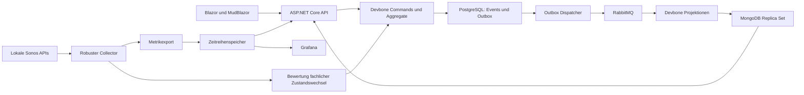

# Devbone: Prüfung und Einsatzplan

Stand: 28.09.2026. Ergänzung zur [maßgeblichen Planung](planung.md), insbesondere
SM-019/SM-020 und DEC-005/DEC-014. Die folgende Referenzprüfung entstand vor der Umsetzung. Der aktuelle Implementierungs- und Prüfstand steht in [Planung](planung.md#umsetzungsstand-backend) und [Backend-Dokumentation](umsetzung-backend.md).

## 1. Ergebnis und Quellenbindung

Der Nutzer möchte Devbone ausdrücklich auch zur Erprobung des jungen Frameworks einsetzen.
Das ist ein eigenständiges Projektziel und begründet zusätzlichen Aufwand gegenüber einer
einfachen Monitoring-Anwendung. Empfehlung: wenige fachliche Abläufe vollständig durch die
vorhandene Framework-Pipeline führen; numerische Messreihen getrennt speichern.

Geprüfte Referenzen:

- [Öffentliche API-Referenz](https://devboneframeworks.github.io/Api-Reference/) und
  [Versionsseite](https://devboneframeworks.github.io/Api-Reference/versions.html).
- [API-Guide](https://github.com/DevboneFrameworks/Devbone-EventDrivenPlatform/blob/379f7bb16ec223f9719c5e6a5b74e7a0fbd19874/docs/FRAMEWORK_API_GUIDE.md),
  [Kompatibilitätsmatrix](https://github.com/DevboneFrameworks/Devbone-EventDrivenPlatform/blob/379f7bb16ec223f9719c5e6a5b74e7a0fbd19874/docs/compatibility/README.md) und
  [Paketliste](https://github.com/DevboneFrameworks/Devbone-EventDrivenPlatform/blob/379f7bb16ec223f9719c5e6a5b74e7a0fbd19874/docs/compatibility/Directory.Packages.props)
  am Quellcommit `379f7bb16ec223f9719c5e6a5b74e7a0fbd19874`.
- Die lokale [API-Guide-Kopie](framework/FRAMEWORK_API_GUIDE.md) wurde bytegenau aus
  `docs/FRAMEWORK_API_GUIDE.md` dieses Commits wiederhergestellt. Ihr Git-Blob-SHA-1 ist
  `d48603707264f843de9951793cb48b645dffad09`; `git hash-object` auf der lokalen Datei
  ergab denselben Wert. Der Guide enthält die vollständige Framework-Matrix dieses Commits;
  der automatisierte Abgleich prüft die in den Projekt-Lockfiles verwendeten Devbone-Pakete
  sowie zentral verwaltete Devbone-Versionen.
- Paket-READMEs für EventSourcing, EventProjectionPipeline und Testing am selben Commit;
  heruntergeladene NuGet-Metadaten und tatsächliches Restore-Ergebnis.

Das Quellrepository ist privat und erfordert Zugriff. Die öffentliche Referenz ist beweglich;
für Implementierung und spätere Updates ist die oben fixierte Referenz mit der Paketkombination
abzugleichen. Die Versionslisten der gelesenen öffentlichen Referenz und des Guides stimmen überein.
Die fünf einzeln geprüften Pakete Ddd, Ddd.Testing, EventSourcing, EventSourcing.Ddd und
EventProjection verweisen in ihrer NuGet-Metadatenherkunft auf genau diesen Quellcommit.

## 2. Tatsächlich aufgelöste Paketkombination

Restore eines temporären Prüfprojekts mit Ziel `net10.0`, lokalem SDK `10.0.201` und dem vorhandenen
GitHub-Packages-Zugang erfolgreich. Folgende Devbone-Versionen stehen in `project.assets.json`:

| Paket nach Präfix `Devbone.Frameworks.` | Version | Verwendung im Vorschlag |
|---|---|---|
| Ddd | 12.3.2 | Aggregate, Commands, Events |
| Ddd.Testing | 4.5.2 | Nur Tests; später nicht im Produktionshost referenzieren |
| EventSourcing | 12.2.0 | PostgreSQL-Event-Store und transaktionale Outbox |
| EventSourcing.Ddd | 6.4.0 | Vorgegebener Direct-Adapter und Routing |
| EventBus.Contracts | 1.0.1 | Kanonische Event-Hülle |
| EventBus | 2.0.3 | Transportneutrale Busanbindung |
| EventBus.Outbox | 2.3.1 | Dauerhafte Veröffentlichung und Wiederanlauf |
| EventBus.RabbitMq | 2.0.2 | Vorgeschlagener Brokertransport |
| EventProjection | 12.5.0 | Raw-/Merged-/Derived-Projektionen |
| EventProjection.MongoDb | 1.1.3 | JSON-/BSON-Kompatibilität |
| EventProjection.RabbitMq | 1.11.2 | Vorgeschlagener Projektionstransport |
| EventProjection.Client | 6.1.0 | Begrenztes Warten auf Lesemodellsichtbarkeit, falls benötigt |
| Privacy | 1.2.1 | Transitive Abhängigkeit; kein automatischer Bedarf an eigenem Key-Service |

Event-Store-Schema laut passender Matrix: **Version 4**. Initiales Erzeugen und Upgrade getrennt
behandeln; angewandte Version vor Schreibzugriff prüfen. Versionen bei Umsetzung zentral pinnen,
direkte/transitive Abhängigkeiten und Vertragskataloge in CI prüfen. Dies ist ein geprüfter
Ausgangspunkt, keine Behauptung, dass beliebige ältere/neue Versionen miteinander funktionieren.

**Prüfgrenze:** Erfolgreicher Download und Restore bestätigen Bezug und Paketauflösung auf dem
Prüfrechner. Kein Anwendungscode erstellt/gebaut; keine PostgreSQL-, RabbitMQ- oder MongoDB-Instanz
gestartet. Linux-Ausführung, Datenfluss, Ressourcenbedarf, Sicherheit der Abhängigkeiten und
Fehlererholung wurden dadurch nicht nachgewiesen. Der Restore war eine isolierte Metadatenprüfung,
kein vollständiges Release-/Audit-Gate.

## 3. Empfohlene Komposition

Die Pfeile beschreiben Datenfluss, nicht immer die Richtung des HTTP-Verbindungsaufbaus.
Prometheus zieht Metriken vom Exporter. Die Darstellung fordert nicht einen Prozess je Kasten.
Collector und API können zunächst einen Backendprozess teilen; Blazor bleibt gemäß AGENTS.md
über API/Contracts angebunden. Der Projektionsworker kann als eigener Prozess laufen, damit
Neustart und Wiederaufbau die Geräteerfassung nicht mit anhalten. Prozessaufteilung im ersten
Slice prüfen; keine allgemeine Microservice-Aufteilung ableiten.

- **Direct Mode:** Direkter PostgreSQL-Zugang über `AddDevboneEventSourcing`; kein zusätzlicher
  Persistence Gateway erforderlich. Vorhandenen Adapter verwenden.
- **Outbox:** Der Adapter schreibt bei jedem Commit Events und Outbox in derselben Transaktion.
  Ohne Dispatcher würden Einträge liegen bleiben. „Brokerfreie kleine App“ ist daher kein fertig
  dokumentierter Ende-zu-Ende-Ersatz für die vorgeschlagene Projektion. Embedded Dispatcher im
  Backend ist möglich; Brokerfehler führen zur Nachlieferung, nicht zum Rückgängigmachen bestätigter
  Events. Rückstau, dauerhafte Fehler und Speichergrenzen überwachen.
- **RabbitMQ:** Als einziger Broker vorgeschlagen. Die vorhandene RabbitMQ-Projektion provisioniert
  ihre dauerhafte Topologie, verwendet manuelle Bestätigung und geordnete Verarbeitung. Das spart
  projektspezifische Kafka-Topic-Provisionierung; Ressourcenbedarf trotzdem messen. Kein eigener
  In-Memory-Bus als vermeintlich gleichwertiger Ersatz für dauerhafte Zustellung.
- **MongoDB:** Die Framework-Projektion benötigt ein initialisiertes Replica Set oder einen
  Sharded Cluster; ein Standalone-Server wird beim Start abgewiesen. Für den Einzelhost ist ein
  Ein-Knoten-Replica-Set ein Prüfkandidat, keine Hochverfügbarkeit. Bereits Ddd hängt für
  Kompatibilitätsprüfungen von EventProjection.MongoDb/BSON ab; das allein startet keinen Server.
- **Prometheus/Grafana:** Zusätzlicher Messdatenweg gemäß SM-014/SM-015. Messproben nicht als
  Events durch PostgreSQL, Broker und MongoDB vervielfachen. Collector/Scrape-Ausfälle bleiben
  als fehlende Beobachtungen erkennbar.

Damit fallen für den vollständigen Vorschlag Anwendung/Worker plus PostgreSQL, RabbitMQ,
MongoDB und Zeitreihenspeicher an; Grafana kann bereits vorhanden sein. Das ist für eine kleine
Heimnetz-App erheblich. Der zusätzliche Betrieb dient hier bewusst der Framework-Erprobung.
Keine zusätzliche Gateway-, Kafka-, Key-Service- oder Time-Machine-Instanz ohne konkreten Bedarf.
Optionaler Time-Machine-Einsatz erst bei Diagnosebedarf und mit Zugriffsschutz planen.

## 4. Fachlicher Umfang und Grenzen der Resilienz

Erster fachlicher Slice als Vorschlag: Der Nutzer aktiviert die Überwachung eines bekannten
Geräts mit einer gültigen Erfassungsregel. Das Aggregat prüft Eingaben und bestehenden Zustand;
danach steht `DeviceMonitoringEnabled` fest. Deaktivierung ist eine eigene Absicht mit eigenem
Event. Aggregate- und Eventnamen sind Entwurf, keine schon festgelegten öffentlichen Verträge.
Ein ausgeschalteter Lautsprecher muss die Konfiguration seiner Überwachung nicht verhindern.

Weitere Kandidaten: Alarmregel vereinbaren, eine erkannte Störung eröffnen/beenden und eine
Störung quittieren. Die genaue Regel und Aggregatgrenze vor dem jeweiligen Schreib-Slice
beschreiben. Flüchtige Erreichbarkeitsproben, Sonos-GENA-Ereignisse und Domain-Events unterscheiden.
Störungsbewertung genau einmal fachlich besitzen; Prometheus/Grafana/C# nicht als drei unabhängige
Regelimplementierungen betreiben. Alarmbesitzer bleibt vor SM-011 zu entscheiden.

Devbone bietet Commit-/Outbox-/Projektionsmechanismen. Es macht einen Sonos-Aufruf nicht
zuverlässig und kann eine Wirkung am Lautsprecher nicht mit der Datenbank atomar committen.
Sonos-Netzwerkzugriffe außerhalb von Aggregatentscheidung und Datenbank-/Aggregatsperren planen.
Kontrollabsicht und tatsächlich bestätigtes Ergebnis getrennt speichern, falls SM-013 umgesetzt
wird. Nach unklarer Antwort keine vermeintliche Exactly-once-Garantie durch eine Request-ID behaupten.
Read-/Retry-/Datenqualitätsregeln liegen in SM-019 des Gesamtplans.

Teilbetrieb ausdrücklich entwerfen: Sonos-Ausfälle stoppen keine anderen Geräte; Broker- oder
Projektionsausfälle werden als verzögerte fachliche Anzeige sichtbar. Ein TSDB-Ausfall lässt
Liveerfassung weiterlaufen, erzeugt beim Pull-Modell aber historische Lücken. Bei Ausfall der
autoritativen Konfigurationsquelle keine unbestätigten Regeln übernehmen; bereits geladene
gültige Regeln höchstens mit dokumentierter Gültigkeit weiterverwenden. Kaltstart ohne gültige
Konfiguration bleibt ein eigener eingeschränkter Zustand. Keine unbeschränkten RAM-Puffer.

## 5. Geplante Framework-Abnahme und Rückkanal

| Nachweis | Erwartung |
|---|---|
| Fachlicher Ablauf | Reale HTTP-Anfrage durch Command, Commit und Projektion bis zur API-Abfrage; abgelehnte Absichten verändern nichts |
| Idempotenz/Konkurrenz | Stabile Aktion und Ziel-ID bei Wiederholung; gleicher Schlüssel mit anderer Eingabe explizit behandelt; konkurrierende Regeländerung ergibt nachvollziehbaren Konflikt |
| Historische Verträge | Produktionsserializer, ältere Event-Payloads, Eventkatalog und Wiederaufbau geprüft |
| Brokerunterbrechung | Bestätigte Events samt Outbox bleiben erhalten; nach Rückkehr Nachlieferung ohne doppelte fachliche Wirkung |
| Projektion unterbrochen | UI zeigt ausstehenden Stand; Wiederzustellung und Neustart erzeugen keine Duplikate |
| Rebuild | Lesemodell aus erhaltenen Quellen nachvollziehbar wiederherstellen und gegen API-Ergebnis prüfen |
| Sonos-/Framework-Fehler gleichzeitig | Geräteabfragen bleiben begrenzt; Zustandsqualität und verzögerte Verarbeitung unterscheidbar |
| Persistenz/Restore | Autoritative Daten, Outbox und Metrikdaten sichern und wiederherstellen; Projektions-Rebuild ersetzt kein Metrikbackup |

Nur isolierte, entbehrliche Testinfrastruktur verwenden. Erst der ausgeführte Nachweis erhält
einen verifizierten Status; die Tabelle ist gegenwärtig vollständig geplant, nicht bestanden.

Bei einem konkreten Befund wird `docs/LESSONS_LEARNED_SonosMonitoring.md` mit stabilen IDs
angelegt und hier/README verlinkt. Zugehörige Antworten erhalten gemäß AGENTS.md den Namen
`LESSONS_LEARNED_SonosMonitoring_ANSWERED.md`. Art (Issue-Verdacht, Feedback, Feature Request),
Paketkombination, Reproduktion, erwartetes/beobachtetes Verhalten und Verifikationsstatus führen.
Noch kein Framework-Defekt behauptet. Es wurden keine Issues oder Nachrichten extern versendet.

## 6. Zugang und weitere Prüfungen

Das Repository-Secret `DEVBONE_PACKAGES_TOKEN` ist vorhanden; nur dessen Name/Existenz geprüft.
GitHub liefert gespeicherte Secret-Werte nicht zum Auslesen zurück. Lokal war bereits ein
passender Benutzer-NuGet-Feed samt Zugang vorhanden und für den Paketabruf nutzbar. Es wurden
keine Secret-Werte ausgegeben oder ins Repository kopiert und keine Zugangskonfiguration verändert.
Für CI später die vorhandene Secret-Referenz mit minimal nötigen Paketleserechten verwenden;
private Pakete über eindeutige Paketquellenzuordnung beziehen. Runtime-Container brauchen keinen
Paketlesetoken. Fehlende Lizenzdeklarationen in den betrachteten NuGet-Metadaten sind keine
Freigabe zur öffentlichen Weiterverteilung; bei geplanter Verteilung Bedingungen separat klären.

Offen sind insbesondere Linux-Integration, Blazor-Render-Modus, konkrete Infrastrukturversionen,
Ressourcenmessung und die tatsächlichen Tests aus Abschnitt 5. Diese Prüfung bestätigt den
gewählten Ansatz und Paketbezug, keine Produktionsreife des Frameworks oder unserer Anwendung.
