# Devbone Event-Driven Platform — Framework API Guide for AI-Assisted Development

## How to use this document

Copy this single file into a new (greenfield) application repository before writing any code against the
Devbone Event-Driven Platform NuGet packages. It is self-contained: every type, signature, and code sample
below is either quoted or adapted from real, compiled, tested code in the platform repository — nothing here
is speculative syntax. This document assumes the application does **not** have access to the platform's
source repository; it only consumes the packages listed below from a NuGet feed.

This is a **usage** reference, not a changelog. It describes the current shape of the public API only. If you
are instead modifying the platform itself, see that repository's own `AGENTS.md`.

All packages target `net10.0`. `System.Text.Json` is the production serializer throughout; Newtonsoft.Json is
never required.

## Versions described by this document

This guide describes exactly the package versions below. A guide without a version stamp is how a documented
promise about package content survived two major versions without being true — check this table against your
`PackageReference` versions before trusting a signature on this page. The table is generated from the project
files and verified in CI, so it cannot drift the way the promise it replaced did.

<!-- devbone:versions:begin - generated by scripts/Docs/New-CompatibilityMatrix.ps1 -->

| Package | Version |
|---|---|
| `Devbone.Frameworks.Ddd` | 12.3.3 |
| `Devbone.Frameworks.Ddd.Testing` | 4.5.3 |
| `Devbone.Frameworks.EventBus` | 2.0.4 |
| `Devbone.Frameworks.EventBus.Contracts` | 1.0.2 |
| `Devbone.Frameworks.EventBus.Ddd` | 2.7.2 |
| `Devbone.Frameworks.EventBus.Kafka` | 1.0.5 |
| `Devbone.Frameworks.EventBus.Outbox` | 2.3.2 |
| `Devbone.Frameworks.EventBus.RabbitMq` | 2.0.3 |
| `Devbone.Frameworks.EventPersistence.Client` | 5.2.3 |
| `Devbone.Frameworks.EventPersistence.Contracts` | 2.0.2 |
| `Devbone.Frameworks.EventProjection` | 12.5.1 |
| `Devbone.Frameworks.EventProjection.Client` | 6.1.1 |
| `Devbone.Frameworks.EventProjection.Kafka` | 2.8.3 |
| `Devbone.Frameworks.EventProjection.MongoDb` | 1.1.4 |
| `Devbone.Frameworks.EventProjection.RabbitMq` | 1.11.3 |
| `Devbone.Frameworks.EventSourcing` | 12.2.1 |
| `Devbone.Frameworks.EventSourcing.Ddd` | 6.4.1 |
| `Devbone.Frameworks.EventSourcing.TimeMachine` | 4.1.3 |
| `Devbone.Frameworks.Privacy` | 1.2.2 |
| `Devbone.Frameworks.Privacy.KeyService` | 1.0.3 |

Event-store schema version **4**. The full matrix, including the dependency closure and a
Central Package Management fragment that pins this combination, is in
[docs/compatibility](compatibility/README.md).
Take the complete current row as the supported upgrade unit. Adapter and testing packages remain
independently versioned, so an additive minor release may intentionally carry a new dependency major
without pretending that its own unchanged public API became breaking.

<!-- devbone:versions:end -->

## Package overview

| Package | Purpose |
|---|---|
| `Devbone.Frameworks.EventBus.Contracts` | Broker-independent canonical event envelope, metadata, and JSON serialization. |
| `Devbone.Frameworks.EventBus` | Transport-neutral publish/subscribe API. Carries **no** broker client. |
| `Devbone.Frameworks.EventBus.Kafka` | Apache Kafka transport. Reference it only if you use Kafka. |
| `Devbone.Frameworks.EventBus.RabbitMq` | RabbitMQ transport. Reference it only if you use RabbitMQ. |
| `Devbone.Frameworks.Ddd` | Event-sourced DDD building blocks: aggregates, commands, command pipeline. Defines persistence *ports* only. |
| `Devbone.Frameworks.Ddd.Testing` | In-memory persistence ports and a `Given → When → Then` harness. Test-only; never a production dependency. |
| `Devbone.Frameworks.EventSourcing` | Concrete PostgreSQL event store, outbox, snapshots, locks, and the canonical schema script. |
| `Devbone.Frameworks.EventSourcing.Ddd` | **Direct-mode adapter.** Implements every DDD persistence port over the event store, and owns aggregate routing and the stored-event mappers. No broker dependency. |
| `Devbone.Frameworks.EventBus.Ddd` | Non-durable direct publish of an already-routed stored event. Two types; routing and the mappers live in `EventSourcing.Ddd`. |
| `Devbone.Frameworks.EventBus.Outbox` | Durable outbox dispatcher: claims outbox rows and publishes them to the bus. |
| `Devbone.Frameworks.EventPersistence.Contracts` | Wire DTOs for the optional remote persistence gateway. |
| `Devbone.Frameworks.EventPersistence.Client` | HTTP implementation of every DDD persistence port, talking to a deployed Gateway. |
| `Devbone.Frameworks.EventProjection.MongoDb` | Shared JSON↔BSON conversion/compatibility validation for MongoDB projections. Referenced by `Devbone.Frameworks.Ddd` on purpose — see below. |
| `Devbone.Frameworks.EventProjection` | Broker-to-MongoDB projection pipeline as a library: raw, merged, and application-owned derived layers. Carries **no** broker client. |
| `Devbone.Frameworks.EventProjection.Kafka` | Apache Kafka projection transport with fail-fast externally provisioned topic preflight. Reference it only if your projection host uses Kafka. |
| `Devbone.Frameworks.EventProjection.RabbitMq` | RabbitMQ projection transport and its durable topology. Reference it only if your projection host uses RabbitMQ. |
| `Devbone.Frameworks.EventProjection.Client` | Bounded, opt-in read-your-writes waiting for API hosts that query the read models. Carries **no** pipeline dependency. |
| `Devbone.Frameworks.EventSourcing.TimeMachine` | Embeddable read-only Blazor diagnostics UI over the event store. |
| `Devbone.Frameworks.Privacy` | Per-subject data keys and field protection for personal data in immutable copies: registry, wrapping and protector contracts, the tagged value format, and the key service client. Carries **no** other Devbone dependency. |
| `Devbone.Frameworks.Privacy.KeyService` | The key service as a library: the `/v1/keys` endpoints with client-secret authentication, roles and rate limiting, and the PostgreSQL registry of wrapped subject keys. Mounted by the `Devbone.Privacy.KeyService` host. |

### Why the DDD package depends on the MongoDB contract

`Devbone.Frameworks.Ddd` references `Devbone.Frameworks.EventProjection.MongoDb`, and therefore
`MongoDB.Bson`, even in an application that never touches MongoDB directly. This is deliberate.

MongoDB is the platform's read-side store. That is a platform decision, not a per-application one, so BSON
representability and MongoDB size limits are framework invariants — and the write side is where they can still
be enforced usefully. `AggregateRoot.Commit` validates the final aggregate state and every event payload
through the same semantic JSON↔BSON roundtrip and limits the projection pipeline applies on the read side.

The reason it happens at commit and not later: once an event is durable it is immutable. A representability
failure discovered downstream has no supported repair — the projection dead-letters that message forever and
the read model diverges permanently. Caught at commit, it is an ordinary command failure you can act on.

If your application provably does not project to MongoDB, switch the guard off rather than fighting the
dependency:

```csharp
var compatibility = new ProjectionCompatibilityOptions { IsEnabled = false };
var changeTracker = ChangeTrackerFactory.Create(id, writer, uniques, increments, compatibility);
```

That disables the write-side commit guard only. The projection pipeline keeps validating its own writes,
because there the limits are physical rather than policy.

Two ways to get from "aggregate command" to "durable event, published on a bus":

- **Direct mode** (default, no extra service): `Devbone.Frameworks.Ddd` + `Devbone.Frameworks.EventSourcing` +
  `Devbone.Frameworks.EventSourcing.Ddd` (the adapter) + `Devbone.Frameworks.EventBus.Outbox` +
  `Devbone.Frameworks.EventBus`, all running inside your own application process(es) against your own
  PostgreSQL database and message broker, plus the transport package for that broker (§3 or §4). Four
  registrations wire the whole chain — see §10.
- **Gateway mode** (optional): `Devbone.Frameworks.Ddd` + `Devbone.Frameworks.EventPersistence.Client` talking
  over HTTPS to a separately deployed `Devbone.EventPersistence.Gateway` service, which itself does everything
  Direct mode does. Use this when multiple applications must share one persistence/routing authority, or when
  an application should never hold direct database credentials.

Pick one mode per application. Do not mix `Devbone.Frameworks.EventSourcing` and
`Devbone.Frameworks.EventPersistence.Client` for the same aggregate.

### OpenTelemetry subscriptions and trace propagation

A host-local composition root that already references a package should use that package's public
ActivitySource/Meter constants for an exact opt-in. A shared package-neutral telemetry module may instead
subscribe to `Devbone.Frameworks.*` for both traces and metrics. This stable prefix selects matching sources
actually loaded by each host, including sources created later; it neither loads absent packages nor creates
their instruments. It excludes unrelated prefixes. The tradeoff is forward opt-in: future platform packages
loaded by the host become observable without changing the shared module. Exporters, sampling and volume limits
remain application-owned. Do not add implementation references solely to enumerate telemetry names.

The six current instrumented package areas expose these stable names:

| Package area | Public constants | Activity source | Meter |
|---|---|---|---|
| DDD commands, locks, loads and commits | `DddInstrumentation.ACTIVITY_SOURCE_NAME` / `.METER_NAME` | `Devbone.Frameworks.Ddd` | `Devbone.Frameworks.Ddd` |
| PostgreSQL event store and persisted outbox operations | `EventSourcingInstrumentation.ACTIVITY_SOURCE_NAME` / `.METER_NAME` | `Devbone.Frameworks.EventSourcing` | `Devbone.Frameworks.EventSourcing` |
| Broker publish/consume/settlement and outbox dispatch | `EventBusInstrumentation.ACTIVITY_SOURCE_NAME` / `.METER_NAME` | `Devbone.Frameworks.EventBus` | `Devbone.Frameworks.EventBus` |
| Raw, merged and derived projection pipeline | `ProjectionPipelineInstrumentation.ACTIVITY_SOURCE_NAME` / `.METER_NAME` | `Devbone.Frameworks.EventProjection` | `Devbone.Frameworks.EventProjection` |
| Bounded read-your-writes waits | `ReadModelWaiterInstrumentation.ACTIVITY_SOURCE_NAME` / `.METER_NAME` | `Devbone.Frameworks.EventProjection.Client` | `Devbone.Frameworks.EventProjection.Client` |
| Field protection and subject key resolution | `PrivacyInstrumentation.ACTIVITY_SOURCE_NAME` / `.METER_NAME` | `Devbone.Frameworks.Privacy` | `Devbone.Frameworks.Privacy` |


The following fragments use the application-owned OpenTelemetry SDK (`OpenTelemetry`,
`OpenTelemetry.Trace`, `OpenTelemetry.Metrics`). Add the host’s exporters before building the providers.

Host-local composition with `ProjectionPipelineInstrumentation` from the pipeline package:

<!-- devbone:example:begin id=host-telemetry -->
```csharp
        var traces = Sdk.CreateTracerProviderBuilder()
            .AddSource(ProjectionPipelineInstrumentation.ACTIVITY_SOURCE_NAME);
        var metrics = Sdk.CreateMeterProviderBuilder()
            .AddMeter(ProjectionPipelineInstrumentation.METER_NAME);
```
<!-- devbone:example:end id=host-telemetry -->

Shared telemetry module, with no platform implementation types or package references:

<!-- devbone:example:begin id=shared-telemetry -->
```csharp
        var traces = Sdk.CreateTracerProviderBuilder().AddSource("Devbone.Frameworks.*");
        var metrics = Sdk.CreateMeterProviderBuilder().AddMeter("Devbone.Frameworks.*");
```
<!-- devbone:example:end id=shared-telemetry -->

A dedicated observability-contract package is deferred: the shared module needs a prefix, and no current
consumer requires an exact compile-time list independent of implementation packages. Instrumentation names do
not belong in `EventBus.Contracts`. The subscription tests execute the real OpenTelemetry SDK wildcard rules.

`EventSourcingInstrumentation` owns spans for claiming and changing persisted outbox rows;
`EventBusInstrumentation` owns the dispatcher span that publishes a claimed row. The projection and waiter
meter names above expose the documented `devbone.projection.*` and `devbone.readmodel.wait.*` instruments used
for operational dashboards. Treat other internal span names as implementation detail unless their package
README explicitly promises them.

At stored-event mapping, `StoredEventEnvelopeMapper` uses `EventPublicationContext.TraceParent` and
`TraceState` first, then falls back to `Activity.Current`; an absent `CorrelationId` falls back to the stored
request id. Kafka and RabbitMQ publishers inject the active publish context as W3C `traceparent`/`tracestate`
headers (falling back to envelope metadata), and consumers extract those headers before starting their
consumer activity. The canonical envelope retains the original trace metadata as durable diagnostic context;
the transport headers carry the current producer-to-consumer edge.

## Package dependencies

The graph below is generated from the project files by `scripts/Docs/New-ArchitectureGraph.ps1`, which
fails the build when it is stale. An arrow points from a package to what it references. Reference only
what your process needs: a Direct-mode application takes `EventSourcing.Ddd`, a Gateway-mode application
takes `EventPersistence.Client`, and a broker client enters your graph only through the one transport
package you choose.

```mermaid
flowchart TB
  %% Generated by scripts/Docs/New-ArchitectureGraph.ps1 from src/*/*.csproj. An arrow points from a project to what it references.
  classDef host stroke:#8a3fa6,stroke-width:2px
  classDef transport stroke:#c4731a,stroke-width:2px
  classDef adapter stroke:#0e8a7d,stroke-width:2px
  classDef core stroke:#2456c7,stroke-width:2px
  classDef foundation stroke:#667889,stroke-width:2px
  classDef testonly stroke-dasharray:4 3
  subgraph host["Hosts (not published)"]
    direction LR
    n_Devbone_EventPersistence_Gateway["Devbone.EventPersistence.Gateway<br/>host"]
    n_Devbone_EventProjection_Worker["Devbone.EventProjection.Worker<br/>host"]
    n_Devbone_EventSourcing_TimeMachine_Host["Devbone.EventSourcing.TimeMachine.Host<br/>host"]
    n_Devbone_Privacy_KeyService["Devbone.Privacy.KeyService<br/>host"]
  end
  subgraph transport["Transports (carry the broker client)"]
    direction LR
    n_Devbone_Frameworks_EventBus_Kafka["EventBus.Kafka<br/>v1.0.4<br/><i>Confluent.Kafka</i>"]
    n_Devbone_Frameworks_EventBus_RabbitMq["EventBus.RabbitMq<br/>v2.0.2<br/><i>RabbitMQ.Client</i>"]
    n_Devbone_Frameworks_EventProjection_Kafka["EventProjection.Kafka<br/>v2.8.2<br/><i>Confluent.Kafka</i>"]
    n_Devbone_Frameworks_EventProjection_RabbitMq["EventProjection.RabbitMq<br/>v1.11.2<br/><i>RabbitMQ.Client</i>"]
  end
  subgraph adapter["Adapters and clients"]
    direction LR
    n_Devbone_Frameworks_Ddd_Testing["Ddd.Testing<br/>v4.5.2"]
    n_Devbone_Frameworks_EventBus_Ddd["EventBus.Ddd<br/>v2.7.1"]
    n_Devbone_Frameworks_EventBus_Outbox["EventBus.Outbox<br/>v2.3.1"]
    n_Devbone_Frameworks_EventPersistence_Client["EventPersistence.Client<br/>v5.2.2"]
    n_Devbone_Frameworks_EventProjection_Client["EventProjection.Client<br/>v6.1.0<br/><i>MongoDB.Driver</i>"]
    n_Devbone_Frameworks_EventSourcing_Ddd["EventSourcing.Ddd<br/>v6.4.0"]
    n_Devbone_Frameworks_EventSourcing_TimeMachine["EventSourcing.TimeMachine<br/>v4.1.2<br/><i>Npgsql</i>"]
    n_Devbone_Frameworks_Privacy_KeyService["Privacy.KeyService<br/>v1.0.2<br/><i>Npgsql</i>"]
  end
  subgraph core["Core"]
    direction LR
    n_Devbone_Frameworks_Ddd["Ddd<br/>v12.3.2"]
    n_Devbone_Frameworks_EventBus["EventBus<br/>v2.0.3"]
    n_Devbone_Frameworks_EventProjection["EventProjection<br/>v12.5.0<br/><i>MongoDB.Driver</i>"]
    n_Devbone_Frameworks_EventSourcing["EventSourcing<br/>v12.2.0<br/><i>Npgsql</i>"]
  end
  subgraph foundation["Foundation (no Devbone dependency)"]
    direction LR
    n_Devbone_Frameworks_Ddd_Generators["Devbone.Frameworks.Ddd.Generators<br/>analyzer"]
    n_Devbone_Frameworks_EventBus_Contracts["EventBus.Contracts<br/>v1.0.1"]
    n_Devbone_Frameworks_EventPersistence_Contracts["EventPersistence.Contracts<br/>v2.0.2"]
    n_Devbone_Frameworks_EventProjection_MongoDb["EventProjection.MongoDb<br/>v1.1.3<br/><i>MongoDB.Bson</i>"]
    n_Devbone_Frameworks_Privacy["Privacy<br/>v1.2.1"]
  end
  n_Devbone_EventPersistence_Gateway --> n_Devbone_Frameworks_EventBus
  n_Devbone_EventPersistence_Gateway --> n_Devbone_Frameworks_EventBus_Ddd
  n_Devbone_EventPersistence_Gateway --> n_Devbone_Frameworks_EventBus_Kafka
  n_Devbone_EventPersistence_Gateway --> n_Devbone_Frameworks_EventBus_Outbox
  n_Devbone_EventPersistence_Gateway --> n_Devbone_Frameworks_EventBus_RabbitMq
  n_Devbone_EventPersistence_Gateway --> n_Devbone_Frameworks_EventPersistence_Contracts
  n_Devbone_EventPersistence_Gateway --> n_Devbone_Frameworks_EventProjection_MongoDb
  n_Devbone_EventPersistence_Gateway --> n_Devbone_Frameworks_EventSourcing
  n_Devbone_EventProjection_Worker --> n_Devbone_Frameworks_EventProjection
  n_Devbone_EventProjection_Worker --> n_Devbone_Frameworks_EventProjection_Kafka
  n_Devbone_EventProjection_Worker --> n_Devbone_Frameworks_EventProjection_RabbitMq
  n_Devbone_EventSourcing_TimeMachine_Host --> n_Devbone_Frameworks_EventSourcing_TimeMachine
  n_Devbone_Frameworks_Ddd -.-> n_Devbone_Frameworks_Ddd_Generators
  n_Devbone_Frameworks_Ddd --> n_Devbone_Frameworks_EventProjection_MongoDb
  n_Devbone_Frameworks_Ddd_Testing --> n_Devbone_Frameworks_Ddd
  n_Devbone_Frameworks_EventBus --> n_Devbone_Frameworks_EventBus_Contracts
  n_Devbone_Frameworks_EventBus_Ddd --> n_Devbone_Frameworks_EventBus
  n_Devbone_Frameworks_EventBus_Ddd --> n_Devbone_Frameworks_EventSourcing_Ddd
  n_Devbone_Frameworks_EventBus_Kafka --> n_Devbone_Frameworks_EventBus
  n_Devbone_Frameworks_EventBus_Outbox --> n_Devbone_Frameworks_EventBus
  n_Devbone_Frameworks_EventBus_Outbox --> n_Devbone_Frameworks_EventSourcing
  n_Devbone_Frameworks_EventBus_RabbitMq --> n_Devbone_Frameworks_EventBus
  n_Devbone_Frameworks_EventPersistence_Client --> n_Devbone_Frameworks_Ddd
  n_Devbone_Frameworks_EventPersistence_Client --> n_Devbone_Frameworks_EventPersistence_Contracts
  n_Devbone_Frameworks_EventProjection --> n_Devbone_Frameworks_EventBus_Contracts
  n_Devbone_Frameworks_EventProjection --> n_Devbone_Frameworks_EventProjection_MongoDb
  n_Devbone_Frameworks_EventProjection --> n_Devbone_Frameworks_Privacy
  n_Devbone_Frameworks_EventProjection_Kafka --> n_Devbone_Frameworks_EventProjection
  n_Devbone_Frameworks_EventProjection_RabbitMq --> n_Devbone_Frameworks_EventProjection
  n_Devbone_Frameworks_EventSourcing --> n_Devbone_Frameworks_Privacy
  n_Devbone_Frameworks_EventSourcing_Ddd --> n_Devbone_Frameworks_Ddd
  n_Devbone_Frameworks_EventSourcing_Ddd --> n_Devbone_Frameworks_EventBus_Contracts
  n_Devbone_Frameworks_EventSourcing_Ddd --> n_Devbone_Frameworks_EventSourcing
  n_Devbone_Frameworks_EventSourcing_TimeMachine --> n_Devbone_Frameworks_Privacy
  n_Devbone_Frameworks_Privacy_KeyService --> n_Devbone_Frameworks_Privacy
  n_Devbone_Privacy_KeyService --> n_Devbone_Frameworks_Privacy_KeyService
  class n_Devbone_EventPersistence_Gateway,n_Devbone_EventProjection_Worker,n_Devbone_EventSourcing_TimeMachine_Host,n_Devbone_Privacy_KeyService host
  class n_Devbone_Frameworks_EventBus_Kafka,n_Devbone_Frameworks_EventBus_RabbitMq,n_Devbone_Frameworks_EventProjection_Kafka,n_Devbone_Frameworks_EventProjection_RabbitMq transport
  class n_Devbone_Frameworks_Ddd_Testing,n_Devbone_Frameworks_EventBus_Ddd,n_Devbone_Frameworks_EventBus_Outbox,n_Devbone_Frameworks_EventPersistence_Client,n_Devbone_Frameworks_EventProjection_Client,n_Devbone_Frameworks_EventSourcing_Ddd,n_Devbone_Frameworks_EventSourcing_TimeMachine,n_Devbone_Frameworks_Privacy_KeyService adapter
  class n_Devbone_Frameworks_Ddd,n_Devbone_Frameworks_EventBus,n_Devbone_Frameworks_EventProjection,n_Devbone_Frameworks_EventSourcing core
  class n_Devbone_Frameworks_Ddd_Generators,n_Devbone_Frameworks_EventBus_Contracts,n_Devbone_Frameworks_EventPersistence_Contracts,n_Devbone_Frameworks_EventProjection_MongoDb,n_Devbone_Frameworks_Privacy foundation
  class n_Devbone_Frameworks_Ddd_Testing testonly
```

<!-- devbone:dependency-graph:begin - generated by scripts/Docs/New-ArchitectureGraph.ps1 from src/*/*.csproj; do not edit -->

<!-- devbone:dependency-graph:end -->

## Cross-cutting rules (apply across every package below)

These are consumer-relevant invariants the packages enforce or assume. Violating them causes validation
exceptions, silently-wrong behavior, or duplicate processing — not compiler errors.

1. **Manual settlement is mandatory.** Never assume auto-ack. Every consumed bus message must be explicitly
   committed (`IMessageSettlement.CommitAsync`) only after your handler fully succeeds.
2. **Delivery is at-least-once, never exactly-once.** Handlers and outbox consumers must be idempotent —
   dedupe by `EventMetadata.EventId` / `EventId`.
3. **One domain event per bus message**, even when a single aggregate commit produces multiple events.
4. **Every aggregate stream starts with exactly one event implementing `IAggregateCreatedEvent<TIdentity>`**,
   whose stable `[EventContract]` name ends in `.created`, at sequence 1. An optional terminal event
   implementing `IAggregateDeletedEvent<TIdentity>` must have a contract ending in `.deleted` and must be the
   last event of its commit.
5. **`AggregateConcurrencyToken` is opaque.** Never derive it from `EventSequence`, aggregate id, or payload.
   A `null` expected token on a command means "the aggregate must not exist yet" (creation).
6. **Persisted aggregate routing (`AggregateRouteId`/`AggregateRouteVersion`) travels with the event and is
   never re-derived from current configuration** once assigned — only new, not-yet-routed events pick up the
   current route.
7. **Never log event payloads, credentials, connection strings, or raw personal/subject identifiers.**
8. **Snapshots are a read-side performance cache only** — never part of the bus contract, never authoritative.
9. Kafka and RabbitMQ are deliberately **not** forced into identical semantics — transport-specific behavior
   (partitioning, redelivery timing) stays behind transport-specific options; see each package section.

---

## 1. `Devbone.Frameworks.EventBus.Contracts`

The canonical, broker-independent event envelope. Every message that crosses a Devbone event bus is shaped
like this, regardless of Kafka or RabbitMQ underneath.

### Key types

```csharp
public sealed record EventEnvelope<TPayload>(EventMetadata Metadata, TPayload Payload);
```

`EventMetadata` (sealed class) — required: `EventId`, `SourceId`, `EventName`, `TimestampUtc`, `EventVersion > 0`.
Optional aggregate/commit fields: `AggregateId`, `AggregateName`, `AggregateRevision`, `EventSequence`,
`PreviousAggregateConcurrencyToken`, `AggregateConcurrencyToken`, `EventOrder`, `AggregateCommitEventCount`,
`AggregateLifecycle`. Routing: `AggregateRouteId`, `AggregateRouteVersion`. Tracing: `CorrelationId`,
`CausationId`, `TraceParent`, `TraceState`. Also `TenantId`, `PrincipalId`, `OrderingKey`, `SchemaVersion`,
`Privacy`.

```csharp
public static EventMetadata Create(string eventName, string sourceId, int eventVersion = 1);
public void Validate(); // throws InvalidOperationException on any invariant violation (see rule 4 above)
```

`AggregateLifecycle` enum: `None = 0`, `Created = 1`, `Deleted = 2` (serialized as string).

`SerializedEventEnvelope` — for publishing/persisting already-serialized JSON without a CLR round-trip:
```csharp
public SerializedEventEnvelope(EventMetadata metadata, ReadOnlyMemory<byte> payloadUtf8);
```

`JsonEventSerializer` (implements `IEventSerializer` and `ISerializedEventSerializer`):
```csharp
public JsonEventSerializer(JsonSerializerOptions? options = null);
byte[] Serialize<TPayload>(EventEnvelope<TPayload> envelope);
EventEnvelope<TPayload> Deserialize<TPayload>(ReadOnlyMemory<byte> payload);
byte[] Serialize(SerializedEventEnvelope envelope);
SerializedEventEnvelope DeserializeSerialized(ReadOnlyMemory<byte> envelopeUtf8);
public static JsonSerializerOptions CreateDefaultOptions();
```
Canonical wire shape: `{"formatVersion":4,"metadata":{...},"payload":{...}}`.

Privacy (optional, opt-in): `EventPrivacyMetadata { required PrivacyClassification Classification }`,
`DataSubjectReference { required SubjectType, required SubjectKey, Role? }`. `SubjectKey` must be an opaque
pseudonym, never a directly readable identifier. Personal-data classifications require a non-empty `TenantId`
and at least one `DataSubjectReference`.

`AggregateConcurrencyToken.Create()` / `.IsValid(string?)` — opaque 22-char Base64Url tokens.

---

## 2. `Devbone.Frameworks.EventBus`

Transport-neutral publish/subscribe with concrete Kafka and RabbitMQ adapters. No dependency on DDD or
EventSourcing — pure messaging.

### Key types

```csharp
public interface ITransportEventBus : IAsyncDisposable
{
    string TransportName { get; }
    IEventPublisher Publisher { get; }
    IEventSubscriber Subscriber { get; }
}

public interface IEventPublisher
{
    ValueTask<PublishResult> PublishAsync<TPayload>(
        string stream, EventEnvelope<TPayload> message,
        PublishOptions? options = null, CancellationToken ct = default);
}

public interface IEventSubscriber
{
    ValueTask<IAsyncDisposable> SubscribeAsync<TPayload>(
        SubscriptionDefinition subscription,
        Func<ConsumedMessage<TPayload>, CancellationToken, ValueTask> handler,
        CancellationToken ct = default);
}
```

`SubscriptionDefinition(string stream, string consumerName, SubscriptionMode mode, int maxConcurrency = 1)`.
`SubscriptionMode.CompetingConsumers | BroadcastPerInstance`.

`ConsumedMessage<TPayload>` — `Message` (`EventEnvelope<TPayload>`), `Context` (`ReceiveContext`), `Settlement`
(`IMessageSettlement`).

```csharp
public interface IMessageSettlement
{
    bool IsCommitted { get; }
    ValueTask CommitAsync(CancellationToken ct = default);
}
```
There is **no auto-commit path**. You must call `CommitAsync` after your handler succeeds, every time.

### Kafka

```csharp
public sealed class KafkaBusOptions
{
    public required IReadOnlyCollection<string> BootstrapServers { get; init; }
    public string? ClientId { get; init; }
    public string? BroadcastInstanceId { get; init; }
    // ProducerConfig?, ConsumerConfig?, MessageSizeLimits, UncommittedMessageRetryDelay
}

public sealed class KafkaEventBus : ITransportEventBus
{
    public KafkaEventBus(KafkaBusOptions options, IEventSerializer? serializer = null, ILogger? logger = null);
}
```
`TransportName == "kafka"`. Construction never touches the network — connections open lazily on first
publish/subscribe. If a handler does not call `CommitAsync`, Kafka seeks back and redelivers before advancing;
keep `SubscriptionDefinition.MaxConcurrency == 1` for Kafka to preserve manual-offset ordering — scale via
partitions/consumer instances instead.

Kafka publication is `Confirmed` only for native `Persisted` delivery. `PossiblyPersisted` maps to `Unknown`
and remains retryable; `NotPersisted` maps to `Rejected`. `ProducerConfig["acks"] = "0"` is rejected because it
cannot provide the acknowledgement required by `Confirmed` and by outbox settlement.

### RabbitMQ

```csharp
public sealed class RabbitMqBusOptions
{
    public string HostName { get; init; } = "localhost";
    public int Port { get; init; } = 5672;
    public string UserName { get; init; } = "guest";
    public string Password { get; init; } = "guest";
    public string VirtualHost { get; init; } = "/";
    public required string ExchangeName { get; init; } // default "devbone.events"
    public bool Durable { get; init; } = true;
    public bool PersistentMessages { get; init; } = true;
    public ushort PrefetchCount { get; init; } = 1;
    public string? BroadcastInstanceId { get; init; }
    // PublisherConfirmTimeout, InitialConnectionRetryCount/DelayMs, MessageSizeLimits
}

public sealed class RabbitMqEventBus : ITransportEventBus
{
    public RabbitMqEventBus(RabbitMqBusOptions options, IEventSerializer? serializer = null, ILogger? logger = null);
}
```
`TransportName == "rabbitmq"`. If a handler throws or doesn't commit, RabbitMQ immediately `Nack`s with
`requeue: true` (no delay knob like Kafka's) — configure a dead-letter/delivery-limit policy on the queue to
avoid infinite redelivery loops of a poison message.

`PrefetchCount` must be greater than zero. Competing-consumer queues are declared with Single Active Consumer,
so one active instance retains queue order across replicas while a delivery is unsettled. When upgrading an
existing deployment to `Devbone.Frameworks.EventBus.RabbitMq` 2.0.0, drain and delete every
`{consumerName}.{stream}` competing-consumer queue before startup; RabbitMQ cannot add
`x-single-active-consumer=true` by policy and rejects redeclaration with changed arguments. The adapter then
recreates the queue. Preserve or replay messages that cannot be drained before deletion.

### Complete publish + subscribe example (Kafka; RabbitMQ is identical shape, swap the bus class + options)

```csharp
using Devbone.Frameworks.EventBus.Bus;
using Devbone.Frameworks.EventBus.Contracts.Messaging;
using Devbone.Frameworks.EventBus.Publishing;
using Devbone.Frameworks.EventBus.Subscribing;
using Devbone.Frameworks.EventBus.Transports.Kafka;

var options = new KafkaBusOptions
{
    BootstrapServers = new[] { "localhost:19292" },
    BroadcastInstanceId = "my-service-instance",
};

await using var bus = new KafkaEventBus(options);

// Subscribe first so publish is observable.
var subscription = await bus.Subscriber.SubscribeAsync<string>(
    new SubscriptionDefinition("orders.events", "billing-service", SubscriptionMode.CompetingConsumers),
    async (message, ct) =>
    {
        // ... handle message.Message.Payload ...
        await message.Settlement.CommitAsync(ct); // mandatory manual settlement
    });

var metadata = EventMetadata.Create("order.created", "ordering-service");
var envelope = new EventEnvelope<string>(metadata, "hello-kafka");
var publishResult = await bus.Publisher.PublishAsync("orders.events", envelope);

if (publishResult.Success == false)
{
    throw new InvalidOperationException(publishResult.ErrorMessage);
}

await subscription.DisposeAsync();
```

### Multi-target routing (used by the outbox dispatcher and useful standalone)

```csharp
public interface IEventBusResolver
{
    ITransportEventBus Resolve(string busId);
}

public sealed class ConfiguredEventBusResolver : IEventBusResolver, IAsyncDisposable
{
    public ConfiguredEventBusResolver(
        EventBusTargetsOptions options, IEventSerializer? serializer = null, ILogger? logger = null);
}
```
`EventBusTargetsOptions.Targets : Dictionary<string, EventBusTargetOptions>` — each target has `Transport`
(`"kafka"` or `"rabbitmq"`, via `EventBusTransportNames`) plus either `Kafka` or `RabbitMq` options. Buses are
created lazily and cached per `busId`.

### Registration

```csharp
services.AddDevboneEventBus(eventBusTargetsOptions);
services.AddDevboneEventBus(eventBusTargetsOptions, providerFactories);   // custom transports
```

This registers `ConfiguredEventBusResolver` as a singleton `IEventBusResolver`, and `JsonEventSerializer`
behind both `IEventSerializer` and `ISerializedEventSerializer`. One serializer instance serves both on
purpose: the envelope written to an outbox row and the envelope published to a broker must be byte-identical.
Both use `TryAdd`, so registering your own serializer first wins.

> `ConfiguredEventBusResolver` implements `IAsyncDisposable` only, so a synchronous `Dispose()` on the
> container throws. `Host` does the right thing; in a test or a custom composition root use
> `await using var provider = services.BuildServiceProvider();`.

Manual registration stays fully supported — construct `ITransportEventBus` / `ConfiguredEventBusResolver`
yourself and register them as singletons in your composition root.

---

## 3. `Devbone.Frameworks.EventBus.Kafka`

The Apache Kafka transport. §2 carries no broker client; this package is what brings `Confluent.Kafka` and its
native `librdkafka` payload into an application, so reference it only if you use Kafka.

```csharp
using Devbone.Frameworks.EventBus.Kafka.DependencyInjection;

services.AddDevboneKafkaEventBus();
services.AddDevboneEventBus(eventBusTargetsOptions);
```

Order does not matter — the resolver reads the registered factories when it is first constructed, not when it
is registered. **Configuration is unchanged:** `EventBusTargetOptions.Kafka` still binds `KafkaBusOptions`,
which stayed in §2 because the option types are plain data with no dependency on the client.

Manual composition passes the factory explicitly:

```csharp
var resolver = new ConfiguredEventBusResolver(
    targets,
    new IEventBusProviderFactory[] { new KafkaEventBusProviderFactory() });
```

`TransportName` is `kafka`. Construction never touches the network; connections open lazily on the first
publish or subscribe. If a handler does not call `CommitAsync`, the subscriber seeks back and redelivers before
advancing — keep `SubscriptionDefinition.MaxConcurrency` at `1` and scale through partitions and consumer
instances instead.

The publisher rejects `acks=0`. It maps Kafka `Persisted`, `PossiblyPersisted`, and `NotPersisted` delivery
statuses to `Confirmed`, `Unknown`, and `Rejected` respectively, including delivery reports attached to native
produce exceptions.

---

## 4. `Devbone.Frameworks.EventBus.RabbitMq`

The RabbitMQ transport, on the same shape as §3.

```csharp
using Devbone.Frameworks.EventBus.RabbitMq.DependencyInjection;

services.AddDevboneRabbitMqEventBus();
services.AddDevboneEventBus(eventBusTargetsOptions);
```

`EventBusTargetOptions.RabbitMq` binds `RabbitMqBusOptions` from §2, unchanged. `TransportName` is `rabbitmq`.

If a handler throws or does not commit, the subscriber immediately `Nack`s with `requeue: true` — there is no
delay knob equivalent to Kafka's. Configure a dead-letter or delivery-limit policy on the queue, or a poison
message redelivers without end.

`PrefetchCount` must be positive. `CompetingConsumers` queues declare `x-single-active-consumer=true`; this
keeps later queue entries behind an unsettled predecessor even when several application instances subscribe.
Existing `{consumerName}.{stream}` queues from 1.x must be drained and deleted before 2.0.0 starts so the
adapter can recreate them with the new argument. RabbitMQ cannot apply Single Active Consumer by policy.

### Registering no transport is an error you will see immediately

`AddDevboneEventBus` without a transport fails on the first resolve, naming both packages and the registration
call. That is deliberate: it is a wiring mistake with exactly one fix, and the alternative — a core package
that silently carries both brokers so this can never happen — is what the split removed.

---

## 5. `Devbone.Frameworks.Ddd`

Event-sourced DDD building blocks. **This package defines persistence ports only — it ships no database
implementation.** You do not write the adapter: take `Devbone.Frameworks.EventSourcing.Ddd` (§8) for Direct
mode, or `Devbone.Frameworks.EventPersistence.Client` (§12) for Gateway mode. A hand-written adapter remains
supported and is occasionally the right call, but it stopped being the default.

> **Command dispatch requires the bundled source generator.** `CommandExecutor.Handle(...)` resolves handlers
> through compile-time generated code; there is no reflection fallback. As of the version described here, the
> generator ships bundled inside this NuGet package as `Devbone.Frameworks.Ddd.Generators.dll` under
> `analyzers/dotnet/cs/` — a plain `dotnet add package Devbone.Frameworks.Ddd` is enough, and there is no
> separate package to reference. If command dispatch ever fails with `COMMAND_HANDLING_FAILED` for a command
> that should be handled, verify the package restored the analyzer: look for
> `Devbone.Frameworks.Ddd.Generators` under your project's "Analyzers" node, or check that
> `obj/.../generated/` contains generated dispatch code after a build.
>
> The generator also enforces the handler rules below at compile time — see *Generator diagnostics*.

### Key types

| Type | Signature |
|---|---|
| `AggregateRoot<TAggregate,TEntity,TIdentity>` | `protected AggregateRoot(TIdentity id, IChangeTracker<TIdentity> changeTracker)` |
| `Entity<TIdentity>` | `protected Entity(TIdentity id)` |
| `AggregateIdentity<T>` | `protected AggregateIdentity(string value)`. Gives `T.New` (random prefixed GUID: `customer-<guid>`), `T.With(Guid)`, `T.With(string)`. |
| `AggregateEvent<TEvent,TAggregate,TIdentity>` | `protected AggregateEvent()`. Pair with `[EventContract("...", version)]`, which declares the persisted name and current write version. Replay restores the historical row version. |
| `IAggregateCreatedEvent<TIdentity>` / `IAggregateDeletedEvent<TIdentity>` | Marker interfaces — see rule 4. |
| `Command<TIdentity>` | `protected Command(int version, TIdentity aggregateId, IRequestId requestId, AggregateConcurrencyToken? expectedAggregateConcurrencyToken = null)` |
| `IAggregateCommandHandler<TAggregate,TIdentity,TCommand>` | Exactly one per concrete command. Three methods: `ValidateInputAsync`, `ValidateAggregateAsync`, `ExecuteAsync` (see below). |
| `CommandExecutor<TAggregate,TIdentity>` | `protected CommandExecutor(int version, IAggregateName name, IEventStreamReader eventStreamReader, IAggregateLockPort lockPort, ILogger logger, IAggregateCommandHandlerFactory? commandHandlerFactory = null)`. Implement `Handle(...)` by calling protected `HandleLockedAsync(commands, buildAggregate, cancellationToken)`. |
| `ChangeTrackerFactory.Create<TIdentity>(...)` | Only legal way to build a writable `IChangeTracker<TIdentity>`. |
| `IAggregateCommandHandlerFactory` | `ActivatorAggregateCommandHandlerFactory.Instance` (parameterless handlers, the default) or `new ServiceProviderAggregateCommandHandlerFactory(serviceProvider)` (DI-resolved handlers). |
| `AggregateConcurrencyToken` | `sealed record`. `.Create()`, `.Parse(string)`, `.TryParse(string?, out token)`. |
| `RequestId` | `RequestId.New` / `new RequestId(string)`. |
| `Result` / `DomainError` / `IResult` | `DomainError(code, message, category, metadata?)`. See *Error categories* for what `category` may be and where authorization belongs. |
| `[Unique]` · `UniqueValueBuilderAttribute` · `UniqueCompare` · `UniqueScopeKind` · `UniqueScope` · `UniqueProperty` | Declarative uniqueness enforced by the event store inside the commit transaction. See *Declarative uniqueness*. |
| `[IncrementGlobal]` · `AggregateRoot.GetNextIncrement(string)` | Atomically allocated running numbers, monotonic but not gap-free. See *Global increments*. |
| `ValueObject` · `SingleValueObject<T>` · `SingleValueObjectSystemTextJsonConverterFactory` | Equality, ordering and scalar JSON for value objects. See *Value objects*. |
| `GuidFactories.Comb` · `GuidFactories.Deterministic` | Sequential GUIDs, and RFC 4122 v5 for deterministic identity. See *Pattern: deterministic identity for relationship aggregates*. |
| `EventPrivacyDescriptor` · `IEventPrivacyDescriptorProvider` · `DataSubjectReference` · `EventPrivacyClassification` | How a domain event declares its privacy classification. See *Declaring privacy on a domain event*. |
| `CommandFactory<TIdentity,TEntity>` | Parses external input into typed commands and collects structured errors. See *Building commands with validation*. |
| `IsFaulted` · `IsWritable` · `Fault` · `AggregateFault` · `AggregateFaultOrigin` · `AggregateOperationGuard` | Detecting and classifying a faulted aggregate. See *Detecting a faulted aggregate*. |
| `AggregateCommitReceipt` · `IAggregateModificationResult.CommitReceipt` | What a successful commit wrote: revision, first and last `EventSequence`, event count, both concurrency tokens, tenant, request id, and whether the stream was terminated. See *The commit receipt*. |
| `IAggregateSnapshotRoot` · `AggregateRehydration` · `AggregateSnapshotUnreadableException` | Snapshot-aware rehydration. Already implemented by `AggregateRoot` — it is not an opt-in, and the state type must round-trip losslessly. An unreadable snapshot is discarded and rebuilt from events. See *Snapshots*. |

**Ports the adapter supplies (§8 for Direct mode, §12 for Gateway mode):** `IEventStreamReader`, `IEventStreamWriter`,
`IUniqueValueRepository`, `IIncrementValueRepository`, `IAggregateLockPort`. Optional snapshot-aware variants:
`IAggregateSnapshotEventStreamReader`, `IAggregateSnapshotCommitWriter` — implementing these lets
`CommandExecutor` automatically use snapshot-aware rehydration.

### Complete example: an aggregate, a command, a handler, an executor

This block is executed. It is compiled and run verbatim by `GuideCompleteExampleTests` in the platform
repository, and a script fails the build when the two drift, so what follows is not a transcription of working
code — it *is* the working code.

<!-- devbone:example:begin id=ddd-complete - verified against tests/Devbone.Frameworks.Ddd.Tests/Testing/GuideCompleteExampleTests.cs -->

```csharp
[EventContract("customer.created", 1)]
public sealed class CustomerRegistered :
    AggregateEvent<CustomerRegistered, Customer, CustomerId>,
    IAggregateCreatedEvent<CustomerId>
{
    // The attribute owns the write version; the constructor has no version parameter.
    public CustomerRegistered() { }
    public string Email { get; init; } = string.Empty;
}

public sealed class CustomerId : AggregateIdentity<CustomerId>
{
    public CustomerId(string value) : base(value) { }
}

public sealed class RegisterCustomer : Command<CustomerId>
{
    public RegisterCustomer(
        CustomerId aggregateId, IRequestId requestId, string email,
        AggregateConcurrencyToken? expectedAggregateConcurrencyToken = null)
        : base(version: 1, aggregateId, requestId, expectedAggregateConcurrencyToken)
    {
        this.Email = email;
    }
    public string Email { get; }
}

[AggregateName("Customer")]
// partial is required — the generator emits the Apply registrations into this type. See below.
public sealed partial class Customer : AggregateRoot<Customer, CustomerState, CustomerId>
{
    public Customer(CustomerId id, IChangeTracker<CustomerId> changeTracker)
        : base(id, changeTracker)
    {
        this.ReplaceAggregateState(new CustomerState(id));
        // No event registration. A private Apply(TEvent) method is found by convention.
    }

    public string Email => this.AggregateState.Email;

    internal IAggregateModificationResult Register(RegisterCustomer command)
    {
        var normalizedEmail = command.Email.Trim().ToLowerInvariant();
        return this.Emit(command.RequestId, new CustomerRegistered
        {
            AggregateId = this.Id,
            Email = normalizedEmail,
        });
    }

    // Found by convention: one private Apply per event type. Nothing to register.
    private void Apply(CustomerRegistered @event)
    {
        this.ReplaceAggregateState(this.AggregateState.WithEmail(@event.Email.Trim().ToLowerInvariant()));
    }
}

public sealed class CustomerState : Entity<CustomerId>
{
    public CustomerState(CustomerId id, string email = "") : base(id) { this.Email = email; }
    public string Email { get; }
    public CustomerState WithEmail(string email) => new CustomerState(this.Id, email);
}

public sealed class RegisterCustomerHandler :
    IAggregateCommandHandler<Customer, CustomerId, RegisterCustomer>
{
    public ValueTask<IResult> ValidateInputAsync(RegisterCustomer command, CancellationToken ct)
    {
        var result = string.IsNullOrWhiteSpace(command.Email)
            ? new Result(new DomainError("customer.email.invalid", "A customer email address is required.", DomainErrorCategory.Validation))
            : new Result();
        return ValueTask.FromResult<IResult>(result);
    }

    public ValueTask<IResult> ValidateAggregateAsync(Customer aggregate, RegisterCustomer command, CancellationToken ct)
    {
        var result = aggregate.Email.Length > 0
            ? new Result(new DomainError("customer.already_registered", "The customer has already been registered.", DomainErrorCategory.Conflict))
            : new Result();
        return ValueTask.FromResult<IResult>(result);
    }

    public ValueTask<IAggregateModificationResult> ExecuteAsync(
        Customer aggregate, ValidatedCommand<RegisterCustomer> validatedCommand, CancellationToken ct)
        => ValueTask.FromResult(aggregate.Register(validatedCommand.Command));
}

// Application-owned. Resolve the tenant from the authenticated caller, never from the command payload.
// A tenantless application returns null.
public interface ITenantContext
{
    string? TenantId { get; }
}

public sealed class CustomerCommandExecutor : CommandExecutor<Customer, CustomerId>
{
    private readonly IEventStreamWriter _eventStreamWriter;
    private readonly IUniqueValueRepository _uniqueValueRepository;
    private readonly IIncrementValueRepository _incrementValueRepository;
    private readonly ITenantContext _tenantContext;

    public CustomerCommandExecutor(
        IAggregateName aggregateName,
        IEventStreamReader eventStreamReader,
        IEventStreamWriter eventStreamWriter,
        IUniqueValueRepository uniqueValueRepository,
        IIncrementValueRepository incrementValueRepository,
        IAggregateLockPort lockPort,
        ITenantContext tenantContext,
        ILogger<CustomerCommandExecutor> logger,
        IAggregateCommandHandlerFactory commandHandlerFactory)
        : base(1, aggregateName, eventStreamReader, lockPort, logger, commandHandlerFactory)
    {
        this._eventStreamWriter = eventStreamWriter;
        this._uniqueValueRepository = uniqueValueRepository;
        this._incrementValueRepository = incrementValueRepository;
        this._tenantContext = tenantContext;
    }

    public override Task<IAggregateModificationResult> Handle(
        IEnumerable<Command<CustomerId>> commands, CancellationToken cancellationToken = default)
    {
        return this.HandleLockedAsync(
            commands,
            // The factory runs once per Handle; the context it creates belongs to this one tracker. Its tenant
            // reaches every event, the outbox envelope, the snapshot and the receipt of the commit.
            id => new Customer(
                id,
                ChangeTrackerFactory.CreateWithContext<CustomerId>(
                    id, this._eventStreamWriter, this._uniqueValueRepository, this._incrementValueRepository,
                    new AggregateCommitContext { TenantId = this._tenantContext.TenantId })),
            cancellationToken);
    }
}
```

<!-- devbone:example:end id=ddd-complete -->

**DI wiring** (no `AddDdd` extension exists — everything is manual):
```csharp
services.AddHttpContextAccessor();
services.AddScoped<ITenantContext, ClaimsTenantContext>(); // yours: reads the authenticated caller's tenant
services.AddScoped<RegisterCustomerHandler>();
services.AddScoped<IAggregateCommandHandlerFactory>(
    sp => new ServiceProviderAggregateCommandHandlerFactory(sp));
services.AddScoped<CustomerCommandExecutor>();
// The five ports come from AddDevboneEventSourcing (§8) or AddDevboneEventPersistenceClient (§12).
```
A tenantless application implements `ITenantContext` with `TenantId => null`; every stream then stays tenantless.
`ITenantContext` and `ClaimsTenantContext` are application code, not framework types — the framework only needs
the value at the moment the factory runs. See *Commit tenant and publication context* for the rules.
For handlers with no constructor dependencies, omit the `commandHandlerFactory` constructor argument and it
defaults to `ActivatorAggregateCommandHandlerFactory.Instance`.

The generated dispatch map names each concrete handler but deliberately does not register application types in
the DI container. Register every handler before building the host. `ServiceProviderAggregateCommandHandlerFactory`
reports an omitted registration when that command is first prepared; the DDD core has no composition-time
service-provider scan. Cover the real host composition when fail-fast validation is required.

**Invocation:**
```csharp
var result = await customerCommandExecutor.Handle(new[]
{
    new RegisterCustomer(customerId, RequestId.New, "ada@example.test",
        AggregateConcurrencyToken.Parse(existingConcurrencyToken)), // null instead = "must not exist yet"
});

if (result.Success == false)
{
    var error = result.Errors.First();
    // error.Code, error.Message, error.Category
}
```

#### Error categories

`DomainErrorCategory` classifies a failure independently of its stable code, so a generic mapper — RFC 9457
ProblemDetails, a gRPC status, an HTTP status — can act on the category alone.

| Category | Means | Typical HTTP mapping |
|---|---|---|
| `Validation` | Invalid input or a violated invariant | 400 |
| `Authorization` | The caller is known but may not perform this operation | 403 |
| `NotFound` | The addressed aggregate does not exist | 404 |
| `Conflict` | A business conflict, e.g. a unique-value violation | 409 |
| `Concurrency` | An optimistic or pessimistic concurrency conflict | 409 or a retry |
| `Infrastructure` | Persistence, transport, or another infrastructure failure | 500 / 503 |
| `Serialization` | An event or value could not be serialized | 500 |
| `Unknown` | No more specific category is known | 500 |

**Per-command authorization belongs in `ValidateAggregateAsync`.** That is the first stage at which the
aggregate's own state is available — `ValidateInputAsync` runs before the lock and before rehydration, so it
cannot decide "may this caller act on *this* aggregate". A check like "only the borrower may withdraw their own
request" therefore lives there, and reports `Authorization`:

```csharp
public ValueTask<IResult> ValidateAggregateAsync(Loan aggregate, WithdrawRequest command, CancellationToken ct)
{
    var result = aggregate.BorrowerId != command.CallerId
        ? new Result(new DomainError(
            "loan.not_the_borrower",
            "Only the borrower may withdraw this request.",
            DomainErrorCategory.Authorization))
        : new Result();
    return ValueTask.FromResult<IResult>(result);
}
```

The category classifies a decision your application has already made. The framework authenticates nobody and
holds no policy.

> **Gateway note.** The category crosses the Gateway boundary as text and is parsed back by name, falling back
> to `Infrastructure` when the name is unknown. A client on `Devbone.Frameworks.Ddd` 7.0.0 or older therefore
> reads `Authorization` as `Infrastructure`. Upgrade the client with the Gateway if you rely on the mapping.

#### Event and command versions have different owners

`[EventContract("customer.created", 2)]` is the single declaration for an event's stable name and current
write version. Every newly constructed `CustomerRegistered` reports version 2. A replayed version-1 row
reports version 1 to its Apply handler because the serializer restores the value stored beside that payload;
the current declaration never rewrites historic metadata. The version is absent from payload JSON and remains
separate metadata in the event store, privacy lookup, outbox envelope and generated catalogue.

Compatible additive revisions keep the contract name, CLR class and namespace. Increment the declared write
version when consumers need to distinguish the revision. Breaking changes use a new contract and CLR type
while retaining historic types and Apply handlers. Prefer a meaningful business name; when a generation suffix
is necessary, use a shape such as `OrderCreatedV2` with `order.v2.created`, whose own payload version starts at
1. Creation/deletion contracts still end in `.created`/`.deleted`; CLR renames never alter persisted names.

Internal command dispatch is different: it selects exactly one handler by the concrete command type.
`Command.Version` is diagnostic metadata and neither selects a handler nor supplies an event version. Version
HTTP DTOs or serialized command messages at the application-owned boundary. Compatible external generations
may map to the same intent-based internal command; use distinct command types when different semantics must
coexist. Historic event replay does not require retaining obsolete external command DTOs forever.

#### Event payload constructors must be bindable

An event is written as JSON and read back on every rehydration. `System.Text.Json` picks the event's public
constructor and requires **every application payload parameter to bind to a property or field by name**:

```csharp
[EventContract("customer.created", 2)]
public sealed class CustomerRegistered : AggregateEvent<CustomerRegistered, Customer, CustomerId>
{
    public CustomerRegistered() { }                         // ✔ nothing to bind

    [JsonConstructor]
    public CustomerRegistered(string email) { this.Email = email; } // ✔ binds to Email
    public string Email { get; init; } = string.Empty;

    // public CustomerRegistered(int seed = 1) { }          // ✘ no Seed payload member
}
```

Prefer the parameterless form and `init` payload properties. Version is not a payload-constructor concern and
cannot be selected at an event call site. Restoring historical version metadata happens after payload
construction; it therefore fixes old-version replay but deliberately does not make an otherwise unsupported
payload constructor valid. Such a constructor can still write successfully and fail only on a later replay,
so cover every event shape with a serialize/deserialize test. `DBDDDGEN010` warns for an unbound parameter on
the constructor selected by `[JsonConstructor]`, otherwise a public parameterless constructor, otherwise the
single public constructor. Matching uses CLR member names case-insensitively; `JsonPropertyName` changes only
the wire name. A type-level `JsonConverter` owns construction and skips the check. If a converter is registered
only in runtime `JsonSerializerOptions`, suppress `DBDDDGEN010` locally at that constructor and retain the
round-trip test as executable evidence.

#### Aggregates are `partial`, and that is why convention works

Convention-based `Apply` lookup is the supported path. The generator bundled in `Devbone.Frameworks.Ddd` finds
every `void Apply(TEvent)` method an aggregate declares and emits the registrations **into the aggregate
itself** — which is only possible if the type is declared `partial`, because an `Apply` method is normally
private and no code outside the type can reach it.

```csharp
public sealed partial class Customer : AggregateRoot<Customer, CustomerState, CustomerId>
```

Forget the keyword and you get **`DBDDDGEN006`** at build time rather than a `NotImplementedException` on the
first emitted event. The diagnostic is deliberately not raised when the aggregate calls
`RegisterEventManually` itself: that shape is complete without the generator and was the only supported one
before it existed.

#### `RegisterEventManually` is an escape hatch, not the default

Write no constructor code unless you need one of these:

- the handler cannot be named `Apply` — for example two event types would collide after generic substitution;
- the handler lives outside the aggregate class and is passed in as a delegate;
- an event type is not visible to the generator at compile time.

In those cases call `this.RegisterEventManually<TEvent>(handler)` in the constructor. An explicit registration
**wins over the generated one** for that event type, so the two do not conflict: register the one handler you
need differently and leave the rest to convention.

#### Evolving an event contract

The framework's position is **tolerant reader**. There is no upcaster and none is required for additive
evolution.

Allowed on an existing `[EventContract]`, no new version needed:

- adding an optional property;
- widening a value to nullable;
- adding an enum member that old readers may ignore.

Not allowed, ever, on an existing contract — historic events are immutable and already stored:

- renaming a property or the contract itself;
- changing a property's type;
- removing a property;
- changing what an existing value means.

The escape hatch for anything on the second list is a **new event contract**. Publish it, keep the historic
contract and its `Apply` handler in place permanently, and let the aggregate apply both. Renaming an event in
place is not supported and will not become supported; a rename that reaches production is a data migration, not
a refactor.

`EventVersion` is the payload schema version and travels with every event
(`events."EventVersion"`, constrained by `CK_events_event_version`). Increment it when you make an allowed
additive change that a reader might want to detect. It never substitutes for a new contract on a breaking
change.

#### Pattern: deterministic identity for relationship aggregates

Some aggregates are inherently unique per participant pair — a friendship, a rating of one item by one user, a
membership. For those, derive the aggregate ID from the participants instead of generating a random one:

```csharp
// Canonicalize first. Unsorted participants produce two different IDs for the same relationship.
var participants = new[] { firstUserId.Value, secondUserId.Value };
Array.Sort(participants, StringComparer.Ordinal);

var friendshipId = AggregateIdentity<FriendshipId>.With(
    GuidFactories.Deterministic.Create(FRIENDSHIP_NAMESPACE, string.Join('|', participants)));

// A null expected token means "must not exist yet".
var command = new BefriendCommand(1, friendshipId, RequestId.New, expectedAggregateConcurrencyToken: null);
```

`GuidFactories.Deterministic` is RFC 4122 v5. Combined with a `null` expected concurrency token — whose "must
not exist yet" semantics is enforced by `CK_aggregate_commits_initial_token` in the schema — this gives exactly
one aggregate per pair, created race-free, with no unique index, no saga and no read-model check. Two concurrent
requests to create the same relationship produce one commit and one concurrency conflict.

The trap is canonicalization: hash a sorted, delimiter-safe key, or the two orderings silently produce two
aggregates.

### The commit receipt

A successful commit names the position it wrote. Before this existed, the write path reported success and
nothing else, so nothing could refer to that commit afterwards — and the new concurrency token was reachable
only by reading a projection, which is subject to the very delay a caller was trying to reason about.

```csharp
var result = await executor.Handle([command], cancellationToken);
var receipt = result.CommitReceipt;   // null when nothing was written
if (receipt is not null)
{
    // receipt.AggregateName, receipt.AggregateId, receipt.TenantId, receipt.RequestId
    // receipt.AggregateRevision, receipt.FirstEventSequence, receipt.EventSequence, receipt.EventCount
    // receipt.PreviousAggregateConcurrencyToken, receipt.AggregateConcurrencyToken
    // receipt.IsDeleted
}
```

Three things worth knowing:

- **`EventSequence` is the watermark of one aggregate instance.** It is the *last* event of the commit and the position the projection
  pipeline orders by, so "the read model has caught up with my commit" is `applied >= EventSequence`. Compare
  with `>=`, never `==`: delivery is at-least-once and later events may already be applied. §17 turns this into
  an actual wait.
  Positions are comparable only for the same aggregate identity and tenant/projection context. Two different
  aggregates can both be at sequence 1, even on the same broker stream; this is not a topic offset or global
  clock. A maximum across several ratings is therefore not a watermark for a game's summary. Use per-source
  positions and concurrency-safe contribution updates or a fenced rebuild for such a summary. Enrichment can
  also change a merged document without advancing its own aggregate sequence; see tracked reads in §14.
- **`null` is an ordinary answer.** A rejected batch and a batch that emitted no event leave nothing to wait
  for. Check `result.Success` separately.
- **A repeated request identity produces a receipt, marked `AlreadyCommitted`.** The retry wrote nothing, but
  the original commit is durable and the caller has every right to wait for it. The receipt describes that
  commit — its positions, its token, its `EventIds` — not the one this call would have made. Rebuilding it may
  read the stream once when rehydration loaded only a snapshot tail; that cost is paid only on the duplicate
  path. Gateway mode behaves identically: the gateway returns the stored barrier with its response, because
  there the client's own computed values describe a commit that never happened.
- **The new token is here, so do not read it back.** Pass `receipt.AggregateConcurrencyToken` as the next
  command's `expectedAggregateConcurrencyToken`. `AggregateRoot.ConcurrencyToken` is advanced to the same value
  by the commit.

`AggregateName` is the *persisted* aggregate name, which is what the read side is keyed on. `AggregateIdentity<T>`
derives an identifier's prefix from the CLR type name and lower-cases it, while `[AggregateName]` preserves the
stable contract spelling. Those values must match ignoring case: `[AggregateName("Customer")]` and `CustomerId`
therefore produce `Customer` metadata with `customer-<guid>` identifiers. Generated DDD registration rejects a
real mismatch before the application starts processing commands, and the projection pipeline resolves the
lower-case prefix back to the exact configured spelling for validation and reference collections (§14,
*Mandatory Conventions*).

The receipt is assembled by the change tracker from data it already owns, so it is identical in Direct and
Gateway mode and requires no gateway contract change.

### Commit tenant and publication context

`ChangeTrackerFactory.CreateWithContext` has overloads accepting an `AggregateCommitContext` alongside the existing
event, unique-value and increment ports, including the privacy-aware overloads. Create a new context for each
aggregate operation and pass it while constructing the writable aggregate. Its `TenantId` is copied to every
event in a multi-event commit, the snapshot, privacy-provider contexts and the fresh commit receipt. Omit the
context, or leave `TenantId` null, for a tenantless stream. A supplied tenant must be nonblank. The first
durable event fixes the stream tenant; later commits with a different tenant, including a change to or from
tenantless, fail inside the event-store transaction without changing the stream or its outbox. Tenant identity
does not choose a route or a lock key.

**Where the tenant is set.** The aggregate factory your executor passes to `HandleLockedAsync` is the one place:
the complete example above builds the tracker there with `CreateWithContext` and reads the tenant from an
application-owned `ITenantContext`. The rules that make this safe:

- **One context per factory call.** The executor calls the factory once per `Handle`, and a context is bound to
  the one tracker it is given, so concurrent commands never share a tenant, even through a singleton executor.
  Register the tenant source with the lifetime of the thing it reads — scoped when it reads the current request.
- **The tenant comes from a trusted source, never from the command.** Read it from the authenticated caller
  (claims, a validated header behind your gateway) or resolve it from the aggregate identity through your own
  mapping. A tenant field on the command payload is caller-controlled and must not decide which tenant a stream
  belongs to.
- **The commit check is integrity, not access control.** In Direct mode the executor loads the stream and runs
  your handler before the store refuses a foreign tenant. Whether a caller may address an existing aggregate at
  all is decided by the application before `Handle`, or in `ValidateAggregateAsync` — exactly as the Gateway
  does for its clients.
- **Decorating the persistence ports is not an extension point.** Before Ddd 12.3.1 — the first published
  version carrying `AggregateCommitContext`; 12.2.0 and 12.3.0 never reached the feed — the only way to stamp a
  tenant was a decorator over `IEventStreamWriter`, `IUniqueValueRepository` and the snapshot writer. It is not
  supported: it replaces registrations whose shape belongs to the adapter; `ChangeTracker` only writes
  snapshots when the registered writer itself implements `IAggregateSnapshotCommitWriter`; and before
  EventSourcing 10.1.2 nothing stopped a changed configuration from mixing tenants in one stream. To migrate,
  remove the decorator and its registration replacement, move the tenant source into the factory as shown, and
  point existing conflict tests at the executor. The store and the adapters now refuse the conflict the
  decorator used to check (Knowary L-072, O-105).

Such a refusal is an ordinary failed command result in every adapter: `DomainErrorCodes.TENANT_MISMATCH`
(`ddd.tenant.mismatch`) with `DomainErrorCategory.Conflict`. Direct mode, the Gateway (HTTP `409`) and the
in-memory testing adapter report the same code, so a test against `Devbone.Frameworks.Ddd.Testing` describes
production. Do not retry it: unlike `CONCURRENCY_CONFLICT`, the request's tenant is wrong, not its timing. The
message names neither tenant. Code that calls `EventStore` directly receives
`AggregateTenantMismatchException`, which the Direct adapter maps (Ddd 12.3.0, EventSourcing 12.1.0,
EventSourcing.Ddd 6.3.0, Ddd.Testing 4.5.0; O-106).

`PrincipalId` and `CausationId` on that context are optional producer assertions. Direct mode places them in
each immutable outbox envelope and uses the service-level `EventPublicationContext` values as a fallback.
Gateway mode sends them through the existing `PublicationContextDto`; the gateway derives `SourceId` from its
authenticated client registration and authorizes aggregate and tenant access. Applications are responsible
for determining and checking the principal they assert. Replaying an event republishes its persisted envelope
verbatim, retaining the original values. A context is bound to one change tracker, so concurrent commands do
not share mutable actor or cause state.

`AggregateName` and `[AggregateName]` reject null, empty and whitespace values at construction. The CLR type
name remains the fallback when an aggregate has no attribute.

### Detecting a faulted aggregate

An unhandled exception while applying an event, rehydrating a stream, or handling a command permanently
**faults** that in-memory aggregate instance. The rule is "discard and reload". Here is how to see it.

```csharp
if (aggregate.IsFaulted)
{
    var fault = aggregate.Fault!;   // never null when IsFaulted is true
    // fault.Origin, fault.Message, fault.Exception,
    // fault.EventContract, fault.EventVersion, fault.AggregateVersion,
    // fault.RequestId, fault.OccurredAtUtc
}

// IsWritable is the combined guard: not deleted, not faulted, has a change tracker.
if (aggregate.IsWritable == false) { /* do not emit, do not commit */ }
```

Any domain operation on a faulted instance throws `AggregateFaultedException` through
`AggregateOperationGuard.ThrowIfFaulted`, so you cannot accidentally commit one. `IsFaulted` exists so you can
react deliberately instead of catching that exception.

**`AggregateFault.Origin` is the operationally important field**, because it tells you whether a retry can
possibly help:

| `AggregateFaultOrigin` | Meaning | Retry? |
|---|---|---|
| `Rehydration` | A persisted stream could not be deserialized, structurally validated, or replayed. | **No.** Deterministic — it recurs on every attempt. Needs diagnosis, not retry. |
| `EventApplication` | An `Apply` handler threw while applying a newly emitted event. | **No.** Deterministic for the same event. |
| `EventTracking` | Metadata creation or uncommitted-event tracking failed after an event was applied. | No — in-memory state is uncertain. |
| `CommandHandling` | A command handler raised an unexpected exception. | **Possibly.** May be transient (a downstream call, a timeout). |

Retrying a `Rehydration` fault in a loop is the classic mistake: the stream is broken, every attempt reproduces
it, and the loop hides the real failure. Branch on `Origin` before deciding.

`AggregateReplayException` in `Devbone.Frameworks.Ddd.Aggregates.Infrastructure` is the common public catch
for failures interpreting an already acquired event stream. Its sealed `AggregateReplayValidationException`
subtype covers unknown contracts, invalid event positions, stored/payload identities, payload-version
mismatches, lifecycle transitions and invalid concurrency tokens. The existing sealed
`AggregateRehydrationException` retains its narrow serializer/Apply meaning and read-only `EventName`,
`EventVersion` and `EventSequence` coordinates; it now derives from that common base. The stored row stays
internal. Store acquisition errors, cancellation and timeouts (also from serializer/Apply), API preconditions
such as null input or loading an already loaded aggregate, and snapshot validation/recovery remain outside
this family. An unreadable snapshot payload still triggers the existing rebuild; an unreplayable tail event
is a replay failure and cannot be repaired by discarding the snapshot. Discard a faulted aggregate instance.
Application policy decides the response; this is not an authorization policy or proof of obsolete data.
Never log event payloads or unchecked inner-exception contents.

### Declarative uniqueness

Uniqueness is declared on the event property and enforced by the event store inside the same transaction as
the commit. You do not need your own unique index, and there is no read-then-write race.

```csharp
[EventContract("customer.registered", 1)]
public sealed class CustomerRegistered : AggregateEvent<CustomerRegistered, Customer, CustomerId>
{
    // Reserved against other Customer events only (the default scope).
    [Unique(isCaseSensitive: false)]
    public required string Email { get; init; }

    // Reserved across every aggregate contract in the database.
    [Unique(scopeKind: UniqueScopeKind.Global)]
    public required string NationalId { get; init; }
}
```

| Parameter | Default | Meaning |
|---|---|---|
| `keyName` | the property name | Persistence key. Renaming it leaves the old reservation in place; plan an explicit reservation migration. |
| `isCaseSensitive` | `true` | `false` normalizes with invariant lowercase before comparison. |
| `compareStrategy` | `UniqueCompare.IfNotNull` | `Always` reserves even for `null` (empty placeholder); `IfNotNullOrWhitespace` skips blank text. |
| `useSerialization` | `false` | Serializes the value before comparing — for composite values. |
| `scopeKind` | `UniqueScopeKind.Aggregate` | `Global` reserves across all aggregate contracts. |

A violated reservation fails the whole commit with `DomainErrorCodes.UNIQUE_VALUE_CONFLICT` and rolls back
events, outbox, privacy and snapshot writes together.

**A reservation belongs to an aggregate and key, not an event type.** A successful annotated write for the
same scope/key replaces its previous reserved value, making that old value available again. Rewriting the
same value on the same aggregate succeeds. An event without that declaration leaves the reservation alone,
even if its Apply method changes or clears the same state property. A different event declaring the same
scope/key replaces the same reservation. A failed commit changes neither events nor reservations; terminal
aggregate deletion releases all reservations owned by that aggregate.

**Within one commit, only the last declaration per scope/key is checked and reserved.** The tracker walks
events in emission order and replaces earlier declarations, including their comparison mode and dummy-release
marker. `A -> B -> A` reserves only `A`; `A -> B` reserves only `B`; repeating `A` keeps `A`.
An intermediate `B` owned by another aggregate does not reject a commit whose final declaration is `A`.
An occupied final value rejects the entire commit. Omitted declarations and unrelated keys do not clear
earlier declarations. Every event is still persisted in its original order; uniqueness extraction does not
change command validation, execution, replay or event ordering.

This is the DDD 11.0.0 commit rule (O-067). Review code that relied on intermediate-value conflicts before
upgrading. Method signatures and wire/storage formats are unchanged. Existing incorrect reservations are
not automatically repaired; audit affected historical multi-event commits and explicitly repair or reassert
the intended final reservation. Custom event extraction must describe at most one scalar value per scope/key
in a single event. Collections likewise carry one complete replacement per scope/key (O-066).

When the compare strategy excludes a declared value (`null` for `IfNotNull`, or blank text for
`IfNotNullOrWhitespace`), extraction supplies an internal dummy value that replaces the previous reservation.
This differs from omitting the declaration entirely. `Always` includes a null value as an empty placeholder in legacy extraction; the opt-in JSON-array mode below preserves an actual JSON null.

**One aggregate owns one reservation group per key.** PostgreSQL schema 3 keeps that owner/key slot in
`unique_reservations`, including scope and scalar/collection kind. `uniques` contains member hashes; the shared
`(scope, Key, ValueHash)` constraint protects competing owners across both kinds. A partial index limits scalar
groups to one member, and a composite foreign key binds child scope/kind to the group. Changing scope or kind
cannot create a second slot for the same aggregate/key.

Existing scalar attributes still reserve one whole serialized collection. DDD 11.1.0 adds explicit
`UniqueCollectionAttribute` selections:

| Selection | Supported input | Independently reserved member |
|---|---|---|
| `Elements` | String sequences | Each string |
| `DictionaryKeys` | Dictionaries with string keys; arbitrary value types | Each key, independent of its value |
| `DictionaryEntries` | Dictionaries with string keys and string values | Each JSON-framed `[key,value]` pair |

For keys, two owners using `de` conflict regardless of their translations. For entries, `de/Solo` and `de/Duo`
coexist, while a second `de/Solo` conflicts. Pair components are normalized before JSON framing, preserving
Unicode case comparison and distinguishing `ab/c` from `a/bc`. Use different logical keys for independent
invariants; selection itself does not create a separate uniqueness namespace.

The last declaration in event order replaces the complete set; only final membership is conflict-checked.
Omission retains it, an explicit empty collection clears it, and terminal deletion releases every group.
Null collections, null/blank members and blank pair components are rejected. Members are trimmed and, when
`isCaseSensitive: false`, lower-cased invariantly; normalized duplicates collapse. Limits are 1,024 supplied
members, 16,384 normalized UTF-8 bytes per member and 1,048,576 bytes per declaration before deduplication.
For pairs, framed bytes count. DDD, Gateway and the standalone store enforce the same limits. Scopes remain
aggregate-contract or explicitly global, without implicit tenant isolation. Scalar dummy releases are unchanged.

Custom extraction returns one `UniqueProperty.Collection(scope, key, members, isCaseSensitive)` declaration.
Use `IsCollection` and `Members` for sets; `Value` is scalar-only and throws for collections. Do not flatten
sets into scalar declarations. The catalogue records `set-elements`, `set-dictionary-keys` or
`set-dictionary-entries-json-array` in `Composition`; selection changes require uniqueness review.

For a set whose members also depend on event-level values, use the opt-in `componentPropertyNames` overload:

```csharp
[UniqueCollection(
    UniqueCollectionSelection.Elements,
    new[] { nameof(Language), nameof(Facet) },
    keyName: "Labels",
    isCaseSensitive: false)]
public string[] Labels { get; init; } = [];
public string Facet { get; init; } = string.Empty;
public string Language { get; init; } = string.Empty;
```

Each element or dictionary key occupies the first JSON-vector position; a dictionary entry contributes key
then value. Named siblings follow in reflection order (`Facet`, then `Language` above), including inherited
properties, not in the attribute-array order. Strings are normalized before JSON escaping. Thus label
`ab`/facet `c` and label `a`/facet `bc` cannot collide. Repeated names and the decorated property do not add
positions; an unresolved name or blank string component fails before persistence. Existing declarations keep
their old raw element/key or framed-entry encoding. The catalogue records the exact component order and one
of the `set-*-with-components-json-array-reflection-order` tokens, so enabling the option produces
`uniqueness-changed` and requires reservation migration or a new logical key.

For a domain-specific selection the attributes still cannot express, explicitly re-implement the interface on
the event even though the base implementation is non-virtual:

```csharp
IReadOnlySet<UniqueProperty> IAggregateEvent.GetCurrentUniques() =>
    new HashSet<UniqueProperty>
    {
        UniqueProperty.Collection(UniqueScope.Global, "labels", BuildMembers()),
    };
```

The `uniqueness-runtime-computed` result is a catalogue-verification warning with exit code zero, not a
compiler diagnostic affected by `-warnaserror`. Keep positive and negative application tests for that seam.

The following compiled example shows independent declarations to place on event properties. Import
`Devbone.Frameworks.Ddd.UniqueValues` and `System.Collections.Generic`.

<!-- devbone:example:begin id=unique-collections -->
```csharp
/// <summary>Shows the three explicit selections; use these declarations on aggregate event properties.</summary>
public sealed class CollectionReservations
{
    /// <summary>Gets aliases reserved individually.</summary>
    [UniqueCollection(UniqueCollectionSelection.Elements)]
    public string[] Aliases { get; init; } = [];

    /// <summary>Gets entries whose keys are exclusively owned, regardless of their values.</summary>
    [UniqueCollection(UniqueCollectionSelection.DictionaryKeys)]
    public Dictionary<string, string> ExclusiveKeys { get; init; } = new();

    /// <summary>Gets translations whose language/text pairs are unique; different texts may share a language.</summary>
    [UniqueCollection(UniqueCollectionSelection.DictionaryEntries, isCaseSensitive: false)]
    public Dictionary<string, string> Translations { get; init; } = new();
}
```
<!-- devbone:example:end id=unique-collections -->

`UniqueValueBuilderAttribute` starts with the decorated property and then appends the named sibling values
in **reflection order**, not the order of `propertyNames`. It adds **no separator**. Each component uses the
configured compare strategy and optional JSON serialization. Raw `Xb` + `a` collides with `X` + `ba` before
hashing. For known string components, individual JSON encoding preserves their boundaries, as in the example
below. Do not change encoding for existing reservations without migrating them. The standard
`AggregateEvent` base also declares `[Unique]` on `AggregateId`, so two application keys produce three rows.

DDD 10.1.0 adds the opt-in attribute property `Composition = UniqueValueComposition.JsonArray`.
The default `Concatenate` keeps both legacy encodings unchanged. `JsonArray` serializes the entire component
vector as one `System.Text.Json` array, irrespective of `useSerialization`. The decorated property occupies
position zero; selected siblings follow in reflection order, including inherited properties, not in
`propertyNames` array order. Repeated names and the decorated property's name do not add positions; unresolved
names contribute no component, as in legacy extraction. The catalogue records that effective order and
`Composition = "json-array-reflection-order"`; legacy builders remain `"concatenate-reflection-order"`.

| Compare strategy in `JsonArray` mode | Component slot | All components excluded |
|---|---|---|
| `Always` | Includes every value; actual null is JSON `null`, distinct from `""`. | Never; even all-null vectors are concrete reservations. |
| `IfNotNull` | Includes non-null values; excluded nulls keep a JSON `null` slot. | Produces the existing dummy reservation. |
| `IfNotNullOrWhitespace` | Includes values whose `ToString()` is not blank; excluded values keep a JSON `null` slot. | Produces the existing dummy reservation. |

Thus `(1, 23)` and `(12, 3)` encode as `[1,23]` and `[12,3]`; missing positions never slide together.
Framing preserves boundaries between serialized components; it does not make custom serialization injective
or canonicalize arbitrary object/map representations. Scope and case-comparison rules still apply.
Switching an existing key to this mode changes its reserved value and requires an explicit reservation
migration, or a deliberately new `keyName` plus cleanup of the old reservation. Catalogue approval detects
and acknowledges the invariant change; it never backfills, converts or removes stored reservations.

`DBDDDGEN009` warns at a raw builder attribute with at least two effective components, including numeric
and inherited components. Use the framed mode after planning migration, compute a boundary-preserving
application value, or suppress the warning locally only after proving domain-specific boundaries. The warning
is independent of `DevboneStrictEventContracts`; normal compiler warning configuration still applies.
Component-wise `useSerialization: true` is sufficient for known JSON-string components, but adjacent numbers
still collide: both `(1, 23)` and `(12, 3)` produce `123`. It is not a general framing solution.

The following event declaration uses `Customer` from the complete example; an application must also supply
the matching Apply method for its own state change.

<!-- devbone:example:begin id=unique-language-keys -->
```csharp
/// <summary>Declares one reservation per language for the Customer aggregate from the complete example.</summary>
[EventContract("customer.labels_changed", 1)]
public sealed class CustomerLabelsChanged : AggregateEvent<CustomerLabelsChanged, Customer, CustomerId>
{
    /// <summary>Creates the fixed-version event.</summary>
    public CustomerLabelsChanged() { }

    /// <summary>Gets the label category.</summary>
    public required string Facet { get; init; }

    /// <summary>Gets the German label, reserved together with its facet.</summary>
    [UniqueValueBuilder(new[] { nameof(Facet) }, keyName: "Label_de", useSerialization: true)]
    public required string LabelDe { get; init; }

    /// <summary>Gets the English label under its own persistence key.</summary>
    [UniqueValueBuilder(new[] { nameof(Facet) }, keyName: "Label_en", useSerialization: true)]
    public required string LabelEn { get; init; }
}
```
<!-- devbone:example:end id=unique-language-keys -->

`UniqueScope` and `UniqueProperty` are value contracts, not a tracker-level reservation API. The public
`IAggregateEvent.GetCurrentUniques()` method can be implemented by a custom event to compute keys and
reservations; the standard `AggregateEvent` implementation is non-virtual and extracts attributes. A custom
implementation still owns correct replacement/release semantics and cannot bypass the one-value-per-key
storage limit. General set-valued reservation support is deferred: it requires a complete replacement/removal
contract and adapter/schema migration, not just a different SQL primary key.

### Global increments

For fachliche running numbers that must be allocated atomically with the commit:

```csharp
[EventContract("invoice.issued", 1)]
public sealed class InvoiceIssued : AggregateEvent<InvoiceIssued, Invoice, InvoiceId>
{
    [IncrementGlobal]
    public long InvoiceNumber { get; init; }
}

// Inside the aggregate:
var next = this.GetNextIncrement(nameof(InvoiceIssued.InvoiceNumber));
```

Increments are scoped per aggregate contract and are **monotonic but not gap-free**: a rolled-back commit
consumes its allocated value permanently. Never use them where the law requires a gap-free sequence.

### Value objects

Do not hand-roll equality. Two base types are supplied:

```csharp
// Equality from all public instance properties.
public sealed class Address : ValueObject
{
    public required string Street { get; init; }
    public required string City { get; init; }
}

// One scalar carries the whole meaning: equality, ordering, ToString and JSON come for free.
public sealed class Email : SingleValueObject<string>
{
    public Email(string value) : base(value) { }
}
```

`SingleValueObject<T>` implements `IComparable` and serializes as its bare scalar rather than as an object —
register `SingleValueObjectSystemTextJsonConverterFactory` in your `JsonSerializerOptions` for that. It
validates enum values on construction, so an undefined enum member throws instead of persisting.

### Declaring privacy on a domain event

The canonical envelope carries privacy metadata, but the *classification* comes from the application. Supply
an `IEventPrivacyDescriptorProvider` to the change tracker:

```csharp
public sealed class PrivacyProvider : IEventPrivacyDescriptorProvider
{
    public EventPrivacyDescriptor? Describe(IAggregateEvent @event, EventPrivacyContext context)
    {
        return @event switch
        {
            CustomerRegistered registered => new EventPrivacyDescriptor
            {
                Classification = EventPrivacyClassification.PersonalData,
                RetentionPolicy = "customer-7y",
                DataSubjects = new[]
                {
                    // Pseudonymized: a stable opaque key, never the raw email or name.
                    new DataSubjectReference { SubjectType = "customer", SubjectKey = context.AggregateId, Role = "self" },
                },
            },
            _ => EventPrivacyDescriptor.CreateNonPersonal(),
        };
    }
}
```

`EventPrivacyClassification` is `None`, `PersonalData` or `SpecialCategoryPersonalData`. Returning `null` is
accepted only when `EventPrivacyMode.Disabled`; every enabled mode rejects an unassessed event or written
snapshot before database access. Use `None` to record the explicit assessment that the payload or snapshot is
non-personal. `Optional` makes only the registered event-definition catalogue optional (when
`RequireRegisteredPrivacyDefinitions = false`); it does not make assessment optional. Classifying as
`PersonalData` or `SpecialCategoryPersonalData` requires a tenant and at least one subject; the database
enforces this through `CK_events_privacy_subjects`, so an incomplete descriptor fails the write rather than
producing an unusable erasure index.

Classification is declared per contract, in the registered `EventPrivacyDefinition`, and the descriptor of every
instance has to agree with it — with one verifiable exception (EventSourcing 12.2.0): a `None` descriptor is
accepted for a personal definition exactly when every field the definition classifies is absent or `null` in
that payload. Such an instance provably carries nothing personal, is stored as `None` without subjects, needs no
key, no tenant from the privacy model (the stream's own tenant rule still applies) and no retention policy — the
definition's retention describes personal data the instance does not carry. The payload must be a JSON object;
anything else is refused. The rule is for contracts whose personal content varies by instance — a
`shelfitem.created` that names a person for a person's copy and nobody for a household's — and it works only if
the fields that may be absent are declared optional, because a required field that is missing still fails the
commit. The reverse never holds: a classified value that is present requires the personal descriptor and its
subject, and a personal descriptor is never accepted for a `None` definition. Where the personal content does not
follow from the payload at all, carry an actor on every event or split the contract.

### Building commands with validation: `CommandFactory`

The examples above construct commands with `new`. For input that arrives from outside — HTTP, a queue, a form
— `CommandFactory<TIdentity, TEntity>` separates parsing and reference validation from execution. It creates
typed commands and collects structured errors, and can verify that a referenced aggregate stream exists and is
not deleted. It never dispatches commands and never mutates an aggregate.

Use it when a request must be rejected with a list of field errors before anything reaches an aggregate. For a
command you construct yourself in trusted code, `new` remains correct.

### Observing the selected commit port

`ChangeTracker` does not always call the plain `IEventStreamWriter`. It determines whether the supplied writer
also implements `IAggregateSnapshotCommitWriter` and asks its snapshot policy first. It then selects exactly
one route, in this order:

| Condition | Selected persistence call |
|---|---|
| Writer implements `IAggregateStateCommitWriter` | Its state-aware overload, with uniqueness, optional due snapshot and validated final state |
| Otherwise a snapshot is due | The same writer's `IAggregateSnapshotCommitWriter` overload |
| Otherwise the commit declares uniqueness | The separately supplied `IUniqueValueRepository` |
| Otherwise | `IEventStreamWriter.AddEvents(events)` |

`AggregateEvent` already declares its inherited `EventId` as unique, so ordinary framework events normally use
the unique route even without a business uniqueness property. Wrapping only the plain writer cannot observe
the separate unique port. A decorator must preserve the writer's optional capabilities and wrap both supplied
ports; adding an optional interface that the inner writer never implemented would change selection too.
The example below observes successful persistence results once on the selected path and contains observer
exceptions so they cannot make a durable commit appear rolled back. It is an operational observation, not
durable business accounting: crashes, recognized duplicates and exporter timing still matter. Register these
wrappers around the actual resolved ports in the application's composition; do not replace adapter wiring
with a second independent persistence implementation.

<!-- devbone:example:begin id=commit-observation -->
```csharp
/// <summary>Decorates the supplied commit ports without changing their optional capabilities.</summary>
public static class CommitObservation
{
    /// <summary>Returns ports to register in place of both original DI aliases.</summary>
    public static (IEventStreamWriter Writer, IUniqueValueRepository Uniques) Decorate(
        IEventStreamWriter writer, IUniqueValueRepository uniques, Action<int> observe)
    {
        IEventStreamWriter wrapped = writer switch
        {
            IAggregateStateCommitWriter when writer is IAggregateSnapshotCommitWriter => new StateSnapshotWriter(writer, observe),
            IAggregateStateCommitWriter => new StateWriter(writer, observe),
            IAggregateSnapshotCommitWriter => new SnapshotWriter(writer, observe),
            _ => new Writer(writer, observe),
        };
        return (wrapped, new UniqueWriter(uniques, observe));
    }

    private static IEventStoredResult Observe(IEventStoredResult result, int count, Action<int> observe)
    {
        if (result.Success)
        {
            // Observability failure must not turn an already durable commit into an apparent rollback.
            try
            { observe(count); }
            catch (Exception) { }
        }
        return result;
    }

    private class Writer(IEventStreamWriter inner, Action<int> observe) : IEventStreamWriter
    {
        protected IEventStreamWriter Inner { get; } = inner;
        protected Action<int> Observer { get; } = observe;
        public IEventStoredResult AddEvents(IStoredEvent item) => Observe(this.Inner.AddEvents(item), 1, this.Observer);
        public IEventStoredResult AddEvents(IStoredEvent[] items) => Observe(this.Inner.AddEvents(items), items.Length, this.Observer);
    }

    private class SnapshotWriter(IEventStreamWriter inner, Action<int> observe) : Writer(inner, observe), IAggregateSnapshotCommitWriter
    {
        public bool ShouldCreateSnapshot(string name, string id, long sequence) =>
            ((IAggregateSnapshotCommitWriter)this.Inner).ShouldCreateSnapshot(name, id, sequence);
        public IEventStoredResult AddEvents(IStoredEvent[] items, IReadOnlySet<UniqueProperty> uniques, AggregateSnapshot snapshot) =>
            Observe(((IAggregateSnapshotCommitWriter)this.Inner).AddEvents(items, uniques, snapshot), items.Length, this.Observer);
    }

    private sealed class StateWriter(IEventStreamWriter inner, Action<int> observe) : Writer(inner, observe), IAggregateStateCommitWriter
    {
        public IEventStoredResult AddEvents(IStoredEvent[] items, IReadOnlySet<UniqueProperty> uniques, AggregateSnapshot? snapshot, string state) =>
            Observe(((IAggregateStateCommitWriter)this.Inner).AddEvents(items, uniques, snapshot, state), items.Length, this.Observer);
    }

    private sealed class StateSnapshotWriter(IEventStreamWriter inner, Action<int> observe) : SnapshotWriter(inner, observe), IAggregateStateCommitWriter
    {
        public IEventStoredResult AddEvents(IStoredEvent[] items, IReadOnlySet<UniqueProperty> uniques, AggregateSnapshot? snapshot, string state) =>
            Observe(((IAggregateStateCommitWriter)this.Inner).AddEvents(items, uniques, snapshot, state), items.Length, this.Observer);
    }

    private sealed class UniqueWriter(IUniqueValueRepository inner, Action<int> observe) : IUniqueValueRepository
    {
        public IEventStoredResult AddEvents(IStoredEvent item, IReadOnlySet<UniqueProperty> uniques) =>
            Observe(inner.AddEvents(item, uniques), 1, observe);
        public IEventStoredResult AddEvents(IStoredEvent[] items, IReadOnlySet<UniqueProperty> uniques) =>
            Observe(inner.AddEvents(items, uniques), items.Length, observe);
        public IEventStoredResult RemoveUniques(IIdentity id) => inner.RemoveUniques(id);
    }
}
```
<!-- devbone:example:end id=commit-observation -->

### Snapshots

Snapshots are a replaceable event-store cache, never part of the bus contract.

> **There is nothing to opt into, and that is the part worth knowing.** `AggregateRoot<,,>` already implements
> `IAggregateSnapshotRoot`, so *every* aggregate is one. Whether snapshots are used is decided entirely on the
> infrastructure side: `CommandExecutor` takes the snapshot-aware path whenever the registered reader is an
> `IAggregateSnapshotEventStreamReader`, and `AddDevboneEventSourcing` (§8) always registers one. Do not add
> the interface to your aggregate — it is already there — and do not assume the constraints below apply only
> if you asked for them.

`AggregateRehydration` carries an optional `Snapshot` and the `Events` after it. The event store decides
*when* to write one through `IAggregateSnapshotCommitWriter.ShouldCreateSnapshot`; in Direct mode that is the
configured `SnapshotOptions.DefaultIntervalEvents`.

> **The state type must round-trip losslessly through `System.Text.Json`.** Before accepting a snapshot the
> default serializer deserializes the payload, serializes the result again and compares the two JSON trees; any
> difference throws `Snapshot state '…' is not losslessly round-trip serializable`. The usual cause is an
> ordinary-looking state class whose properties have `private set` and no `[JsonInclude]` — those serialize and
> then silently come back empty. Either annotate them, or expose a constructor whose parameter names match the
> properties. The failure surfaces at rehydration, not at commit, so a snapshot interval that is never reached
> in development hides it until production.

> **The snapshot state format is a platform constant, not something an aggregate chooses.** It is
> `SystemTextJsonAggregateEventSerializer.SUPPORTED_SNAPSHOT_FORMAT_VERSION`, currently `1`. There used to be
> an overridable `AggregateRoot.SnapshotFormatVersion`; it was removed, because reading a second format needs
> a second serializer and none can be supplied, so every value except the default produced snapshots the same
> build could not read back. The version is still stamped on every snapshot and still crosses the gateway —
> that is what lets the platform change the format later without a migration, since rows of the old format
> stop being readable and the read path rebuilds them from events.

### When a snapshot cannot be read

A snapshot that this build cannot interpret is treated as what it is — a stale cache entry. `CommandExecutor`
discards it, reloads the complete event stream, rebuilds the aggregate from it, and logs a warning naming the
aggregate and the snapshot format. The command succeeds, and the resulting state is exactly what a full replay
produces, because events are the source of truth.

The realistic cause is a state shape that has since changed, because adding or removing a single property is
enough to break the round trip. The other is a row written by a platform version that used a different
snapshot format, which is what makes changing that format an operation rather than a migration.

Three properties of the recovery are worth planning for:

- **Correctness is restored immediately; performance is not.** Whether a new snapshot is written stays the
  store's decision through `IAggregateSnapshotCommitWriter.ShouldCreateSnapshot`, which measures distance from
  the last snapshot. The unreadable row therefore survives, and **every command replays the whole stream until
  the next snapshot boundary**. On long streams that is the cost snapshots exist to avoid, so a state-shape
  change is still something to plan rather than something to let the fallback absorb.
- **The warning is the signal.** It repeats until the boundary is reached. A run of these after a deploy means
  a state shape changed; a steady trickle means something is wrong with the state contract itself.
- **Only an unreadable payload recovers.** A snapshot addressing a different aggregate, invalid snapshot
  metadata, or an event in the tail that cannot be replayed all still throw, because rebuilding would not help
  and the silence would hide an infrastructure defect.

Code that rehydrates by hand instead of through `CommandExecutor` gets the same signal and should do the same
thing: catch `AggregateSnapshotUnreadableException`, discard the faulted instance, build a fresh aggregate and
`Load` the complete stream.

```csharp
try
{
    aggregate.Load(reader.LoadForRehydration(aggregateName, aggregateId));
}
catch (AggregateSnapshotUnreadableException exception)
{
    logger.LogWarning(exception, "Rebuilding from events.");
    aggregate = BuildAggregate(aggregateId);              // the instance that threw is faulted
    aggregate.Load(reader.LoadAggregate(aggregateId));    // the complete stream, not the snapshot tail
}
```

### Hard rules specific to this package

- Exactly one `IAggregateCommandHandler` per concrete command. `ValidateInputAsync` runs before locking;
  `ValidateAggregateAsync` runs after rehydration, inside the lock; `ExecuteAsync` only ever receives a
  `ValidatedCommand<TCommand>` — single-use, bound to the exact handler instance that validated it.
- `AggregateRoot.HandleAsync` (invoked internally by `CommandExecutor`) is the only application-facing command
  API. Never call the aggregate's internal command pipeline directly.
- `CommandExecutor` owns lock acquisition/release for command handling — do not additionally wrap it in your
  own lock.
- A command `IEnumerable` is snapshotted once before validation. The validated commands are the commands that
  execute; a deferred or changing source is never enumerated again inside the executor.
- An unhandled exception while applying/rehydrating/handling permanently faults that in-memory aggregate
  instance — discard it and reload; never reuse or commit a faulted instance. Detect it with `IsFaulted` /
  `IsWritable` and branch on `Fault.Origin` before retrying (see *Detecting a faulted aggregate* above).
- `Emit` never persists by itself and rejects an event payload targeting another aggregate identity. Created
  and deleted markers must use the exact identity from `IAggregateEvent<TAggregate,TIdentity>` — not merely
  another type implementing `IIdentity`. Only a successful `CommandExecutor.HandleLockedAsync` run commits.
- Increment values (`IIncrementValueRepository`) are monotonic but **not** gap-free — never use them for
  legally required sequential numbering.

The current 9.x increment allocation value is `IncrementGlobalAllocation`; the removed
`IIncrementGlobalResult`/`IncrementGlobalResult` shape is not part of this API. Custom increment ports return
allocations directly. `AggregateModificationResult` keeps error merging separate from the commit receipt: use
`SetCommitReceipt(AggregateCommitReceipt)` only at the commit boundary and read
`IAggregateModificationResult.CommitReceipt` at callers. `PreparedCommandBatch<TAggregate,TIdentity>` receives
the concrete `AggregateModificationResult` it owns.

### Command order and create conflicts

**Command phase order is fixed:** input validation, lock, rehydration, request-idempotency check, expected-token
check, aggregate validation, execution, commit. An existing stream plus a new creation request with a null
expected token returns `ddd.concurrency.conflict` before `ValidateAggregateAsync`. The example's
`customer.already_registered` branch can run only if the token check passed. Repeating an already committed
request is handled earlier and returns its prior receipt instead of executing the handler again.

A route that only creates, always supplies null, and uses a new request identity may map that conflict to its
own AlreadyExists code. Keep this mapping specific to that operation. Retrying an unchanged creation or an
update with the same stale token does not repair the conflict; determine retry advice from the operation and
whether rereading/reconciling state can help.

### Generator diagnostics

The bundled generator enforces these rules at compile time rather than letting them fail at runtime, so these
appear in **your** build, not the platform's. Command-dispatch failures are errors because they would otherwise
fail with `COMMAND_HANDLING_FAILED` at the first request instead.

| ID | Meaning | Severity | Fix |
|---|---|---|---|
| `DBDDDGEN001` | A command has more than one handler | Error | Delete the duplicate. Exactly one handler type per concrete command. |
| `DBDDDGEN002` | One handler implements several `IAggregateCommandHandler` contracts | Error | Split it. One handler class is dedicated to one command. |
| `DBDDDGEN003` | A command has no handler | Error | Add one. Every non-private concrete command needs an explicit handler — this is the one you meet first. |
| `DBDDDGEN004` | Two event types declare the same `[EventContract]` name | Error | Rename one contract. A contract name identifies exactly one payload, or stored events become ambiguous. |
| `DBDDDGEN005` | An event's declared write version is not positive | Warning, or Error under `DevboneStrictEventContracts` | Pass a positive integer literal or named compile-time constant to `[EventContract]`. The invalid event is omitted from the contract catalogue (§8). |
| `DBDDDGEN006` | An aggregate declares `Apply` methods but is not `partial` | Error | Add `partial`. Generated registrations go inside the type, so without it nothing registers the handlers. Not raised when the aggregate calls `RegisterEventManually` itself. |
| `DBDDDGEN007` | A method named `Apply` cannot be an event handler | Warning | It is ignored. Make it a non-static `void` method taking exactly one aggregate event of this aggregate, or rename it. |
| `DBDDDGEN008` | Lifecycle markers do not use the event contract's single identity type | Warning, or Error under `DevboneStrictEventContracts` | Close `IAggregateCreatedEvent<TIdentity>` or `IAggregateDeletedEvent<TIdentity>` over the same `TIdentity` used by `IAggregateEvent<TAggregate,TIdentity>`; remove dual or ambiguous markers. The invalid event is omitted from the catalogue. |
| `DBDDDGEN009` | A raw builder has at least two effective components | Warning | Use an explicitly framed composition after reservation migration review, or prove domain-specific boundaries before local suppression. Component-wise JSON does not frame arbitrary values. |
| `DBDDDGEN010` | The selected event deserialization constructor has a parameter without a bindable CLR member | Warning, or Error under `DevboneStrictEventContracts` | Rename the parameter/member, use a public parameterless constructor, or add a type-level converter. For a converter registered only through runtime options, suppress locally and retain a round-trip test. |

#### When the catalogue is load bearing: `DevboneStrictEventContracts`

`DBDDDGEN005` leaves a runtime-valid event uncatalogued; `DBDDDGEN008` identifies an event that runtime
lifecycle validation also rejects. Both remove the event from the catalogue. `DBDDDGEN010` instead identifies
an event that can be written but cannot be reconstructed by the configured constructor convention. Whether
these event-contract guards must fail the build is an application decision, so it is one you state:

```xml
<PropertyGroup>
  <DevboneStrictEventContracts>true</DevboneStrictEventContracts>
</PropertyGroup>
```

That promotes the catalogue-affecting diagnostics as a **group**, by name. Escalating a raw diagnostic id
through `WarningsAsErrors` works too and is what a team reaches for first — but the id list is the part that
rots as the set grows, and the property is how you record "the catalogue is load bearing for us" once.

**Set it if you have derived projection handlers**, and this is the connection that is easy to miss: a derived
handler receives the merged aggregate as a `JsonObject` (§14), so **nothing in your code is compile-time
coupled to an event's shape**. The catalogue diff in CI is then the only mechanism that notices a renamed or
retyped field — and that is the platform's default projection architecture, not an edge case. An event
dropping silently out of the catalogue removes the guard exactly where you were relying on it.

Leave it off if you never publish a catalogue. It is not a correctness setting; it is a statement about what
your build is responsible for noticing.

Test the aggregates you write here with `Devbone.Frameworks.Ddd.Testing` (§6) — no database, no container.

---

## 6. `Devbone.Frameworks.Ddd.Testing`

Aggregate tests need no database and no container. This package supplies in-memory implementations of every
persistence port from §5 plus a `Given → When → Then` harness, so the thing an event-sourced aggregate is
supposed to be trivially testable *for* — a function from history and a command to events — actually is.

Reference it from test projects only. It packs with `DevelopmentDependency=true` and must never appear in a
production dependency graph.

```xml
<PackageReference Include="Devbone.Frameworks.Ddd.Testing" />
```

### The harness

```csharp
var scenario = AggregateScenario.For<Customer, CustomerState, CustomerId>(
    CustomerId.New,
    (id, tracker) => new Customer(id, tracker));

// Given: prior history, built by replaying real commands rather than by injecting event rows.
await scenario.GivenAsync(aggregate => aggregate.HandleAsync(
    new RegisterCustomer(aggregate.Id, RequestId.New, "ada@example.test"),
    new RegisterCustomerHandler()));

// When: the behaviour under test, committed through the in-memory ports.
await scenario.WhenCommittedAsync(aggregate => aggregate.HandleAsync(
    new ChangeEmail(aggregate.Id, RequestId.New, "ada@new.test", aggregate.ConcurrencyToken),
    new ChangeEmailHandler()));

// Then: assert on the result and on the events this command produced.
scenario.Result!.ShouldSucceed();
scenario.NewEvents().ShouldBe("customer.email_changed");
```

| Member | Purpose |
|---|---|
| `GivenAsync(arrange, ct)` | Executes and commits arranging commands, then **rehydrates a fresh aggregate**, so the command under test runs against stored state rather than an in-flight instance. A failing arrange throws `AggregateScenarioException` instead of being mistaken for the behaviour under test. |
| `WhenAsync(act, ct)` | Executes without committing — for asserting on rejection before persistence. |
| `WhenCommittedAsync(act, ct)` | Executes and commits. |
| `NewEvents()` | Only the events the last `When` produced; arranged history is excluded. |
| `StoredEvents()` | Everything in the in-memory store, history included. |
| `Aggregate`, `Result`, `CommitResult`, `Repository`, `LockRepository` | The instance under test, the last results, and the doubles for tests that need them directly. |

`AggregateScenario` deliberately drives `AggregateRoot.HandleAsync`, **not** `CommandExecutor`. The executor is
abstract and application-owned, so a harness requiring a concrete one would be testing your wiring rather than
your domain rules.

### Assertions

```csharp
result.ShouldSucceed();
result.ShouldFail();
result.ShouldFailWith("customer.email.invalid");                 // by error code
result.ShouldFailWith(DomainErrorCategory.Conflict);             // by category
scenario.NewEvents().ShouldBe("customer.created", "customer.email_changed");
scenario.NewEvents().ShouldBeEmpty();
```

Failures throw `DomainAssertionException` naming what was expected against what the result actually carried, so
a red test reads without a debugger. The extensions live on `IResult` and `IReadOnlyList<IStoredEvent>` and work
with any test framework — nothing here depends on xUnit.

### The doubles, used directly

`InMemoryEventRepository` implements `IAggregateSnapshotEventStreamReader`, `IAggregateSnapshotCommitWriter`,
`IUniqueValueRepository` and `IIncrementValueRepository` — and because the snapshot-aware interfaces extend the
plain `IEventStreamReader`/`IEventStreamWriter`, one instance satisfies all of them. `InMemoryLockRepository`
implements `IAggregateLockPort` with the **real** retry and attempt semantics of `AggregateLockOptions`, so a
contention test exercises the actual policy rather than a stub that always succeeds.

Both are thread-safe. Use them directly when you are testing your own `CommandExecutor` subclass, which the
scenario harness deliberately does not construct for you.

---

## 7. `Devbone.Frameworks.EventSourcing`

Concrete PostgreSQL-backed event store: optimistic concurrency, request-ID idempotency, transactional outbox,
snapshots, privacy indexing, global increments, and PostgreSQL advisory locks.

**This package does not implement `Devbone.Frameworks.Ddd`'s ports.** It has its own model
(`IDatabaseEvent`/`DatabaseEvent`, `IUniqueValue`, `IIncrementGlobal`) and its own lock store,
`IAggregateLockStore` — the persistence-side advisory-lock store one layer below
`Devbone.Frameworks.Ddd.Repositories.IAggregateLockPort`, which is the application-facing port. An adapter
implements the five Ddd ports over this store; `Devbone.Frameworks.EventSourcing.Ddd` ships that adapter.

### Key types

```csharp
public sealed class EventStoreSettings : DatabaseSettings
{
    public required string EventTableName { get; init; }
    public required string AggregateCommitTableName { get; init; }
    public required string IncrementGlobalAggrTableName { get; init; }
    public required string UniqueTableName { get; init; }
    // + inherited DatabaseName, Host, Port, User, Password
    public string AggregateHeadTableName { get; init; } = "aggregate_heads";
    public string OutboxTableName { get; init; } = "event_outbox";
    public string OutboxNotificationChannel { get; init; } = "devbone_outbox";
    public bool RequireOutboxForEventWrites { get; init; } = false;
    public EventStoreSnapshotOptions SnapshotOptions { get; init; } = new();
    public string AggregateSnapshotTableName { get; init; } = "aggregate_snapshots";
    // PrivacyMode, etc.
}

public sealed class EventStore :
    IEventStore, IAsyncEventStore, ITransactionalOutboxEventStore, IEventPrivacyIndex,
    IAggregateSnapshotStore, IAggregateLockStore, IDisposable, IAsyncDisposable
{
    public EventStore(EventStoreSettings settings);
    public EventStore(EventStoreSettings settings, ILogger logger);
}
```

`UniqueValue` implements the scalar form of `IUniqueReservation`; `UniqueValueSet` supplies complete collection
membership. `GetUniqueReservation[Async](aggregateId, key)` returns `UniqueReservationState` (`Scope`,
`IsCollection`, ordered `ValueHashes`): null means absent and an empty list means an empty group. Existing
`GetUniqueValue[Async]` remains scalar-only. `UniqueReservationTableName` defaults to `unique_reservations`;
`UniqueTableName` names the shared member table (`uniques`).

Key `EventStore` members: `StoreEvents(...)`, `StoreEventsWithOutbox[Async](IDatabaseEvent[] events, OutboxMessage[] outboxMessages, params IUniqueReservation[] uniqueValues)`,
`StoreEventsWithOutboxAndSnapshot(...)`, `LoadAggregate(string aggregateId)`, `LoadForRehydration(...)`,
`ShouldCreateSnapshot(...)`, `HasProcessedRequest(...)`, `GetNextIncrements(...)`, `GetCurrentIncrements(...)`,
`RemoveUniques(...)`, and (from `IAggregateLockStore`) `TryAcquireLock`/`TryAcquireLockAsync`.

`OutboxMessage` (required for the transactional outbox path): `EventId`, `AggregateId`, `AggregateName`,
`AggregateRevision`, `TenantId`, `AggregateConcurrencyToken`, `AggregateRouteId`, `AggregateRouteVersion`,
`EventBusId`, `Stream`. Has a `.Validate()` method. The atomic writer additionally requires every event in one
commit to share tenant and route, every outbox row to match its event's revision and tenant, and the complete
outbox batch to share one bus and stream.

### Minimal configuration

```csharp
var settings = new EventStoreSettings
{
    Host = "localhost", Port = 5432, DatabaseName = "eventsourcing",
    User = "postgres", Password = "postgres",
    EventTableName = "events",
    AggregateCommitTableName = "aggregate_commits",
    OutboxTableName = "event_outbox",
    OutboxNotificationChannel = "devbone_outbox",
    RequireOutboxForEventWrites = true,
    UniqueTableName = "uniques",
    IncrementGlobalAggrTableName = "increments",
};

var store = new EventStore(settings, loggerFactory.CreateLogger<EventStore>());
```

Or register it, which gets the lifetimes right without you thinking about them — the store is a singleton and
a scoped registration silently multiplies Npgsql connection factories per request:

```csharp
services.AddDevboneEventStore(configuration);            // binds the "EventStore" section
services.AddDevboneEventStore(settings);                 // or supply settings directly
```

Registration validates settings immediately, so a misconfiguration fails at startup rather than on the first
write. It opens no connection.

It registers both sides of the outbox, which are different types for a reason: `EventStore` writes outbox rows
inside the commit transaction, while `IOutboxStore` (`PostgresOutboxStore`) leases and settles them for the
dispatcher, and `IOutboxNotificationListener` wakes the dispatcher after a commit. Without all three an
application can persist commits and never publish them.

#### Creating the database schema

Run the schema script **once** against a fresh database. It creates the complete current schema and is
deliberately *not* an upgrade migration — never run it against a database that already has event-store tables.

The script ships two ways, and both are the same file:

```csharp
// Programmatic: for migration tooling, test fixtures, container bootstrap.
var ddl = Devbone.Frameworks.EventSourcing.Sql.EventStoreSchema.GetPostgresScript();
```

```text
# Manual: unzip the package and take the plain file.
Devbone.Frameworks.EventSourcing.<version>.nupkg → sql/postgres/schema.sql
```

The package deliberately does **not** use `contentFiles`: that would copy a run-once DDL script into every
consuming project and make it a per-project build input.

#### Knowing which schema version you are on

A database created by the script records its version in the single-row `event_store_schema` table. The
assembly exposes the version it expects:

```csharp
await using var connection = new NpgsqlConnection(connectionString);
await connection.OpenAsync(cancellationToken);

var applied = await EventStoreSchema.ReadAppliedVersionAsync(connection, cancellationToken: cancellationToken);
if (applied != EventStoreSchema.SCHEMA_VERSION)
{
    throw new InvalidOperationException(
        $"Event store schema {applied?.ToString() ?? "(none)"} does not match the required {EventStoreSchema.SCHEMA_VERSION}.");
}
```

`ReadAppliedVersionAsync` returns `null` when the schema table does not exist, which identifies a database
created before the table was introduced. This is an explicit operation on a connection you own: the event
store never opens a connection on construction.

### Bridging §5 and §7: use the adapter, don't write one

`Devbone.Frameworks.Ddd` defines persistence *ports*; `Devbone.Frameworks.EventSourcing` is a concrete store
that does not implement them. `Devbone.Frameworks.EventSourcing.Ddd` is the adapter that joins them, and it is
the supported path — Gateway mode has always shipped its adapter, and Direct mode now does too.

```csharp
services.AddDevboneEventSourcing(
    settings,                                             // EventStoreSettings, §7
    routing,                                              // AggregateRoutingOptions, §8
    new EventPublicationContext { SourceId = "shelf-api" });
```

That single call registers the event store and every DDD port as singletons:
`IEventStreamReader`, `IEventStreamWriter`, `IUniqueValueRepository`, `IIncrementValueRepository`,
`IAggregateLockPort`, plus the snapshot-aware `IAggregateSnapshotEventStreamReader` and
`IAggregateSnapshotCommitWriter`. Your `CommandExecutor` then takes them from DI and nothing else is needed.

What the adapter guarantees, and why writing it yourself is a bad trade:

- **Every commit writes its outbox messages in the same transaction.** It always goes through
  `ITransactionalOutboxEventStore`, never a plain event append. An event persisted without its outbox row is a
  durable event that will never be published, and no retry can repair that.
- **The route is resolved once per commit and snapshotted onto every row and message.** Reconfiguring routing
  later cannot move events that are already durable.
- **Commit identity crosses every boundary unchanged.** Tenant, aggregate revision, route, bus, and stream are
  validated before persistence; the dispatcher also compares the row tenant with the canonical envelope before
  any broker call.
- **Conflicts come back as results, not exceptions.** Optimistic concurrency becomes
  `DomainErrorCodes.CONCURRENCY_CONFLICT`, a uniqueness violation becomes
  `DomainErrorCodes.UNIQUE_VALUE_CONFLICT`, both with `DomainErrorCategory.Concurrency`/`Conflict`, so a
  command handler can retry or report instead of catching database exceptions. A commit whose tenant differs
  from the stream's becomes `DomainErrorCodes.TENANT_MISMATCH` with `Conflict` and is never worth retrying.
- **The lock port owns the retry policy.** `IAggregateLockPort.TryLock` applies `AggregateLockOptions` over the
  event store's single-attempt advisory lock, and the returned lease releases exactly once on dispose.

It also registers the canonical envelope serializer with `TryAdd`, because an outbox row carries an envelope
and the mapper cannot be built without one. Your own serializer, registered first, still wins, and adding
`AddDevboneEventBus` does not create a second instance — the bytes written to an outbox row and the bytes
published have to be identical.

`AddDevboneEventSourcing` registers no bus and no outbox dispatcher on purpose: a commit is durable once the
event and its outbox row are written, and delivery is a separate, independently retried step (§10).

If you do write your own adapter, reuse the published mappers rather than hand-rolling the field mapping —
`StoredEventRouteAssigner`, `StoredEventDatabaseEventMapper`, `StoredEventOutboxMessageMapper` and
`DatabaseEventStoredEventMapper`, all in `Devbone.Frameworks.EventSourcing.Ddd`. Getting concurrency tokens or
lifecycle metadata subtly wrong is expensive and silent.

### Hard rules specific to this package

- PostgreSQL only. Run `schema.sql` once against a fresh database — never against one that already has
  event-store tables.
- `RequireOutboxForEventWrites = true` rejects any direct `StoreEvents` call lacking outbox messages.
- Sequence 1 must be `Created` lifecycle with `EventOrder == 0` and a `.created` contract; `Deleted` must be
  terminal with a `.deleted` contract — `aggregate_heads.IsDeleted` permanently closes the stream.
- This package's `IAggregateLockStore` is the store below Ddd's `IAggregateLockPort`: untyped, one attempt per
  call, no retry policy. They are not interchangeable; the adapter translates between them.
- Outbox delivery is at-least-once — dedupe downstream consumers on `EventId`.

### Erasing personal data without rewriting

The privacy model *finds* events; it does not change them. `IEventPrivacyIndex` only reads, and the platform
never rewrites a committed payload, because immutability and verbatim resend are what make the projection's
byte-equality dedupe correct, and because a rewrite would reach only some of the copies below anyway. What the
platform does instead, from `Devbone.Frameworks.EventSourcing` 11.0.0, is **field protection**: with
`EnableFieldProtection`, a definition field marked `Protected` is encrypted at commit with the key of the
subject it names (§19), before the envelope and the row exist, so every copy carries the tagged value instead
of the plaintext. **Erasure is the destruction of that key**, plus the three steps that clear or recompute the
derived copies. Nothing stored is rewritten.

| Copy | Owner | What it holds | After the procedure |
|---|---|---|---|
| `events."Payload"` (`text`) | EventSourcing | Tagged values at the protected paths; rehydration unprotects them. | Ciphertext without a key; rehydration yields the placeholder or removes the property. |
| `event_outbox."Envelope"` (`bytea`) | EventSourcing | The complete canonical envelope. Rows are never deleted; a resend republishes the bytes verbatim. | Ciphertext without a key; a resend still republishes byte-identical bytes, which the projection still skips. |
| `aggregate_snapshots."Payload"` | EventSourcing | Derived state, not protected by path. | Deleted through `IAggregateSnapshotStore.DeleteSnapshot(Async)`; the next load rebuilds it with placeholders. |
| `events."PrivacyDataSubjects"`, `event_privacy_subjects` | EventSourcing | Pseudonymized subject references. | Untouched; the index still finds the subject's events, which the procedure needs. Keeping them afterwards is the application's legal decision. |
| MongoDB `RawEvents_<AggregateName>` | EventProjection (§14) | Payload and metadata of every projected event, as received: ciphertext. | Ciphertext without a key; never rewritten, never deleted. |
| Raw state and merged document of the subject's own aggregate | EventProjection | Plaintext, unprotected at the fold. | Removed by the terminal tombstone. |
| Raw state and merged documents of other aggregates that carried the subject's data in their own events | EventProjection | Plaintext folded before the destruction. | Placeholders after the refold (§14). |
| Merged documents that embed the aggregate through enrichment, and derived outputs with tracked reads on it | EventProjection, application | Copies of the plaintext. | Rebuilt by the refold's fold phase and its fan-out. |
| Derived outputs that copied personal data from foreign events **without** tracked reads | Application | Copies of the plaintext. | **Not reached.** See the design rule below. |
| Broker topics, DLQ originals, backups | Operations | Ciphertext at the protected paths. | Unreadable once the key is destroyed; retention stays an operations decision. |
| `uniques` | EventSourcing | Hashes only. | Released by the tombstone. |
| Application query models | Application | Like any derived data. | Application, as today. |

**The procedure an application runs**, as compiled and executed end to end against PostgreSQL and MongoDB in
the extended suite (`GuideErasureProcedureTests`):

<!-- devbone:example:begin id=erasure-procedure -->
```csharp
/// <summary>
/// Erases one data subject without rewriting a single stored copy: tombstone, key destruction, snapshot deletion,
/// refold. Every step is a platform port; the tombstone is the application's own command.
/// </summary>
public sealed class SubjectErasure
{
    private readonly ISubjectKeyRegistry _keys;              // the key service client, with the destroy role
    private readonly IEventPrivacyIndex _index;               // the event store: finds the subject's events
    private readonly IAggregateSnapshotStore _snapshots;      // the event store: deletes derived state
    private readonly ProjectionRefoldService _refolds;        // the projection worker's application boundary
    private readonly Func<string, CancellationToken, Task> _tombstone;   // commits the terminal .deleted event of the subject's own aggregate

    /// <summary>Wires the four ports and the application's tombstone command.</summary>
    public SubjectErasure(
        ISubjectKeyRegistry keys,
        IEventPrivacyIndex index,
        IAggregateSnapshotStore snapshots,
        ProjectionRefoldService refolds,
        Func<string, CancellationToken, Task> tombstone)
    {
        this._keys = keys;
        this._index = index;
        this._snapshots = snapshots;
        this._refolds = refolds;
        this._tombstone = tombstone;
    }

    /// <summary>
    /// Runs the procedure for one subject. The report names what was touched, so the application can audit it
    /// and wait for the refolds to complete before it answers the request.
    /// </summary>
    public async Task<SubjectErasureReport> EraseAsync(
        string tenantId, string subjectType, string subjectKey, string ownAggregateName, string reason,
        CancellationToken cancellationToken = default)
    {
        // 1. The subject's own aggregate ends. Its merged document and raw state go, its unique reservations are
        //    released: existing behaviour, nothing new.
        await this._tombstone(subjectKey, cancellationToken);

        // 2. The key goes. Every immutable copy - events, outbox envelopes, RawEvents_*, broker topics, backups -
        //    is unreadable from now on; nothing was rewritten. Idempotent: a second call returns the first destruction.
        var subject = new SubjectKeyReference { TenantId = tenantId, SubjectType = subjectType, SubjectKey = subjectKey };
        var destruction = await this._keys.DestroyAsync(subject, reason, cancellationToken);

        // 3. Every aggregate that carried the subject's data loses its snapshot (the next load rebuilds it with
        //    placeholders), and every foreign one is refolded, so its raw state, merged document and derived outputs
        //    lose the plaintext the fold kept. The own aggregate needs no refold: the tombstone already removed its state.
        var events = await this._index.FindEventsAsync(tenantId, subjectType, subjectKey, cancellationToken);
        var refolds = new List<ProjectionRefoldProgress>();
        foreach (var (aggregateName, aggregateId) in events.Select(e => (e.AggregateName, e.AggregateId)).Distinct())
        {
            await this._snapshots.DeleteSnapshotAsync(aggregateName, aggregateId, cancellationToken);
            if (aggregateName != ownAggregateName)
            {
                refolds.Add(await this._refolds.RequestAsync(
                    new ProjectionRefoldRequest(Guid.NewGuid(), aggregateName, aggregateId, tenantId, reason), cancellationToken));
            }
        }

        return new SubjectErasureReport(destruction.KeyId, destruction.DestroyedAt, refolds);
    }
}

/// <summary>What one erasure destroyed and requested; the refolds complete asynchronously and are read by their identity.</summary>
public sealed record SubjectErasureReport(SubjectKeyId DestroyedKeyId, DateTimeOffset DestroyedAt, IReadOnlyList<ProjectionRefoldProgress> Refolds);
```
<!-- devbone:example:end id=erasure-procedure -->

The order matters: the tombstone first, so no command can add another event with the subject's data while the
key is being destroyed; the destruction second, because from that moment every reader yields placeholders and
the refolds recompute against them; the refolds last, read back by their request identity until they report
`Completed` (§14). Derive the refold request identities from the erasure case if reruns must be idempotent;
the destruction and the snapshot deletion already are. The procedure reaches every row of the table above
except the one marked *not reached*, which is why the design rule exists.

**Design rule: personal data lives in the subject's own aggregate.** Bring it into other read models by
enrichment (§14, references) and into derived outputs by tracked reads, never by copying it into another
aggregate's events or into a handler's output without a declared dependency. Enrichment and tracked reads are
what the refold's fold phase and fan-out reach; a copy made any other way survives the procedure. The refold
is the safety net for existing designs, not a substitute for the rule.

**Four operating rules for the key service** (§20), because without them destruction is a claim:

1. Destroy deletes the wrapped key physically; only the audit row remains.
2. The key database is backed up separately from the events and retained for a shorter period; a backup that
   outlives the events is a key that outlives its destruction.
3. Rotation of the key-encryption key is a rewrap job, never a data rewrite.
4. Key material never appears in logs, telemetry or error messages; the client counts accesses per client,
   without subjects.

**History written without field protection** stays readable and unprotected, and for it
`event_outbox."Envelope"` still has no supported answer: left unchanged, a resend republishes the original
personal data; rewritten, a resend delivers an `EventId` the projection already stored with different content,
which it rejects as a conflict, dead-letters at `MaximumEventConflictRetryCount`, and keeps the original in
`RawEvents_<AggregateName>`. A one-time protect job is deliberately not offered, because it is a rewrite. Enable
protection before the first personal event, or carry the gap knowingly. The Time Machine (§18) shows protected
values as markers and never unprotects.

Enabling protection in Direct mode is one option plus one registration: `EnableFieldProtection = true` on
`EventStoreSettings` (valid only with `PrivacyMode.Required`), and an `ISubjectKeyRegistry`, normally
`AddDevboneSubjectKeyServiceClient` from §19. `AddDevboneEventSourcing` (§8) verifies at startup against the
generated catalogue that every protected field is a string, and that a field removed on erasure is nullable and
optional; the store repeats the enforceable core at commit and refuses a protected field that arrives in
plaintext. A `FieldPath` is dot-separated; a segment may end with the element wildcard `[]` to address the same
property of every object element of an array (`Loans[].BorrowerName`, from EventSourcing 12.2.0). Every element
is protected under the one subject the field names — a wildcard does not bind elements to different subjects.
Numeric indexes and a trailing wildcard are not supported. For a protected or required field, a path that lands
on an array without the wildcard, or on a scalar where an object is expected, is refused at commit for required
and optional fields alike, never treated as an absent field; a path with `[` or `]` outside the wildcard is
refused when the definition is validated, so a definition such as `items[0].name` now fails at startup. Register the `ProjectionCompatibilityOptions` the change trackers use in DI as well: the payload
limit is re-checked after protection, because a tagged value is longer than its plaintext. A commit that cannot
obtain a key is rejected, never written with a fallback. Schema 4 carries the model; the packed
`sql/postgres/migrate-3-to-4.sql` upgrades a version 3 database and refuses definitions it cannot map, naming
them.

Enabling a privacy mode has three preconditions worth knowing up front. `PersonalData` and
`SpecialCategoryPersonalData` require a tenant for events and snapshots (`CK_events_privacy_subjects`,
`CK_aggregate_snapshots_privacy_subjects`). Descriptors are written at persistence and never backfilled, so
events stored before a mode or definition existed stay unindexed. The DDD commit path carries a tenant only from
`Devbone.Frameworks.Ddd` 12.3.1 — the first published version with `AggregateCommitContext.TenantId`; 12.2.0 was
never on the feed.

**Why personal data needs a tenant, and what a single-tenant application does about it.** The tenant is the
scope of the whole subject model, not a column: a subject key is identified by `(TenantId, SubjectType,
SubjectKey)` in the key service, the privacy index is queried by tenant, projections never resolve a reference
across tenants, and a protected field without a tenant has no key to be protected with. A tenantless subject
would be a second address space in every one of those places, so it does not exist. An application without
tenants therefore chooses one constant and models nothing by doing so: stable for the life of the deployment,
not switchable through runtime configuration, never blank, for example the application's own name. The same
constant then goes wherever the application addresses subjects itself — `IEventPrivacyIndex` queries, refold and
repair requests, Time Machine filters.

**Choose the constant before the first stream exists.** A stream's tenant is fixed by its first event and every
later commit must repeat it, `null` included; a commit under a different tenant fails with
`DomainErrorCodes.TENANT_MISMATCH`, a `Conflict` no retry resolves (§5). Enabling a tenant on a deployment that
already holds tenantless streams therefore does not take "one line per executor": every stored aggregate would
reject its next command. Migrating existing streams means rewriting the tenant on `events`, on the outbox rows
and the envelopes they carry (the dispatcher compares the two before publishing), on `aggregate_snapshots`, and
on the `tenantId` of the raw and merged documents of the read side — and the platform provides no operation for
that. Either the constant is in place before the first stream is written, or that migration is part of the
application's plan.

A snapshot descriptor is not one of them. From 12.0.0 a due snapshot without a descriptor is stored with a
NULL classification instead of failing the commit at the snapshot interval, because nothing reads it: the
privacy index (`IEventPrivacyIndex`) queries events only, and the erasure procedure above deletes snapshots
through the API. Supplying one through `IAggregateSnapshotPrivacyDescriptorProvider` (§5) stays an optional
override that is validated and stored; supplying one while privacy is disabled is still refused, and a personal
descriptor still needs a tenant.

---

### Stored-event contracts and durable outbox inventory

Subscribe to the `Devbone.Frameworks.EventSourcing` meter. The additive counter
`devbone.eventsourcing.events.stored.by_contract` labels newly persisted rows with `devbone.aggregate.name`
and `devbone.event.name`. Mixed-event commits are grouped by both names; recognized duplicate requests and
rolled-back/conflicting writes contribute nothing. Sync, async and snapshot paths share that rule. Existing
counters retain their dimensions. Contract names must come from a bounded catalogue even for standalone-store
callers. No aggregate/event IDs, tenant, payload or exception text is a metric dimension. Counting happens after
commit in this process, so a crash before observation or export can lose a measurement. Persist idempotent
accounting over unique stored events when an exact business total is required.

`PostgresOutboxStore` implements `IOutboxStateReader.ReadStateAsync`. It returns one `OutboxStateSnapshot`
with database sampling time and mutually exclusive current row counts:

| Snapshot property / status label | Meaning |
|---|---|
| `Pending` / `pending` | Due pending rows plus processing rows whose claim lease expired |
| `Claimed` / `claimed` | Processing rows with a live lease |
| `RetryWait` / `retry_wait` | Pending rows scheduled for a future attempt |
| `Published` / `published` | Retained published rows; excluded from outstanding age |
| `Failed` / `failed` | Terminal failures, still included in oldest outstanding age |

`OldestOutstandingAge` is null when no non-published row exists. This is inventory, so retry/claim operations
do not add rows. One SQL aggregate scans the configured outbox table using database time; cost grows with
retained rows, including published history. Choose a sampling interval appropriate to measured query cost.
The reader needs database read access and no broker credentials.

Create one `OutboxStateSampler(reader, storeName, interval, maximumAge)` per logical store per process.
`storeName` is a stable deployment label (1–100 characters), never a connection string or tenant. Intervals must
be positive and `maximumAge >= interval`. An application-owned hosted service awaits `RunAsync` with its
lifetime token; cancel and await that loop before disposing the sampler. `SampleAsync` supports an explicit
single read and propagates errors; the loop retries failed reads after the interval. Constructors and metric
callbacks perform no I/O. The sampler emits on the same EventSourcing meter:

| Instrument | Value and dimensions |
|---|---|
| `devbone.eventsourcing.outbox.depth` | Rows, `devbone.store.name` and finite `devbone.outbox.status` |
| `devbone.eventsourcing.outbox.oldest_outstanding.age` | Seconds in the last usable snapshot, store name |
| `devbone.eventsourcing.outbox.sample.age` | Monotonic seconds since the last sample started, store name |
| `devbone.eventsourcing.outbox.sample.fresh` | 1 for a usable sample, otherwise 0, store name |

Before the first sample, after failure and when stale, depth and oldest-age measurements are absent, not zero.
Sample age remains observable after a failed refresh; a slow read consumes its freshness budget while running.
Two replicas sampling one database report the same inventory. Aggregate gauges with `max` by logical store and
status rather than summing replicas; alert on freshness and configure exporter staleness handling so an old
scraped depth is not presented as current. Sum counters only where process-event totals are intended.

## 8. `Devbone.Frameworks.EventSourcing.Ddd`

The Direct-mode adapter. It implements every `Devbone.Frameworks.Ddd` persistence port over
`Devbone.Frameworks.EventSourcing`, and it owns aggregate routing and the stored-event mappers that turn a
durable event into a canonical bus envelope.

Its dependencies are `Devbone.Frameworks.Ddd`, `Devbone.Frameworks.EventSourcing` and
`Devbone.Frameworks.EventBus.Contracts` — the envelope shape an outbox row must carry. **It references no
broker transport.** Persisting a commit and delivering it are separate concerns, and this package only does
the first; delivery is §10.

The composite registration and what the adapter guarantees are in §7, *Bridging §5 and §7*. This section
covers routing, the mappers, and the completeness test that keeps privacy definitions in step with the
contracts.

### Keeping privacy definitions complete

An application keeps two hand-written lists in step: the `IEventPrivacyDescriptorProvider` that classifies
each event at commit, and one `EventPrivacyDefinition` per contract version. A field added to a contract
later is silently absent from both, and under field protection (§7) an absent definition is an unprotected
field. Nothing at runtime can tell the difference between a field nobody assessed and one assessed as
non-personal, so the distinction has to be written down and tested at build time.

`EventPrivacyCatalogCheck.FindGaps` compares the definitions with the generated contract catalogue (§5) in
both directions and returns an `EventPrivacyCatalogGaps` with four lists: catalogue contracts without a
definition, definitions without a catalogue contract, definition field paths that are not fields of their
contract, and catalogue fields neither covered by a definition nor declared non-personal. A definition with
classification `None` declares its whole contract non-personal; a path covers everything below it; an array of
objects is enumerated per element member as `Loans[].Member` and the array path `Loans` covers all of them;
scalar arrays, maps and objects beyond the catalogue's nesting depth count as one field; a contract is matched
by name and, when the catalogue records a version, by version. The test an application copies:

<!-- devbone:example:begin id=privacy-completeness-test -->
```csharp
/// <summary>
/// The build-time test an application keeps beside its privacy definitions. It fails the moment a contract or
/// a field exists that nobody has classified or declared non-personal, and the moment a definition names
/// something the contracts no longer have. Under field protection an unclassified field is an unprotected one.
/// </summary>
public static class PrivacyCompleteness
{
    /// <summary>Fields assessed as non-personal, as contract:path; a path covers everything below it.</summary>
    public static readonly string[] NonPersonalFields =
    [
        "order.created:total",
        "order.created:lines",
    ];

    /// <summary>Compares the definitions the event store is configured with against the generated catalogue.</summary>
    /// <param name="definitions">The definitions, normally <c>EventStoreSettings.PrivacyDefinitions</c>.</param>
    /// <param name="catalogue">The catalogue; omit it to use the generated one of the application assembly.</param>
    /// <returns>Every gap; an empty description means complete.</returns>
    public static EventPrivacyCatalogGaps Find(
        IReadOnlyCollection<EventPrivacyDefinition> definitions,
        IReadOnlyList<EventContractDescriptor>? catalogue = null) =>
        EventPrivacyCatalogCheck.FindGaps(definitions, NonPersonalFields, catalogue);
}
```
<!-- devbone:example:end id=privacy-completeness-test -->

The test itself is one assertion, `gaps.IsComplete` with `gaps.Describe()` as the failure message, so the
name of the unclassified field is the first thing the failing build says. `AddDevboneEventSourcing` runs the
narrower `EventPrivacyCatalogCheck.Verify` at startup — protected fields are strings, removed fields are
optional — and does not run this one, because whether a field is personal is an assessment, not a rule the
framework can apply. The hand-written descriptor provider stays the supported way to produce descriptors; the
attribute-driven generator that was considered for this is recorded under O-100 and was not built, because
the two lists this test compares already exist.

### Routing

```csharp
public sealed class AggregateRoutingOptions
{
    public Dictionary<string, string> Aggregates { get; init; } = new(); // aggregate name -> RouteId
    public Dictionary<string, AggregateRouteDefinitionOptions> Routes { get; init; } = new();
    public string? StreamNamingConvention { get; init; }                 // optional, off by default
}
public sealed class AggregateRouteDefinitionOptions
{
    public int CurrentVersion { get; init; }
    public Dictionary<int, AggregateRouteTargetOptions> Versions { get; init; } = new();
}
public sealed class AggregateRouteTargetOptions
{
    public required string EventStoreId { get; init; }
    public required string EventBusId { get; init; }
    public required string Stream { get; init; }
}

public interface IAggregateRouteResolver
{
    AggregateRoute Resolve(AggregateRouteRequest request);
}
public sealed class ConfiguredAggregateRouteResolver : IAggregateRouteResolver
{
    public ConfiguredAggregateRouteResolver(AggregateRoutingOptions options);
}

public sealed class StoredEventRouteAssigner
{
    public StoredEventRouteAssigner(IAggregateRouteResolver routeResolver);
    public AggregateRoute Assign(IStoredEvent storedEvent, string? tenantId = null); // mutates storedEvent.AggregateRouteId/Version
}
```
If a stored event already has a persisted `AggregateRouteId`/`AggregateRouteVersion`, the resolver honors it
verbatim — it is **never** re-derived from current configuration (see cross-cutting rule 6). Call
`StoredEventRouteAssigner.Assign` before the event-store append, for new events only.

#### Enforcing a stream naming convention on a shared broker

On a broker shared by several applications, stream names are a **cross-application namespace** that nothing
reserves or validates. Two applications can pick the same stream: each publishes into the other's topic, and
each consumes events it cannot interpret. That is diagnosed late and painfully.

Set an optional pattern and every configured stream is checked at startup:

```csharp
var routing = new AggregateRoutingOptions
{
    StreamNamingConvention = @"^shelf\.[a-z0-9-]+\.events$",
    Aggregates = { ["Order"] = "orders-route" },
    Routes = { /* ... Stream = "shelf.order.events" ... */ },
};

routing.Validate();   // throws, naming the route, the version and the offending stream
```

- **Off by default.** `null` or empty disables the check, so an existing deployment is unaffected until it
  opts in.
- **Every route version is checked, not only the current one.** An older version still routes the events
  already persisted against it.
- **An unusable pattern is a configuration error**, reported as `InvalidOperationException` with the regex
  failure as the inner exception rather than escaping from somewhere deep in startup.

The framework enforces the pattern; it does not choose it. Owning and reserving the namespace on a shared
cluster is a platform-operations responsibility.

#### Publishing and verifying the event contract catalogue

The naming convention protects stream names. The other half of the shared namespace — **contract names and
their payloads** — needs the same treatment: two applications can pick the same `[EventContract]` name for
different payloads, and nothing notices until a foreign consumer fails to interpret an event.

Every project referencing `Devbone.Frameworks.Ddd` gets a generated catalogue of its declared contracts, with
no configuration. Turn it into a publishable artifact from your entry point:

DDD 10.0.0 writes **catalogue schema 2**. `EventContractDescriptor.Uniqueness` contains an
`EventContractUniqueness` with `EventContractUniqueDeclaration` entries. Each contract's JSON `uniqueness`
records effective CLR member and
JSON name, key, aggregate/global scope, comparison strategy, case sensitivity, serialization and ordered builder
components, including inherited and JSON-ignored declarations. Its fingerprint is separate from
`fieldsFingerprint`; the verifier compares the complete declarations, never just either hash.
Overridden properties must redeclare their attributes: runtime `PropertyInfo` extraction does not inherit
the base property's attributes through an override, and the catalogue follows that behavior.
The JSON excerpt below shows payload fields only, not a complete schema-2 baseline.

Changing a declaration produces the error `uniqueness-changed`, independently of payload compatibility.
Both adding and removing a reservation require review: adding does not backfill existing aggregates, and
removing does not delete persisted reservations. Review duplicates, migration/backfill and desired invariant,
then regenerate and approve the baseline. Schema-1 baselines or missing uniqueness metadata fail verification
with an explicit review-required diagnostic; they are never interpreted as an empty set of constraints.
Custom `GetCurrentUniques` implementations or derived attribute types are marked `isRuntimeComputed` and
produce a warning because static declarations cannot prove their behavior. Retain application invariant tests.

```csharp
// Program.cs, first statement — before any host is built, so a catalogue run opens no connections.
if (EventContractCatalogCommand.TryHandle(
        args,
        () => EventContractCatalog.CreateDocument("shelf", routing.ToCatalogRoutes()),
        out var catalogExitCode))
{
    return catalogExitCode;
}
```

Module initializers register contracts only after their declaring assembly is loaded. If the domain assembly is
referenced transitively and no domain type has been touched yet, load it explicitly before the document factory
runs (for example with `RuntimeHelpers.RunModuleConstructor(typeof(ShelfItem).Module.ModuleHandle)`). The command
rejects configured routes plus zero contracts and does not write the file, so an unloaded domain layer cannot
silently establish an empty compatibility baseline. Zero contracts with zero routes remains valid for an
intentionally empty application.

```bash
dotnet MyApp.dll --devbone-event-contracts contracts/shelf.eventcontracts.json
dotnet MyApp.dll --devbone-event-contracts-verify contracts/shelf.eventcontracts.json
```

The first writes the document, the second compares the current build against a committed baseline and exits
non-zero on an incompatible change. Both work against the deployed container image, which is what makes them
usable in CI. `ToCatalogRoutes()` is an extension on `AggregateRoutingOptions` in
`Devbone.Frameworks.EventSourcing.Ddd`; omit it and the document covers declared contracts only.

Each entry records the contract name, its aggregate, its declared write version, its lifecycle role, and the
serialized payload fields with a normalized wire-shape token. `EventName` and `Version` are framework metadata,
not payload fields, and therefore never appear in `fields` or its fingerprint:

```json
{
  "contract": "shelf.item.created",
  "aggregateName": "ShelfItem",
  "eventVersion": 1,
  "lifecycle": "Created",
  "fields": [
    { "name": "AggregateId", "type": "string", "isNullable": false, "isRequired": false },
    { "name": "Title", "type": "string", "isNullable": false, "isRequired": false }
  ],
  "fieldsFingerprint": "Kjb0GIew0jEE-j-pHW86uQ"
}
```

**Verification enforces the evolution rules from §5 mechanically.** These fail the build:

| Rule | Why |
|---|---|
| `contract-removed` | Stored events carrying it can no longer be mapped to a type. |
| `field-removed` | A rename is indistinguishable from a removal on the wire. |
| `field-type-changed` | Historic payloads were written in the old shape and must still deserialize. |
| `field-nullability-narrowed` | Historic payloads may legitimately carry null. |
| `required-field-added`, `field-became-required` | Deserialization enforces required members, so every historic payload written without it fails. |
| `lifecycle-changed` | Rehydration compares the stored lifecycle against the contract and rejects every historic event on a mismatch. |
| `aggregate-changed` | Stored events keep the old aggregate name. |

These are reported without failing: `version-changed` (reading a stored event uses the persisted version, so a
bump neither breaks nor legitimizes anything) and `route-version-removed` (events persisted with that version
can no longer resolve their target, but the framework cannot know whether any exist).

Adding a new contract and adding an optional field always pass. Everything on the failing list has exactly one
supported answer: publish a new contract and keep the old one and its handler in place forever.

Three properties worth knowing before you rely on it:

- **The document is deterministic** — no timestamp, no machine name, stable ordering. Two builds of the same
  commit produce byte-identical files, which is what makes the diff meaningful.
- **Single-value objects collapse to their scalar**, so renaming an identity type is not a payload change.
  Enums are recorded as their numeric representation, so adding a member stays the allowed additive change it
  is.
- **Nested complex types are inlined but compared structurally.** Member markers in the normalized token retain
  nested nullability and requiredness. Optional additions inside objects or array elements pass; removals,
  retypes, nullability narrowing and required additions fail at the nested field path. A legacy token without
  markers is accepted once for existing members while the regenerated baseline establishes the richer shape.

Nested object members use this wire-token grammar:

```text
member := name ":" wire-type ["?"] ("!" | "~")
```

| Suffix | Nullable | C# `required` |
|---|---|---|
| `!` | No | Yes |
| `~` | No | No |
| `?!` | Yes | Yes |
| `?~` | Yes | No |

The optional `?` comes before exactly one requiredness marker. The suffix belongs to each nested object
member's complete wire type, including arrays, maps and objects, not just scalar leaves; for example,
`Items:array<string>?!` is a nullable, required array member. Top-level `EventContractField` entries instead
store separate `IsNullable` and `IsRequired` properties. Legacy nested tokens without markers remain accepted
as unknown nullability/requiredness metadata for existing members; they do not mean non-null or optional.
Regeneration establishes explicit markers. Markerless tokens are not synonymous with catalogue schema 1:
markers arrived in DDD 9.1.0, before schema 2 added uniqueness metadata in DDD 10.0.0.

The generator reads the attribute's integer literal or named compile-time constant directly; constructor
arguments have no versioning role. A non-positive declaration reports `DBDDDGEN005` and is omitted rather than
creating an invalid catalogue entry. Two types claiming the same contract name fail the build outright with
`DBDDDGEN004`. Both come from the bundled generator in `Devbone.Frameworks.Ddd`; its diagnostics are listed
under *Generator diagnostics* in §5.

The framework produces and compares the document. It deliberately ships no registry: reserving names across
applications is a platform-operations responsibility, and the catalogue is the mechanical input it needs.

### Mapping

```csharp
public sealed class EventPublicationContext
{
    public required string SourceId { get; init; }
    public string? CorrelationId { get; init; }
    public string? CausationId { get; init; }
    public string? TraceParent { get; init; }
    public string? TraceState { get; init; }
    public string? PrincipalId { get; init; }
}

public sealed class StoredEventEnvelopeMapper
{
    public SerializedEventEnvelope Map(IStoredEvent storedEvent, AggregateRoute route, EventPublicationContext context);
}

public sealed class StoredEventOutboxMessageMapper
{
    public StoredEventOutboxMessageMapper(
        StoredEventEnvelopeMapper envelopeMapper, ISerializedEventSerializer serializer,
        EventMessageSizeLimits? messageSizeLimits = null);
    public OutboxMessage Map(IStoredEvent storedEvent, AggregateRoute route, EventPublicationContext context);
}
```

The mapper resolves trace fields before creating the immutable envelope: explicit
`EventPublicationContext.TraceParent`/`TraceState` win, otherwise it uses `Activity.Current`; an absent
`CorrelationId` becomes the stored request id. Kafka and RabbitMQ then inject the current publish activity as
canonical W3C `traceparent`/`tracestate` transport headers and consumers extract them before starting the
consumer span. This transport edge may advance while the immutable envelope keeps its original diagnostic
context.

### Example: routing config + assignment

```csharp
var routing = new AggregateRoutingOptions
{
    Aggregates = new(StringComparer.OrdinalIgnoreCase) { ["Customer"] = "customers-primary" },
    Routes = new(StringComparer.OrdinalIgnoreCase)
    {
        ["customers-primary"] = new AggregateRouteDefinitionOptions
        {
            CurrentVersion = 1,
            Versions = new()
            {
                [1] = new() { EventStoreId = "primary-db", EventBusId = "primary-bus", Stream = "customers.events" },
            },
        },
    },
};

var routeResolver = new ConfiguredAggregateRouteResolver(routing);
var routeAssigner = new StoredEventRouteAssigner(routeResolver);

// Before the event-store append, for each new stored event:
var route = routeAssigner.Assign(storedEvent, tenantId);
```

---

## 9. `Devbone.Frameworks.EventBus.Ddd`

One job, two types. It publishes an already-persisted stored event straight to its routed bus, without the
outbox.

```csharp
public sealed class StoredEventPublisher
{
    public StoredEventPublisher(
        IAggregateRouteResolver routeResolver, IEventBusResolver eventBusResolver,
        StoredEventEnvelopeMapper mapper);

    public ValueTask<RoutedPublishResult> PublishAsync(
        IStoredEvent storedEvent, EventPublicationContext context, CancellationToken ct = default);
}

public sealed record RoutedPublishResult(AggregateRoute Route, PublishResult PublishResult)
{
    public bool CanMarkPublished { get; }   // true only on a confirmed publish
}
```

It refuses an event that does not already carry `AggregateRouteId` and `AggregateRouteVersion`, so it cannot
invent a destination for something that was never routed. **This is not the durable path.** A publish that
fails here is simply lost — there is no row to retry from. Use it only where a lost message is acceptable and
the event is already durable; otherwise use the outbox dispatcher in §10.

The package used to own routing and the mappers as well. Those moved to `Devbone.Frameworks.EventSourcing.Ddd`
(§8) when the Direct-mode adapter shipped, because an outbox row must be built inside the commit transaction,
where no broker is involved. That is why this package is now two types and why §8 is where you look for
`AggregateRoutingOptions`.

---

## 10. `Devbone.Frameworks.EventBus.Outbox`

The durable dispatcher: claims outbox rows written by `Devbone.Frameworks.EventSourcing`'s transactional
outbox, publishes their exact stored bytes through the resolved bus, and settles (published / retry / failed)
with at-least-once semantics.

### Key types

```csharp
public enum OutboxDispatchMode { Disabled, Embedded, External }

public sealed class OutboxDispatcherOptions
{
    public OutboxDispatchMode Mode { get; init; } = OutboxDispatchMode.Embedded;
    public required string EventStoreId { get; init; }
    public string WorkerId { get; init; } = OutboxWorkerIdGenerator.Create();
    public int BatchSize { get; init; } = 100;
    public TimeSpan LeaseDuration { get; init; } = TimeSpan.FromMinutes(5);
    public TimeSpan RecoveryInterval { get; init; } = TimeSpan.FromMinutes(1);
    public TimeSpan NotificationReconnectDelay { get; init; } = TimeSpan.FromSeconds(5);
    public int MaxAttempts { get; init; } = 10;
}

public sealed class OutboxDispatcher
{
    public OutboxDispatcher(
        IOutboxStore outboxStore, IEventBusResolver eventBusResolver, ISerializedEventSerializer serializer,
        OutboxDispatcherOptions options, IOutboxRetryPolicy? retryPolicy = null,
        IOutboxClock? clock = null, ILogger? logger = null);

    public Task<OutboxDispatchResult> DispatchAvailableAsync(CancellationToken cancellationToken = default);
}

public sealed class OutboxDispatcherHostedService : BackgroundService
{
    public OutboxDispatcherHostedService(
        OutboxDispatcher dispatcher, IOutboxNotificationListener notificationListener,
        OutboxDispatcherOptions options, ILogger? logger = null, IOutboxClock? clock = null);
}
```

`ExponentialBackoffOutboxRetryPolicy` (the default) — min delay 1s, max 5min, jittered, gives up after
`MaxAttempts`. `LeaseDuration` must exceed the worst-case time to publish one full `BatchSize` batch.

From `Devbone.Frameworks.EventSourcing.Outbox`: `PostgresOutboxStore(EventStoreSettings settings)` and
`PostgresOutboxNotificationListener(EventStoreSettings settings)` — the concrete `IOutboxStore` /
`IOutboxNotificationListener` implementations you pass in.

### Complete wiring example

Four registrations wire Direct mode from aggregate command to published event. The transport line is the one
people forget: §2 is transport-neutral and carries no broker client, so without it the resolver fails on the
first publish.

This block is executed too — `GuideDirectModeWiringTests` runs it and resolves the dispatcher it builds.

<!-- devbone:example:begin id=direct-mode-wiring - verified against tests/Devbone.Frameworks.EventBus.Outbox.Tests/GuideDirectModeWiringTests.cs -->

```csharp
        services.AddDevboneEventSourcing(eventStoreSettings, routing, publicationContext);  // §7 — persist
        services.AddDevboneKafkaEventBus();                                                 // §3 — broker client
        services.AddDevboneEventBus(eventBusTargetsOptions);                                // §2 — logical buses
        services.AddDevboneOutboxDispatcher(new OutboxDispatcherOptions                     // §10 — publish
        {
            Mode = OutboxDispatchMode.Embedded,
            EventStoreId = "primary-db",
            BatchSize = 100,
            LeaseDuration = TimeSpan.FromMinutes(1),
            RecoveryInterval = TimeSpan.FromMinutes(1),
            MaxAttempts = 10,
        });
```

<!-- devbone:example:end id=direct-mode-wiring -->

`AddDevboneEventBus` also registers `JsonEventSerializer` behind both `IEventSerializer` and
`ISerializedEventSerializer`. One instance serves both on purpose: the envelope written to an outbox row and
the envelope published to a broker must be byte-identical. Both use `TryAdd`, so registering your own
serializer first wins.

> **The provider must be disposed asynchronously.** `ConfiguredEventBusResolver` and
> `PostgresOutboxNotificationListener` implement `IAsyncDisposable` only, so a synchronous `Dispose()` on the
> container throws. `Host` does the right thing; in a test or a custom composition root use
> `await using var provider = services.BuildServiceProvider();`.

`Embedded` hosts the dispatcher in your API/command process. `External` registers the dispatcher but does
**not** host it, so a dedicated worker process can drive the identical classes without two hosts competing for
the same outbox rows. `Disabled` writes events and outbox rows but never dispatches them, which is useful in
tests.

The manual form remains supported:

```csharp
var outboxStore = new PostgresOutboxStore(eventStoreSettings);
var notificationListener = new PostgresOutboxNotificationListener(eventStoreSettings);
var busResolver = new ConfiguredEventBusResolver(eventBusTargetsOptions);
var dispatcher = new OutboxDispatcher(outboxStore, busResolver, new JsonEventSerializer(), dispatcherOptions);

services.AddHostedService(_ => new OutboxDispatcherHostedService(dispatcher, notificationListener, dispatcherOptions));
```

### Replaying already published events

When a read model is wrong and the events have aged out of broker retention, the outbox is still the record of
what was published: rows are marked `Published`, never deleted, so `event_outbox.Envelope` holds the exact
bytes that went out. A replay republishes those bytes.

```csharp
services.AddDevboneEventResend(new ResendOptions
{
    IsEnabled = true,             // off by default
    BatchSize = 200,
    LeaseDuration = TimeSpan.FromMinutes(5),
    PollInterval = TimeSpan.FromSeconds(15),
});
```

A replay is *requested* by inserting a row into `event_resend_requests` and *executed* by whichever instance
claims it. Requesting and executing are separate on purpose: only processes with broker credentials publish.

**Why the original bytes and not a rebuilt envelope.** A projection compares an incoming event with the one it
already stored, metadata included. Byte-identical means "already have it" and the event is skipped. A rebuilt
envelope — a fresh timestamp, a new trace context — looks like the same `EventId` carrying different content,
which dead-letters after the configured conflict retries. Replaying rebuilt envelopes would damage the read
model it was meant to repair.

**What happens to events arriving during a replay.** Nothing that needs coordinating. The raw projection layer
applies only contiguous `EventSequence` values, so:

| Situation | Result |
|---|---|
| Raw already contains this event | Raw recognizes the duplicate. This does not request recomputation of a completed derived output. |
| Raw is being reconstructed from empty | Replayed events apply in order; a live event arriving mid-replay waits until the gap before it closes. |
| One event was lost and later events are stuck | The replayed event closes the gap and every waiting event applies in the same transaction. |
| A replayed and a live event race | Both are keyed by `AggregateId`, so both land on the same partition; publish order does not matter. |

This table describes raw event ingestion. Application collections, `ProjectionInvalidations` and
`ProjectionCheckpoints` are separate state. Deleting an output or a checkpoint does not make equal-position
`Checkpointed` work executable; `Completed` work repairs its checkpoint without invoking the writer again.
Use the explicit derived repair API in §14 for missing or incorrect application outputs.
Repair reruns the application writer. A skip-existing/insert-only writer cannot migrate an existing
document; the application must implement idempotent replacement or migration. Framework completion certifies
the successful invocation and its fenced progress, not an application-specific output shape.
Do not clear live
framework collections as a repair procedure. A full raw/merged reconstruction requires an isolated target and
an ordered, complete retained event history; a definition scan alone is not historical event processing.

**Multiple instances are safe by construction.** Every instance may host the executor. They race for the same
conditional-update claim on the request row, one wins, and an instance that dies releases the request by lease
expiry. Progress is stored on the row, so a replacement pod resumes from the cursor instead of starting over.
An instance persists progress and renews its lease after every confirmed message. Rate-limit waits longer than
half a lease renew while waiting, so a healthy slow replay cannot be overtaken merely because its mandatory rate
is low. An instance that loses its lease returns an explicit internal lost-lease outcome and neither settles nor
logs the request as completed; terminal PostgreSQL settlement also requires exactly one row owned by its claim.

**Operational constraints, all enforced:**

- **A rate limit from 1 through 1,000 envelopes per second is mandatory** on every request. The executor
  revalidates claimed rows before publication, including historical or manually inserted rows. An unthrottled
  replay of a whole aggregate contract is an outage, not a repair.
- **A reason is mandatory**, because a replay reaches every consumer of the affected streams — including
  applications that do not belong to the requester. On a shared broker, confirm that foreign consumers are
  idempotent before enabling this.
- **Only `Published` rows are replayed.** A `Pending` or `Processing` row still belongs to the dispatcher, and
  replaying it would race normal publication.
- **The persisted route is used verbatim**, so a historical event cannot be sent somewhere it never belonged.

The Time Machine can offer this as a UI when `TimeMachine:EnableResendRequests` is set. It only records the
request; it has no broker credentials and never publishes. See §18.

### Hard rules specific to this package

- At-least-once by design — a crash between broker confirmation and marking published causes the lease to
  expire and the message to republish. Dedupe by `EventId`.
- Ordering is per-aggregate: a later event for the same `AggregateId` is not claimable while an earlier one
  is pending/processing/failed — a terminally failed row blocks that aggregate until an operator intervenes.
- Cross-validates persisted aggregate, revision, tenant, and routing identity against envelope metadata before every publish; refuses to
  publish (retries instead) on any mismatch.

---

## 11. `Devbone.Frameworks.EventPersistence.Contracts`

Plain, dependency-free wire DTOs for the optional Gateway's HTTP API (§"Optional deployable services").
Mostly used indirectly through `Devbone.Frameworks.EventPersistence.Client` (§12); reach for these directly
only for custom HTTP integrations against the Gateway. Serialized with `System.Text.Json`,
`JsonSerializerDefaults.Web` (camelCase), enums as strings.

Commit types: `CommitRequest` (`AggregateState?`, `Events`, `UniqueValues`, `Snapshot?`, `Publication`) and
`UniqueValueDto` (`Scope`, `Key`, `Value`, `IsCaseSensitive`, optional `Members`). Contracts 2 uses null/omitted
`Members` for a scalar `Value`; non-null `Members` means complete set replacement and requires empty-string
`Value`. An empty set clears membership. Upgrade Gateway and Client 5 together with schema 3. Application
selection of dictionary keys or pairs happens before this wire boundary; Gateway validates member bounds and
preserves the complete group.

Other types: `StoredEventDto` (full durable event record, mirrors `IStoredEvent`), `AggregateLifecycle` enum,
`CommitResponse` (`RequestId`, `AlreadyCommitted`, `EventIds`, and `Barrier` — the stored position, present only on an idempotent repeat), `AggregateCommitBarrierDto`, `GatewayError`/`GatewayErrorResponse`
(`Code`, `Message`, `Category`, `Metadata`), `LockRequest`, `SnapshotDto`, `RehydrationResponse`.

`StoredEventDto.AggregateRouteId` and `AggregateRouteVersion` describe rows already persisted by the platform.
`POST /v1/commits` rejects non-null route fields and resolves a new commit solely from the authenticated aggregate
name and trusted Gateway configuration; callers cannot select a configured database, bus, stream, or route version.

---

## 12. `Devbone.Frameworks.EventPersistence.Client`

Implements every `Devbone.Frameworks.Ddd` persistence port as HTTPS calls against a deployed Gateway — an
**alternative** to §7, not an addition to it. Use this when your application should talk to a shared
persistence authority over the network instead of holding direct PostgreSQL credentials.

### Key types

```csharp
public sealed class EventPersistenceClientOptions
{
    public required string ApiKey { get; init; }
    public string ApiKeyHeaderName { get; init; } = "X-Api-Key";
    public bool AllowInsecureTransport { get; init; } = false; // must be true to use non-HTTPS BaseAddress
    public string? TenantId { get; init; }
    public Func<string, string?>? TenantIdResolver { get; init; } // takes precedence over TenantId
}

public sealed class HttpEventPersistenceRepository :
    IAggregateSnapshotEventStreamReader, IAggregateSnapshotCommitWriter, IAggregateStateCommitWriter,
    IUniqueValueRepository, IIncrementValueRepository, IAggregateLockPort
{
    public HttpEventPersistenceRepository(HttpClient httpClient, EventPersistenceClientOptions options);
}
```
Register **one instance** as the implementation for every DDD port it implements — it implements all of them,
so you no longer write the adapter from §7.

The gateway client's fixed `TenantId` or `TenantIdResolver` supplies identity-only reads and lock requests.
When either is configured, its tenant must match the `AggregateCommitContext.TenantId` already stamped on a
commit; the client will not silently change events after the change tracker has made a snapshot and receipt.
Omit those options for tenantless applications. Null and nonblank tenants are valid; a supplied blank tenant
fails before an HTTP request. The gateway repeats the nonblank check and its authorization check.

```csharp
var httpClient = new HttpClient
{
    BaseAddress = new Uri("https://event-persistence.internal.example/"),
    Timeout = TimeSpan.FromSeconds(30),
};

var repository = new HttpEventPersistenceRepository(httpClient, new EventPersistenceClientOptions
{
    ApiKey = configuration["EventPersistence:ApiKey"]
        ?? throw new InvalidOperationException("Gateway API key is missing."),
    TenantId = configuration["TenantId"],
});

services.AddSingleton(repository);
services.AddSingleton<IEventStreamReader>(repository);
services.AddSingleton<IEventStreamWriter>(repository);
services.AddSingleton<IUniqueValueRepository>(repository);
services.AddSingleton<IIncrementValueRepository>(repository);
services.AddSingleton<IAggregateLockPort>(repository);
services.AddSingleton<IAggregateSnapshotEventStreamReader>(repository);
services.AddSingleton<IAggregateSnapshotCommitWriter>(repository);
```

Multi-tenant apps resolve the tenant per aggregate instead of a fixed value:
```csharp
new EventPersistenceClientOptions
{
    ApiKey = gatewayApiKey,
    TenantIdResolver = aggregateId => tenantContext.ResolveForAggregate(aggregateId),
};
```

### Behavior worth knowing

- HTTPS is enforced unless `AllowInsecureTransport = true` (local testing only).
- Concurrency/validation/unique-value conflicts from the Gateway come back as a **failed `IEventStoredResult`**
  with a mapped `DomainError` — not as an exception. `EventPersistenceGatewayException` is only thrown for
  transport-level failures that don't map to a DDD result.
- Scalar uniqueness conflicts include a second scope for the same `(AggregateId, Key)` slot, not only a
  value held by another owner. Both return HTTP `409`, `ddd.unique_value.conflict`, category `Conflict`.
  A scope change is not a supported reservation migration; rejection leaves the previous reservations,
  events, outbox and snapshot intact. Other database failures retain `gateway.infrastructure.failed` (O-069).
- A commit whose tenant differs from the stored stream's, including a change from or to tenantless, returns HTTP
  `409`, `ddd.tenant.mismatch`, category `Conflict` — the same code Direct mode reports — and writes nothing.
  Access is checked first: a client not allowed the stored tenant receives `403 gateway.authorization.denied`
  and learns nothing about the stream (O-106).
- `TryLock` opens a server-sent-events streamed HTTP POST; disposing the returned lock cancels the stream,
  releasing the lock. Any reverse proxy in front of the Gateway must not buffer or time out this endpoint.
- The repository remembers `aggregateName`/`tenantId` per aggregate ID after the first load/commit/lock in
  that instance — identity-only calls before that will throw `InvalidOperationException`.
- Gateway authorization is bound to stored identity: every returned event or snapshot must carry the requested
  aggregate name and an allowed tenant. Duplicate recovery, preflight operations, aggregate-ID enumeration, and
  unique removal apply the same check before returning data or mutating state.

You need, from whoever operates the Gateway: its HTTPS base URL, an `ApiKey` matching one of its configured
clients, and confirmation that client is authorized for your aggregate names and tenant IDs.

---

## 13. `Devbone.Frameworks.EventProjection.MongoDb`

A narrow, shared utility library for converting between JSON and native MongoDB BSON documents with
deterministic, size-limited compatibility validation. You rarely reference it directly — it is a transitive
dependency of `Devbone.Frameworks.Ddd` (the pre-persistence commit guard described at the top of this document)
and of `Devbone.Frameworks.EventProjection` (§14), which uses it on the read side. Reach for it directly only
when you are writing a MongoDB read model outside the projection pipeline entirely.

Key types: `ProjectionBsonConverter` (JSON↔BSON, depth-limited), `ProjectionCompatibilityValidator`
(validates a JSON payload/state round-trips losslessly through BSON and stays under configured size limits;
throws `ProjectionCompatibilityException` on violation), `ProjectionCompatibilityOptions` (configurable
depth/size limits, and `IsEnabled` to switch off the write-side guard only).

---

## 14. `Devbone.Frameworks.EventProjection`

The broker-to-MongoDB projection pipeline **as a library**. It carries no broker client; §15 and §16 do. Three
layers, of which the first two are framework-standard and configuration-only:

| Layer | Owner | What it is |
|---|---|---|
| **raw** | framework | One document per aggregate, folded from its events in strict sequence order. |
| **merged** | framework | The raw document with automatic, same-tenant canonical-ID references resolved into it; explicit mappings refine individual paths. |
| **derived** | **your application** | Stable query models for shapes or semantics automatic merged enrichment cannot express — traversals, aggregations, denormalizations. |

`Devbone.EventProjection.Worker` (below) is a thin host over this library and remains the zero-code deployment
for applications that need only raw and merged. Reference the library instead when you need the third layer,
and you inherit subscription management, per-aggregate ordering, `EventId` dedupe, manual settlement, bounded
retry, dead-lettering and the post-crash recovery sweep rather than re-implementing them.

### Registration

```csharp
using Devbone.Frameworks.EventProjection.Kafka.DependencyInjection;   // or ...RabbitMq.DependencyInjection

services.AddDevboneKafkaEventProjection();                  // the transport package for your broker (§15/§16)
services.AddDevboneEventProjection(configuration);          // binds the "EventProjection" section
services.AddProjectionHandler<FriendshipSummaryProjectionHandler>();
```

The transport line is not optional and its order does not matter — the pipeline reads the registered providers
when it first resolves its transport, not when they are registered. Registering none fails at that point with
a message naming both packages.

Everything the pipeline registers is a singleton: it holds broker connections and a MongoDB client for the
lifetime of the host, and no part of it is request-scoped. `ValidateOnStart` validates the statically bound
options. For Kafka, transport initialization next validates the complete externally provisioned topic set (§15).
Store initialization then connects to MongoDB, verifies that it is an initialized replica-set member or a
`mongos` router, creates indexes, publishes the deployment's complete definition catalogue, and starts the
instance-owned capability lease before consumer workers start. A missing
Kafka topic or standalone MongoDB server therefore fails host startup with the required correction rather than
retrying inside a consumer forever.

`ProjectionPipelineOptions.Transport` is a **name**, matched case-insensitively against the registered
providers — `ProjectionTransportNames.KAFKA` (`"kafka"`) and `ProjectionTransportNames.RABBIT_MQ`
(`"rabbitmq"`) are the two the platform ships, not the set of names the pipeline accepts. Configuration files
are unchanged: `"Transport": "Kafka"` still binds, and `EventProjection:Kafka` / `EventProjection:RabbitMq`
still bind `KafkaProjectionOptions` / `RabbitMqProjectionOptions`, which stayed in this package because they
are plain data with no dependency on a client.

### Complete configuration and MongoDB prerequisite

Raw event insertion, contiguous application and raw-state replacement use a MongoDB transaction. MongoDB must
therefore run as a replica set or sharded cluster in production. A reachable standalone server is not
sufficient. Local/test environments normally use a one-node replica set: start it with
`mongod --replSet rs0 --bind_ip_all`, run `rs.initiate(...)`, wait until it is primary, and include
`replicaSet=rs0` in the connection string. When a container advertises an internal member address but the test
connects through a mapped host port, add `directConnection=true` as the repository integration tests do.

`Kafka.BootstrapServers` is one scalar string; this intentionally differs from the write-side event bus target,
whose `Kafka.BootstrapServers` is a collection. `Aggregates[].SourceAddress` is the exact existing broker topic
or routing address for that aggregate. It defaults to `AggregateName`, so set it explicitly whenever write-side
routing uses another address.

The following complete Kafka shape is executed by the test suite; the JSON inside the C# raw string is the
corresponding `appsettings.json` content:

<!-- devbone:example:begin id=event-projection-configuration - verified against tests/Devbone.Frameworks.EventProjection.Tests/ProjectionCompositionTests.cs -->
```csharp
        var projectionConfiguration = """
{
  "EventProjection": {
    "Transport": "Kafka",
    "Mongo": {
      "ConnectionString": "mongodb://localhost:27017/?replicaSet=rs0",
      "DatabaseName": "event_projections"
    },
    "ControlPlane": {
      "DeploymentId": "orders-projection-worker",
      "Revision": "sha256:test-artifact",
      "HeartbeatInterval": "00:00:15",
      "LeaseDuration": "00:00:45",
      "LeaseGracePeriod": "00:00:05"
    },
    "InternalAddressPrefix": "orders.projection",
    "Kafka": {
      "BootstrapServers": "kafka:9092",
      "ConsumerGroupPrefix": "orders-readmodel"
    },
    "Aggregates": [
      { "AggregateName": "Order", "SourceAddress": "orders.events" },
      { "AggregateName": "Customer", "SourceAddress": "customers.events" }
    ],
    "Compatibility": {
      "MaximumEventPayloadBytes": 262144,
      "MaximumAggregateStateBytes": 1048576,
      "MaximumIntermediateStateBytes": 12582912,
      "MaximumDocumentDepth": 64
    },
    "MaximumRawEventDocumentBytes": 524288,
    "MaximumRawProjectionDocumentBytes": 2097152,
    "MaximumMergedProjectionDocumentBytes": 15728640,
    "MaximumEnrichmentDepth": 16,
    "MaximumReferenceRetryCount": 20,
    "MaximumDerivedHandlerAttemptCount": 5,
    "ReferenceRetryDelay": "00:00:10",
    "DeadLetterEvidenceRetention": "30.00:00:00"
  }
}
""";
```
<!-- devbone:example:end id=event-projection-configuration -->

### The raw and merged documents

`Raw_<AggregateName>` holds the current raw state or a deleted tombstone of one aggregate, `Merged_<AggregateName>`
its reference-enriched projection. Both are a documented, tested shape: their field names are the public constants
of `ProjectionFields` in `Devbone.Frameworks.EventProjection.Client` (§16), and `ProjectionStorageContractTests`
hold those constants equal to what the store writes. A tool that only needs MongoDB — a restore procedure
comparing the read side with the event store, for example — references the Client package and never the pipeline.

| Field | Raw | Merged | Meaning |
|---|---|---|---|
| `_id` | yes | yes | The aggregate identifier. |
| `tenantId` | yes | yes | The tenant of the stream, or null. |
| `eventSequence` | yes | yes | **The last applied `EventSequence` of this aggregate.** Raw and merged record their own position here and have no checkpoint row; a dependency refresh leaves it unchanged. |
| `metadata` | yes | yes | Metadata of the last applied event, as native BSON. |
| `state` | yes | yes | Current state as native BSON, or BSON null for a raw tombstone. |
| `isDeleted` | yes | — | Whether the aggregate reached its terminal deleted lifecycle. |
| `dependencies` | yes | — | Unique direct references `{ aggregateName, aggregateId }`, never the document's own identity. |
| `updatedAtUtc` | yes | yes | When the document was last written; what tells a stalled stream from a slow one. |

```javascript
db.getCollection("Raw_Order").findOne({ _id: "Order-3f2c…" }, { eventSequence: 1, isDeleted: 1, updatedAtUtc: 1 })
```

An absent document means the aggregate was never projected; a present one names the position it was carried to,
so "rebuilt" and "rebuilt up to event 3 of 7" are different answers. In process, `IRawProjectionStore.GetRawAsync`
returns `RawProjectionState.EventSequence` and `IMergedProjectionStore.GetMergedAsync` returns
`MergedProjectionDocument.EventSequence`. `ProjectionCheckpoints` is a different fact: how far each application
query model has processed the aggregate, one layer further down.

### Automatic references, tenants, and the merged shape

Automatic reference enrichment is the default; `ReferenceMappings` is not required for ordinary references.
For every object and array element, the pipeline recognizes a string property whose name ends in `Id` or `Ids`,
case-insensitively, only when its value is a canonical `<configured aggregate name>-<GUID>` identity. The
aggregate-name prefix is matched against `Aggregates` case-insensitively and resolved to its configured
spelling. Consequently `OwnerId`, `GameId`, and `BaseGameIds` can become nested JSON objects or arrays of
objects in merged state, while `CreatedBy`, `MemberOne`, and `MemberTwo` remain strings unless explicitly
mapped. The rule recurses through nested objects and arrays.

`ReferenceMappings` adds a field that does not follow that naming convention or overrides convention at one
exact field path. It also accepts `[]` for every numeric element of an array of objects, for example
`Members[].Owner`. A mapping is never a prefix. It still requires the value to be a canonical identity of the
mapped configured aggregate. For a scalar array, use the containing property path (for example,
`BaseGameIds`). An exact indexed mapping has priority over a matching `[]` mapping; both have priority over
convention, and a rejected explicit mapping does not fall back.

```json
{
  "AggregateName": "Order",
  "ReferenceMappings": {
    "Owner": "Customer",
    "Shipping.CustomerId": "Customer",
    "Members[].Member": "Customer"
  }
}
```

The referenced raw document must belong to the same tenant as the source document. A missing or cross-tenant
reference leaves its original identity in place and sends the aggregate through the delayed missing-reference
retry path. After `MaximumReferenceRetryCount`, the pipeline publishes the original diagnostic message to the
restricted aggregate DLQ; the source delivery settles only after that publish is confirmed. Those DLQ records
may contain payload data and must have explicit retention and access controls.

A reference to an aggregate that reached its terminal `.deleted` lifecycle is neither: it resolves as
**absent**. The property keeps its scalar identifier, nothing is missing, and the dependent's merged document
is rewritten without the embedded state, on the live dependent refresh the tombstone triggers as much as in a
refold. The distinction comes from `IProjectionReferenceSource.IsDeletedAsync` (12.4.0), answered from the
tombstone by the MongoDB store; a custom source answers `false` through the default implementation until it
implements the member. Handlers must therefore accept an unexpanded identifier where they expect an embedded
object, which they already had to for a reference that never arrived.

The raw document's technical `dependencies` array excludes its own `AggregateId`: an aggregate does not depend
on itself merely because its state exposes that identity. A distinct canonical identity of the same aggregate
type remains a dependency, so same-type relationship fields such as `BaseGameIds` continue to receive refreshes.

`ProjectionFailures` is different: it is payload-free, TTL-bound read-side failure evidence for reliable
aggregate positions. It does not copy an original message, an exception message, or the unresolved referenced
aggregate identity into a query collection. The restricted DLQ is where the diagnostic original remains.

### Writing a derived handler

Raw and merged are the framework-standard layers, not the only API shapes an application may publish. If
automatic enrichment cannot express the query, has a shape unsuitable for an application API, or has different
semantics from the intended read model, register an `IProjectionHandler` and materialize an application-owned
document. The handler below turns the enriched `OwnerId` and `MemberIds` values into a deliberately smaller,
stable document and exposes a query for it; `IFriendshipSummaryStore` is application-owned storage.

<!-- devbone:example:begin id=derived-projection-query-model - verified against tests/Devbone.Frameworks.EventProjection.Tests/GuideDerivedProjectionExampleTests.cs -->
```csharp
/// <summary>Provides the application-owned friendship summary document.</summary>
public sealed record FriendshipSummary
{
    /// <summary>Gets the friendship aggregate identity.</summary>
    public required string FriendshipId { get; init; }

    /// <summary>Gets the display name copied from the enriched owner.</summary>
    public required string OwnerDisplayName { get; init; }

    /// <summary>Gets the number of enriched members.</summary>
    public required int MemberCount { get; init; }
}

/// <summary>Stores and queries application-owned friendship summary documents.</summary>
public interface IFriendshipSummaryStore
{
    /// <summary>Creates or replaces one friendship summary.</summary>
    /// <param name="summary">Summary to persist.</param>
    /// <param name="cancellationToken">Token that cancels the operation.</param>
    /// <returns>A task that completes after persistence.</returns>
    Task UpsertAsync(FriendshipSummary summary, CancellationToken cancellationToken = default);

    /// <summary>Finds one friendship summary by aggregate identity.</summary>
    /// <param name="friendshipId">Friendship aggregate identity.</param>
    /// <param name="cancellationToken">Token that cancels the operation.</param>
    /// <returns>The matching summary, or <see langword="null"/> when it is absent.</returns>
    Task<FriendshipSummary?> FindAsync(string friendshipId, CancellationToken cancellationToken = default);

    /// <summary>Removes one friendship summary by aggregate identity.</summary>
    /// <param name="friendshipId">Friendship aggregate identity.</param>
    /// <param name="cancellationToken">Token that cancels the operation.</param>
    /// <returns>A task that completes after removal.</returns>
    Task RemoveAsync(string friendshipId, CancellationToken cancellationToken = default);
}

/// <summary>Materializes a friendship summary and tracks its owner's changing display name.</summary>
public sealed class FriendshipSummaryProjectionHandler : IDependencyTrackingProjectionHandler
{
    private readonly IFriendshipSummaryStore _summaries;

    /// <summary>Initializes the handler with its application-owned document store.</summary>
    /// <param name="summaries">Store receiving materialized summaries.</param>
    public FriendshipSummaryProjectionHandler(IFriendshipSummaryStore summaries)
    {
        this._summaries = summaries;
    }

    /// <summary>Gets the stable public projection name.</summary>
    public string ProjectionName => "social.friendship-summary";

    /// <summary>Gets the semantic version of this transformation and output shape.</summary>
    public string DefinitionVersion => "2";

    /// <summary>Determines whether the handler observes an aggregate contract.</summary>
    /// <param name="aggregateName">Exact aggregate contract name.</param>
    /// <returns><see langword="true"/> when the aggregate is a friendship.</returns>
    public bool CanHandle(string aggregateName) => aggregateName == "Friendship";

    /// <summary>Writes or removes the summary represented by one merged projection update.</summary>
    /// <param name="context">Current merged projection notification and state.</param>
    /// <param name="cancellationToken">Token that cancels the operation.</param>
    /// <returns>A task that completes after the application document is updated.</returns>
    public async Task HandleAsync(DependencyTrackingProjectionContext context, CancellationToken cancellationToken = default)
    {
        if (context.Merged is null)
        {
            await this._summaries.RemoveAsync(context.Notification.AggregateId, cancellationToken);
            return;
        }

        var ownerReference = context.Merged.Value["OwnerId"];
        var ownerId = ownerReference is JsonObject enrichedOwner
            ? enrichedOwner["AggregateId"]?.GetValue<string>()
            : ownerReference?.GetValue<string>();
        if (string.IsNullOrWhiteSpace(ownerId))
        {
            throw new InvalidOperationException("A friendship must identify its owner.");
        }
        // This read records the dependency even when OwnerId was already enriched in Merged.
        var owner = await context.ReadMergedAsync("User", ownerId, cancellationToken);
        if (owner is null)
        {
            await this._summaries.RemoveAsync(context.Notification.AggregateId, cancellationToken);
            return;
        }
        var ownerDisplayName = owner.Value["DisplayName"]?.GetValue<string>()
            ?? throw new InvalidOperationException("An owner must contain a display name.");
        var memberCount = context.Merged.Value["MemberIds"]?.AsArray().Count
            ?? throw new InvalidOperationException("A merged friendship must contain its enriched members.");
        await this._summaries.UpsertAsync(
            new FriendshipSummary
            {
                FriendshipId = context.Notification.AggregateId,
                OwnerDisplayName = ownerDisplayName,
                MemberCount = memberCount,
            },
            cancellationToken);
    }
}

/// <summary>Queries application-owned friendship summary documents.</summary>
public sealed class FriendshipSummaryQueries
{
    private readonly IFriendshipSummaryStore _summaries;

    /// <summary>Initializes the query service with its document store.</summary>
    /// <param name="summaries">Store containing materialized summaries.</param>
    public FriendshipSummaryQueries(IFriendshipSummaryStore summaries)
    {
        this._summaries = summaries;
    }

    /// <summary>Finds one materialized friendship summary.</summary>
    /// <param name="friendshipId">Friendship aggregate identity.</param>
    /// <param name="cancellationToken">Token that cancels the operation.</param>
    /// <returns>The matching summary, or <see langword="null"/> when it is absent.</returns>
    public Task<FriendshipSummary?> FindAsync(string friendshipId, CancellationToken cancellationToken = default) =>
        this._summaries.FindAsync(friendshipId, cancellationToken);
}
```
<!-- devbone:example:end id=derived-projection-query-model -->

After merged state is durable and before any optional broker wake-up, the pipeline reads durable current
definitions and upserts an aggregate-shaped work unit in `ProjectionInvalidations`.
It is tenant-scoped and keyed by `(ProjectionName, DefinitionVersion, TenantId, OutputKey)`; for this code-handler
contract, `OutputKey` is the triggering `AggregateId`. The worker claims it with its `InstanceId`, a MongoDB
server-time lease, and an opaque fencing token. A newer event sequence supersedes older dirty or claimed work,
while equal or older deliveries coalesce into the existing generation.

After an ordinary handler returns, the pipeline completes that claim and then records a checkpoint in
`ProjectionCheckpoints`, keyed by `(ProjectionName, DefinitionVersion, AggregateName, AggregateId)`. The order is
**your write, invalidation completion, checkpoint, checkpoint confirmation**. A crash after your write leaves
dirty or lease-expired work. A crash after completion but before the checkpoint is repaired by the independent
reconciler or broker redelivery without invoking your handler again. The reverse order could report a query model
as caught up that never received the event.

Completed work remains for `InvalidationCompletionRetention` and is then TTL-pruned. Checkpoint writes stay
monotonic within one definition version, so a redelivered older announcement changes nothing while concurrent
rolling versions cannot overwrite one another's progress. The model itself is yours and may not live in this
database; the checkpoint is the progress fact that makes it waitable through §17.

**Choose by the origin of the data.** Stay on `IProjectionHandler` when output values come from the triggering
aggregate's own events. Use `IDependencyTrackingProjectionHandler` and actually call `ReadMergedAsync` whenever
the output copies changing values from another aggregate, **including a reference already enriched into
`context.Merged`**. Enrichment maintains the merged document; its dependency graph does not automatically
become the derived output's dependency graph. The reason to switch is durable reverse invalidation:
the framework records which tenant-scoped source positions the successful output observed and can enqueue the
dependent output again when one of those sources advances. Do not switch merely for a different method shape or
for reads whose changes do not affect this output.

The example uses definition `2` because adding tracked reads changes the refresh semantics. When retrofitting
an existing handler, raise `DefinitionVersion` and let the durable current-input rebuild run. This recomputes
old outputs and seeds their missing dependency sets; deploying the new handler alone leaves never-rerun
outputs without those edges, even for subsequent source changes. Keep the input identity available inside
enriched references and allow dependency refreshes at an unchanged input `EventSequence`.

The tracked handler's `HandleAsync` receives a
`DependencyTrackingProjectionContext` with the same `Notification` and `Merged` values plus
`ReadMergedAsync(aggregateName, aggregateId, cancellationToken)`. That method inherits the triggering output's
tenant boundary: a missing, deleted, or cross-tenant document returns `null`, and a visible document is tracked
with the sequence the handler observed. A missing or tenant-invisible source is tracked as an explicit absence,
so its first later same-tenant merged position wakes the output. A same-tenant terminal raw tombstone creates no
permanent edge. The context is execution-local; do not retain it after `HandleAsync`.
The tracked interface adds no further member to an implementation that already satisfies the current
`IProjectionHandler`, including its required `DefinitionVersion`. Since version 11, `MergedProjectionContext`
also carries durable `InvocationReasons`, which participates in record equality and serialization.
Register both ordinary and dependency-tracking handlers with the same
`services.AddProjectionHandler<THandler>()` call. Reads made through an application database client, remote
service, or any other path are opaque to the framework: changing interface does not make them dependencies, and
the application must arrange their refresh semantics itself. `CanHandle` remains the conservative static
aggregate trigger; it is not a substitute for an output-to-source edge.

A `null` result does not reveal whether a source is absent or belongs to another tenant. The stored negative
edge is therefore scoped to the output tenant, just like positive edges: an update in another tenant cannot
match it. If the source never appears, the edge remains inert until the output is recomputed or its definition
is rebuilt; complete-set replacement then publishes only the reads from that successful execution.

The payload-free `ProjectionDependencies` storage model is exposed through
`IDerivedProjectionDependencyStore`. A dependent output is identified by
`(ProjectionName, DefinitionVersion, OutputKey, TenantId)` and each source by aggregate name and identity, with
`ObservedSequence` as its positive watermark or `IsAbsent=true` with a zero in-memory placeholder. MongoDB
persists the latter as `isAbsent: true` and omits `observedSequence`, so absence is never represented as a
fabricated sequence zero. `ReplaceAsync` replaces one output's complete set atomically;
`ReadForOutputAsync` is its forward lookup, and `FindDependentsAsync` is tenant-isolated reverse lookup.

`ProjectionDependencySource.IsAbsent` is additive in 9.5.0. Existing handlers, positive stored edges, and custom
store implementations remain compatible: positive sources retain `IsAbsent=false`. A custom store that
persists these values must retain the distinct marker and treat an absent edge as older than the first positive
source position in `FindCurrentDependentsAsync`; the default interface implementation already applies that rule.
Normal `AddDevboneEventProjection` composition uses the combined MongoDB raw/merged/dependency store, whose raw
tombstone check prevents a terminally deleted same-tenant source from leaving a false absence edge. Manual
composition whose `IRawProjectionStore`, `IMergedProjectionStore`, and `IDerivedProjectionDependencyStore` are
separate uses the additive `DerivedProjectionProcessor` overload accepting all three; the previous overloads
remain compatible and discover raw state when either the merged or dependency store also implements the raw port.

For a dependency-tracking handler, 9.2.0 extends the execution order to **your output write, complete dependency
replacement, invalidation completion, checkpoint, checkpoint confirmation**. The framework treats a successful
`HandleAsync` return as proof that the application-owned output write completed. A handler/output failure does
not touch the previous graph. Atomic replacement failure also preserves it, returns the work to `Dirty`, and is
an infrastructure retry rather than a handler attempt. A crash after replacement but before completion reruns
the idempotent handler and replaces the complete set again after the claim lease expires. Once completion is
durable, checkpoint repair repeats neither application code nor dependency replacement. Because definition
version is part of the output identity, rolling definitions cannot inherit or overwrite one another's graph.

Normal DI supplies the dependency store. Manual composition with a custom invalidation store and tracked
handlers passes `IDerivedProjectionDependencyStore` to the additive `DerivedProjectionProcessor` overload; the
previous overload remains valid for ordinary handlers and when its invalidation store implements that port.
In 9.3.0, reverse lookup becomes a work producer. After one merged source update is durable and before any broker
wake-up, the pipeline calls bounded `FindCurrentDependentsAsync` with the source tenant and exact durable current
definition fences. It ignores another tenant, an old definition version, an already observed source sequence,
and an output already present in the inherited visited path. Every accepted output key is upserted into the same
`ProjectionInvalidations` ledger used by static triggers, so the independent reconciler remains authoritative
when a broker hint is lost or every executor is absent.

Dependency work distinguishes its changed **cause** from its aggregate-shaped **input**. The source aggregate and
sequence fence that invalidation generation. `InputAggregateName`, `InputAggregateId`, `InputEventSequence`, and
`IsInputDeleted` identify the current document supplied to the handler and the position recorded in its
checkpoint. The input sequence is deliberately the dependent aggregate's unchanged sequence: it must never be
replaced with the source position or presented as cross-aggregate read-your-writes proof.

`MaximumDependencyInvalidationFanOut` defaults to 200 (hard maximum 10,000),
`MaximumDependencyPropagationDepth` to 16 (hard maximum 64), and
`MaximumDependencyVisitedPathLength` to 64 (hard maximum 256). Low-cardinality counters expose created work,
fan-out truncation, depth/path limits, and skipped cycles without identifiers. Fan-out truncation is not a
correctness boundary: before settling the source message, the producer also durably schedules complete,
resumable current-state scans for every current derived definition in `ProjectionInvalidationRebuilds`. The
bounded dependency page is the low-latency path and the rebuild ledger is the payload-free evidence and recovery
path for everything beyond it. Custom invalidation stores implement `ScheduleRebuildsAsync`; the default method
throws rather than silently dropping work. Manual compositions whose
invalidation and dependency ports are separate pass both to the additive `MergedProjectionProcessor` overload;
normal DI and a combined `MongoProjectionStore` require no application change.

The control plane does not execute stored definitions. Current transformations are application-owned .NET code
registered as `IProjectionHandler` or `IDependencyTrackingProjectionHandler`; `ProjectionDefinitions` and
`WorkerCapabilityAdvertisements` contain reconstructible metadata only. There is no JSON transformation
language, MongoDB-pipeline executor, JavaScript runtime, or WASM executor in the platform. Phase 5 was explicitly
declined in [`O-016`](OPEN_ITEMS.md#o-016--optional-executable-projection-definitions-are-not-implemented): code
handlers are the permanent execution model, not a temporary fallback for a promised stored-definition runtime.

Raw and merged have no checkpoint row: their own document already records the position it was carried to.

Every derived handler declares an application-controlled `DefinitionVersion`. Keep it independent of assembly
and deployment versions, and increment it when changed transformation or output semantics may require existing
documents to be recomputed. The deterministic definition snapshot hash includes it. Checkpoints and derived
barriers carry it too, so old-definition progress cannot satisfy a new-definition request. Publishing a new or
changed definition schedules resumable scans over its current merged inputs in
`ProjectionInvalidationRebuilds`. This schedules calls over surviving current inputs; it does not inspect or
migrate application documents. An insert-only writer can complete the scan while retaining every old document.
Registration rejects a `ProjectionName` or `DefinitionVersion` longer than 200 characters, the same limit used
by explicit repair requests. A registered handler can therefore always be named by a repair target.
The application writer must perform idempotent replacement/upsert or an explicit schema migration, including
removal of obsolete fields. A completed scan means all pages became durable work, not that every handler or
application migration completed. Historical event-by-event processing needs its own reconstruction from the
retained event history; ordinary derived handlers read current merged state.

At startup each deployment replaces one complete catalogue in `ProjectionDefinitions` — the reserved layer
names for every configured aggregate plus every handler, with definition version and applicability. Each worker
instance separately owns one complete lease in `WorkerCapabilityAdvertisements`. MongoDB server time calculates
`leaseUntilUtc`, readers filter it against the same server clock, and a TTL index cleans it up. This separates
`Unknown` (no durable/current definition) from `Unavailable` (definition exists, no live executor). Replicas can
never delete each other's advertisements; a removed definition remains visible through old live instances and
disappears after the last old lease expires. The control plane is reconstructible metadata only: replay ignores
definitions, capabilities and checkpoints, and executable handler code remains in the versioned deployment
artifact. Set `ControlPlane.DeploymentId` consistently across replicas and `Revision` to the image or commit
digest; omit `InstanceId` only when the generated process-lifetime identity is suitable.

`DeploymentId` identifies one complete host composition. Differently composed hosts must not share it; replicas
of the same composition must. Definition rows are intentionally durable and do not expire with capability
leases, because unavailable workers must not stop production of durable work. If a deployment identity is
permanently replaced, put the exact predecessor ID in `ControlPlane:RetiredDeploymentIds` on the replacement.
Startup first publishes an empty catalogue for every listed predecessor and then the current catalogue. A still
live predecessor remains observable only through its bounded capability lease. Never retire the current ID;
after the old lease plus grace period and successful verification, remove the one-rollout migration entry.

The metadata has to be shared: handlers are registered in the worker while names are asked for in the API host,
so an in-process catalogue would be empty exactly where it is read. Handler names are validated at composition,
so a missing name, a reserved one, or two handlers claiming one name fail startup.

Normal `AddDevboneEventProjection` composition registers `IProjectionControlPlaneStore`,
`IProjectionInvalidationStore`, and `IDerivedProjectionDependencyStore`, resolves one `ProjectionWorkerIdentity`, publishes
`ProjectionDefinitionPublication` during store initialization, and runs the leased
`ProjectionCapabilityAdvertisement` heartbeat plus the independent invalidation reconciler. Manual composition
must supply the control-plane port and identity to `ProjectionStoreInitializer`, the control-plane and
invalidation ports to `MergedProjectionProcessor`, and the control-plane, invalidation, identity, and options to
`DerivedProjectionProcessor`; registry publication is no longer part of `IProjectionCheckpointStore`.

```csharp
public sealed record MergedProjectionNotification
{
    public required string AggregateName { get; init; }
    public required string AggregateId { get; init; }
    public string? TenantId { get; init; }
    public required long EventSequence { get; init; }
    public required bool IsDeleted { get; init; }
}

public sealed record MergedProjectionDocument(EventMetadata Metadata, JsonObject Value, long EventSequence);
public sealed record MergedProjectionContext(MergedProjectionNotification Notification, MergedProjectionDocument? Merged)
{
    public ProjectionInvocationReasons InvocationReasons { get; init; }
}
```

### Invocation reasons and explicit derived repair

`MergedProjectionContext.InvocationReasons` (or `DependencyTrackingProjectionContext.Current.InvocationReasons`)
is a flags value persisted with the work. `SourceUpdate = 0` means no extra recomputation requirement;
`DefinitionRebuild = 1`, `DependencyRefresh = 2`, `DependencyRebuild = 4` and `Repair = 8` can combine.
Test nonzero flags with `HasFlag` or bitwise operations; do not test `HasFlag(SourceUpdate)`.
Newer live events retain pending migration/repair requirements when they coalesce into the same output.
Rebuild scans conservatively retain their accumulated origins until their retained scan record expires.
Recovery and broker delivery describe how work was obtained, not why it must run; never infer a migration
from a missing broker message. A reason does not implement the writer's migration on its behalf.

`ProjectionRepairService` is the application-facing C# API for recomputing one aggregate-shaped output even
at an unchanged event position. It is registered scoped by `AddDevboneEventProjection`; the hosted repair
coordinator schedules work and the existing reconciler executes registered handlers. No HTTP endpoint is
installed. An application hosting an operator endpoint supplies its own authenticated boundary and an
`IProjectionRepairAuthorization` implementation. The default denies every operation. Authorization is checked
for every frozen target on acceptance, idempotent retry and progress read; the policy returns trusted audit
attribution, never a caller-supplied actor. Use a non-personal operator/service reference and restrict access
to the stored audit record. The tenant is part of every lookup and edge; absence in another tenant is not disclosed.

Repair reruns the application writer. A skip-existing/insert-only writer cannot migrate an existing
document; the application must implement idempotent replacement or migration. Framework completion certifies
the successful invocation and its fenced progress, not an application-specific output shape.

Construct a `ProjectionRepairTarget` from the stable projection name, exact current definition version,
configured aggregate name and canonical aggregate ID. Pass it to a `ProjectionRepairRequest` with a nonempty
`Guid` request ID, tenant and mandatory reason (1–500 characters). Call `RequestAsync` and retain the ID for
`ReadAsync(id, tenant)`. `TenantId = null` selects exactly tenantless projection metadata; it is not a
wildcard. Empty and whitespace tenant IDs are invalid, never aliases for null. Matching non-null tenants must
be supplied unchanged. Reusing an ID requires identical request fields; changed scope requires a new ID.
`IncludeDependents` defaults to false. Setting it to true freezes the observed transitive graph at acceptance,
including persisted aggregate dependencies and successfully declared derived-output reads. Graph discovery
is not a database snapshot of concurrent handler executions. Missing historical edges cannot be invented.
Increasing a handler's definition version and rebuilding its outputs is required when adding declarations.

`DependencyTrackingProjectionContext.DeclareDerivedDependency(projectionName, definitionVersion, outputKey)`
declares each application-owned derived output actually read during that invocation. Tenant comes from the
context. The application performs the read and enforces its own query authorization; the method does not fetch
data. It replaces the successful output's complete declaration set, including an empty set, behind the work
claim fence. The current code-handler adapter uses the input aggregate ID as `outputKey`. Declarations of
arbitrary external documents do not turn them into executable aggregate-shaped repair targets.
The implemented declaration graph drives explicit repair; it does not automatically observe ordinary writes
to application-owned collections or schedule their dependent outputs.

The graph has a configurable `MaximumGraphNodes` of 1–1,000 (default 1,000), a fixed 10,000-edge limit and an
8 MiB serialized request limit. Exceeding a bound rejects acceptance rather than silently truncating work.
`RatePerSecond` is 1–100 (default 10) and limits newly scheduled outputs per request using database time across
replicas; it is not a global throughput limit or a rate limit on retry attempts. Sources complete before their
dependent nodes are scheduled. Repair assumes raw and merged are already correct and uses their current position.

| Condition | During new request acceptance | After acceptance, before remaining scheduling |
|---|---|---|
| `dependency_cycle` | Persist and return `Blocked`; schedule no output; no rejection counterpart | Frozen graph is not rediscovered |
| `definition_retired` | Reject with `DefinitionRetired`; persist no request | Persist `Blocked` with `definition_retired` |
| `input_unavailable` | Reject with `InputUnavailable`; persist no request; foreign input is indistinguishable from absence | Persist `Blocked` with `input_unavailable` |
| `handler_failed` | Cannot occur; no rejection counterpart | Persist `Failed` once an output's terminal attempt is confirmed dead-lettered |

The first column is the complete set of `ProjectionRepairProgress.FailureCode` values; compare against the
`ProjectionRepairFailureCodes` constants (`DEPENDENCY_CYCLE`, `DEFINITION_RETIRED`, `INPUT_UNAVAILABLE`,
`HANDLER_FAILED`) rather than repeating the literals. `FailureCode` is null while a request is `Pending` or
`Completed`. The two vocabularies overlap in exactly two conditions: `InputUnavailable` ↔ `input_unavailable`
and `DefinitionRetired` ↔ `definition_retired`. `dependency_cycle` and `handler_failed` exist only as durable
progress, and `InvalidRequest`, `InvalidTarget`, `Unauthorized`, `IdempotencyConflict` and `GraphLimitExceeded`
exist only as rejections: a rejected request is never persisted and therefore never carries a failure code.
`FailureCode` stays a string in this release, for the same reason as the output status below.

Catch `ProjectionRepairRejectedException` and inspect its `ProjectionRepairRejectionCode Code` for deterministic
rejections. `InvalidRequest` covers identity, reason, tenant, rate and configured graph bounds; `InvalidTarget`
covers malformed target names/identity; `DefinitionRetired` covers a non-current published definition;
`InputUnavailable` covers missing/non-visible input (including a request ID already owned by another tenant);
`Unauthorized` covers policy denial; `IdempotencyConflict` covers changed fields on an existing same-tenant ID;
`GraphLimitExceeded` covers discovered node, edge or serialized-size overflow. Invalid identities/tenants and
policy denial on `ReadAsync` use the same contract. A progress read absent in its exact tenant returns null.
Messages contain no tenant, target or reason. Database errors, cancellation and exceptions thrown by application
authorization remain unchanged; do not classify them as operator mistakes. Existing same-field retries return
their original frozen request and progress rather than revalidating the input as a new request.

`ProjectionRepairOutputProgress.Status` intentionally remains a string in this release. Record equality and
JSON shape are unchanged: default System.Text.Json emits the outer `ProjectionRepairStatus` as a number and
the output status as a string. HTTP DTOs and serializer policy belong to the application. A typed output-status
property is deferred to a separately reviewed API migration, rather than adding a second serialized property.

Progress is independent of ordinary read-your-writes checkpoints: `Pending`, `Completed`, `Failed`, or
`Blocked`, with per-output status (`Pending`, `Scheduled`, `Completed`, `Failed`) and actual failed-attempt
count. A previous checkpoint cannot satisfy a new repair generation. A live claim is allowed to finish first;
new source work that later supersedes repair carries its obligation into the replacement generation.
Completion requires the writer, fenced work completion, checkpoint and transactional confirmation of the
request's own output. Completed repair work awaiting checkpoint repair has no TTL, so a restart can confirm it
without losing request evidence or invoking the application again. Handler failures use a fresh request-owned
attempt budget and the ordinary confirmed DLQ policy. A failed DLQ publication leaves work retryable.
`Failed` and `Blocked` can describe partially applied requests; already scheduled independent work may finish.
Writers must remain idempotent because application writes and framework completion are not one transaction.

`ProjectionRepairs` retains immutable requests, reasons, trusted attribution and progress; it has no automatic
TTL. Operators must define access, capacity and archival retention. Retain request identities for the full
promised idempotency period; deleting a record permits that ID to be accepted anew. Keep
`ProjectionDerivedDependencies` with the application outputs' recoverable metadata and do not delete it to
request repair. Normal index initialization adds both collections. The broker envelope remains unchanged.

**Non-rolling initial cutover.** The 10→11 transition is a `Recreate` deployment, and the same precondition
applies when introducing EventProjection 12's first cooperating writer protocol from any pre-12 version:

1. Stop every old writer against this database, across every deployment ID: workers, reconcilers, repair/operator
   hosts and direct store users. Disable old autoscaling, scheduled jobs and restart/rollback policies.
2. Verify process termination and withdrawal or expiry of their `WorkerCapabilityAdvertisements` documents (see below),
   including the configured grace period. An absent advertisement alone does not prove an old process stopped.
3. Prevent the old images/credentials from starting again. Rotate or revoke their database grants/credentials
   as appropriate; do not rely on a marker that those binaries never read.
4. Start the new writers and normal index initialization. Never roll an old image back onto this database.

Capability `Revision` identifies an application artifact, not its pipeline storage protocol. A two-binary
10.0.1/11.0.0 regression demonstrates an old replacement dropping generation, reasons and repair identity;
an old binary can also ignore the new gate. No validator or retroactive old-binary protection is claimed.

**Reading cutover evidence.** Two collections carry the database evidence for a cutover. Both shapes below are a
supported, read-only operator contract: read them, never update, delete or downgrade them. Liveness is always
`leaseUntilUtc` compared with MongoDB server time (`$$NOW`), never with a client clock.

- `WorkerCapabilityAdvertisements` holds one document per worker instance that publishes capabilities:
  `_id` (`<deploymentId>|<instanceId>`), `deploymentId`, `instanceId`, `revision`, `definitions`, `updatedAtUtc`
  and `leaseUntilUtc`. For the pre-12 cutover this is the only database evidence about old processes, and only
  for hosts that publish capabilities; repair/operator hosts and direct store users publish none.
- `ProjectionWriterContracts` holds one marker, `_id` = `"contract"` with `version` (the database's writer protocol)
  and `admission` (a counter every admission increments, not a liveness signal), plus one lease per store
  instance of EventProjection 12 or later: `_id` (an opaque writer identity), `kind` = `"writer"`, `version`,
  `fence` (an internal token; do not interpret it) and `leaseUntilUtc`. Pre-12 binaries write nothing here. From
  12 on every store instance holds a lease, including those without capabilities, so for every future protocol
  change this collection is the exact evidence.

Pre-flight with `mongosh` against the projection database, preferably with read-only credentials:

```javascript
// Live capability advertisements; empty is necessary, never sufficient, for the pre-12 cutover.
db.WorkerCapabilityAdvertisements.find(
  { $expr: { $gt: ["$leaseUntilUtc", "$$NOW"] } },
  { deploymentId: 1, instanceId: 1, revision: 1, updatedAtUtc: 1, leaseUntilUtc: 1 })

// Protocol marker (absent until the first EventProjection 12 writer is admitted) and live writer leases.
db.ProjectionWriterContracts.find({ _id: "contract" }, { version: 1, admission: 1 })
db.ProjectionWriterContracts.find(
  { kind: "writer", $expr: { $gt: ["$leaseUntilUtc", "$$NOW"] } },
  { version: 1, leaseUntilUtc: 1 })
```

From .NET, `IProjectionWriterContractInspector` (registered by `AddDevboneEventProjection`, or
`new MongoProjectionWriterContractInspector(database)` in an operator tool) returns the same evidence:
`MarkerVersion` (`null` when no cooperating writer was ever admitted), `LiveWriterLeases` and
`LiveCapabilityAdvertisements`. It reads with plain finds and takes no store, so it never passes the writer gate:
it creates no lease, does not increment `admission`, does not promote the marker and creates no collection — a
pre-flight from a newer binary cannot trigger the cutover it checks. The three reads are not one snapshot. The
result identifies deployments and instances, so expose it only to authorized operators. An empty result is not
proof that no old process runs; steps 1 and 3 remain the proof.

**Future cooperating writers (EventProjection 12.0.0).** `ProjectionStorageContract.WRITER_VERSION = 1`
identifies the first fenced protocol. It is a platform constant, not application configuration or a package
version. `ProjectionWriterContracts` owns a permanent monotone contract marker and per-store-instance server-time
leases, separate from deployment IDs, artifact revisions and capability advertisements. Startup checks transaction
topology and admission before projection indexes, definition publication or consumers; Kafka topic preflight still
runs first. Same-version replicas coexist. A higher version is admitted only after all older leases have expired
or been withdrawn; a lower version is always rejected, even after all newer workers stop. An incompatible writer
raises `ProjectionWriterContractException` without exposing database or instance identity.

Admission is serialized on the marker. Every pipeline data mutation, including claims, status-only updates,
checkpoints, repairs, definitions and capabilities, touches its writer lease in the same MongoDB transaction.
Promotion deletes old lease rows transactionally, conflicting with in-flight old writes; expiry therefore never
allows an old claim to complete after promotion. Compatible writes touch their own instance row, not one global
data-write lock. The heartbeat renews at `ControlPlane.HeartbeatInterval` with
`LeaseDuration + LeaseGracePeriod`; failure requests host shutdown, and writes remain fenced during shutdown.
Normal host shutdown withdraws only its own lease after workers stop; direct store users may simply let it expire.
Keep the marker permanently, with no TTL; never delete or downgrade it for rollback. Old lease rows are discarded
at the next protocol promotion. Application-owned output writes remain outside the framework transaction:
handlers must be idempotent, and operators must stop old processes before changing application output semantics.
This protocol fences platform storage, not arbitrary application databases or administrator writes.

Pipeline 12.0.0, Kafka 2.8.0 and RabbitMQ 1.11.0 carry this change. MongoDB roles need read/write access to the
new collection and transaction support. The marker does not replace the initial `Recreate` cutover.

The bounded counter `devbone.projection.derived.skipped` uses `devbone.reason` with
`missing_work`, `completed_progress`, `terminal`, `checkpointed`, or `checkpoint_confirmed_elsewhere`. It
explains broker wake-up decisions and does not count lost application outputs or certify repair completeness.
`checkpoint_confirmed_elsewhere` is the normal race of a bulk replay: the reconciler and a broker delivery find
the same completed work, both record the monotone checkpoint, and the second confirmation finds the row already
checkpointed or superseded by newer work. From 12.5.0 that settles the delivery with an `Information` log; it is
not a processing failure and needs no action. A failing checkpoint write still leaves the delivery unsettled.

### Protected values at the fold, and refolding an aggregate

The pipeline consumes the envelopes the write side publishes. With field protection enabled on the write side
(§7), the payload strings at the registered definition's field paths arrive as tagged values
(`dbp:1:<keyId>:<policy>:<payload>`, §19). The raw layer folds them exactly once:

- `RawEvents_<AggregateName>` stores the payload as received — ciphertext. That is the copy key destruction
  makes unreadable, and it is never rewritten.
- The fold in `PersistAndApplyAsync` unprotects every tagged value before applying the event, so
  `Raw_<AggregateName>` and `Merged_<AggregateName>` hold plaintext and queries, enrichment and handlers work as
  before. A destroyed or unknown key yields the placeholder the tag carries, or removes the property; that is
  an expected state, never a dead letter. An unreachable key service throws out of the fold and leaves the
  delivery unsettled — nothing is stored, and the same bytes are applied once the service answers. A value that
  does not authenticate is deterministic and goes to the aggregate's dead-letter destination with the original
  bytes.
- Register the key service client in the worker host with `AddDevboneSubjectKeyServiceClient` (§19) using a
  client that holds the `unprotect` role. The pipeline resolves `ISubjectKeyRegistry` optionally: a host
  without one folds untagged payloads as before and refuses the first tagged value with a configuration error,
  because a read model that holds tags instead of plaintext is a read model no query can use.
- Byte-identical redelivery is still skipped, by BSON equality of the stored ciphertext.

A key destruction changes what the stored raw events yield, but the raw state, the merged document and every
derived output keep the plaintext they were built from. **Refold** recomputes them:

```csharp
public sealed record ProjectionRefoldRequest(
    Guid RequestId, string AggregateName, string AggregateId, string? TenantId, string Reason)
{
    public bool IncludeDependents { get; init; } = true;   // erasure is the purpose, so on by default
    public int MaximumGraphNodes { get; init; } = 1000;
    public int RatePerSecond { get; init; } = 10;
}

public sealed record ProjectionRefoldProgress(
    ProjectionRefoldRequest Request, ProjectionRefoldStatus Status, string? FailureCode,
    long? RefoldedEventSequence, IReadOnlyList<ProjectionRepairOutputProgress> Outputs);

public interface IProjectionRefoldAuthorization
{
    Task<string?> AuthorizeAsync(
        string aggregateName, string aggregateId, string? tenantId, bool isMutation, CancellationToken cancellationToken = default);
}

public sealed class ProjectionRefoldService
{
    public Task<ProjectionRefoldProgress> RequestAsync(ProjectionRefoldRequest request, CancellationToken cancellationToken = default);
    public Task<ProjectionRefoldProgress?> ReadAsync(Guid requestId, string? tenantId, CancellationToken cancellationToken = default);
}
```

`ProjectionRefoldService` is registered scoped by `AddDevboneEventProjection`, next to the repair service and
with the same conventions: immutable request identity, mandatory reason (1–500 characters), exact tenant,
application-owned authorization that denies by default and returns trusted audit attribution, no HTTP route,
and no Time Machine page. Authorization is decided on the aggregate, not on the outputs; a policy that must
restrict single projections belongs to repair. Rejections are `ProjectionRefoldRejectedException` with a
`ProjectionRefoldRejectionCode`: `InvalidRequest`, `InvalidTarget` for an unconfigured aggregate name or a
non-canonical identifier, `InputUnavailable` when no raw state is visible in the tenant, `Unauthorized`,
`IdempotencyConflict` (also when the identity belongs to a repair) and `GraphLimitExceeded`.

What a refold does, in order, and what its progress reports:

1. **Acceptance** freezes the output graph: every current derived definition observing the aggregate, plus,
   with `IncludeDependents`, the outputs that declared reads of those outputs and the outputs of aggregates
   whose raw state references the refolded one, discovered as for repair. A cycle blocks the request at
   acceptance with `dependency_cycle`.
2. **Fold phase**, run by the hosted repair coordinator: the applied raw events are read in `EventSequence`
   order and checked to be contiguous from the created event; each is unprotected and applied; the raw state is
   replaced under the writer fence only while no live event moved the aggregate (a live event restarts the
   fold, bounded, and otherwise leaves the request pending for the next visit); the merged document is rebuilt
   by enrichment, or removed for a tombstone; and the merged documents of every aggregate that embeds this one
   through enrichment are rebuilt synchronously, so no output runs against a copy of the old plaintext. Missing
   references defer the fold by `ReferenceRetryDelay` up to `MaximumReferenceRetryCount` times, then block it
   with `input_unavailable`. `RefoldedEventSequence` is set when this phase completes.
3. **Scheduling and execution** use the repair machinery: each frozen output is scheduled at `RatePerSecond`
   as an invalidation carrying the refold's own work id, which is why it runs although its `CauseEventSequence`
   did not change; a plain invalidation at an equal sequence is discarded as a duplicate. The ordinary
   reconcilers execute the handlers with `ProjectionInvocationReasons.Repair` set; attempts and dead letters
   are accounted against the request; a retired definition blocks it.
4. **Completion** means every output confirmed its write and checkpoint under the request's work id. The status
   becomes `Completed`, `Failed` with `handler_failed`, or `Blocked` with a code from
   `ProjectionRefoldFailureCodes`. The two fold-specific codes are `raw_events_incomplete` (the stored events do
   not start at the created event or have a gap: replay them and request again) and `protected_value_invalid`.
   A key service that cannot be reached during the fold is not a failure; the request stays pending.

| Operation | Input | What it changes | Whom it reaches |
|---|---|---|---|
| Resend (§7) | outbox envelope, byte-identical | nothing when the bytes are known | lost deliveries |
| Repair | the current merged document | one derived output, optionally dependents | one handler |
| Refold | `RawEvents_*` of the aggregate | raw state, merged, the merged documents embedding it, then every output | every handler of the aggregate plus dependents |

Refold requests share the `ProjectionRepairs` collection with repairs and are told apart by `kind`; a repair
read never discloses a refold, and one request identity cannot serve both. The full erasure procedure —
tombstone, key destruction, snapshot deletion, refold of the aggregates that carried the subject's data — is
in §7, "Erasing personal data". Counters: `devbone.projection.refolds.folded` and
`devbone.projection.refolds.blocked`.

### The consistency contract — read this before writing a handler

> A derived handler observes merged state **at least as new as** the event it is handling. If the merged
> document is older than the announced `EventSequence`, the message is retried; a handler is never invoked
> against stale state.

Two consequences that the guarantee's first half hides, and that a handler author must plan for:

- **"At least as new" also means "possibly newer."** Delivery is at-least-once and later events may already
  have been merged, so `Merged.EventSequence` can exceed `Notification.EventSequence`. Treat the document as
  **current state**, never as "the state immediately after this one event", and make handlers idempotent.
- **Payloads are not carried on the notification.** Replicating them onto the internal address would double
  broker volume for data the raw event collection already stores. `Merged.Metadata` identifies the last applied
  event; a handler that genuinely needs a payload reads it from the raw event collection. Do **not** derive a
  per-event delta by diffing merged documents.

> **A handler reads `JsonObject`, so the compiler cannot help it.** Renaming a field on an event breaks a
> derived handler at runtime, silently, whenever the events happen to flow. Nothing in this layer is
> compile-time coupled to an event's shape, which makes the generated contract catalogue the only mechanism
> that notices — set `DevboneStrictEventContracts` and diff the catalogue in CI. See *When the catalogue is
> load bearing* in §5.

### Why the derived layer is a broker hop, not a callback

Handlers run in their own consumer stage fed by an internal `{prefix}.merged-applied.{aggregateName}` address,
keyed by `AggregateId` — not as a callback inside the merged write path. That costs one hop and buys three
things an in-process callback cannot give:

- **Failure isolation.** A handler that throws leaves raw and merged healthy and retries in its own consumer.
  Kafka seeks the same record and RabbitMQ requeues it until `MaximumDerivedHandlerAttemptCount` (five total
  invocations by default). At the terminal attempt the pipeline publishes a confirmed handler-specific dead
  letter, leaves that handler's checkpoint behind, and continues unrelated handlers for the same aggregate.
- **Independent scaling.** A graph traversal has a completely different cost profile from a merge, and gets its
  own consumer group to scale and lag on.
- **Independent rebuild.** A layer can only be rebuilt separately if it has its own subscription and cursor.

A handler whose query model is a pure function of current merged state can also be rebuilt by scanning the
merged collection directly — no event store, no broker, no retention dependency.

### Hard rules specific to this package

- Handlers must be idempotent; see the consistency contract above.
- `CanHandle` takes the **exact** aggregate contract name. A typo silently produces a handler that never runs.
- Raw events apply only in contiguous `EventSequence` order, so a missing event stalls one aggregate rather
  than corrupting it. Watch the stall gauges (below) — a stall is only the better failure mode while it is
  visible.
- The library must not be given a dependency on DDD, EventSourcing or a bus transport. It consumes canonical
  envelopes and writes MongoDB; that is the whole contract. Its one other Devbone dependency is
  `Devbone.Frameworks.Privacy`, which depends on nothing, for unprotecting tagged values at the fold.
- Keep refold separate from resend and repair: resend redelivers bytes and is skipped when they are known,
  repair re-runs one handler over the current merged input, refold recomputes raw state and merged from the
  stored raw events and re-invokes every current definition through invalidations carrying its own work id.
  `RawEvents_*` is never rewritten; plaintext of a protected field exists behind the fold only.
- Every dead-letter record — from a pipeline stage or from a transport rejecting an unusable message — is
  built by the public `ProjectionDeadLetterMessageFactory.Create(sourceAddress, messageKey, reason,
  originalMessage, sourceTransport, sourcePartition, sourceOffset, wasRedelivered, aggregateName, aggregateId,
  eventSequence)`, which produces a
  `ProjectionDeadLetterMessage`. It keeps valid UTF-8 in `OriginalMessage`, invalid bytes losslessly in
  `OriginalMessageBase64`, and always records length and SHA-256. **Those fields can contain personal data**:
  apply explicit retention and access control to DLQ destinations, and never log them.
- The projection host separately persists a payload-free terminal marker in `ProjectionFailures` when the
  aggregate name, identifier and positive sequence are reliable. `DeadLetterEvidenceRetention` (30 days by
  default) controls its lifetime through a MongoDB TTL index. It never copies the reason or original body. A
  marker without `ProjectionName` applies to every downstream projection; a terminal derived-handler marker is
  scoped to the handler's stable public name and cannot falsely fail another query model.
- Conflicting bytes that reuse an immutable `EventId` increment `conflictRetryCount` outside the rejected
  event/state transaction. This preserves event/application atomicity while allowing the configured conflict
  retry limit to terminate in a confirmed DLQ publication instead of blocking the ordered delivery forever.
  The same rule decides what a resend does after an application rewrote an outbox envelope for an erasure: the
  rewritten event dead-letters and the original payload stays in `RawEvents_<AggregateName>`, which a terminal
  tombstone does not clear either. See "Erasing personal data" in §7 before designing an erasure.
- Derived handler attempts are counted durably and payload-free in `ProjectionDerivedAttempts`, keyed by
  projection, aggregate and event sequence. Every handler exception except requested worker cancellation is
  retryable. Merged-state reads, attempt persistence, dead-letter publication and checkpoint writes are
  infrastructure operations and remain unsettled on failure rather than being reported as successfully settled.

---

## 15. `Devbone.Frameworks.EventProjection.Kafka`

The Apache Kafka projection transport. §14 carries no broker client; this package is what brings
`Confluent.Kafka` and its native `librdkafka` payload into a projection host, so reference it only if you use
Kafka.

```csharp
using Devbone.Frameworks.EventProjection.Kafka.DependencyInjection;

services.AddDevboneKafkaEventProjection();
services.AddDevboneEventProjection(configuration);
```

Order does not matter, and **configuration is unchanged** — `EventProjection:Transport` selects `kafka`, and
`EventProjection:Kafka` binds `KafkaProjectionOptions` from §14.

`EventProjection:Kafka:BootstrapServers` remains one scalar string, including when it contains Kafka's
comma-separated broker list. An indexed child such as `EventProjection:Kafka:BootstrapServers:0` is the
different event-bus write-side shape. Projection composition rejects it at startup with the full invalid key
named, so the valid `localhost:9092` default cannot silently survive a malformed configuration.

Manual composition can pass the provider and its observable assignment state explicitly:

```csharp
var readiness = new KafkaProjectionReadiness();
var resolver = new ConfiguredProjectionTransportResolver(
    options,
    new IProjectionTransportProvider[]
    {
        new KafkaProjectionTransportProvider(options, addresses, loggerFactory, readiness, derivedRegistry),
    });
```

`TransportName` is `kafka`. Topics are externally provisioned infrastructure. Before MongoDB initialization or
any consumer, the transport reads broker metadata and verifies the complete finite topic contract. Missing or
non-describable topics fail host startup in one sorted list. The initializer never creates a topic and never
relies on broker auto-creation, because either would guess partition count, replication, retention, compaction
and access policy. The deployment identity therefore needs topic `Describe` permission beside its normal
read/write permissions.

For every configured `<AggregateName>`, provision its configured `SourceAddress` (or `<AggregateName>` when it
is omitted), `<prefix>.raw-applied.<AggregateName>`, `<prefix>.missing-references-delayed.<AggregateName>`,
`<prefix>.missing-references.<AggregateName>` and `<prefix>.dlq.<AggregateName>`. Provision
`<prefix>.dlq.generic` once per deployment. Add `<prefix>.merged-applied.<AggregateName>` only when a registered
`IProjectionHandler` observes that aggregate. `<prefix>` is `EventProjection:InternalAddressPrefix`; aggregate
name spelling is exact and case-sensitive.

After that preflight, consumption disables automatic commit and offset storage: an offset is committed only
after the handler succeeds, and a failure seeks back to the uncommitted record before advancing, so a failed
message is reprocessed rather than skipped. `UsesBrokerManagedDelay` is `false`, so the pipeline runs its own
delay worker for unresolved-reference retries.

Constructing or resolving the Kafka projection publisher opens no connection. One concurrency-safe native
producer is initialized by the first explicit publication and disposed only when it was created.

`AddDevboneKafkaEventProjection()` registers one `KafkaProjectionReadiness` singleton for the host. Its
`GetSnapshot()` result contains one bounded entry per started worker: `WorkerName`, `ConsumerGroupId`,
`BootstrapServers`, intended `SourceAddresses`, `Status`, `AssignedPartitionCount`, assigned source addresses,
the last transition time, and the computed `IsReady`. `IsReady` becomes true only after Kafka's assignment
callback and false again on revoke, assignment loss, or worker stop. A completed zero-partition assignment is
ready because an idle replica has still reached the intended broker and joined the group. The Kafka runner logs
the same subscription intent and actual assignment transitions. Neither surface retains payloads, event or
aggregate identifiers, credentials, or exception text; do not export configured source names as unbounded
metric labels.

The adapters themselves are `internal`. An application composes against `AddDevboneKafkaEventProjection` and
the options in §14; a foreign transport implements `IProjectionTransportProvider` instead of subclassing
these.

### Writing a transport of your own

`IProjectionTransportProvider` is the whole contract — a transport name plus three factory methods:

```csharp
public interface IProjectionTransportProvider
{
    string TransportName { get; }
    IProjectionMessagePublisher CreatePublisher();
    IProjectionMessageConsumer CreateConsumer(IProjectionMessagePublisher deadLetterPublisher);
    IProjectionTransportInitializer CreateInitializer();
}
```

Register it with `TryAddEnumerable(ServiceDescriptor.Singleton<IProjectionTransportProvider, YourProvider>())`
and select it by putting its `TransportName` in `EventProjection:Transport`; an unknown name is not an
options-validation failure, because only the registered providers can judge one. Two rules the platform
transports follow and yours must too:

- **Construction opens nothing.** Connections, topology and subscriptions belong to the returned adapters'
  explicit publish, initialize and run operations.
- **Reject an unusable message with `ProjectionDeadLetterMessageFactory.Create(...)`** from §14 rather than a
  record of your own. A consumer rejects an empty body before any pipeline stage sees it, so the generic
  dead-letter queue would otherwise carry two different shapes. That factory is public for exactly this
  reason.

---

## 16. `Devbone.Frameworks.EventProjection.RabbitMq`

The RabbitMQ projection transport, on the same shape as §15, plus the projection-owned durable topology.

```csharp
using Devbone.Frameworks.EventProjection.RabbitMq.DependencyInjection;

services.AddDevboneRabbitMqEventProjection();
services.AddDevboneEventProjection(configuration);
```

`EventProjection:Transport` selects `rabbitmq` and `EventProjection:RabbitMq` binds `RabbitMqProjectionOptions`
from §14, unchanged. `TransportName` is `rabbitmq`.

Unlike Kafka, this transport **owns topology**: it declares the durable exchanges, per-stage queues, delay
queues and dead-letter queues idempotently before any consumer starts. Publication is persistent with
mandatory routing and publisher confirms, so an unroutable or unconfirmed message throws instead of being lost.
Consumption uses manual acknowledgement with bounded prefetch and, by default, quorum queues. Every ordered
consumer queue declares Single Active Consumer and startup rejects `UseSingleActiveConsumer=false`, so
per-aggregate ordering survives replicas. Existing ordered queues without SAC must be drained and deleted before
upgrade because RabbitMQ cannot add the argument by policy or redeclare changed arguments.
`UsesBrokerManagedDelay` is `true`: the delay path is a
durable TTL queue that dead-letters into the ready retry route, so ready retries are never blocked by messages
still waiting. The dead-letter evidence consumer reads the already-declared aggregate DLQ queue directly and
acknowledges only after its payload-free MongoDB marker is durable.

`RabbitMqProjectionQueueNames` is the one public type besides `RabbitMqProjectionTransportProvider` and the
registration method, because the queue names are an operational contract — what an operator inspects, purges,
or applies a policy to — and they must stay identical across replicas and restarts.

### Registering no transport is an error you will see immediately

`AddDevboneEventProjection` without a transport fails when the pipeline first resolves its transport, naming
both packages and the registration calls. A configured transport with no matching provider fails the same way
and lists what *is* registered. Both are deliberate: it is a wiring mistake with exactly one fix, and the
alternative — a core package that silently carries both brokers so this can never happen — is what the split
removed.

---

## 17. `Devbone.Frameworks.EventProjection.Client`

Bounded, opt-in **read-your-writes** waiting: a caller that just committed something can wait until the read
model reflects that commit before it queries.

**This does not make the platform consistent.** Nobody else's read becomes more consistent, no ordering
guarantee changes, and delivery stays at-least-once. It closes one gap, for one caller, on request — the
interaction where a user is shown the result of their own action immediately afterwards.

Use it **per request, never as a global mode**. Waiting on every write puts a database round trip and the
projection's failure modes onto the critical path of writing, which is the opposite of why the read side is
separate.

It does **not** reference `Devbone.Frameworks.EventProjection`. An API host reads what the projection workers
produced and must not gain the workers, their transport resolution and their option validation to do so.

### The two halves

| Half | Package | What it contributes |
|---|---|---|
| Write | `Devbone.Frameworks.Ddd` | `AggregateCommitReceipt` — what the command wrote, reached through `result.CommitReceipt` (§5). |
| Read | this package | `IReadModelConsistencyBarrier` — has a layer reached the receipt's `EventSequence`? — and `IReadModelWaiter`, a bounded wait on the same question. |

`EventSequence` is the watermark of one aggregate instance, and the comparison is `applied >= EventSequence`, never `==`: delivery is
at-least-once, so later events may already be applied. `AggregateRevision` is not a substitute (one commit can
emit several events, so a revision maps to a range and the projection does not order by it), and the
concurrency token is not either (it is opaque and random, so it supports equality but carries no ordering).

### Which projections can be waited for

Any projection the deployment publishes. A `ReadModelBarrier` names one:

| Projection name | Maintained by | Progress read from |
|---|---|---|
| `<AggregateName>.raw` | framework | the raw document itself |
| `<AggregateName>.merged` | framework | the merged document itself |
| anything else | a registered `IProjectionHandler` (§14) | the checkpoint it records after its own write |

```csharp
ReadModelBarrier.OnMerged(receipt.AggregateName, receipt.AggregateId, receipt.EventSequence);
ReadModelBarrier.On(
    "orders.summary",
    selectedDescriptor.DefinitionVersion,
    receipt.AggregateName,
    receipt.AggregateId,
    receipt.EventSequence);
```

Projection names come from the client-visible read model, never from a command's aggregate types. An orchestrator
calls `IProjectionRegistry.ResolveMetadataAsync` with the explicit names before executing the command. The result
contains an opaque registry version and the frozen `ProjectionDescriptor` values, including each definition
version, availability, and which aggregate types each projection observes. Reject `UnknownNames` as an invalid
public name and `UnavailableNames` as a deployment-liveness failure before a durable write.
The registry hash includes the definition version, so changing transformation semantics changes the snapshot.
Combine that snapshot with the receipt exactly once and create barriers only for aggregates both present in the
receipt and observed by the selected projection. Store the definition version in every derived barrier and keep
the snapshot plus those exact tuples with the request. Never resolve again while polling: a later deployment
must not change what an in-flight request means.

`ResolveAsync(requestedNames, aggregateNames)` remains available for a caller that already has an authoritative
aggregate subject. It requires at least one explicit non-empty public name; null and an empty collection never
mean "all". It separates unknown names from projections that do not apply to that subject, but it is not the
acceptance path for a client selecting read models by name.

### Two shapes: check once, or wait

`IReadModelConsistencyBarrier` is the primitive — one non-blocking batch check. `IReadModelWaiter` is a bounded
wait built on it. Pick by who owns the retry rhythm:

| | Use when | Owns the rhythm |
|---|---|---|
| `IReadModelConsistencyBarrier.CheckAsync` | The response returns early and the client comes back: a queued response, a status endpoint, an orchestrator. | The caller, driven by `RetryAfter`. |
| `IReadModelWaiter.WaitAsync` | The request is held briefly and answered with the result. | The framework, inside one bounded budget. |

Both speak the same vocabulary: a `ReadModelBarrier` is an aggregate plus the position a commit wrote.

```csharp
public enum ReadModelBarrierState { Satisfied = 0, Pending = 1, Failed = 2, Unavailable = 3 }
public enum ReadModelWaitOutcome { CaughtUp = 0, Timeout = 1, Stalled = 2, Rejected = 3 }

public interface IReadModelConsistencyBarrier
{
    Task<ReadModelBarrierResult> CheckAsync(
        IReadOnlyCollection<ReadModelBarrier> barriers,
        CancellationToken cancellationToken = default);
}

public interface IReadModelWaiter
{
    Task<ReadModelWaitResult> WaitAsync(
        ReadModelBarrier barrier,
        TimeSpan? timeout = null,
        CancellationToken cancellationToken = default);
}

public interface IProjectionFailureReader
{
    Task<IReadOnlyDictionary<string, ProjectionFailure>> ReadFailuresAsync(
        string aggregateName,
        IReadOnlyDictionary<string, long> targetsByAggregateId,
        CancellationToken cancellationToken = default);
}

public static IServiceCollection AddDevboneReadModelWaiter(
    this IServiceCollection services, IConfiguration configuration);
public static IServiceCollection AddDevboneReadModelWaiter(
    this IServiceCollection services, Action<ReadModelWaiterOptions> configure);
public static IServiceCollection AddDevboneReadModelWaiter(
    this IServiceCollection services,
    Action<ReadModelWaiterOptions> configure,
    Func<IServiceProvider, IProjectionWatermarkReader> readerFactory);
```

<!-- devbone:example:begin id=read-your-writes -->
```csharp
/// <summary>Serves a query only after the read model reflects the caller's own write.</summary>
public static class ReadYourWrites
{
    /// <summary>Waits until the merged read model reflects the commit a command just made.</summary>
    /// <param name="commandResult">Result returned by the command executor.</param>
    /// <param name="readModelWaiter">Registered waiter.</param>
    /// <param name="cancellationToken">Cancellation token.</param>
    /// <returns>How the wait ended.</returns>
    public static async Task<ReadModelWaitOutcome> WaitForOwnWriteAsync(
        IAggregateModificationResult commandResult,
        IReadModelWaiter readModelWaiter,
        CancellationToken cancellationToken)
    {
        // Null is an ordinary answer, not a failure: a rejected batch or a batch that emitted no event leaves
        // nothing to wait for. A repeated request instead carries the original commit's receipt.
        var receipt = commandResult.CommitReceipt;
        if (receipt is null)
        {
            return ReadModelWaitOutcome.CaughtUp;
        }

        var wait = await readModelWaiter.WaitAsync(
            ToBarrier(receipt),
            TimeSpan.FromSeconds(2),
            cancellationToken);

        // Every outcome except CaughtUp needs a different answer: Timeout and Rejected mean "defer", Stalled
        // means the event reached the read side and can never be applied, so retrying is pointless.
        return wait.Outcome;
    }

    /// <summary>Checks once, without blocking, whether the read model reflects a commit.</summary>
    /// <param name="commandResult">Result returned by the command executor.</param>
    /// <param name="barrierCheck">Registered barrier check.</param>
    /// <param name="cancellationToken">Cancellation token.</param>
    /// <returns>The current state and, while pending, how long to wait before asking again.</returns>
    public static async Task<ReadModelBarrierResult> CheckOwnWriteAsync(
        IAggregateModificationResult commandResult,
        IReadModelConsistencyBarrier barrierCheck,
        CancellationToken cancellationToken)
    {
        // This is the shape to use when the response returns early and the client comes back: the caller owns
        // the retry rhythm and gets RetryAfter to drive it, instead of a request thread parked in a wait.
        var receipt = commandResult.CommitReceipt;
        var barriers = receipt is null
            ? Array.Empty<ReadModelBarrier>()
            : [ToBarrier(receipt)];

        return await barrierCheck.CheckAsync(barriers, cancellationToken);
    }

    /// <summary>Turns a commit receipt into the position a read model must reach.</summary>
    /// <param name="receipt">Receipt of a durable commit.</param>
    /// <returns>The barrier.</returns>
    /// <remarks>
    /// Name an application query model instead of the merged layer — <c>ReadModelBarrier.On("orders.summary",
    /// "2", ...)</c> — to wait for a registered projection handler rather than for the framework's own layer.
    /// </remarks>
    private static ReadModelBarrier ToBarrier(AggregateCommitReceipt receipt) =>
        ReadModelBarrier.OnMerged(receipt.AggregateName, receipt.AggregateId, receipt.EventSequence);
}
```
<!-- devbone:example:end id=read-your-writes -->

Wait **after** the command completes, never inside it. The command holds an aggregate lock for its duration, so
waiting inside adds the projection latency to the lock hold time and to every other writer of that aggregate.

### Outcomes

The batch check reports four states; the bounded wait adds the outcomes that exist because it is bounded.

| Barrier state | Wait outcome | Meaning | Usual response |
|---|---|---|---|
| `Satisfied` | `CaughtUp` | The layer reached the position or a later one. | Query and return. |
| `Pending` | `Timeout` | Still progressing. The check reports `RetryAfter`; the wait ran out of budget. | Deferred or queued response. |
| `Unavailable` | — | An unreached definition exists, but no live worker advertises it. A durable reached watermark remains `Satisfied`. | Return unavailable; restore deployment health. |
| `Failed` | `Stalled` | The event reached the read side and cannot be applied. | Fail fast, alert. Waiting longer never helps. |
| — | `Rejected` | Too many waits in flight. | Degrade immediately; do not queue. |

`Failed` carries a stable `FailureCode` for a caller to branch on — `readmodel.projection.stalled` when the
stream is stuck, `readmodel.projection.dead_lettered` when a payload-free durable marker proves that an awaited
position was terminally rejected, `readmodel.projection.unknown` when no current definition exists,
`readmodel.projection.unavailable` when a definition exists without a live executor, and
`readmodel.progress.unavailable` when the progress store itself could not be read. An
unreadable store is a state rather than an exception: losing it must not lose the commit being asked about.
A batch containing one failed barrier is failed even if others are merely pending, because it will not become
true by waiting.

Failure evidence applies only after the observed durable watermark and through the requested target. A retained
raw, merged, or handler-scoped marker at or below current progress has been repaired and cannot fail a later
target; that later target remains pending until new progress or new failure evidence reaches it.

Cancellation throws; every state and outcome is returned. A projection that has not caught up is an expected state of
a correctly working system, and each outcome has a different sensible response that one exception type would
flatten.

`Stalled` exists because raw events apply only in contiguous sequence: an event whose predecessor never arrived
stays stored and unapplied forever. The waiter detects it directly — the awaited event is present in
`RawEvents_<AggregateName>`, still unapplied, and older than `StallThreshold`. Keep that threshold below the
pipeline's `StallWarningAge`. Without this, every request touching a stalled aggregate would burn its full
budget and one stuck stream would present as an unresponsive endpoint.

The effective timeout is enforced as a monotonic deadline before any later watermark or stall observation is
accepted. Once it has elapsed, the outcome is `Timeout` even if runtime load delayed the cancellation-timer
callback until the unapplied event had also crossed `StallThreshold`. `Stalled` therefore means the stall was
established while the caller still had budget, never after it.

### What it cannot do

- **You can only wait for the aggregate you wrote.** Writing `Customer` eventually rewrites the merged document
  of every `Order` referencing it, and that is not waitable: a dependency refresh carries the dependent's own,
  unchanged `EventSequence` and writes it back unchanged, so the document gains content while its recorded
  position stays put. Nothing advances, so no barrier can name it. A satisfied `Order.merged` barrier likewise
  does not pin which version of the referenced customer is embedded.
- **Only reliably addressable dead letters can fail a barrier.** Projection workers retain payload-free markers
  in MongoDB independently of broker retention. A rejection before aggregate name, identifier and positive
  sequence are known cannot safely be assigned to a barrier and therefore still presents as pending or timeout.
  A marker for a later position does not fail an earlier target, and a target already reached after repair stays
  satisfied while the old marker waits for its TTL.
- **Nothing is repaired.** A stalled stream is reported and abandoned.

### Deletions

A deleted aggregate has no merged document — the pipeline removes it. Waiting on `Merged` for a delete commit
therefore succeeds once the raw tombstone reaches the position, and the result carries `IsDeleted`, so finding
nothing afterwards is known to be the correct answer rather than a projection still catching up.

### Configuration

```json
{
  "ReadModelWaiter": {
    "ConnectionString": "mongodb://mongo1,mongo2,mongo3/?replicaSet=rs0",
    "DatabaseName": "event_projections",
    "PollInterval": "00:00:00.050",
    "DefaultTimeout": "00:00:02",
    "MaximumTimeout": "00:00:30",
    "StallProbeAfter": "00:00:00.500",
    "StallProbeInterval": "00:00:00.500",
    "StallThreshold": "00:00:15",
    "PendingRetryAfter": "00:00:00.250",
    "MaximumConcurrentWaits": 200
  }
}
```

`DatabaseName` must be the database the pipeline writes; a waiter pointed elsewhere reports a projection that
never catches up. `MaximumConcurrentWaits` is load shedding: reaching it returns `Rejected` immediately instead
of queueing, so a projection outage degrades responses rather than filling the host.

Why polling rather than a broker subscription: `raw-applied` and `merged-applied` are internal addresses with
per-aggregate ordering topology. An API host would need its own consumer group or queue per instance, would
compete with the Single Active Consumer the pipeline depends on, would lose every pending wait on restart, and
would still race against notifications that passed before the request arrived — and in a zero-code deployment
`merged-applied` is not published at all. Polling reads the document the caller is about to read anyway, through
an indexed point lookup, and one tick serves every wait on the same layer and aggregate type in a single keyed
query. An idle host issues no reads.

Full package documentation: [docs/EventProjectionClient](EventProjectionClient/README.md).

## 18. `Devbone.Frameworks.EventSourcing.TimeMachine`

Embeddable, read-only Interactive-Server Blazor diagnostics UI over a PostgreSQL event-sourcing database
(aggregates, timeline, snapshots, outbox, increments, unique reservation groups, privacy). No dependency on
your domain types — it reads the raw event-store SQL schema directly.

**Read-only with exactly one exception:** when explicitly enabled, it may insert a row into
`event_resend_requests` (see *Requesting an event replay* below). It never writes to event, outbox, snapshot,
unique, increment or privacy tables, never retries an outbox row, never mutates a snapshot, and holds no broker
credentials — so it can request a replay but can never perform one.

It holds no subject key either. Protected values (§19) are shown as markers in the JSON, YAML and Flat
representations, `[protected | key <prefix>.. | erased: "<placeholder>"]` or `[... | erased: removed]`, with
their count above the payload (`FormattedPayload.ProtectedValueCount`); the Plain Text representation keeps
the stored tags verbatim. The Time Machine never unprotects.

```csharp
public static IServiceCollection AddDevboneTimeMachine(
    this IServiceCollection services, Action<TimeMachineOptions>? configure = null);

public static IEndpointConventionBuilder MapDevboneTimeMachine(
    this WebApplication app, string pathBase = "/time-machine");
```
`MapDevboneTimeMachine` calls `.RequireAuthorization()` internally — **authentication is required by default**;
chain your own policy: `.RequireAuthorization("TimeMachine.Read")`.

`TimeMachineOptions` (config section `"TimeMachine"`): `ConnectionStringName = "TimeMachineEventStore"`,
`DatabaseSchema = "public"`, table-name overrides (`EventTableName`, `AggregateCommitTableName`,
`SnapshotTableName`, `UniqueReservationTableName = "unique_reservations"`, `UniqueTableName`,
`IncrementTableName`, `OutboxTableName`, the three privacy tables and
`ResendRequestTableName = "event_resend_requests"`), `DefaultPageSize = 50` (1–500),
`MaximumPageSize = 200` (1–1000), `CommandTimeoutSeconds = 15` (1–300), plus the two replay switches
`EnableResendRequests` (off by default) and `ResendAuthorizationPolicy` — see below.

The uniqueness page uses the authoritative `unique_reservations` parent rows and shows aggregate name/id, key,
scalar/collection kind, request id, creation date, member count and only the ordered hashes stored in `uniques`.
An explicitly empty collection is therefore visible with zero members, while an absent or released group is
not. `IEventStoreDiagnosticsReader.GetUniqueReservationsAsync` exposes the same group view with stable
`(AggregateId, Key)` keyset pagination. The existing `GetUniqueValuesAsync` member view and its
`(AggregateId, Key, ValueHash)` cursor remain available unchanged. Unique-key suggestions also read the parent
table, so empty groups participate without exposing original domain values.

### Minimal embedding example

```csharp
var builder = WebApplication.CreateBuilder(args);

builder.Services.AddAuthentication(/* your application scheme */);
builder.Services.AddAuthorization(options =>
{
    options.AddPolicy("TimeMachine.Read", policy =>
    {
        policy.RequireAuthenticatedUser();
        policy.RequireClaim("permission", "eventstore:diagnostics");
    });
});

builder.Services.AddDevboneTimeMachine();

var app = builder.Build();
app.UseAuthentication();
app.UseAuthorization();

app.MapDevboneTimeMachine("/time-machine")
   .RequireAuthorization("TimeMachine.Read");

app.Run();
```

Connection string, default key `TimeMachineEventStore`, pointed at a **dedicated read-only** PostgreSQL role:
```json
{ "ConnectionStrings": { "TimeMachineEventStore": "Host=postgres;Database=eventstore;Username=time_machine_reader;Password=..." } }
```

Multi-instance deployments using the Interactive-Server render mode must configure a shared, persistent
ASP.NET Core Data Protection key ring (Blazor circuits depend on it).

### Mount conventions and endpoint discovery

At a non-root path, `MapDevboneTimeMachine` returns the outer catch-all guarding endpoint's builder.
Chained authorization and application metadata apply there; arbitrary conventions are not copied to the
inner component endpoints. The DI `EndpointDataSource` can expose those component pages with mount-relative
patterns, POST support and no copy of the outer policy. This does not bypass the branch's HTTP authorization.
At `/`, the mapper returns the component builder directly, so conventions apply directly to those endpoints.

`TimeMachineEndpointMetadata.PathBase` identifies ownership with the normalized mount (`/` at root). The
marker covers component pages, interactive infrastructure and the subpath guarding endpoint. Static assets
and consumer endpoints carry no marker. It is not proof of authorization; inspect the guard and actual HTTP
access when auditing a subpath. Do not infer ownership from component CLR types, page counts or POST support,
and do not assume a consumer marker chained at a subpath will appear on each component page.

Navigation resolves below the fixed document base: aggregate/snapshot links use `timeline?...`, and Start and
fallback links use `./`, preserving escaped identifiers and global context. `DebugContextState.ApplyToUri("")`
continues to normalize to `/`; use `./` explicitly for a mounted start link.

### Requesting an event replay

The Time Machine is read-only with exactly one exception: it may record a replay request.

```json
{
  "TimeMachine": {
    "EnableResendRequests": true,
    "ResendAuthorizationPolicy": "EventStoreOperator"
  }
}
```

It inserts a row into `event_resend_requests` and nothing else. It never writes to event, outbox, snapshot,
unique, increment or privacy tables, and it holds no broker credentials — execution belongs to the application
instances hosting the resend worker (§10), which claim the request and publish under their own identity.

With the option set, a **Resend** entry appears in the navigation and the page offers:

- an optional scope — aggregate contract, one aggregate instance, and a creation-time window;
- the two mandatory fields, 1 through 1,000 envelopes per second and reason;
- an explicit confirmation that the replay reaches every consumer of the affected streams;
- the recent requests with their status, claiming instance, cursor and republished count, which is the only
  feedback an operator gets, since another process executes the request asynchronously.

`ResendAuthorizationPolicy` names an application-owned policy that is evaluated in addition to the
authorization already required for the Time Machine endpoint itself. Reading the event store and triggering
broker traffic are deliberately separate permissions; without the policy the page renders a refusal and no
form. The policy is **mandatory** once `EnableResendRequests` is set — options validation rejects the
combination at startup, so a deployment cannot end up granting a replay to everyone who may read diagnostics.
The current authentication state and this policy are evaluated again immediately before the insert. A revoked
principal or permission in a long-lived Interactive Server circuit therefore fails closed, and `RequestedBy`
is derived from the same fresh principal that passed that decision.

That separation is what makes the feature safe to embed. A diagnostics UI able to publish would give every
application hosting it the ability to flood a shared broker from a single mis-click.

Two consequences for the read-only PostgreSQL role above: it needs `INSERT` on the resend table when this is
enabled, and nothing else changes. Leave `EnableResendRequests` off and the role stays purely read-only.

Every Time Machine connection is opened with `default_transaction_read_only=on`. The request insert runs in
one explicit `BEGIN READ WRITE` transaction and leaves the session read-only, so granting `INSERT` on the
resend table is what enables the feature — no wider write capability is created.

---

## 19. `Devbone.Frameworks.Privacy`

Per-subject data keys and field protection for personal data that lives in immutable copies: events, outbox
envelopes, projected raw events, broker topics, dead-letter originals and backups.

Every personal field is encrypted at commit with a key that belongs to the data subject; erasure is the
destruction of that key. No stored byte changes, so immutability, verbatim resend and the projection's
byte-equality dedupe (§14) stay intact, and the copies no rewrite could reach become unreadable at the same
moment. The mechanism replaces the erasure rewrite that §7 explains has no supported answer; the design and
its reasoning are in `docs/proposals/DRAFT-subject-key-field-protection.md` (O-102, O-103).

**This package depends on no other Devbone package, and never will.** The write side, the Gateway, the
projection worker and API hosts all protect or unprotect values, and none of them may gain the others'
dependency graph to do so. What they share is here: the tagged value format, the registry contract and the key
service wire contract.

**Most applications never call this package directly.** Protection at the registered privacy definition's
field paths happens in the write-side adapters (§7, *Erasing personal data without rewriting*), unprotection at
the projection fold (§14), and the keys live in the key service (§20). What follows is the mechanism those
build on, for an application that protects values outside an event payload or needs the registry itself.

### What is in the package

| Area | Types | Purpose |
|---|---|---|
| Keys | `SubjectKeyReference`, `SubjectKeyId`, `SubjectKeyMaterial`, `SubjectKeyResolution`, `SubjectKeyDestruction`, `ISubjectKeyRegistry` | One key per pseudonymized subject `(TenantId, SubjectType, SubjectKey)`: get-or-create, resolve, destroy |
| Keys | `CachingSubjectKeyRegistry`, `SubjectKeyCacheOptions` | Per-caller cache bounded by the registry's window, the caller's maximum and a size limit |
| Keys | `InMemorySubjectKeyRegistry` | Test registry with the service's semantics, including a switch that makes it unavailable |
| Protection | `FieldProtector`, `ProtectedValueTag`, `ErasedValuePolicy`, `UnprotectedValue` | AES-256-GCM over one string value, rendered as the tagged string |
| Wrapping | `IKeyWrapper`, `WrappedKey`, `MasterKeyWrapper` | Wraps subject keys with a key-encryption key the registry never stores |
| Client | `SubjectKeyServiceClient`, `SubjectKeyServiceClientOptions`, `AddDevboneSubjectKeyServiceClient` | The registry over the key service's HTTPS contract |
| Contracts | `KeyServiceRoutes`, `KeyServiceRoles`, request and response DTOs, `KeyServiceErrorResponse` | The wire contract shared by client and service |

### The tagged value

A protected field is stored as a string of five colon-separated segments:

```
dbp:1:<keyId>:<policy>:<payload>
```

| Segment | Content |
|---|---|
| `dbp` | fixed marker |
| `1` | format version |
| `keyId` | registry-assigned identifier, 32 lowercase hex characters, never derived from the subject |
| `policy` | `r` to remove the property, or `p` plus the base64url placeholder |
| `payload` | base64url of nonce ‖ ciphertext ‖ GCM tag, AES-256-GCM with the subject's key |

The header `dbp:1:<keyId>:<policy>` is the associated data of the encryption, so policy and key cannot be
swapped undetected. A value is a tag only when all five segments parse completely; anything else is plaintext,
which is why `FieldProtector.Protect` rejects a plaintext that parses as a tag. The JSON type stays `string`,
so the contract catalogue (§5), the MongoDB compatibility limits (§13) and JSON Merge Patch (§14) are
unaffected. This is a storage format: it changes only with a new format version and a package major.

### Protecting, unprotecting, erasing

<!-- devbone:example:begin id=privacy-protect-unprotect -->
```csharp
/// <summary>Protects, reads and erases one customer's name. The registry is the key service client in production.</summary>
public static class CustomerNameProtection
{
    private static readonly ErasedValuePolicy _policy = ErasedValuePolicy.WithPlaceholder("[deleted customer]");

    /// <summary>Write side: one key per subject; every personal field is protected with the policy that applies once the key is gone.</summary>
    public static async Task<string> ProtectAsync(ISubjectKeyRegistry registry, SubjectKeyReference subject, string name)
    {
        var key = (await registry.GetOrCreateAsync([subject]))[0];
        return FieldProtector.Protect(name, key, _policy);
    }

    /// <summary>Read side: parse, resolve, unprotect. A destroyed or unknown key yields the placeholder, never a failure.</summary>
    public static async Task<UnprotectedValue> ReadAsync(ISubjectKeyRegistry registry, string stored)
    {
        if (ProtectedValueTag.TryParse(stored, out var tag) == false)
        {
            return new UnprotectedValue(UnprotectOutcome.Unprotected, stored);   // history written before protection
        }

        var resolution = (await registry.ResolveAsync([tag!.KeyId]))[0];
        return FieldProtector.Unprotect(tag, resolution);
    }

    /// <summary>Erasure: destroy the key. Every stored copy is unchanged and yields the placeholder from now on.</summary>
    public static Task<SubjectKeyDestruction> EraseAsync(ISubjectKeyRegistry registry, SubjectKeyReference subject, string reason) =>
        registry.DestroyAsync(subject, reason);
}
```
<!-- devbone:example:end id=privacy-protect-unprotect -->

`FieldProtector` is pure cryptography. It neither resolves keys nor caches them, so the write side and the
projection fold keep control of resolution and of what an unreachable registry means for each of them.

`TaggedJsonValue` and `JsonTagUnprotector` are the reader's half for whole documents: `TaggedJsonValue.Collect`
finds every tagged string in a `System.Text.Json.Nodes` document without a definition, with its parent node,
key and dotted path; `Apply` writes the unprotected value back in place (a removal deletes an object property
and nulls an array position); and `JsonTagUnprotector.UnprotectAsync(root)` resolves the keys of one or many
documents in batches of `ISubjectKeyRegistry.MAXIMUM_BATCH_SIZE` and applies the results, letting the two
registry exceptions and `FieldProtectionException` pass through. The event store's rehydration (§8) and the
projection fold (§14) are built on them.

### What a missing key yields

The application decides per field, and the decision travels inside the tag:

- `ErasedValuePolicy.WithPlaceholder(...)`: a constant value takes the field's place. Choose one that binds to
  the field's type on rehydration; a placeholder that does not bind makes the stream unwritable, the failure
  P-030 describes for snapshots.
- `ErasedValuePolicy.Remove`: the property is removed. Only for a nullable, non-required field.

Not the ciphertext (it reveals length and existence), not a hash (a stable pseudonym that correlates the
erased person across documents), not a random value (two refolds would disagree).

### Two kinds of failure

- `SubjectKeyRegistryException` with a stable `Code` (`SubjectKeyErrorCodes`): the registry answered and said
  no. A write side rejects its commit.
- `SubjectKeyRegistryUnavailableException`: the registry could not be reached, timed out, answered 5xx or
  answered nonsense. A write side rejects its commit; a reader leaves its delivery unsettled and retries. It is
  never a dead letter and never a placeholder.

There is no local emergency key. A key that exists in one process only is lost with that process, and the
data with it.

### The key service client

```csharp
services.AddDevboneSubjectKeyServiceClient(new SubjectKeyServiceClientOptions
{
    BaseAddress = new Uri("https://keys.internal.example/"),
    ApiKey = configuration["KeyService:ApiKey"]!,
    Cache = new SubjectKeyCacheOptions { MaximumDuration = TimeSpan.FromMinutes(5), MaximumEntries = 10_000 },
});
```

This registers `ISubjectKeyRegistry` as `CachingSubjectKeyRegistry` over `SubjectKeyServiceClient`. The
service sets a cache window per answer; the client keeps an answer no longer than that window and no longer
than its own maximum. That bound is also the longest delay with which a destruction elsewhere takes effect at
this caller. Unknown identifiers are never cached.

The service authenticates each client by a secret in a header (`X-Api-Key` by default) and authorizes by
role (`KeyServiceRoles`): `protect` for get-or-create, `unprotect` for resolve, `destroy` for destroy. A
write side needs `protect` and, for rehydration, `unprotect`. One key service serves one trust domain, by
default one application; it never authenticates against the users' identity provider. Logs carry status and
error code, never a subject reference and never material.

| Endpoint | Role | Request | Response |
|---|---|---|---|
| `POST /v1/keys` | `protect` | 1–100 subject triples | per triple: `keyId`, key as base64, `state: active`, `cacheUntil` |
| `POST /v1/keys/resolve` | `unprotect` | 1–100 `keyId` | per id: `state` `active`, `destroyed` or `unknown`; key only when active; `cacheUntil` |
| `POST /v1/keys/destroy` | `destroy` | subject triple and reason | `keyId`, `destroyedAt`, reason; idempotent |
| `GET /healthz` | none | | readiness including database and key-encryption key |

### Wrapping

The registry stores subject keys wrapped by a key-encryption key it never holds. `MasterKeyWrapper` wraps
with one configured 32-byte key for development and small deployments; a production deployment implements
`IKeyWrapper` over its KMS. Rotation is a rewrap of the registry, never a rewrite of data.

### Operating rules

Without these, destruction is a claim:

1. Destroy deletes the wrapped key physically; only the audit row remains.
2. The key database is backed up separately from the events and retained for a shorter period.
3. Rotation of the key-encryption key is a rewrap job, never a data rewrite.
4. Key material never appears in logs, telemetry or error messages.

Whether ciphertext whose key has been irrecoverably destroyed counts as erased under an application's legal
regime is the application's assessment with its data-protection officer. The package provides the mechanism
and states its guarantees.

### Hard rules specific to this package

- Protect at the registered definition's field paths, never by a converter on a value type and never by
  rewriting a committed payload.
- No local emergency key: a commit that cannot obtain the subject's key is rejected.
- A destroyed or unknown key is a placeholder, never a failure; an unreachable registry is a failure, never a
  placeholder.
- The tagged string and the `/v1` path are storage and wire formats.

---

## 20. `Devbone.Frameworks.Privacy.KeyService`

The key service of §19 as a library: the `/v1/keys` endpoints of the wire contract, client-secret
authentication with roles and a per-client rate limit, and the PostgreSQL registry that stores subject keys
wrapped by a key-encryption key it never holds. `Devbone.Privacy.KeyService` (see the deployable services
below) is the composition host over it; a host of your own mounts the same code.

It references `Devbone.Frameworks.Privacy` and Npgsql and no other Devbone package, for the same reason the
Privacy package references none: a host that serves keys must not gain the write side's or the worker's graph.

### One instance per trust domain

A key service serves one application, or one group of applications that share subjects and security
responsibility. Not one for the platform: the instance is the blast radius of a compromised caller, foreign
consumers on a shared broker must see ciphertext by default, and subject keys are application-defined
pseudonyms the platform cannot correlate across applications anyway. It never authenticates against the
users' identity provider; callers are services inside the trust domain and present a registered secret.

### Hosting

```csharp
builder.Services.AddDevboneKeyService(keyServiceOptions);                                     // endpoints, filter, rate limiter
builder.Services.AddDevbonePostgresSubjectKeyRegistry(databaseOptions, new MasterKeyWrapper(masterKeyOptions));
var app = builder.Build();
app.MapDevboneKeyService();                                                                   // rate limiter middleware, then the routes
```

The two registrations are separate on purpose: a test runs the real endpoints over `InMemorySubjectKeyRegistry`,
and a deployment with a KMS replaces `MasterKeyWrapper` with its own `IKeyWrapper` and nothing else. A host
that composes its own middleware order uses `MapDevboneKeyServiceEndpoints` and calls `UseRateLimiter` itself.

`KeyServiceOptions`: `ApiKeyHeaderName` (`X-Api-Key`), `Clients` (name → `Secret` of at least 16 characters,
unique, and `Roles` from `protect`, `unprotect`, `destroy`), `CacheWindow` (default five minutes; the window
callers may cache an answer and therefore the longest delay of a destruction at a caller), and
`RequestsPerSecondPerClient` (default 100, zero disables). `KeyServiceDatabaseOptions`: host, port, database,
user, password. Keep the key database separate from the event store: its backups must have a shorter life than
the events, or a restore revives what was erased.

### Behaviour of the endpoints

| Endpoint | Role | Answer |
|---|---|---|
| `POST /v1/keys` | `protect` | get-or-create per subject, race-safe through a partial unique index; a subject whose key was destroyed receives a new key with a new identifier |
| `POST /v1/keys/resolve` | `unprotect` | `active` with material, `destroyed`, or `unknown`, in request order |
| `POST /v1/keys/destroy` | `destroy` | removes the wrapped material physically, keeps the row as the audit record, idempotent |
| `GET /healthz` | none | `200` after checking the schema version and a wrap/unwrap round trip; `503` with the reason otherwise |

Errors: `UNAUTHORIZED` 401, `ROLE_MISSING` 403, `VALIDATION` 400, `SUBJECT_UNKNOWN` 404, `RATE_LIMITED`
429, `UNAVAILABLE` 503. An unreachable database and a row wrapped by a key-encryption key this instance does
not hold both answer `UNAVAILABLE`: the data exists and the deployment is misconfigured or mid-rotation, which
is not the same as an unknown key. Logs name the client, the path, the status and the code; never a subject
reference and never material.

### Schema and rotation

`KeyServiceSchema.GetPostgresScript()` is the DDL for an empty database, also packed at
`sql/postgres/schema.sql`; `KeyServiceSchema.SCHEMA_VERSION` is what readiness compares with the
`subject_key_schema` table. `PostgresSubjectKeyRegistry.RewrapAsync(previousWrapper)` unwraps every active row
of the previous key-encryption key and wraps it with the current one; data is never touched. Until it has run
after a rotation, rows of the previous wrapper answer `503`.

### Hard rules specific to this package

- One instance per trust domain, authenticated by client secrets, never by the users' identity provider.
- Destroy deletes the wrapped material physically; only the audit row remains.
- The key database is backed up separately from the events and retained for a shorter period.
- Rotation is a rewrap job, never a data rewrite. Key material never appears in logs, telemetry or errors.
- Run at least two instances with the key database as available as the event database: the service is on the
  write path, and a commit that cannot obtain a key is rejected.

---

## Optional deployable services (not NuGet packages)

These are separately deployable applications, not libraries you reference. A full application may run zero,
one, or several of them alongside the packages above.

### `Devbone.EventPersistence.Gateway`

Centralizes producer authentication, aggregate routing, atomic event/unique/snapshot/outbox persistence, and
connection-bound aggregate locks — the server side of §12. Run via `dotnet run` or the provided `Dockerfile`
(exposes port `8080`). Configuration is bound once at startup from `EventPersistenceGateway` (client API keys
and per-client allowed aggregate names/tenant IDs), `EventStoreTargets`, `EventBusTargets`, and
`AggregateRouting` — env-var override form: `EventPersistenceGateway__Clients__<name>__ApiKey=...`. Every
endpoint, including `/health`, requires the configured API-key header. `200 OK` from `POST /v1/commits` means
durable event + outbox rows committed in one transaction — **never** synchronous broker delivery.

When a target's `PostgreSql` settings enable field protection (§7), the gateway is the key service client for
that target: the `KeyService` section (`BaseAddress`, `ApiKey`, cache bounds, bound to
`SubjectKeyServiceClientOptions` of §19) is required, the gateway protects the definition's fields on commit and
unprotects them before a rehydration response, and the calling application never holds a key. An unreachable
key service answers `503 gateway.key-service.unavailable` and persists nothing; a definition the payload cannot
satisfy is a `400` request failure.

### `Devbone.EventProjection.Worker`

An independent Kafka- or RabbitMQ-to-MongoDB CQRS read-model service: consumes canonical domain events for
configured aggregates, folds them into a "raw" per-aggregate MongoDB document with strict-ordering replay, and
recursively enriches automatic same-tenant canonical-ID references (plus explicit field mappings) into a
"merged" read document. Configuration root
`EventProjection` (`ProjectionPipelineOptions`): `Transport` (`Kafka`/`RabbitMq`), `Mongo` (connection string +
database), `Aggregates` (name + source address per aggregate), plus the matching `Kafka`/`RabbitMq` transport
block. This host references **both** transport packages and registers both providers, because it is one image
that must serve either broker on nothing but a configuration change — an application hosting the library
itself references only its own broker (§15/§16). Idempotent under redelivery: duplicate events are detected and are a no-op; a bounded retry-then-dead-
letter path exists for producer bugs (reused event IDs with different payloads); a periodic sweep worker
recovers notifications that were applied but never published after a crash.

**This host is a composition root over `Devbone.Frameworks.EventProjection` (§14), not a closed service.**
Deploy it as-is when raw and merged are all you need — that is the zero-code path and it stays supported. When
you need application-owned query models, reference the library and register `IProjectionHandler`
implementations instead of standing up a second consumer against the same bus.

Raw events apply only in contiguous sequence, so a missing event stalls one aggregate instead of corrupting
it. `ProjectionStallDetector` makes that visible — gauges `devbone.projection.raw.events.unapplied` and
`…unapplied.oldest_age` per aggregate, plus a warning past `StallWarningAge` naming the affected aggregate
identifiers. Alert on the age rather than the count: a replay legitimately produces waiting events while it
runs. Repair stays an explicit operator replay (§10).

### `Devbone.EventSourcing.TimeMachine.Host`

Standalone, root-mounted (`/`) host for §18, for deployments that don't want to embed the diagnostics UI into
an existing app. **Important:** unlike the library's own default, this Host explicitly maps with
`AllowAnonymous()` — it ships with no authentication and must be placed behind your own authenticating reverse
proxy, VPN, or forked with `UseAuthentication()`/`UseAuthorization()` added before it is exposed beyond a
trusted network. Configuration: connection string key `TimeMachineEventStore`, `TimeMachine` options section,
optional `TimeMachine:DataProtectionKeysPath`.

### `Devbone.Privacy.KeyService`

The composition host over §20: one key service per trust domain. Run via `dotnet run` or the provided
`Dockerfile` (exposes port `8080`). Configuration is bound and validated once at startup from `KeyService`
(secret header, clients with secrets and roles, cache window, rate limit), `KeyDatabase` (the PostgreSQL
connection; a database of its own, backed up separately from the events) and `MasterKey` (the configured
key-encryption key, `WrapperId` and 32 base64 bytes) — env-var override form:
`KeyService__Clients__<name>__Secret=...`. Every `/v1/keys` endpoint requires the secret header; `/healthz`
does not. Create the database from the packed `sql/postgres/schema.sql` before the first start; readiness
reports a missing or older schema as unhealthy. A deployment with a KMS forks the one line that constructs
`MasterKeyWrapper`.

---

## Putting it all together — the full chain (Direct mode)

This is the shape of a complete write path: a command reaches an aggregate, is durably persisted with an
outbox row in the same transaction, and is dispatched onto a message bus for downstream consumers (including,
optionally, `Devbone.EventProjection.Worker` building a CQRS read model).

```
Application code
  -> CustomerCommandExecutor.Handle(command)              [Devbone.Frameworks.Ddd, §5]
    -> CommandExecutor.HandleLockedAsync
      -> IAggregateLockPort.TryLock                        [Devbone.Frameworks.EventSourcing.Ddd, §8]
      -> IEventStreamReader.LoadAggregate                  [Devbone.Frameworks.EventSourcing.Ddd, §8]
      -> generated dispatch -> handler -> aggregate.Emit
      -> selected state / snapshot / unique / plain port  [Devbone.Frameworks.EventSourcing.Ddd, §8; selection in §5]
        -> StoredEventRouteAssigner.Assign(event)          [Devbone.Frameworks.EventSourcing.Ddd, §8]
        -> StoredEventOutboxMessageMapper.Map(event, route)[Devbone.Frameworks.EventSourcing.Ddd, §8]
        -> EventStore.StoreEventsWithOutbox(events, outbox)[Devbone.Frameworks.EventSourcing, §7]
           (event row + outbox row committed atomically in one PostgreSQL transaction)

Independently, in the same or a separate worker process:
  OutboxDispatcherHostedService                            [Devbone.Frameworks.EventBus.Outbox, §10]
    -> PostgresOutboxNotificationListener (wakes on commit, LISTEN/NOTIFY)
    -> OutboxDispatcher.DispatchAvailableAsync
      -> IEventBusResolver.Resolve(message.EventBusId)      [Devbone.Frameworks.EventBus, §2]
      -> IEventPublisher.PublishAsync(stream, envelope)      [Kafka §3 or RabbitMQ §4]
      -> IOutboxStore.MarkPublishedAsync

Downstream consumer(s):
  Your own service:   IEventSubscriber.SubscribeAsync -> handler                [§2 + §3/§4]
                        -> IMessageSettlement.CommitAsync
  Projection pipeline: IProjectionMessageConsumer.RunAsync -> raw -> merged     [§14 + §15/§16]
                        (its own transport abstraction; it depends on §1, never on §2)
```

Replace the `EventStore`/adapter branch with `HttpEventPersistenceRepository` (§12) end-to-end to run in
Gateway mode instead — the application-facing `CustomerCommandExecutor.Handle(command)` call does not change.
