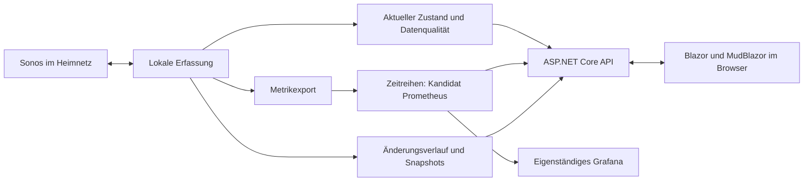
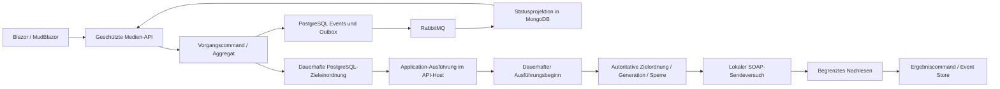

# Analyse und Planung: SonosMonitoring

Stand: 30.09.2026. Anforderungen und Entscheidungen werden hier fortgeschrieben.

Dieses Dokument ist die maßgebliche Quelle für Anforderungen, Entscheidungen und offene
Prüfungen. Vorschläge sind noch keine beschlossenen Produktanforderungen. Der Backend-Stand ist
unter [Umsetzungsstand Backend](#umsetzungsstand-backend) einschließlich der Frontendergänzungen maßgeblich erfasst; die Abschnitte zur
ursprünglichen Analyse und Slice-Planung bleiben als Planungshistorie erhalten.

## Umsetzungsstand Backend

Stand: 30.09.2026. Diese Tabelle ordnet den aktuellen Backend-Stand den stabilen Anforderungen
SM-001 bis SM-022 zu. „Umgesetzt“ bezeichnet den beschriebenen Backend-Slice, nicht automatisch
die vollständige Produktabnahme. Maßgebliche technische Einzelheiten stehen in
[Backend-Umsetzung](umsetzung-backend.md) und [Backend-Betrieb](betrieb.md).

| ID | Status | Aktueller Stand und offene Abnahme |
|---|---|---|
| SM-001 | teilweise | API mit eingebettetem Collector und separater Projektionsworker sind umgesetzt; Docker-/Linux-Betrieb ist dokumentiert. Dauerbetrieb und Netzwerkrückweg auf dem tatsächlichen LXC/Linux-Ziel sind offen. |
| SM-002 | teilweise | Konfigurierbare, begrenzte IPv4-CIDR-Unicast-Suche, Seeds, Deduplizierung und Geräteidentität sind umgesetzt. Optionales SSDP sowie frische Topologiehinweise ergänzen erlaubte Kandidaten, ohne die Vollsuche zu ersetzen. Zusätzliche Topologieabrufe sind begrenzt, nutzen Backoff und validieren die tatsächliche HTTP-UDN. Reale Multicast-, Modell-/Firmware- und geroutete Mehrnetzabnahme bleiben offen. |
| SM-003 | teilweise | SOAP-Topologiepolling sowie reporterbezogene Webkarte und Liste mit Koordinatoren und expliziten Elternzuordnungen sind umgesetzt. Jeder Reporter behält seine Quellenqualität. Keine Interpretation von Stereo-/Heimkinorollen oder Netzwerkpfaden; reale Gruppenwechsel-/Modellabnahme bleibt offen. |
| SM-004 | Frontend implementiert | Filterbare Geräteliste, Details sowie Cytoscape-Topologiekarte mit Live-Quellenqualität, Wiedergabe-/Netzwerkzustand und repräsentativen RX-/TX-Raten. Kompakte Knoten, einklappbare Reporterdetails, Zoom, verschiebbare Knoten und gleichwertige Liste. 360-/1440-Pixel-Ansichten, DE/EN, Maus, Tastatur und Touch sind mit simulierten API-Daten geprüft; Positionen/Zoom bleiben bei Liveupdates erhalten. Keine gemessenen Meshpfade. |
| SM-005 | Frontend implementiert, reale Störungskalibrierung offen | Collector-Heartbeat, sieben Quellen, Alter, effektives Diagnoseintervall und GENA-Zustand sind sichtbar. Unbeobachtet, verfügbar, fehlgeschlagen, veraltet, deaktiviert, Policy-Ausfall und nicht unterstützt bleiben unterscheidbar. Fehlgeschlagene Webaktualisierung erhält den gekennzeichneten alten Stand. |
| SM-006 | Frontend implementiert | Geschützter reduzierter JSON-Download und grafische Offlineansicht einschließlich Quellen, Zählern und reporterbezogenen Gruppen. Schema-/Größen-/Strukturprüfung, keine Liveverknüpfung der Aliase. Browserimport/-download mit gültigen/ungültigen Dateien geprüft; keine Exporthistorie oder Restorefunktion. |
| SM-007 | teilweise | API-Key/Loopback sowie separater Webzugang mit Loopbackstandard, optionaler Cookie-Anmeldung, CSRF, Sessionablauf, HTTPS-Pflicht für nichtlokale Peers und Loginlimit umgesetzt. HTTP-Sicherheitsablauf geprüft; Mehrbenutzer-/Rollenmodell und tatsächliche LAN-/TLS-Abnahme bleiben offen. |
| SM-008 | teilweise | Interface-Zähler, WLAN-Modus/Verbindungstyp, Ethernet-Link sowie technische Versionen sind mit eigenen Quellenzuständen umgesetzt. Lesende Modellproben für drei SYMFONISK-Geräte mit Software 86.10-80260 liegen vor. Ethernetgeschwindigkeit bleibt ein Rohwert ohne belegte Einheit. RSSI/SNR und breite Modell-/Firmwareabdeckung bleiben offen. |
| SM-009 | offen | Keine Peerlinks, gemessenen Meshpfade oder Durchsatzwerte zwischen Geräten. |
| SM-010 | Backend und Frontend implementiert | Dauerhafter PostgreSQL-Beobachtungsverlauf und Webansicht mit Cursorpaging, Kennungsfilter, Vorher-/Nachher-Details und sichtbaren Retentions-/Erfassungslücken. Sampling standardmäßig 2 Sekunden, Retention 90 Tage/20.000 Einträge; schnelle Zwischenstände können zusammenfallen. |
| SM-011 | Backend implementiert, Prüfstand unten | Nutzerentscheidung: ausschließlich interne Meldungen über die API. Drei verzögerte Störungen und drei positive Erholungsnachweise werden durch Prometheus bewertet; die geschützte API validiert Regelgesundheit/Aktualität und liefert stabile Störungs- und Vorkommnisidentitäten. Erholung erfordert positive Quellen und frühere Firing-Evidenz innerhalb 24 Stunden. Keine externe Zustellung, Quittierung, dauerhafte Inbox oder nutzerspezifischen Regeln. Reale Kalibrierung bleibt offen. |
| SM-012 | offen | Mehrere Haushalte/Installationen und Mandantenisolation sind nicht umgesetzt. |
| SM-013 | L0–L3 implementiert und automatisiert geprüft | Lokale Mediensteuerung einschließlich dauerhafter Koordination, API und DE/EN-Oberfläche umgesetzt. Der [Medienbereich](#ergänzung-lokale-mediensteuerung-30092026) führt Anforderungen und tatsächliche Nachweise getrennt; reale Schreibabnahme bleibt offen. |
| SM-014 | teilweise | 34 Exportdefinitionen und 26 erlaubte Historienselektoren mit Einheiten/Scope, Quellen- und Interfacefiltern sind umgesetzt. Die Testumgebung verwendet 7 Tage; 400 Tage ist der vorgeschlagene Produktionsdefault. Sicherung/Wiederherstellung in neue Ziele ist geprüft. Kapazität und echtes Jahreswachstum bleiben offen; ein beschleunigter Retentionstest ist kein Jahresnachweis. |
| SM-015 | implementiert und lokal geprüft | Prometheus, vier detaillierte Grafana-Dashboards mit lesbaren Gerätenamen und Webmetriken verwenden dieselbe Datenquelle. Eigene UTC-Bounds, Schrittweite, Einheiten, lückenbewusste Diagramme und zugängliche Wertetabelle vorhanden. Identische API-/Grafana-Matrizen, unveränderte Historie beim Namensabgleich und tatsächliche Browserdarstellung geprüft; aktueller Prüfstand unten. |
| SM-016 | Backend implementiert, reale Abnahme offen | Optionaler begrenzter GENA-Listener, Initial-Callback-Nachweis, Lease-Erneuerung/-Wiederanmeldung, Duplikat-/Sequenzprüfung und SOAP-Abgleich sind implementiert. Polling bleibt bei gesperrtem Rückweg aktiv. Reale Geräte-IP-Wechsel, Firmware, geroutete Firewall und Linux/LXC müssen separat abgenommen werden. |
| SM-017 | lokale Lese- und Steuerpfade implementiert | Feste lokale GETs und SOAP-Aktionen auf Port 1400 mit validierten Service-/Controlpfaden und SCPD-Aktionslisten. Mediensteuerung gemäß SM-013; kein stiller Cloud-Fallback. Reale Offlineabnahme lokaler Medien mit gesperrtem Anwendungs-Internetzugang bleibt offen. |
| SM-018 | Frontend implementiert | Blazor Interactive Server/MudBlazor 9.10.0 mit zentralen DE-/EN-Ressourcen, gespeichertem Sprachwechsel und Browserfallback. Ressourcen-/Kulturtests und responsive Browserprüfung einschließlich Touch/Tastatur bestanden. Native Geräte-/Screenreaderabnahme bleibt offen. |
| SM-019 | implementiert, reale Dauerabnahme offen | Begrenzte Timeouts, Parallelität, Wiederholungen, Backoff und Quellenisolation für den lesenden Collector. Mediensteuerung hat eigenen Executor, begrenzte Warteschlange/Budgets und dauerhafte Unklarheitssperren ohne Geräte-Retry. Prometheus-Störungsregeln und interne API-Meldungen sind vorhanden. Vollständige Störfallmatrix und reale Dauerabnahme bleiben offen. |
| SM-020 | umgesetzt | Devbone Direct Mode mit PostgreSQL, transaktionaler Outbox, RabbitMQ und MongoDB-Projektionen ist real integriert. Der isolierte Command-bis-Query-Weg, Idempotenz/Duplikat, Outbox-Wiederzustellung und Projektions-Rebuild sind mit echter Infrastruktur nachgewiesen. |
| SM-021 | implementiert, Prüfstand unten | Vollständige reguläre Erfassungskonfiguration über die Webseite: Netzgrenzen, Seeds, Intervalle, Ressourcenlimits, SSDP und GENA; dauerhafte Speicherung und Übernahme ohne API-Neustart, Konfliktschutz und identische Retries. Aufklappbare SSDP-/GENA-Erklärung und Einrichtungshilfe DE/EN. Hostzugang/Secrets/Infrastruktur bleiben Deploymentaufgabe (DEC-017). |
| SM-022 | implementiert und an drei Geräten geprüft, 30.09.2026 | Lesende lokale Wiedergabezustände, Playerlautstärke und Mute mit eigenem Quellenstatus in API, Gerätedetails und Topologie. Erfolgreiche reale Collectorantworten, Prometheusreihen und Historie sowie simulierte Fehler-/Unsupported-/Policyfälle geprüft. Keine Steuerung; Gruppenlautstärke wird nicht aus Playerwerten abgeleitet. Breitere Modell-/Firmwareabnahme bleibt offen. |

**Docker-Skript, Ergänzung zu SM-001:** Der normale Start muss den aktuellen Arbeitsbaum
per Locked-Restore, Publish und Image-Build übernehmen. Alte Images dürfen nur mit explizitem
`-SkipBuild` wiederverwendet werden. Nach erfolgreicher Bereitschaftsprüfung sind die vier
Dienst-URLs gemeinsam auszugeben. Stoppen muss beide Compose-Projekte ohne Datenlöschung
erfassen, wiederholbar sein und ohne lokale Zugangsdaten, SDK oder Zertifikate auskommen.
Diese Kriterien sind im [Stack-Skript und Betriebshandbuch](betrieb.md#vollständiger-lokaler-docker-stack)
umgesetzt. Nachgewiesen sind PowerShell-Syntax und zwölf isolierte Ablaufprüfungen einschließlich
Fehlerabbrüchen; die Docker-/SDK-Aufrufe waren dabei ersetzt. Ein erneuter realer Stack-Start
wurde für diese Skriptänderung nicht ausgeführt; der frühere Docker-Nachweis bleibt separat.

**Implementierter Umfang:** Der Collector verwendet begrenzte Unicast-Aufrufe
für Gerätebeschreibung, Interface-, WLAN- und Ethernetdiagnosen sowie feste lesende SOAP-
Aktionen für Topologie/Wiedergabe/Playerlautstärke/Mute und optionales aktives SSDP-Multicast;
optionaler GENA-Empfang ergänzt Polling mit begrenzten Topologiehinweisen. Der
Monitoring-Domain-Slice kann eine Policy aktivieren und deaktivieren. Outbox, Duplikatverhalten
und Wiederaufbau der Projektion sind im isolierten Testaufbau mit echten Diensten nachgewiesen.
Die zuvor ausgeschlossene Oberfläche wurde mit dem nachfolgenden Frontendauftrag ergänzt;
Plan und Bedienung stehen in [Frontend-Umsetzung](umsetzung-frontend.md). Dauerhafter
Beobachtungsverlauf und interne Alarmabfragen haben eigene Webansichten. Fachliche
Störungsvorgänge und Steuerung bleiben spätere Erweiterungen.

**Auftrag „ganzes Frontend“, 29.09.2026:** V1-Oberfläche für die vorhandenen Backendfähigkeiten
priorisiert. Umsetzungsschritte und Entscheidungen: [Frontendplan](umsetzung-frontend.md).
Der eigene Webhost referenziert ausschließlich Contracts. API-Schlüssel bleiben serverseitig;
lokale Assets benötigen keine CDN-Verbindung. Überwachungsregeln verwenden immutable
Retry-Anfragen, echte Konflikte und begrenzte Projektionsnachprüfung. Der Policy-GET liefert
additiv den echten Commit-Token zum dargestellten Stand; der ursprüngliche Frameworkvertrag
und alle Eventkataloge bleiben erhalten. Interne Meldungen (SM-011) sind jetzt auch als
filterbare Oberfläche einschließlich ausdrücklich positiver Erholungsmeldungen umgesetzt.

**Geforderte Frontendprüfung:** Architekturgrenzen einschließlich transitiver Pakete,
DE-/EN-Ressourcen und Kulturformatierung, Quellen-/Lade-/Leer-/Fehlerzustände, Messlücken,
Snapshotvalidierung, unveränderte Retries, Konflikte, verzögerte Projektionen, geschützte
Browseranmeldung mit CSRF, Desktop/Mobil und Touch/Maus/Tastatur. Realer Command-bis-Query-Weg
einschließlich Neuladen eines Änderungstokens bleibt zusätzlich Backend-E2E-Aufgabe.

**Tatsächlicher Frontendprüfstand, 29.09.2026:** Das vollständige lokale Gate
`scripts/verify.ps1 -IncludeInfrastructure` besteht: Locked-Restore, nichtinkrementeller
Release-Build mit **0 Warnungen/0 Fehlern**, Format, Event-/Metrikkataloge,
**198 Unit-Tests, 23 Frontendtests, 9 Integrationstests und 34 HTTP-E2E-Tests**,
jeweils ohne Fehler/übersprungene Tests. Reale PostgreSQL-/RabbitMQ-/MongoDB-Prüfung
bestätigt den angezeigten Token nach API-Neustart und dessen Verwendung beim Folgecommand.
Prometheus-Regeln sowie PostgreSQL-/Prometheus-Backup und Restore bestehen ebenfalls;
eigene Testcontainer und Testnetz wurden entfernt.

**Browsernachweis:** 14 Szenarien mit Playwright 1.62.1 und lokalem Edge gegen einen
isolierten API-Simulator und den echten Webhost: Filter/Leerzustand, stabiler Retry nach
unklarer Commitantwort, Konflikt/Neuladen, Projektionswartezeit, Karte/Liste, Messlücke und
Tabelle, eigener UTC-Zeitraum, Journalpaging/Retention, positive Erholung, Ausfall einer
Aktualisierung, Snapshotdownload/-import, beide Sprachen bei 360 Pixeln, Desktop bei
1440 Pixeln und Touchnavigation. Screenshots wurden visuell geprüft. Keine ungewollten
horizontalen Seitenüberläufe oder JavaScript-Seitenfehler im Prüflauf.
Belege: `artifacts/frontend-verification.log`, `artifacts/test-results/{unit,web,integration,e2e}.trx`
und `artifacts/test-results/browser/{report.json,*.png}`.
Browserdaten sind simuliert; Backendpersistenz ist getrennt mit echten Diensten geprüft.
Remote-CI, reale Sonos-/Netz-/Firmware-/Linux/LXC-Abnahme, Screenreader und Grafana-Bildvergleich
sowie Jahreskapazität bleiben offen. Keine echten Sonos-Geräte wurden verändert.

**Abschließende Auslieferungsprüfung:** Nach der Web-CSRF-Fehlerabbildung (kontrolliertes 400
bei ungültigem Formtoken) wurde `scripts/verify.ps1` erneut erfolgreich ausgeführt;
Beleg `artifacts/frontend-final-verification.log`. Das Release-Publish des Webhosts besteht.
Dieselben 14 Browserabläufe bestehen auch gegen das veröffentlichte Artefakt im
Produktionsmodus mit Edge 154.0.4258.37. Das lokale Image `sonosmonitoring-web:local`
startet als `app`; ein Container ohne Netzwerk liefert Startseite, App-CSS/-JS,
MudBlazor-CSS und Blazor-JS jeweils mit HTTP 200. Testcontainer anschließend entfernt.
Belege: `artifacts/frontend-publish.log`, `artifacts/frontend-image.log` und
`artifacts/test-results/web-container-{smoke,host}.log`. Das neue Webimage wurde nicht
veröffentlicht und in dieser Frontendrunde keinem zusätzlichen Trivy-Lauf unterzogen;
die CI-/Scan-Skripte berücksichtigen es nun.

**Auftrag „Backend fertigstellen“, 29.09.2026:** Priorisiert sind die noch fehlenden
V1-Backendbausteine Ereignisempfang, Beobachtungsverlauf, interne Alarmabfragen sowie
Sicherung/Wiederherstellung und Betriebsartefakte. Der Nutzer hat den Kanal ausdrücklich
auf interne API-Meldungen beschränkt. Die bereits ausgeschlossene UI und nachrangige
V2-Steuerung/Mehrmandantenfähigkeit werden nicht vorgezogen. Architektur- und
Aufbewahrungsentscheidungen stehen bei [den Backend-Ergänzungen](umsetzung-backend.md#backend-ergänzungen-vom-29092026).
Geforderter Nachweis: Initial-Callback-Rennen, Erneuerung, gesperrter Rückweg und erneute
Anmeldung; dauerhafte Änderungen ohne Poll-Duplikate, sichtbare Lücken, Paging/Retention;
Alarmregelgesundheit, Zugriffsschutz, positive Erholungsnachweise und wiederholbare API-Abfragen;
PostgreSQL-/TSDB-Sicherung in neue Ziele und
Wiederaufnahme der Anwendungsdaten. Tatsächliche neue Ergebnisse folgen getrennt unten.

**Aktueller Prüfstand nach Backend-Fertigstellung (29.09.2026):**
`scripts/verify.ps1 -IncludeInfrastructure` erfolgreich, Exit 0: Locked-Restore,
nichtinkrementeller Release-Build mit **0 Warnungen/0 Fehlern**, Formatprüfung,
Eventkatalogkompatibilität und Aktualität beider generierten Kataloge.
**196 Unit-Tests, 9 Integrationstests und 34 HTTP-E2E-Tests bestanden**; jeweils keine
Fehler und keine übersprungenen Tests. Zusätzlich bestehen **13 Prometheus-Regelszenarien**
mit dem tatsächlich gepinnten Prometheus 3.13.3. Ein eigener Server lädt und bewertet alle
acht Regeln; die echte Release-API liefert dessen aktive Meldung und verweigert Zugriff ohne
Schlüssel. Erholungsbedingungen werden durch promtool, die sichere Zuordnung/Identitäten
durch Reader-Tests nachgewiesen; dies ist keine Alarmkalibrierung an realen Sonos-Geräten.

Neue technische Nachweise: GENA-Initialmeldung vor der SUBSCRIBE-Antwort, Erneuerung,
Publisher-Ablehnung/Wiederanmeldung, fehlender Initial-Callback, Duplikate, falscher Peer/SID,
XML-/Größenlimits und SOAP-Abgleich. Dauerhaftes Journal mit Baselines, Änderungen ohne
Poll-Duplikate, Lücken, Filter/Paging, Retention und API-Neustart. PostgreSQL-Restore erhält
echte Policy-Events, Outbox und Journal, erlaubt denselben idempotenten Request ohne
Duplikat und anschließende neue Commits/Beobachtungen. Prometheus-Restore in ein neues Volume
liefert denselben historischen Abfragebereich; bestehende Ziele werden abgelehnt.

Belege: `artifacts/test-results/{unit,integration,e2e}.trx`, `alerts-promtool.log`,
`alerts-runtime.json`, `alerts-api-runtime.json`,
`postgres-backup-d311bb11f793430694fbd18767d784ea.log` und
`prometheus-backup-00017f0f2e5c433bb45993d202d2ba6a.log`.
Die Testcontainer, Testvolumes und das Backend-Testnetz wurden anschließend entfernt.
Eine additive Gauge `sonos_source_observation_fresh` wurde generiert und nach Prüfung in den
Metrikkatalog übernommen; Eventkatalog und Framework-Paketkombination sind unverändert.

Im Prüflauf korrigierte Testannahmen: unabhängige Gerätequellen können in unterschiedlicher
Reihenfolge sichtbar werden; der Test wartet auf beide erwarteten Beobachtungen. Der
GENA-Simulator verwendet für frühe HTTP-Ablehnungen `Expect: 100-continue`, damit ein
absichtlich übergroßer Upload nicht vor Lesen des Status die Verbindung beendet. Ein
PowerShell-Testprozess verwendet native asynchrone Stream-Reads statt Runspace-fremder
Callbacks. Beim Restore schützt eine zufällige Operationskennung vor konkurrierendem Zugriff
auf ein neues Volume. Es wurden keine realen Sonos-Geräte oder bestehenden Betriebsdaten verändert.
Remote-CI, reale Firmware-/Netz-/Linux/LXC-Abnahme, produktiver Probe-Restore und einjähriger
Dauerbetrieb/Kapazitätsnachweis bleiben offen.

**Auslieferungsnachweis desselben Quellstands (29.09.2026):**
`scripts/publish.ps1 -BuildImages`, der isolierte `scripts/smoke-containers.ps1`-Lauf und
`scripts/scan-images.ps1` sind jeweils mit Exit 0 abgeschlossen. API: autorisierte Readiness
200, ohne Schlüssel 403. Worker: Liveness 200, eigene RabbitMQ-Queue und keine erkannten
Startfehler. Beide Linux-Images laufen als `app` und enthalten kein .NET-SDK.
Der gepinnte Trivy meldet für beide Images **0 HIGH-/CRITICAL-Befunde**;
Belege: `artifacts/security/api-vulnerabilities.json` und `projections-vulnerabilities.json`.
Gebaut und geprüft wurden lokal `sonosmonitoring-api:local`
(`sha256:93434b5f73408a982e90e67861a733037a35d75a5d19e6e2c394289ebeeb0056`)
und `sonosmonitoring-projections:local`
(`sha256:bb2086776d75b27929b9a5be9947943cddeb5b492493fbd9b97721f5e9f6d156`).
Keine Images veröffentlicht oder Zielsysteme umgestellt. Die systemd-Vorlagen sind geliefert,
aber nicht auf dem tatsächlichen Linux/LXC-Ziel ausgeführt. Eine abschließende Docker-Abfrage
bestätigt, dass eigene Testcontainer und Backup-Testvolumes entfernt sind.
Die folgenden Abschnitte sind frühere Prüfstände.

**Fortsetzung 29.09.2026 – SM-002/SM-003/SM-017/SM-019:** Als nächster Backend-Ausbauschritt
wurde lesendes SOAP-Topologiepolling gewählt, weil Gruppeninformationen die Grundlage der
späteren Liveübersicht bilden. Der dokumentierte Ausschluss des Frontends bleibt bestehen.
Topologie ist eine flüchtige Beobachtung der Sonos-Quelle, keine fachliche Schreibaktion;
deshalb entstehen keine neuen Domain-Events und keine zusätzliche autoritative Persistenz.
Die vorhandenen Event- und Metrikkataloge bleiben unverändert.

Geforderte technische Abnahme dieses Schritts: gültige SOAP-Anfrage, Gruppenwechsel bis zur
HTTP-Ausgabe, explizite Satellitenzuordnung ohne erfundene Rollen, getrennte Quellenfehler,
Erhalt/Alterung letzter guter Werte, Erholung, Größen-/XML-/Zielgrenzen sowie begrenzte
Parallelität pro Geräteidentität. Reale Modell-/Firmwareantworten und Gruppenwechsel gegen
die Sonos-App bleiben eine gesonderte Produktabnahme. Erkenntnis aus der Protokollreferenz:
Satelliten können veraltete Topologiesichten melden; deshalb behält die API die Herkunft
je Reporter, statt Sichtweisen ungeprüft zu vereinigen. Einzelheiten und Referenzen stehen
in [Gruppentopologie](umsetzung-backend.md#gruppentopologie-sm-002-sm-003-sm-017-sm-019).

**Weitere Fortsetzung 29.09.2026 – SM-002/SM-016/SM-019:** Optionales aktives SSDP ergänzt
die Discovery als nächster Backend-Schritt. Verlangt werden explizite lokale IPv4-Interfaces,
begrenzte Suchfenster/Datagrammzahlen, Sender-/LOCATION-/CIDR-Prüfung, Kandidatendeduplizierung,
anschließende HTTP-Identifikation und vollständige Unicast-Suche trotz frühem Fund oder
leerer SSDP-Antwort. Interfacefehler, Empfangslimit und Abbruch müssen separat sichtbar bleiben.
Keine automatische Subnetzerweiterung oder passive Listener. Bewusste Betriebsentscheidung:
TTL 1 begrenzt Multicast auf lokale Segmente; entfernte erlaubte Netze behalten Unicast.
USN ist nur ein geprüftes Formatmerkmal des Kandidaten; autoritativ für die Beobachtungsidentität
bleibt die erfolgreich gelesene Gerätebeschreibung. Referenzen und Konfiguration siehe
[optionales SSDP](umsetzung-backend.md#optionale-ssdp-erkennung-sm-002-sm-016-sm-019).
Reale Sonos-/Multicast-/Firewall- und Linux/LXC-Abnahmen bleiben eigenständige offene Prüfungen.

**Weitere Fortsetzung 29.09.2026 – Topologie-Discovery, SM-002/SM-019:** Aktuelle gemeldete
Mitgliedsadressen schließen die bisher offene Verbindung zwischen Topologie und Discovery.
Kanonische Beschreibungsadressen werden als `reportedAddress` erhalten; nur nutzbare Hosts
innerhalb der freigegebenen CIDRs kommen als neue HTTP-Ziele infrage. Reporter mit veralteter
oder fehlgeschlagener Beschreibung/Topologie liefern keine neuen Hinweise. Auswahl pro Runde,
Rotation, Backoff und bestehende Rundengrenzen begrenzen zusätzliche Last. Die vollständige
periodische CIDR-Suche bleibt erhalten. Die tatsächliche HTTP-UDN entscheidet über Identität;
gemeldete UDNs sind keine Zuordnungsanweisung. Beobachtungen bleiben im flüchtigen Cache,
ohne neue fachliche Commands, Events oder Persistenz.

Geforderte Abnahme: kanonische URL-Prüfung, CIDR-/Hostgrenzen, Quellenalter/-fehler,
Deduplizierung, Kandidatenlimit ohne dauerhafte Verdrängung späterer Hinweise, Retry-Backoff,
Neuerkennung und IP-Wechsel zwischen Vollsuchen sowie Ablehnung ungeprüfter Identitätszuordnung.
Details und Betrieb unter [Discovery aus Topologiehinweisen](umsetzung-backend.md#discovery-aus-topologiehinweisen-sm-002-sm-019).
Zum damaligen Stand blieben reale Sonos-/Linux/LXC-Abnahmen und die GENA-Implementierung offen;
der aktuelle Ereignisempfang steht in der Tabelle oben.

**Weitere Fortsetzung 29.09.2026 – Diagnoseexport, SM-006:** Der vorgeschlagene V1-Punkt
wird als nächster Backend-Slice priorisiert. Ein geschützter Download liest eine Cacheansicht
und liefert Schemafassung, Aufnahmezeit, Quellenbeobachtungen und Topologie. Kennungen,
Adressen und freie Gerätetexte werden nach einer expliziten Reduktionsregel behandelt;
Referenzen bleiben innerhalb der Datei erhalten. Keine neue fachliche Schreibaktion,
Persistenz oder Domain-Events. Der Ausschluss des Frontends bleibt bestehen; eine gespeicherte
JSON-Datei kann unabhängig vom Collector betrachtet werden.

Geforderte Abnahme: keine Originalkennungen in verschachtelten Referenzen oder Freitextfeldern,
konsistente Aliase einschließlich unbekannter Mitglieder, Erhalt von Nullwerten, Datenqualität,
Zeitpunkten und Messwerten; unabhängige Aufnahme trotz späterer Cacheänderungen; verweigerter
Download ohne gültigen konfigurierten Schlüssel; lesbare Datei nach Stoppen der API; ehrliche
leere Aufnahme bei deaktiviertem Collector. Vertrag und Grenzen stehen unter
[Snapshot und Diagnoseexport](umsetzung-backend.md#snapshot-und-diagnoseexport-sm-006).

**Weitere Fortsetzung 29.09.2026 – Störungserkennung, SM-005/SM-011/SM-019:**
Als nächster V1-Backend-Schritt wird die verzögerte Bewertung vorhandener Messwerte priorisiert.
Prometheus besitzt die drei technischen Regeln; C# und Grafana berechnen sie nicht erneut.
Ein fehlgeschlagener Beschreibungsabruf ist eine Beobachtung aus Collector-Sicht, kein Beweis
für einen Geräte- oder Audioausfall. Die Regeln sind versionierte Betriebskonfiguration;
es werden keine Alarmregel-Commands oder Domain-Events für jeden Poll eingeführt.
Änderungen nutzerverwalteter Regeln, Quittierungen und dauerhafte Störungsvorgänge bleiben
einem eigenen fachlichen Modell vorbehalten. Eine neue Aktivierungsmetrik trennt den
bewusst deaktivierten Collector vom nicht angelaufenen oder unterbrochenen Collector.
Das Heartbeat-Budget folgt SweepTimeout + PollInterval + 5 Sekunden Schedulerreserve.

Gewählte Startwerte: API-/Collector-Störung nach 2 Minuten, Gerätebeschreibungsfehler nach
5 Minuten; Nachlauf 1 beziehungsweise 2 Minuten. Kein Gerätestart bei fehlender Beobachtbarkeit
des zugehörigen Collectors. Diese Startwerte sind noch keine am realen Bestand kalibrierte
Produktabnahme. Ein erloschener Alarm bestätigt bei fehlenden Daten keine Erholung.
Zu diesem früheren Planungsstand war noch kein Benachrichtigungskanal gewählt. Die spätere
Nutzerentscheidung für interne API-Meldungen und deren aktueller Umfang stehen oben. Einzelheiten
stehen unter [Störungserkennung](umsetzung-backend.md#störungserkennung-sm-005-sm-011-sm-019).

Geforderte Abnahme: Pending-/Firing-Grenzen, Einzel- und Flatterfehler, Nachlauf und Wiederfehler,
deaktivierter/nicht gestarteter/unterbrochener Collector, lange Scanbudgets, verschwundene
Serien, zielgenaue Unterdrückung bei API-/Collector-Ausfall und unveränderte Geräteidentität
in Metriklabels. Regeln gegen den Metrikkatalog prüfen, mit dem tatsächlich gepinnten
Prometheus auswerten und die produktive Konfigurationsvorlage samt Regeldatei im isolierten
Server laden. Reale Alarmkalibrierung, Benachrichtigungswiederholung/-Deduplizierung und
Erholungsnachrichten bleiben getrennte offene Abnahmen.

**Früherer Prüfstand mit Störungserkennung, vor GENA/Journal/Erholungsmeldungen (29.09.2026):**
`scripts/verify.ps1 -IncludeInfrastructure` erfolgreich: Locked-Restore, nichtinkrementeller
Release-Build mit 0 Warnungen/0 Fehlern, Formatprüfung, Eventkatalogkompatibilität sowie
Aktualität beider Kataloge. **141 Unit-Tests, 3 Integrationstests und 29 E2E-Tests bestanden**,
jeweils 0 Fehler und 0 übersprungen. Zusätzlich bestehen **8 Prometheus-Regelszenarien** mit
dem gepinnten Image `prom/prometheus:v3.13.3` und der echte isolierte Serverstart mit allen
vier geladenen/erfolgreich ausgewerteten Regeln. Der vollständige CI-Ablauf enthält diese
Prüfungen jetzt verpflichtend; eine Remote-CI-Ausführung wurde hier nicht vorgenommen.

Neue Nachweise: Aktivierungsmetrik und konfigurationsabhängiges Heartbeat-Budget, korrekte
Gerätebeschreibungsmetriken im simulierten HTTP-Fehlerweg, Mindestdauern, Pending-/Firing-
Übergänge, Flattern, Nachlauf/Wiederfehler, Datenverlust sowie Trennung nach Job/Instanz.
Die Regeltests verwenden künstliche Zeitreihen und die produktiven Regeldateien; der reale
Prometheus-Start prüft Laden/Auswerten der gemeinsamen Vorlage, kein reales Sonos-Netz.
Eine anfängliche Testerwartung lag beim veralteten Heartbeat um ein 15-Sekunden-Intervall
zu früh; die Grenze ist auf das erste Überschreiten des Budgets plus Mindestdauer korrigiert.
Belege: `artifacts/test-results/{unit,integration,e2e}.trx`, `alerts-promtool.log`,
`alerts-runtime.json`. Alle kurzlebigen Testcontainer und das Backend-Testnetz wurden entfernt.

Metrikkatalog um zwei generierte Gauges erweitert; vorhandene Definitionen, Eventkatalog und
Framework-Pakete unverändert. Keine bestehende Entwicklungs-/Metrikumgebung verändert,
keine realen Geräte kontaktiert oder Benachrichtigungen versendet. Anwendungsimages für diesen
Quellstand nicht neu gebaut oder gescannt. Kanal/Zustellung, dauerhafte Störungsvorgänge,
reale Kalibrierung und Geräte-/Netzabnahmen bleiben offen.

**Prüfstand vor Störungserkennung, mit Diagnoseexport (29.09.2026):**
`scripts/verify.ps1 -IncludeInfrastructure` erfolgreich: Locked-Restore, nichtinkrementeller
Release-Build mit 0 Warnungen/0 Fehlern, Formatprüfung, Eventkatalogkompatibilität und
Aktualität der Event-/Metrikkataloge. **139 Unit-Tests, 3 Integrationstests und 29 E2E-Tests
bestanden**, jeweils 0 Fehler und 0 übersprungen. Die neuen Tests prüfen die Reduktion aller
identifizierenden Textfelder, unbekannte Fehlercodes, Referenzgleichheit über mehrere Reporter,
unbekannte Mitglieder, erhaltene Quellen-/Messwerte und Kopierisolation. Der echte HTTP-Download
weist Zugriffssperre, Attachment-/Cacheheader, unveränderte Liveausgabe und das erneute Lesen
einer gespeicherten Datei nach Cacheänderung und API-Stopp nach. Ein deaktivierter Collector
liefert eine leere, versionierte Aufnahme. Die Exporttests befüllen den isolierten Beobachtungscache;
die bestehenden Simulator-/Devbone-Wege laufen zusätzlich im vollständigen Prüfablauf.
Ein anfänglicher Fehler im neuen Kopierisolationstest betraf einen Array-Cast auf eine vom Compiler
erzeugte Read-only-Liste; die Testdaten verwenden jetzt explizite veränderliche Arrays.

Aktuelle Belege unter `artifacts/test-results/`; die isolierten Testcontainer und ihr Netzwerk
wurden entfernt. Keine realen Sonos-Geräte kontaktiert. Grafische Offlineansicht, reale Geräte-/
Netzabnahme und GENA bleiben offen. Framework-Pakete und Event-/Metrikkataloge unverändert;
für diesen Quellstand keine neuen Anwendungsimages gebaut oder gescannt.

**Prüfstand vor Diagnoseexport, mit Topologie-Discovery (29.09.2026):**
`scripts/verify.ps1 -IncludeInfrastructure` erfolgreich: Locked-Restore, nichtinkrementeller
Release-Build mit 0 Warnungen/0 Fehlern, Formatprüfung, Katalogkompatibilität und Aktualität.
**135 Unit-Tests, 3 Integrationstests und 25 E2E-Tests bestanden**, jeweils 0 Fehler und
0 übersprungen. Neue Nachweise: strikte URL-Erkennung, Quellenalter/-fehler, Hostgrenzen,
Deduplizierung, Kandidatenlimit/Rotation und Retry-Verhalten. Der HTTP-E2E-Test identifiziert
ein erst nach der ersten Vollsuche verfügbares Gerät anhand von Topologiehinweisen und erkennt
anschließend dessen IP-Wechsel bei unverändertem `firstSeenUtc`, ohne eine weitere Vollsuche.
Eine absichtlich falsche gemeldete UDN überschreibt die tatsächliche HTTP-Identität nicht;
das erreichbare Loopback-Testziel außerhalb der CIDRs erhielt keinen Beschreibungsabruf.
Zusätzlich ist die Isolation eines Verbindungsabbruchs während der Gerätebeschreibung geprüft.
Die vorhandenen vollständigen Unicast-, SSDP-, SOAP- und Devbone-Wege bestehen weiter.
Belege in `artifacts/test-results/` wurden aktualisiert; isolierte Testcontainer/-netz entfernt.
Keine realen Sonos-Geräte kontaktiert. Reale Modell-/Netzabnahme und GENA bleiben offen.
Framework-Pakete, Event-/Metrikkataloge unverändert; keine neuen Images gebaut oder gescannt.

**Prüfstand vor Topologie-Discovery, mit SSDP (29.09.2026):** `scripts/verify.ps1 -IncludeInfrastructure`
erfolgreich: Locked-Restore, nichtinkrementeller Release-Build mit 0 Warnungen/0 Fehlern,
Formatprüfung, Katalogkompatibilität und Katalogaktualität. **115 Unit-Tests, 3 Integrationstests
und 23 E2E-Tests bestanden**, jeweils 0 Fehler und 0 übersprungen. Die neuen Tests weisen
Parser-/Zielgrenzen einschließlich gemischter Zeilenumbrüche und ungültiger Zusatzheader
sowie Konfigurationsfehler nach. Sie prüfen realen UDP-Transport an kurzlebige
Loopback-Responder: gewählte Quelladresse, M-SEARCH-Format, Paketgrößen-/Anzahllimit,
leeres Fenster, Abbruch, Teilfehler und Deduplizierung. Collector-bis-HTTP-Tests finden beide
simulierten Geräte in zwei erlaubten Bereichen sowohl mit SSDP-Fund als auch bei leerer Antwort.
Nur das interne UDP-Testziel wurde ersetzt; es wurden keine Multicast-Pakete ins reale Netz
gesendet. Reale Multicast-Zustellung, Sonos-Antworten und Firewall-/Linux-Betrieb sind damit
ausdrücklich nicht nachgewiesen. Testcontainer/-netz wurden anschließend entfernt.
Belege unter `artifacts/test-results/` wurden auf diesen Lauf aktualisiert. Framework-Pakete,
Event- und Metrikkataloge unverändert; keine neuen Anwendungsimages gebaut oder gescannt.

**Prüfstand vor SSDP (29.09.2026):** `scripts/verify.ps1 -IncludeInfrastructure` erfolgreich:
Locked-Restore, nichtinkrementeller Release-Build mit 0 Warnungen/0 Fehlern, Formatprüfung,
Eventkatalog-Kompatibilität und Aktualität beider Kataloge. 73 Unit-Tests, 3 Integrationstests
und 16 HTTP-E2E-Tests bestanden; jeweils 0 Fehler und 0 übersprungen. Neue Nachweise umfassen
SOAP-/XML-Validierung, Referenz-Zielgrenzen, Kopierisolation des Caches, Gruppenwechsel,
Timeout, HTTP 503, Redirect, Antwortlimit, kaputtes XML, SOAP-Fault und Verbindungsabbruch
während der Antwort, Erholung sowie zusammengefasste Parallelabrufe derselben Gerätekennung.
Die echten isolierten PostgreSQL-/RabbitMQ-/Mongo-Testdienste wurden anschließend entfernt.
Belegpfade: `artifacts/test-results/unit.trx`, `integration.trx` und `e2e.trx`; spätere Läufe ersetzen diese Dateien.
Die Tests bestätigen den Simulator-/Backendweg; keine reale Sonos-/Linux-Netzabnahme.
Anwendungsimages wurden für diesen Quellstand nicht neu gebaut oder gescannt; die folgenden
Image-Nachweise beziehen sich auf den Stand vom 28.09.2026. Keine Framework-Paketänderung.

**Prüfstand (28.09.2026):** `scripts/verify.ps1 -IncludeInfrastructure` erfolgreich: Locked-Restore, nichtinkrementeller Release-Build mit 0 Warnungen/0 Fehlern, Formatprüfung sowie Katalogkompatibilität und Aktualität. 57 Unit-Tests, 3 Integrationstests und 8 HTTP-E2E-Tests bestanden, jeweils 0 Fehler und 0 übersprungen. Integration und E2E liefen nacheinander gegen die echten isolierten PostgreSQL-/RabbitMQ-/Mongo-Dienste; TRX-Belege unter `artifacts/test-results/` werden bei späteren Läufen ersetzt. In einem vorherigen E2E-Lauf wurde der initiale Simulator nicht innerhalb der Beobachtungsfrist erkannt. Das Requestbudget beträgt jetzt 1 s statt 200 ms bei weiterhin 10 s injiziertem Timeout; Discovery wiederholt im Test nach 5 s innerhalb der 30-s-Beobachtungsfrist, damit ein verspäteter Erstabruf erneut versucht wird. Anschließend bestand der vollständige E2E-Lauf. Die GitHub-CI ist eingerichtet, aber noch nicht remote ausgeführt. Betriebsabnahmen für reales
Linux/LXC-Netz, unterstützte Gerätemodelle/-firmware, Dauertest, Restore und einjährige Retention
bleiben unabhängig davon offen.

Weitere technische Nachweise vom 28.09.2026 (vor der Topologie-Erweiterung):

- Testumgebung: Windows x64, .NET SDK 10.0.201 / lokale Runtime 10.0.5, Docker Desktop mit Linux-Containern. PostgreSQL 17.11, RabbitMQ 4.1.8 und MongoDB 8.0.30 als Replica Set; Image-Digests stehen in den Compose-Dateien.
- Beide Anwendungsimages aus `scripts/publish.ps1 -BuildImages` erfolgreich gebaut: .NET Runtime 10.0.12 auf Ubuntu 24.04, Basisimage per Digest fixiert.
- `scripts/smoke-containers.ps1` gegen frisch gestartete Testdienste erfolgreich: API mit Schlüssel HTTP 200, ohne Schlüssel 403; Worker-Liveness 200 und eigene RabbitMQ-Queue angelegt. Beide Hosts laufen als `app` ohne SDK. Danach eigene Smoke-Ressourcen und die gesamte entbehrliche Testumgebung entfernt; Entwicklungs-/Metrikvolumes bleiben erhalten.
- `scripts/scan-images.ps1`: Trivy 0.74.0 meldete für beide Anwendungsimages 0 HIGH-/CRITICAL-Befunde. NuGet-Audit einschließlich transitiver Pakete meldete keine bekannten Schwachstellen. Das sind datenbankabhängige Momentaufnahmen, keine allgemeine Sicherheitsgarantie. Infrastrukturimages wurden nicht umfassend gescannt.
- Entwicklungssetup `scripts/start-backend.ps1 Up`: PostgreSQL-Schema 4, Mongo-Replica-Set-Primary und RabbitMQ-Bereitschaft geprüft. Wiederholung erhält bestehende lokale JSON-Konfigurationen; anschließend nur die Entwicklungscontainer gestoppt, persistente Volumes erhalten.
- Prometheus 3.13.3 und Grafana 13.1.6: Konfiguration mit promtool validiert, Grafana-Gesundheit und geschützter Dashboardzugriff sowie Provisionierung geprüft. `PROMETHEUS_RETENTION=7d` wird als `1w` wirksam und bleibt nach Neustart erhalten. Der Prüf-Scrape zielte bewusst auf einen nicht erreichbaren Testport; ein durchgängiger realer Sonos-Collector–Prometheus–Grafana-Messwertvergleich ist noch offen. Prüfcontainer anschließend entfernt, Volumes erhalten.

## 1. Ausgangspunkt und bestätigte Vorgaben

- Eine Webapp mit einem ähnlichen Nutzen wie SonoStats entwickeln.
- Zuerst in Ruhe planen, anschließend schrittweise umsetzen.
- C# und MudBlazor bevorzugt. Devbone Event-Driven Platform ist ausdrücklich gewünscht,
  auch um das junge Framework mit einer realen Anwendung zu erproben. Zusätzlicher Aufwand
  ist damit bewusst begründet; der konkrete Betriebsaufbau bleibt zu validieren.
- Unzuverlässige Sonos-APIs als Normalfall behandeln: begrenzte Fehlerbehandlung, Isolation
  einzelner Geräte/Quellen, automatische Erholung und nachvollziehbare Datenqualität.
- Lokale APIs sind grundsätzlich zu bevorzugen. Cloudanbindungen nur bei begründetem Bedarf
  als bewusste optionale Erweiterung; kein stiller Cloud-Fallback bei lokalen Fehlern.
- Mehrsprachigkeit von Beginn an: zunächst Deutsch und Englisch für die eigene Webapp.
- Dauerbetrieb auf Linux innerhalb eines Containers. Proxmox LXC bevorzugt; Docker als
  Alternative und zweite Option für lokale Tests (Nutzerantworten vom 28.09.2026).
- Livekarte/Diagnose und Verlauf/Ausfälle/Benachrichtigungen sind die wichtigsten Funktionsbereiche.
  Wiedergabe- und Gerätesteuerung gehören ebenfalls zum gewünschten Umfang, mit geringerer Priorität.
- Metrikhistorie ist ausdrücklich erforderlich, zusätzlich zum Verlauf fachlicher Änderungen.
  Mindestens ein Jahr aufbewahren; ältere Daten dürfen gröber sein. Grafana muss neben der
  eigenen Webapp angebunden werden können (Nutzerantworten vom 28.09.2026).
- Aktuell sind alle Geräte im WLAN. LAN und SonosNet sollen ebenfalls berücksichtigt werden.
  Der Nutzer vermutet S2 für alle Geräte; dies ist noch nicht verifiziert.
- Die Geräte stehen in einem separaten Subnetz. Automatische Discovery über mehrere
  ausdrücklich definierte Subnetze ist erforderlich. Als erster Suchbereich ist vorerst
  `192.168.6.0/24` vorgesehen; die Liste muss konfigurierbar sein. Der LXC steht voraussichtlich
  in einem anderen Subnetz. pfSense kann passend konfiguriert werden; eine zusätzliche
  LXC-Schnittstelle ist bei Bedarf möglich. Exakte Regeln und Collector-Adresse sind noch offen;
  eine Multicastweiterleitung wird nicht vorausgesetzt.
- Das Repository enthielt bei der Bestandsaufnahme ausschließlich AGENTS.md, .editorconfig und .gitignore.
  Keine Anwendung, Framework-Pakete oder Framework-Referenz waren vorhanden.

Noch unbekannt: konkrete Geräte/Firmware, bestätigte S2-Zuordnung, genauer Netzwerkaufbau,
Proxmox-Version/Distribution/Architektur, Detailauflösung der Metrikhistorie, Alarmkanäle, konkrete Steuerungsaktionen sowie
Nutzung durch weitere Personen beziehungsweise Haushalte.

## 2. Referenzprodukt und eigenes Produktziel

SonoStats beschreibt eine lokale Liveansicht von Lautsprechern, Gruppen, Stereo-/Heimkinoverbünden
und Verbindungen. Hinzu kommen eine SonosNet-Meshansicht, Signalindikatoren, visualisierter
Datendurchsatz, Gerätedetails, Snapshots und mehrere gespeicherte Haushalte. Laut Anbieter
erfolgt die Kommunikation lokal ohne Cloudkonto. Das ist eine Produktbeschreibung, kein Nachweis
der zugrunde liegenden Datenquellen oder ihrer Verfügbarkeit für unsere Geräte. [Q1]

Vorgeschlagenes Produktziel: Im Browser erkennen, welche Geräte und Räume vorhanden sind,
wie sie für die Wiedergabe zusammengehören, welche Beobachtungen aktuell sind und wo sich
Hinweise auf Verbindungsprobleme ergeben. Gestaltung und Implementierung werden eigenständig.

Dabei drei Ebenen getrennt halten:

1. **Geräte und Räume:** Physischer Lautsprecher, Raum/Zone und feste Stereo-/Heimkinozuordnung.
2. **Wiedergabe:** Temporäre Gruppe und ihr Koordinator.
3. **Netzwerk:** Ethernet, WLAN, SonosNet und gegebenenfalls tatsächlich belegte Funkverbindungen.

Ein Koordinator ist nicht automatisch ein Netzwerkrouter. Eine Gruppenverbindung belegt weder
einen direkten Funklink noch die Richtung oder Menge des Datenverkehrs. Ein Router-Symbol darf
als Orientierung dienen, aber keine gemessene Route suggerieren. Unbekannte Werte bleiben unbekannt.

## 3. Technische Machbarkeit und offene Datenquellen

### Webapp und lokaler Dienst

Eine gewöhnliche Webapp hat keine frei nutzbaren UDP-Sockets für SSDP-Geräteerkennung.
Chrome dokumentiert solche Fähigkeiten separat für Isolated Web Apps; das ist kein allgemeiner
Browserstandard für unsere Anwendung. Direkte HTTP-Zugriffe auf LAN-Geräte unterliegen zusätzlich
Browserregeln wie CORS und lokalen Netzwerkberechtigungen. [Q2, Q3]

Vorschlag: Der Browser kommuniziert mit unserer API. Ein Dienst im Sonos-Netz übernimmt die
Erkennung, Abfragen und Ereignisabonnements. Der bestätigte lokale Dauerbetrieb passt dazu.
Eine später installierbare PWA könnte den Einstieg erleichtern, ersetzt diesen Dienst aber nicht.

### Sonos-Anbindung

Die offizielle Sonos Control API beschreibt Cloudzugriff auf Gruppen, Player und deren Steuerung.
Sonos nennt die LAN-Variante ausdrücklich nicht allgemein verfügbar. Für das gewünschte lokale
Monitoring ist deshalb ein separater lokaler Integrationsweg zu untersuchen. [Q4, Q5]

Die vertiefte Recherche unterscheidet Cloud-Discovery nach Kontoautorisierung, lokale
UPnP/SOAP-Kommunikation und den in weiteren Quellen beschriebenen lokalen WebSocket-Weg.
Sonos erwähnt selbst SSDP/WebSockets im Cloud-Queue-Ablauf; daraus folgt kein allgemein
freigegebener Vertrag für unsere lokale Monitoring-Anwendung. Sonos nennt für seine eigene
App und die Produkte dasselbe Subnetz als Voraussetzung. Unsere subnetzübergreifende
Erfassung ist daher gesondert zu prüfen und verspricht keine Wiedergabegruppen über beliebige
Netzgrenzen. Quellen und Projektvergleich: [Discovery und lokale APIs](discovery.md).

Das SoCo-Projekt belegt als Community-Implementierung SSDP-Discovery und lokale
ZoneGroupTopology-Abfragen sowie Ereignisverarbeitung. Es ist eine technische Referenz, keine
Garantie von Sonos und noch keine Entscheidung für Python als Laufzeitabhängigkeit. [Q6–Q8]

| Information | Planungsstand | Nachweis vor einer Zusage |
|---|---|---|
| Geräteidentität, Name und Modell | Plausibler Kern über lokale Gerätebeschreibungen | Reale Antworten aller vorgesehenen Modelle prüfen |
| Gruppen und Koordinatoren | Lokaler Weg durch SoCo belegt | Daten mit Sonos-App und kontrollierten Gruppenwechseln abgleichen |
| Stereo-/Heimkinozuordnung | Topologiedaten enthalten unter anderem Satelliten | Stereokanäle, Subs und Surrounds anhand vorhandener Geräte prüfen |
| Erreichbarkeit und letzter Kontakt | Durch eigene Abfragen messbar | Ausfall des Collectors von fehlender Geräteantwort unterscheiden |
| WLAN-/Ethernet-/SonosNet-Modus | Fachlich getrennte Modi bei Sonos dokumentiert | Zuverlässige lokale Quelle je Modell/Firmware bestimmen |
| WLAN-Signal, SNR, Kanal, Access Point | Teilweise in der Sonos-App vorhanden | Daraus folgt keine verfügbare öffentliche API; lokale Quelle offen |
| SonosNet-Peerlinks und tatsächliche Pfade | Nicht zugesichert | Diagnosequelle, Bedeutung und Vollständigkeit prüfen |
| Durchsatz je Verbindung | Nicht zugesichert | Echte Zähler, Richtung, Einheit und Zuordnung zu einem Link nachweisen |

Ergänzender Befund für SM-008/SM-009/SM-014: Am ausdrücklich benannten lokalen Gerät wurden
WLAN-Modus, Ethernet-Linkstatus, Interface-Zähler und einige Funkdiagnosen gelesen.
Zwei Interface-Abfragen zeigten steigende Bytezähler. Das belegt lesbare Quellen an diesem
Gerät mit Firmware 86.10-80260, keinen vollständigen Meshgraphen oder allgemeinen Gerätesupport.
Endpunkte, Messgrenzen und Speichervarianten stehen in [Metriken und Datenquellen](metriken.md).

Sonos unterscheidet inzwischen mehrere Verbindungstypen; insbesondere bedeutet die ältere
Angabe WM:0 nicht zuverlässig „dieser Lautsprecher besitzt ein Ethernetkabel“. [Q9]
Einige Modelle wie Era 100, Era 300 und Arc Ultra unterstützen kein SonosNet. [Q10]
Sonos dokumentiert WLAN-Netzwerkdetails nur für bestimmte Betriebsarten, nicht etwa generell
für Surrounds oder Subs. SNR und RSSI dürfen nicht gleichgesetzt werden. [Q11]

Für SM-008/SM-009 gilt: Fehlende Diagnosewerte sind kein Defekt der App. Messwerte benötigen
Quelle, Messzeitpunkt, Einheit und Verfügbarkeitsstatus. Interface-Zähler alleine belegen keinen
Durchsatz zwischen zwei Lautsprechern. Animationen ohne Messgrundlage dürfen nur Aktivität,
nicht gemessene Datenraten darstellen. Signalqualität allein beweist keine Ursache für Audioaussetzer.

Die SoCo-Implementierung beschreibt auch mögliche veraltete Topologiedaten von Satelliten und
einen Ereignis-Fallback bei fehlgeschlagenen Gruppenabfragen größerer Systeme. Diese Beobachtungen
sind Hinweise für unsere Tests, keine universellen Sonos-Grenzwerte. [Q7]

## 4. Anforderungen als Diskussionsgrundlage

Priorität V1 = Vorschlag für erste nutzbare Version; V2 = nachrangiger Ausbau; E = zuerst erkunden.
Die folgende Tabelle bewahrt den ursprünglichen Anforderungs- und Abnahmetext. Der aktuelle
Umsetzungsstatus steht verbindlich in [Umsetzungsstand Backend](#umsetzungsstand-backend);
die genaue Aufteilung in Lieferstufen und noch nicht bestätigte Abnahmekriterien bleiben Vorschläge.

| ID | Priorität / Status | Anforderung und vorgeschlagenes Abnahmekriterium |
|---|---|---|
| SM-001 | V1 / Betriebsform bestätigt | Dauerbetrieb in Linux-Container, bevorzugt Proxmox LXC; Docker als zweite Option. Browser schließen beendet die Erfassung nicht; Dienstneustart stellt Erfassung wieder her. Discovery und Rückmeldungen in beiden Betriebsformen prüfen. |
| SM-002 | V1 / bestätigt, Details vorgeschlagen | Automatische Geräteerkennung über mehrere definierte Subnetze. Erreichbare unterstützte Geräte in sämtlichen freigegebenen CIDRs ohne Einzel-IP-Eingabe finden, auch ohne SSDP-Weiterleitung. Suche nicht nach erstem Fund/Haushalt beenden. Gerätestabile Identität bei IP-Wechsel erhalten; überlappende Bereiche deduplizieren. SSDP, bekannte Geräte und Topologiedaten ergänzen begrenzte Unicast-Suche. Außerhalb erlaubter Ziele keine Geräteabrufe auslösen. |
| SM-003 | V1 / vorgeschlagen | Gruppen, Koordinatoren und feste Verbünde anzeigen. Raum, physisches Gerät und Wiedergabegruppe bleiben unterscheidbar; Änderung wird im vereinbarten Aktualitätsfenster sichtbar. |
| SM-004 | V1 / vorgeschlagen | Karte und gleichwertige Geräteliste. Auswahl öffnet Details; Zoom, Verschieben und Auswahl sind mobil und am Desktop bedienbar. Unbekannte Verbindungen werden entsprechend markiert. |
| SM-005 | V1 / vorgeschlagen | Datenalter und Erfassungszustand anzeigen. Fehlende Antwort, veralteter Wert und Collector-Unterbrechung ergeben unterscheidbare Zustände; eine einzelne fehlgeschlagene Abfrage löst nicht sofort einen sicheren Ausfallbefund aus. |
| SM-006 | V1 / vorgeschlagen | Snapshot und Diagnoseexport. Export enthält Zeitpunkt, Datenqualität und Schemafassung; sensible Kennungen werden standardmäßig reduziert. Ein Snapshot kann unabhängig vom Livezustand angesehen werden. |
| SM-007 | V1 / vorgeschlagen | Lokale Nutzung und Zugriffsschutz. Kernerfassung benötigt keinen externen Dienst. Ein festzulegendes Zugriffsmodell schützt API und Diagnosedaten; LAN-Freigabe erfolgt explizit. |
| SM-008 | E / Machbarkeit offen | Netzwerkmodus und Signalwerte. Unterstützte Messwerte zeigen Quelle/Einheit/Alter; nicht unterstützte Werte werden weder als null dB noch als schlechter Empfang ausgegeben. |
| SM-009 | E / Machbarkeit offen | Mesh und Durchsatz. Erst nach Gerätemessung priorisieren; keine berechnete Gruppenkarte als gemessenen Funkpfad ausgeben. |
| SM-010 | V1 / Bereich bestätigt | Änderungsverlauf. Gruppenwechsel und Erreichbarkeitsänderungen sind mit Beobachtungszeit nachvollziehbar; Erfassungslücken bleiben sichtbar. Aufbewahrung und Verdichtung vorher bestimmen. |
| SM-011 | V1 / Bereich bestätigt | Benachrichtigungen. Regeln, Verzögerungen, Erholungsmeldungen und wiederholte Zustellung prüfen; keine Meldungsflut bei flackernder Erreichbarkeit. Kanal inzwischen festgelegt: geschützte interne API, siehe aktuellen Umfang oben. |
| SM-012 | V2 / Priorisierung offen | Mehrere Haushalte. Daten und Einstellungen bleiben je Haushalt getrennt; jeder entfernte Standort braucht einen passenden lokalen Erfassungsweg. |
| SM-013 | Umsetzung beauftragt, 30.09.2026 | Der Folgeauftrag „dann setze alles um“ umfasst die priorisierten Stufen L0–L3 mit den angenommenen Reviewkorrekturen. Explorative E-Funktionen bleiben außerhalb dieser Lieferung. Anforderungen und reale Geräteabnahme stehen im [Medienbereich](#ergänzung-lokale-mediensteuerung-30092026). |
| SM-014 | V1 / bestätigt | Numerische Metrikhistorie mindestens ein Jahr, ältere Werte dürfen gröber sein. Zeiträume und Geräte in der eigenen Webapp vergleichen; Einheiten, Auflösung und Erfassungslücken anzeigen. Neustart erhält Historie. Retention wird je Umgebung konfiguriert; 7 Tage für Tests, 400 Tage als Produktionsdefault-Vorschlag. Counter-Reset, fehlende Werte und Restore gezielt prüfen; ein beschleunigter Retention-Test ist kein einjähriger Betriebsnachweis. |
| SM-015 | V1 / bestätigt | Grafana unabhängig von der eigenen Webapp anbinden. Eine dokumentierte Datenquelle und versionierte Beispieldashboards liefern. Für denselben Zeitraum und dieselbe Abfrage müssen Webapp und Grafana gleiche Werte/Einheiten verwenden; keine zweite Gerätedatenerfassung durch Grafana. |
| SM-016 | V1 / vorgeschlagene Abnahme zu SM-002 | Discovery, HTTP-Abfragen und Ereignisempfang separat diagnostizieren. Bei erreichbarem Gerät und blockiertem Callback zeigen UI/API eingeschränkten Livebetrieb und begrenztes Polling statt „offline“. Callback-Adresse/-Port konfigurierbar. Tests mit gerouteten Netzen, gesperrtem Rückweg, Geräte-IP-Wechsel und Teilfehlern je Suchbereich. |
| SM-017 | V1 / bestätigt, Abnahme konkretisiert | Lokale APIs bevorzugen: Discovery, verfügbare Diagnose-/Topologiedaten und geeignete Steuerungsaktionen über lokale Gerätezugriffe umsetzen. Cloudbedarf je Ausnahme begründen und sichtbar konfigurierbar machen; keine stillen Ausweichaufrufe. Mit gesperrtem Internetzugriff der Anwendung lokale Erfassung, Historienabfrage und Oberfläche prüfen. Externe Musikdienste oder von Sonos selbst benötigte Internetzugriffe sind dadurch nicht als offlinefähig zugesagt. |
| SM-018 | V1 / bestätigt, Details vorgeschlagen | Eigene Webapp vollständig auf Deutsch und Englisch: Navigation, Validierung, Status-/Fehlertexte, Diagrammbeschriftungen und appseitige Benachrichtigungsvorlagen. Sprache auswählbar und gespeichert; Auswahl/Fallback und Zahlen-/Datumsdarstellung prüfen. Beide Ressourcensätze auf fehlende Schlüssel und passende Platzhalter prüfen; zentrale Abläufe mobil und am Desktop in beiden Sprachen abnehmen. |
| SM-019 | V1 / bestätigt, Verfahren vorgeschlagen | Ausfälle und fehlerhafte Antworten lokaler Sonos-APIs dürfen den Collector, andere Geräte/Quellen und die UI nicht blockieren. Begrenzte Aufruf-/Gesamtzeit, Parallelität, Wiederholung und Warteschlangen; Backoff mit Zufallsanteil und Wiederanlauf. Fehler, Datenalter und Teilverfügbarkeit sichtbar machen. Keine erfundenen Nullwerte, kein Alarm pro Fehlversuch, kein blindes Wiederholen unklarer Steuerungsaktionen. Fehlerfälle mit simulierten Geräten reproduzierbar prüfen; reale Geräte nicht absichtlich stören. |
| SM-020 | V1 / bestätigt, Abnahme vorgeschlagen | Devbone gezielt für fachliche Zustandsänderungen einsetzen und im realen Command-bis-Query-Weg erproben. Versionen/Referenz gemeinsam festhalten; Idempotenz, Konkurrenzkonflikt, historische Events, Outbox-Nachlieferung, Wiederzustellung und Projektionswiederaufbau nachweisen. Framework-Befunde mit stabilen IDs und Reproduktion dokumentieren. Ein Restore oder Build allein ist keine Framework-Abnahme. |

Vorläufige Qualitätsziele für SM-002 bis SM-005: über SSDP oder bekannte Adressen erreichbare
unterstützte Geräte innerhalb von 30 Sekunden nach Erfassungsstart anzeigen. Für vollständige
CIDR-Suchläufe Umfang, Parallelität und Timeout gesondert dimensionieren; Fortschritt und
Teilfunde früh zeigen statt pauschal dieselbe Frist für beliebig große Netze zu versprechen.
Gruppenänderungen innerhalb von 5 Sekunden bei funktionierendem
Abonnement, sonst innerhalb von 30 Sekunden durch Nachabfrage. Das sind zu bestätigende Ziele,
keine Messergebnisse. Last und Intervalle werden am tatsächlichen Gerätebestand geprüft.

Für SM-004 prüfen wir zunächst 360 px und 1440 px Ansichtsbreite sowie Touch, Maus und Tastatur.
Die Seite darf nicht horizontal überlaufen; die Karte besitzt einen eigenen begrenzten Bereich.
Laden, leeres System, Teilfehler, Wiederverbindung und veraltete Daten gehören zur Oberfläche.

## 5. Architekturvarianten

### Gemeinsame Richtung

Das Diagramm zeigt Verantwortungen, keine zwingend getrennten Prozesse. Erfassung und API können
zunächst gemeinsam laufen. Erfassung ist unabhängig von Anzahl und Lebensdauer der Browser;
zehn offene Browser dürfen nicht zehn Geräteabfragen je Intervall auslösen.

| Variante | Geeignet für | Aufwand und offene Punkte |
|---|---|---|
| A: ASP.NET Core, Blazor/MudBlazor, Collector, Zeitreihenspeicher; zum Beispiel SQLite für Anwendungsdaten | Liveübersicht, Metrikhistorie/Grafana und eigener Änderungsverlauf | Ereignisprotokoll und Anwendungsregeln explizit gestalten; TSDB betreibt die numerische Historie. |
| B: Gleiche Metrikarchitektur plus gezielter Devbone-Einsatz | Fachlich relevante Historie, Regeln und nachvollziehbare Änderungen | Nutzen und Mindestbetrieb erst gegen konkrete Framework-Version prüfen. Rohmessungen nicht automatisch in Aggregatstreams umwandeln. |
| C: Vollständige Event-Sourcing-/Projektionsarchitektur für die Anwendung, zusätzlich TSDB | Komplexere Abläufe, mehrere Standorte oder bewusstes Framework-Referenzprojekt | Zusätzliche Vertrags-, Replay-, Migrations- und Betriebsaufgaben müssen durch Produkt- oder Lernziel gerechtfertigt sein. |

**Aktualisierte Entscheidung:** Variante B mit gezieltem Devbone-Einsatz ist durch den Nutzer
gewünscht, ausdrücklich auch als Framework-Erprobung (SM-020). Variante A bleibt als verworfene
Vereinfachungsalternative erhalten; das Lern-/Validierungsziel begründet den Mehraufwand.
Für die fachlichen Abläufe empfehlen wir die vorhandene Direct-/Outbox-/Projektionskette mit
PostgreSQL, RabbitMQ und MongoDB; Details und geprüfte Versionen in [Framework-Prüfung](framework.md).
Damit wird der vollständige Framework-Datenweg an wenigen echten Anwendungsfällen geprüft,
während häufige Sonos-Messwerte im Zeitreihenpfad bleiben. Dies ist kein Auftrag, sämtliche
optionalen Framework-Module oder eigene Microservices einzubauen.

Für SM-014/SM-015 ist Prometheus mit eigener TSDB der vorläufige Speicherkandidat. Die eigene
API fragt dieselbe Datenquelle ab wie Grafana. Mindestens ein Jahr Historie erfordert bewusste
Retention und Kapazitätsplanung; Verdichtung ist erlaubt, aber nicht zwingend. VictoriaMetrics
und Timescale werden anhand vorhandener Infrastruktur und tatsächlicher Anforderungen verglichen,
siehe [Metriken und Datenquellen](metriken.md). Anwendungsdaten und Änderungsverlauf bleiben
von der numerischen Metrikhistorie getrennt. Die frühere Variante mit ausschließlich einfacher
Anwendungsdatenbank wurde aufgrund der expliziten Metrik-/Grafana-Anforderung erweitert.

Die frühere Abwägung zu Variante A ist durch die ausdrückliche Devbone-Wahl abgeschlossen.
Die Event-Store-Regel der AGENTS-Vorlage bleibt für fachliche Zustandsänderungen bestehen.
Messungen und externe Beobachtungen sind von diesen Änderungen zu unterscheiden.

### Blazor, Oberfläche und Projektgrenzen

MudBlazor ist die bevorzugte Bibliothek für Navigation, Tabellen, Details und Einstellungen.
Die Topologiekarte bekommt eine abgegrenzte SVG- oder Canvas-/Graph-Komponente; Auswahl einer
Bibliothek erst nach Klärung von Graphgröße, Interaktion, Lizenz und Pflegezustand. [Q12]

Interactive Server ist ein Kandidat für wenige Nutzer im LAN; WebAssembly ist ein Kandidat
für mehr Verarbeitung im Browser und eine spätere PWA. Microsoft dokumentiert beide Modelle.
Clientseitige Animationen sollten unabhängig vom Messintervall laufen. Der Render-Modus bleibt
bis zur Entscheidung über Bedienung und Verbindungsverhalten offen. [Q13]

Unabhängig von der Variante gelten API- und Abhängigkeitsgrenzen aus AGENTS.md: Die UI konsumiert
Contracts und API, keine Domain-/Persistenz-/Sonosimplementierung. Vertical Slices zunächst
für Discovery, Topology, Diagnostics, History und Alerts planen; Playback nachrangig ergänzen.
Projektanzahl erst nach Stackentscheidung festlegen, keine leeren Schichten vorab anlegen.

### Lokale APIs und Mehrsprachigkeit

SM-017 ist eine Auswahlregel für Integrationen, keine Behauptung gleicher Stabilität aller
lokalen Endpunkte. Verfügbare lokale Funktionen zuerst nutzen, undokumentierte Diagnosen weiter
mit Modell-/Firmwaregrenzen kennzeichnen. Ein Ausfall führt zu verständlichem Fehler-/Wartezustand
und lokalem Wiederholungsverhalten. Eine Cloudfunktion ist erst nach begründeter Produktentscheidung
Teil des Umfangs und bleibt ausdrücklich erkennbar; keine automatische Konto-/Cloudabhängigkeit
für bisher lokal funktionierende Abläufe schaffen. Erforderliche UI-Ressourcen lokal ausliefern.

Für SM-018 zentrale .NET-Ressourcen und die Lokalisierungsmechanismen von Blazor einsetzen;
Komponententexte von MudBlazor und der später gewählten Diagrammlösung ebenfalls berücksichtigen.
Blazor unterstützt .NET-Ressourcen und `IStringLocalizer`; konkrete Registrierung erst passend
zur gewählten Paketkombination und zum Render-Modus festlegen. [Q16]

Vorgeschlagene Auswahlreihenfolge: gespeicherte manuelle Auswahl, passende Browsersprache
Deutsch/Englisch, sonst Deutsch. Zunächst pro Browser speichern; bei späteren Nutzerkonten
eine Profilpräferenz bewusst ergänzen. Sprache darf nicht durch einen globalen Serverzustand
zwischen Nutzern wechseln. Datum, Uhrzeit und Zahlen zur ausgewählten Kultur formatieren;
Zeitzone getrennt von Sprache behandeln und in historischen Ansichten erkennbar machen.

Gerätenamen, Raumnamen und Tracktitel bleiben unveränderte Nutz-/Gerätedaten. Stabile API-Fehlercodes,
Metriknamen/-labels, maschinenlesbare Zahlen und Zeitstempel bleiben sprachunabhängig; Texte erst
an der Anzeigegrenze übersetzen. Zeitpunkte intern eindeutig in UTC führen. Fehlende Übersetzungen
nicht nur durch Fallback verdecken, sondern automatisiert über Ressourcenabgleich erkennen.

Die Zweisprachigkeit betrifft die eigene Anwendung einschließlich ihrer Benachrichtigungsvorlagen.
Ein separat betriebenes Grafana hat eigene Spracheinstellungen; Sprache/Varianten der mitgelieferten
Beispieldashboards vor deren Erstellung festlegen. Die App-Sprache steuert fremde Grafana-Sitzungen
nicht automatisch. Projektdokumentation bleibt Deutsch, Code/Code-Dokumentation Englisch.

### Datenverantwortung und Devbone-Einsatz

Sonos bleibt die autoritative Quelle für seinen Zustand. Die Anwendung verwaltet Beobachtungen
mit stabiler Geräteidentität, Haushalt, Quelle, Beobachtungszeit und Verfügbarkeit. Ein Snapshot
aus mehreren Geräteantworten ist nicht automatisch eine atomare Aufnahme des ganzen Haushalts.

Häufige Messwerte, aktuelle Ansicht und fachlich relevante Historie separat bewerten.
Bei beispielsweise 20 Geräten und einer Probe alle 5 Sekunden entstehen 345.600 Geräteproben
pro Tag. Das Rechenbeispiel begründet eine Aufbewahrungsentscheidung, keine reale Lastmessung.

Für Devbone zunächst einen echten fachlichen Ablauf modellieren, beispielsweise
die Überwachung eines Haushalts aktivieren oder eine Alarmregel ändern. Anwendungscommands und
Domain-Events von Sonos-Benachrichtigungen und Telemetrie unterscheiden. Keine künstlichen
Property-Patch-Commands für jeden Poll erzeugen. Für importierte Beobachtungen sind Identität,
Duplikate, verspätete Daten und Lücken ausdrücklich zu behandeln; externe Ereignisse lassen sich
nicht nachträglich durch Replay vollständig wiederbeschaffen.

Die Referenz wurde mit dem versionsgebundenen API-Guide und der Kompatibilitätsmatrix abgeglichen.
Eine passende Paketkombination einschließlich transitiver Devbone-Abhängigkeiten wurde erfolgreich
in einem temporären .NET-10-Prüfprojekt wiederhergestellt. Keine Laufzeitintegration durchgeführt.
Der Direct-Adapter schreibt Events und Outbox gemeinsam; die mitgelieferte Projektionspipeline
verwendet einen Broker und MongoDB als initialisiertes Replica Set. Daher sind diese Dienste
Teil der vorgeschlagenen Komposition, nicht bloß eine Annahme aus der Vorlage. [Q17]

### Umgang mit unzuverlässigen Sonos-APIs

SM-019 gilt bereits im ersten Collector-Slice. Ein erfolgreiches HTTP-Ergebnis garantiert weder
gültiges XML noch einen erfolgreichen SOAP-Aufruf oder vollständige Daten. Transport-, SOAP-,
Parser-, Fähigkeits- und Aktualitätsfehler getrennt behandeln. Fehlerhafte Quellen dürfen gültige
Werte anderer Quellen nicht löschen oder pauschal ein gesamtes Gerät als offline markieren.

- **Isolation und Zeitbudget:** Pro Gerät eine begrenzte Zahl gleichzeitiger Requests, global
  begrenzte Parallelität und eigene Budgets je Quelle. Startvorschlag: höchstens ein laufender
  Request je Gerät, 3 Sekunden je Versuch, maximal zwei Versuche und 8 Sekunden Gesamtbudget
  für wiederholbare Reads. Werte am realen Bestand kalibrieren. Langsame Diagnosequellen separat
  planen; keine überlappenden Pollingrunden und kein unbegrenztes Nachholen verpasster Runden.
- **Wiederholungen:** Nur bekannte vorübergehende Fehler und nachweislich wiederholbare Aktionen
  erneut versuchen, exponentielle Wartezeiten mit Zufallsanteil und begrenztem Maximum verwenden.
  Dauerhafte SOAP-Fehler, ungültige Eingaben und nicht unterstützte Funktionen nicht in schneller
  Schleife wiederholen. Beschädigte Antworten als ungültige Beobachtung behandeln, nicht als
  gültigen Teilzustand einspielen. Bei 429 eine vorhandene Retry-After-Angabe innerhalb des Budgets
  beachten. Wiederholt fehlerhafte Geräte/Quellen pausieren und mit einzelnen Prüfaufrufen erholen;
  ein Fehlerzähler für alle Hosts würde gesunde Geräte unnötig sperren.
- **Operationssemantik:** Sonos verwendet auch für lesende SOAP-Aktionen HTTP POST. Daher weder
  alle POSTs noch alle HTTP-Aufrufe pauschal wiederholen. Wiederholbarkeit pro bekannter Aktion
  festlegen. Kein paralleles mehrfaches Absenden desselben Aufrufs (Hedging). Nach einem Timeout
  einer Steuerungsaktion kann deren Wirkung bereits eingetreten sein: Ergebnis nachlesen und
  bei Unklarheit so anzeigen. Framework-Idempotenz schützt den Event Store, nicht den Lautsprecher.
- **Ereignisempfang:** Tatsächlich gewährte Abo-Laufzeit beachten, rechtzeitig erneuern und nach
  Neustart/Aboverlust erneut abonnieren. Begrenztes Polling gleicht den Zustand ab, bis der Rückweg
  funktioniert. Ruhe eines Geräts allein beweist keinen defekten Callback. Verspätete oder doppelte
  Meldungen dürfen neuere Beobachtungen nicht blind überschreiben; bei Lücken neu abgleichen.
- **Datenqualität und Alarme:** Letzten gültigen Wert samt ursprünglichem Erhebungszeitpunkt
  behalten, sichtbar als veraltet markieren und nach Gültigkeitsfenster nicht weiter als frische
  Metrik exportieren. Unbekannt, nicht unterstützt, Quelle fehlerhaft, Gerät nicht erreichbar und
  Collector ausgefallen unterscheiden. Mindestdauer/Erholung verhindern Alarmflattern (SM-011).
- **Begrenzte Ressourcen:** Antwortgröße und Parserarbeit begrenzen, XML ohne externe Entitäten
  verarbeiten; Stopp/Abbruch respektieren. Wiederholte Fehlerlogs zusammenfassen, Details dosieren.
  Ausstehende Arbeit begrenzen und Polls zusammenfassen/verwerfen; fachliche Commands nicht
  still verlieren. Liveness bleibt bei Sonos-Ausfall gesund, solange der Prozess selbst arbeitet.

Microsoft bietet passende HTTP-Resilienzmechanismen; deren Standardkonfiguration wird nicht
unverändert übernommen. Insbesondere wiederholt der Standardhandler auch unsichere Methoden.
Die Sonos-Aktionsklassifikation und Partitionierung nach Gerät/Quelle bleiben unsere Verantwortung.
Home Assistant und SoCo belegen den Bedarf an Polling-Fallback und Abo-Erneuerung. [Q18–Q20]

**Geplanter Nachweis für lesende Erfassung (SM-019):** Simulierter Sonos-Server liefert Timeout, Verbindungsabbruch, HTTP 429/5xx,
HTTP 200 mit kaputtem XML, SOAP-Fault und übergroße Antworten. Zusätzlich ein hängendes Gerät neben
gesunden Geräten, wiederholtes Flattern, IP-Wechsel/Neustart, abgelaufenes Abo, blockierter Callback,
verspätete/duplizierte Events. Diese Szenarien jeweils mit dem betroffenen Collector-,
Discovery- oder Abo-Slice abnehmen; der erste Collector-Slice benötigt noch keine Aboimplementierung.
Prüfen: feste obere Zeit-/Parallelitätsgrenzen, sichtbare Lücken,
automatische Erholung ohne Neustart und fortlaufende Erfassung gesunder Geräte. Ein Dauertest
mit längerer Störung prüft begrenzten Speicher, Warteschlangen und Logvolumen. Fehler injizieren
wir zunächst ausschließlich in isolierten Tests; reale Ausfalltests gesondert vereinbaren.
Die HTTP-/Parser-Fehler und die Isolation zweier simulierter Geräte sind inzwischen implementiert, einschließlich lesender SOAP-Topologie; der konkrete Prüfstand steht im Abschnitt Umsetzungsstand Backend. Abo-/Callback-, reale SOAP-Geräteabnahme und Dauertests bleiben offen.

**Zusätzlicher Nachweis erst bei Steuerung (SM-013):** Der simulierte Lautsprecher führt einen
Befehl aus und verliert dessen Antwort. Unsere Anwendung darf den Befehl nicht blind wiederholen
und muss die unklare Wirkung sichtbar machen beziehungsweise durch Nachlesen abgleichen.
Dieser Test ist ein Gate für den späteren Steuerungs-Slice, keine Voraussetzung für den ersten
lesenden Collector. Die Trennung wiederholbarer Reads und Steuerungsaktionen wird trotzdem
schon beim Entwurf des lokalen API-Adapters berücksichtigt.

### Historie, Störungen und Steuerung

Für SM-010/SM-011 drei Dinge unterscheiden: eine einzelne fehlgeschlagene Beobachtung, eine nach
festgelegten Regeln erkannte Störung und eine darüber verschickte Nachricht. Vorgeschlagen sind
eine Mindestdauer beziehungsweise mehrere Fehlversuche vor einem Alarm, eine Erholungsphase
gegen Flattern und eine eigene Anzeige für Unterbrechungen der Erfassung. Geräteschlaf oder
bewusst ausgeschaltete mobile Geräte benötigen eine passende Überwachungsregel.

Das System kann zunächst „vom Collector nicht erreichbar“ feststellen, nicht automatisch einen
hörbaren Audioaussetzer beweisen. Ereigniszeit beim Gerät und Beobachtungszeit im Collector
unterscheiden, soweit die Quelle beide liefert. Retention, Abtastraten und benötigte Diagramme
werden vor Auswahl eines Zeitreihenspeichers festgelegt.

Für Devbone sind Überwachungsaktivierung, Änderungen von Alarmregeln und das Quittieren
einer Störung als fachliche Commands vorgesehen. Die genaue Aggregatgrenze und die Bewertung von
Beobachtungen werden anschließend entworfen. Eine Historienprojektion ersetzt keine erhaltene
Beobachtungshistorie. Externe Benachrichtigungen benötigen wiederholbare Zustellung und
Deduplizierung unabhängig vom gewählten Framework.

Für SM-013 gilt: Eine angenommene Steuerungsanfrage ist noch keine bestätigte Zustandsänderung
am Lautsprecher. Ergebnis abgleichen, Timeouts anzeigen und unklare Resultate nachlesen.
Nicht idempotente Aktionen wie „nächster Titel“ nicht nach unklarer Antwort blind wiederholen.
Eine Datenbanktransaktion kann Sonos-Geräte nicht atomar mit einschließen.

## 6. Betrieb und Risiken

Vorgeschlagene Bereitstellung für SM-001:

| Ziel | Geplante Form | Gesonderter Nachweis |
|---|---|---|
| Proxmox LXC, bevorzugt | Unprivilegierter Linux-Systemcontainer mit eigener IP an einer passenden Bridge; veröffentlichte .NET-Anwendung als Dienst, beispielsweise via systemd | Geroutete Unicast-Discovery und Callback-Rückweg über pfSense; SSDP zusätzlich bei passender Netzanbindung. Dienstneustart, persistente Daten und Restore. |
| Docker, zweite Option | Docker-Image aus demselben Quellstand; Laufzeitkonfiguration und Datenvolumen extern | Auf Linux Host-Netzwerk als zu prüfender Kandidat für den Collector; Ports, Bindings und Netzwerkisolation bewusst festlegen |
| Lokale Entwicklung | Docker für reproduzierbare Anwendungstests; bereinigte Geräte-Fixtures für automatisierte Tests | Docker-Desktop-Tests ersetzen den realen Netzwerktest unter Linux/LXC nicht |

LXC und Docker verwenden verschiedene Paketierungs- und Startmodelle. Gemeinsame Konfiguration
und Anwendungslogik vorsehen, aber zunächst zwei nachvollziehbare Bereitstellungswege planen.
Für den LXC-Weg ist ein zusätzlicher verschachtelter Docker-Daemon nicht vorgesehen.
Proxmox dokumentiert Bridge-Anbindung und Containerbetrieb; die konkrete Version wird später
gegen die vorhandene Installation geprüft. Docker dokumentiert Host-Netzwerk für Linux mit
eigenen Einschränkungen unter Docker Desktop. Ein Host-Netzwerk teilt den Netzwerk-Namespace;
dadurch entfallen die sonst üblichen Port-Mappings. [Q14, Q15]

Die Zeitreihendatenbank ist jetzt eine geplante Betriebskomponente. Für Docker eigene Dienste
und persistente Volumes vorsehen. Unter Proxmox können Anwendung und TSDB zunächst separate
Dienste in einem LXC oder getrennte LXC nutzen; vorhandenes Grafana/Prometheus bevorzugt
integrieren, sofern Kapazität, Retention und Zugriff passen. Diese Platzierung ist noch offen.
Nur der Collector benötigt Sonos-Discovery und Geräte-Callbacks; TSDB und Grafana benötigen
HTTP-Zugriff auf ihre jeweiligen Datenquellen.

Durch die Devbone-Wahl kommen im vorgeschlagenen Aufbau PostgreSQL, RabbitMQ und MongoDB hinzu.
MongoDB benötigt auch im Einzelhostbetrieb ein initialisiertes Replica Set. Gemeinsame oder
getrennte LXC-Platzierung bleibt eine Betriebsentscheidung; Docker Compose kann dieselben
Dienste für Tests bereitstellen. Ein einzelner Host bietet keine Hochverfügbarkeit. Ressourcen,
Startreihenfolge, persistente Volumes, Backup und Wiederanlauf aller Dienste praktisch prüfen.

Der Collector kann in einem anderen gerouteten Netz als die Lautsprecher stehen, sofern
Gerätezugriff und Ereignisrückweg erlaubt sind. Ein LXC mit eigener IP ist dafür ein passender
Kandidat. SSDP zusätzlich auf direkt angeschlossenen Netzen verwenden; Docker-Hostnetz ist
kein Ersatz für Routing oder Multicastweiterleitung. Vorgeschlagenes Verfahren und
Netzwerkverbindungen: [Discovery über mehrere Subnetze](discovery.md).

- **Container-Netzwerk:** SSDP-Multicast, passende Netzwerkschnittstelle und erreichbare
  Callback-Adresse auf dem konkreten Host prüfen. Docker Desktop und ein Linux-NAS nicht
  als gleichwertige Netzwerkumgebungen behandeln. Manuelle Startadresse ersetzt keine
  Prüfung der Ereignisrückmeldungen. [Q6, Q8]
- **Firmware und Geräte:** Integrationsadapter isolieren, anonymisierte Antworten als
  Parser-Fixtures sichern und eine nachgewiesene Modell-/Firmwarematrix führen.
- **Ereignislücken:** Abonnements erneuern; nach Start, Unterbrechung und Wiederverbindung
  aktuellen Zustand neu abgleichen. Polling begrenzen, Fehler mit Wartezeit erneut versuchen.
- **Darstellung:** Unbekannt, nicht unterstützt, veraltet und nicht erreichbar unterscheiden.
  Collector-Stillstand darf nicht als gleichzeitiger Ausfall aller Lautsprecher erscheinen.
- **Zugriff:** Loopback als Entwicklungsstandard; für mobile Geräte bewusste LAN-Bindung.
  Authentifizierung, TLS und gegebenenfalls VPN vor Betrieb festlegen. Öffentliche Erreichbarkeit
  ist bislang nicht angefordert. Manuelle Ziele und gefundene URLs auf erlaubte LAN-Ziele begrenzen.
- **Aufbewahrung:** Für die bestätigte Speicherung Volumen, Löschfristen und Restore
  festlegen. Logs/Exporte dürfen keine unkontrollierte Sammlung von MAC-Adressen, SSIDs oder
  Wiedergabeinformationen werden. Abhängige Webassets für lokalen Betrieb mit ausliefern.

## 7. Entscheidungen und offene Fragen

| ID | Status | Entscheidung / nächste Klärung |
|---|---|---|
| DEC-001 | bestätigt, 28.09.2026 | Zuerst Analyse und Planung. Kein Implementierungsbeginn in dieser Runde. |
| DEC-002 | bestätigt, 28.09.2026 | Dauerbetrieb in Linux-Container. Proxmox LXC bevorzugt, Docker als Alternative und für lokale Tests. Distribution, CPU-Architektur und konkrete Netzwerkparameter noch bestimmen. |
| DEC-003 | umgesetzt, 29.09.2026 | Eigenständiger Blazor-Interactive-Server-Webhost mit MudBlazor 9.10.0 auf .NET 10, nur Contracts als Anwendungsreferenz. Keine Vorabdarstellung interaktiver Seiten, damit Formulare erst bedienbar erscheinen, wenn ihre Ereignisbehandlung verbunden ist. Devbone bleibt im Backend gemäß DEC-005. |
| DEC-004 | Umfang bestätigt, Reihenfolge vorgeschlagen | Liveübersicht und Monitoring mit Historie/Alarmen haben Vorrang; Steuerung folgt. Zunächst ein Haushalt als noch offene Vereinfachung. |
| DEC-005 | bestätigt, 28.09.2026 | Devbone bewusst nutzen, auch zur Erprobung des jungen Frameworks. Frühere offene Auswahl A/B damit zugunsten gezielten Einsatzes entschieden; Messreihen bleiben getrennt. Referenz- und Paketprüfung sowie der begrenzte echte Laufzeitweg sind durchgeführt; weitere Framework-Abnahmen siehe SM-020. |
| DEC-006 | umgesetzt, 29.09.2026 | Eigene Webapp auf Deutsch und Englisch. Gespeicherte manuelle Auswahl vor unterstützter Browsersprache, sonst Deutsch; Zahlen-/Datumsformat folgt der Auswahl; seit SM-024 bestimmt die Browserzeitzone die Anzeige, Zeitstempel nennen den UTC-Offset. Deutsche Projektdokumentation; Code Englisch gemäß AGENTS.md. |
| DEC-007 | bestätigt, 28.09.2026 | WLAN ist der aktuelle Betrieb. LAN und SonosNet berücksichtigen; S2 zunächst unbestätigte Annahme. Support für S1 gesondert entscheiden. |
| DEC-008 | bestätigt, 28.09.2026 | Metrikhistorie mindestens ein Jahr, ältere Daten dürfen gröber sein; zusätzlich eigenständiges Grafana unterstützen. |
| DEC-009 | vorgeschlagen | Prometheus-kompatibler Export; Prometheus als erste TSDB-Option. Gemeinsame historische Datenquelle für Webapp und Grafana; Auswahl nach vorhandener Infrastruktur, Volumen und Aufbewahrung. |
| DEC-010 | Anforderung bestätigt, Verfahren vorgeschlagen | Automatische Erkennung in mehreren konfigurierten Subnetzen. Kombination aus begrenzter Unicast-Suche, SSDP je passender Schnittstelle, bekannten Geräten und validierter Topologie; keine SSDP-Weiterleitung als Pflicht. IPv4-CIDRs als erster Umfang vorgeschlagen; IPv6 separat entscheiden. |
| DEC-011 | Rahmen bestätigt, Netzplan vorgeschlagen | Vorerst `192.168.6.0/24` als Suchbereich, später frei konfigurierbare Liste. LXC vermutlich in anderem Subnetz; pfSense-Regeln anpassbar. Unicast-Routing als Ausgangspunkt; zweites LXC-Interface nur bei praktischem Bedarf, nicht als Pflicht. |
| DEC-012 | bestätigt | Lokale APIs grundsätzlich bevorzugen; optionale Cloud-Ausnahmen nur begründet und explizit, kein stiller Fallback. |
| DEC-013 | Anforderung bestätigt, Parameter vorgeschlagen | Sonos-Aufrufe als unzuverlässige externe Abhängigkeit behandeln. SM-019 umfasst Isolation, begrenzte Wiederholungen, Wiederanlauf, Datenqualität und sichere Steuerungssemantik. |
| DEC-014 | umgesetzt, Laufzeitweg nachgewiesen | Tatsächliche Komposition: Devbone Direct Mode mit PostgreSQL, transaktionaler Outbox, RabbitMQ und MongoDB-Projektionen. Kein zusätzlicher Persistence Gateway, kein Kafka als zweiter Broker. Der begrenzte Monitoring-Command-bis-Query-Weg sowie Duplikat, Outbox-Wiederzustellung und Projektions-Rebuild sind mit isolierter echter Infrastruktur geprüft; Details und Grenzen siehe [Backend-Umsetzung](umsetzung-backend.md). |
| DEC-015 | technische Annahme umgesetzt | Standardzugriff bleibt an Loopback gebunden; ohne `Access:ApiKey` wird nur der tatsächliche Loopback-Peer zugelassen. Ein gesetzter API-Key ist bei allen Anfragen einschließlich Healthchecks und Scrapes erforderlich. LAN-/Containerfreigabe verlangt explizite Bindung und Konfiguration; das ist eine technische Zugriffsvoreinstellung, kein bestätigtes Mehrbenutzer-Sicherheitsmodell (SM-007). |

Noch offen; die zeitliche Einordnung steht unter Startbereitschaft:

1. Gerätebestand: Modelle, Anzahl, Stereo-/Heimkinoverbünde, bestätigtes S2; zusätzliche Such-CIDRs,
   Collector-IP/-Netz und pfSense-Interfaces. Erster Suchbereich `192.168.6.0/24` und pfSense bestätigt.
2. Konkretisierung: Detailauflösung, vorhandene Grafana-/TSDB-Infrastruktur, Alarmkanäle
   und Steuerungsaktionen. Retention ist je Umgebung konfigurierbar; Tests verwenden 7 Tage,
   400 Tage sind als Produktionsdefault vorgeschlagen. Mindestens ein Jahr Metrikhistorie ist bestätigt.
3. Betriebsdetails: Proxmox-Version, Linux-Distribution/Architektur, Bridge/VLAN und lokale Docker-Umgebung.
4. Devbone: dokumentierte Komposition praktisch validieren; Linux-Runtime, Ressourcen und
   Nutzungs-/Weitergabebedingungen bei geplanter Verteilung klären. Framework-Lernziel bestätigt,
   passende Referenz, Restore und begrenzter Laufzeitweg liegen vor; Linux-Runtime,
   Ressourcen und Nutzungs-/Weitergabebedingungen bei geplanter Verteilung bleiben offen.
5. Nutzung: nur eigener Haushalt oder Weitergabe an andere; benötigte Nutzer und Zugriffsrechte.

## 8. Vorgehen und Prüfstand

### Startbereitschaft

**Historische Planungsbewertung vor der Umsetzung:** Genügend recherchiert für einen begrenzten technischen Durchstich. Ein weiterer
breiter Produkt-/Bibliotheksvergleich ist derzeit nicht nötig. Die übrigen technischen Risiken
werden besser durch konkrete Versuche als durch weitere allgemeine Recherche geklärt.
Die endgültige Produktarchitektur und Betriebsabnahme sind noch nicht abgeschlossen. Die
anschließende Umsetzung ist unter [Umsetzungsstand Backend](#umsetzungsstand-backend) erfasst.

| Zeitpunkt | Noch zu entscheiden beziehungsweise nachzuweisen |
|---|---|
| Vor dem vollständigen Projektgerüst | Geprüfte Devbone-Kombination und vorgeschlagene Komposition übernehmen/konkretisieren; Blazor-Render-Modus und übrige Paketversionen festlegen. Sonos-Resilienz von Beginn an einbauen. |
| Vor dem echten Netztest | Collector-IP und Callback-Port, Linux-Testhost beziehungsweise LXC, passende pfSense-Verbindungen und verfügbare Testgeräte bestimmen. Zunächst das benannte Gerät nutzen; weitere Modelle aus Discovery für die Supportmatrix erfassen. |
| Vor dem Historien-Slice | TSDB und Bereitstellung konkret auswählen; Erfassungs-/Scrape-Intervall, Gültigkeitsfenster, Retention und Kapazitätsannahmen für den ersten Messumfang festlegen. |
| Vor einer regulär im LAN nutzbaren Version | Nutzer-/Zugriffsmodell, konkrete TSDB-Bereitstellung (vorhanden oder mitgeliefert), Datenvolumen und Restore-Verfahren festlegen. |
| Vor dem jeweiligen Ausbauschritt | Alarmkanäle und Regelbesitzer, genaue Steuerungsaktionen sowie zusätzliche Historien-/Dashboardfunktionen konkretisieren. Diese Punkte blockieren den lesenden technischen Durchstich nicht. |

**Erster begrenzter Durchstich:** Ein bekanntes Gerät lesend bis zur API erfassen und
Fehler-/Datenalterzustände mit simulierten Antworten prüfen. Dafür noch keine vollständige
Subnetzsuche, Benutzeroberfläche, TSDB oder Steuerung voraussetzen. Das ist eine technische
Teilabnahme, keine fertig nutzbare Version oder Erfüllung aller V1-Anforderungen.

Die folgende Lieferfolge ist der maßgebliche Vorschlag für die ersten Slices; sie führt keinen
eigenen Anforderungsstatus neben SM-001 bis SM-020 ein:

| Schritt | Umfang | Eigene Abnahme |
|---|---|---|
| 1: Lesender Collector bis API | Bekanntes Gerät identifizieren, ausgewählte belegte Interface-Zähler lesen, Quelle/Einheit/Erhebungszeit ausgeben; SM-005/SM-017/SM-019 | Timeouts, kaputte Antworten und Teilfehler im Simulator bleiben begrenzt; gesunde Geräte werden weiter erfasst, alte Werte sind erkennbar; Collector läuft ohne Browser. Reales Gerät anschließend lesend gegenprüfen. |
| 2: Erster fachlicher Devbone-Slice | Überwachung für ein bekanntes Gerät aktivieren/deaktivieren, vom API-Command bis zur abgefragten Projektion; SM-020 | Reale isolierte Infrastruktur, stabile Aktion/Ziel-ID, Konflikt, Outbox-Nachlieferung, Wiederzustellung und Rebuild. Keine Rohmessungen als Domain-Events. |
| 3: Discovery und erste Liveoberfläche | Konfigurierbare mehrere Subnetze, Topologieabgleich, Ereignisrückweg/Polling und mobile Geräteliste/-details; SM-002/SM-003/SM-016/SM-018 | Zwei erlaubte geroutete Testnetze, stabile Identität bei IP-Wechsel, Callback-Ausfall/Erholung getrennt prüfen. Die erste Oberfläche bereits Deutsch/Englisch, mobil und am Desktop; Kartenumfang SM-004 gesondert ausbauen. |
| 4: Metrikhistorie und Grafana | Metrikexport, ausgewählte TSDB, historische Webansicht und Grafana-Beispiel; SM-014/SM-015 | Gleiche Werte/Einheiten für gleiche Zeiträume, sichtbare Erfassungslücken, Counter-Reset, konfigurierte Jahresaufbewahrung, Neustart und Restore; Speicherbedarf messen. |

Metrikvertrag und Sprachunabhängigkeit von API-Codes schon im ersten Schritt berücksichtigen;
die zweisprachige Darstellung beginnt mit der ersten UI. Alle Ergebnisse mit Modell/Firmware
und Testumgebung dokumentieren. Auch nach diesen Slices besteht noch kein Jahresbetriebs-
oder Allmodell-Nachweis. Komplexe Meshgrafik und Steuerung folgen auf die belastbare Datenbasis.

### Ursprüngliche Umsetzungsschritte und verbleibende Produktschritte

Die folgende Liste entstand vor dem Backend-Durchstich. Abgeschlossene technische Teile sind
unter [Umsetzungsstand Backend](#umsetzungsstand-backend) dokumentiert; diese Liste beschreibt
den verbleibenden Produktumfang und ersetzt keinen Anforderungsstatus.

1. **Produktumfang abstimmen:** Offene Fragen beantworten, SM-Anforderungen priorisieren,
   Unterstützungsmatrix und Aktualitätsziele definieren.
2. **Machbarkeit vertiefen:** Aufbauend auf der autorisierten lesenden Einzelgerätediagnose
   auf dem Zielhost lokal Geräte finden,
   Topologie abgleichen, Events einschließlich Erneuerung empfangen und Diagnosequellen prüfen.
   Ergebnis ist eine Tabelle tatsächlich verfügbarer Daten pro Modell/Firmware.
3. **Architektur vervollständigen:** Devbone-Komposition und erster fachlicher
   Command-bis-Query-Weg sind umgesetzt und geprüft (DEC-014/SM-020). Blazor-Modus,
   Zugriff für weitere Nutzer und Produktionsdeployment bleiben offen.
4. **Bedienung planen:** Karte, Liste, Details und Fehlerzustände auf Mobilgerät und Desktop
   skizzieren; dann einen kleinen vollständigen vertikalen Implementierungsschritt festlegen.
5. **Produktumfang weiter umsetzen:** Der Backend-Durchstich ist begonnen und teilweise
   abgeschlossen. Danach Änderungsverlauf, Ausfallerkennung und Alarme (SM-010/SM-011),
   anschließend Steuerung einschließlich ihrer zusätzlichen Resilienzabnahme (SM-013).
   Snapshots, Zugriffsschutz
   und Diagnosequalität in die jeweiligen Schritte integrieren. SM-008/SM-009 nur mit
   nachgewiesenen Datenquellen zusagen; LAN/SonosNet separat von WLAN abnehmen.

Geplanter Nachweis: Parser-/Modelltests mit bereinigten Antworten, Integration am vereinbarten
Host, Gruppenwechsel, fehlende/verspätete/duplizierte Meldungen, Reconnect und IP-Wechsel.
Störversuche nur mit dafür freigegebenen Geräten; automatisierte Tests verändern keine normale
Sonos-Nutzung. Bei Event Sourcing zusätzlich historische Verträge, Wiederzustellung und Rebuild
gemäß AGENTS.md. Bei dauerhaften Daten Restore prüfen. Mobil-/Desktopabnahme separat durchführen.

**Tatsächlich ausgeführt:** Repository- und Regelprüfung, öffentliche Quellenrecherche
einschließlich offizieller Sonos-Dokumentation und mehrerer lokaler GitHub-Integrationen sowie
lesende GET-Abfragen der vom Nutzer angegebenen Statusseite und ihrer sieben Diagnoseunterseiten
an genau einem Gerät; ifconfig zweimal. Begrenzte Ergebnisse unter SM-008/SM-009/SM-014 und
in [Metriken und Datenquellen](metriken.md) festgehalten. Zusätzlich Devbone-API-Referenz,
versionsgebundener Guide/Matrix und Paketmetadaten geprüft; Restore der in
[Framework-Prüfung](framework.md) genannten Kombination einschließlich transitiver
Devbone-Abhängigkeiten in einem temporären Prüfprojekt erfolgreich.
**Nicht ausgeführt:** Netzwerkscan, Gerätesteuerung, Prototyp, Build, Anwendungstests,
Firmwarevergleich, TSDB/Grafana-Integration, Sonos-Fehlerinjektion oder Devbone-Laufzeitintegration.
Die Erhebung bestätigt keine vollständige Geräteunterstützung und keinen Dauerbetrieb.
Insbesondere wurde bisher kein subnetzübergreifender Discovery- oder Callback-Test ausgeführt.

### Unabhängiges Planungsreview vom 28.09.2026

Ein Subagent prüfte README, Gesamtplan, Discovery-, Metrik- und Framework-Dokument sowie die
passende lokale Framework-Referenz. Kein technischer Blocker für einen eng begrenzten lesenden
Durchstich gefunden. Zwei Planungsbefunde wurden geprüft und im Dokument korrigiert:

- **REV-001 (SM-001/SM-014/SM-015/SM-020):** Der erste Meilenstein bündelte mehr Umfang als
  die gestufte Lieferfolge. Durch die maßgebliche Slice-Tabelle getrennte Abnahmen festgelegt.
  Die bestätigte Zweisprachigkeit gilt weiterhin ab der ersten Oberfläche.
- **REV-002 (SM-019/SM-013):** Die Resilienzabnahme trennte den späteren Steuerungsumfang nicht
  klar vom Collector. Tests verlorener Steuerungsantworten jetzt ausdrücklich SM-013 zugeordnet;
  lesende Fehlerfälle und Abo-/Discovery-Fehler mit dem jeweils betroffenen Slice prüfen.

Das Review prüft die Planung und vorhandene Belege. Es ersetzt keine Laufzeit-, Netzwerk-
oder Produktabnahme; Render-Modus/übrige Pakete und die Testumgebung sind weiterhin rechtzeitig
vor den betroffenen Schritten festzulegen.

## Ergänzung: Webkonfiguration und Topologiekarte, 29.09.2026

Der aktuelle Nutzerauftrag priorisiert SM-021 und die grafische Erweiterung von SM-003/004.
**SM-021-Abnahmekriterien:** Alle regulären Collector-Einstellungen sind auf Deutsch/Englisch
am Desktop und auf dem Handy editierbar. Servervalidierung verhindert ungültige Netz-/Zeit-/
Ressourcenkombinationen. Speichern übernimmt ohne API-Neustart, bleibt nach Neustart erhalten,
beendet ausgemusterte Erfassung, schützt konkurrierende Änderungen und wiederholt unklare
Speicheraktionen mit identischer Nutzlast und ID. Unberechtigte Zugriffe werden abgelehnt;
Speicherfehler lassen die aktive Generation unverändert. Ein-/Ausschalten und Netzwechsel
müssen gegen isolierte simulierte Geräte über echte HTTP-Aufrufe geprüft werden.

**SM-004-Erweiterungsabnahme:** Tatsächlich gerenderte Knoten und Kanten, Koordinatoren,
Satellitenbeziehungen und unbeobachtete Referenzen prüfen; Maus-/Touch-/Tastaturbedienung,
Detailauswahl, äquivalente Liste, Quellenwechsel, Liveaktualisierung ohne Positionsverlust,
360/1440 px und keine Seitenüberbreite. Gemessene Meshpfade bleiben bei SM-009 offen.

**DEC-016 — entschieden:** Cytoscape.js 3.34.3, MIT, lokal ausgeliefert; Vergleich und Quellen
in [Frontend-Umsetzung](umsetzung-frontend.md#grafische-topologie-und-bibliotheksentscheidung-sm-003004-dec-016).
**DEC-017 — entschieden:** Technische Collector-Installationseinstellungen werden unabhängig
vom optionalen fachlichen Backend atomar dateibasiert persistiert. Sie steuern Prozess-/Netz-
Orchestrierung und sind keine fachlichen Gerätepolicies. Deshalb kein zusätzlicher Domain-
Stream/Projektionswriter für Deploymentparameter. Fachliche Überwachungsregeln bleiben im
Event Store. Eine API-Instanz besitzt die Datei; Persistenzpfad und Zugriffsschutz bleiben
Deploymentkonfiguration. Details und Wiederanlauf im Backenddokument und Runbook.

**Prüfstand dieser Ergänzung, 29.09.2026:** `scripts/verify.ps1` auf dem abschließenden Stand
bestanden: Locked-Restore, nichtinkrementeller Release-Build mit **0 Warnungen/0 Fehlern**,
Formatierung, unveränderte aktuelle Event-/Metrikkataloge, **198 Unit- und 23 Frontendtests**.
Die Infrastrukturabschnitte wurden ebenfalls ausgeführt: Prometheus-Regel-/Meldungsprüfung,
PostgreSQL- und Prometheus-Backup/Restore; nach der letzten Korrektur erneut **9 Integrations-
und 36 HTTP-E2E-Tests** mit isolierten echten Diensten, keine übersprungenen Tests. Die
Konfigurationstests prüfen auch zwei tatsächlich konkurrierende gültige Schreibanfragen.
Die beiden Klassen mit demselben Player-Simulator teilen gezielt die Testcollection
`Loopback player ports`; alle übrigen Fixtures behalten ihre eigene Parallelitätsstrategie.
API-Testkonfigurationen verwenden eigene, zufällige Konfigurationspfade und lesen keine
lokalen Benutzereinstellungen. Die isolierten Docker-Testdienste wurden danach entfernt.

**15 Browser-Szenarien** mit Edge 154.0.4258.37 bestanden: Deutsch/Englisch, 360/1440 px,
Einstellungen inklusive Validierung, identischer Retry-Nutzlast und Konflikt-Neuladen,
gerenderte Knoten/Kanten, Satelliten, unbeobachtete Referenzen, Mausauswahl/-verschieben,
Tastatur-Pan, Zoom, Positionserhalt nach Aktualisierung, Touch und Listenalternative.
Desktop-/Mobil-Screenshots wurden visuell geprüft. Bericht und Bilder liegen unter
`artifacts/test-results/browser/`; aktuelle .NET-Berichte unter `artifacts/test-results/`.
`node src/SonosMonitoring.Web/vendor.cjs --check` bestätigt die ausgelieferten Assets gegen
das gepinnte npm-Paket; dieselbe Prüfung ist in CI ergänzt. Remote-CI wurde hier nicht ausgeführt.
Die neuen Runtime-Images wurden in dieser Änderung nicht gebaut; der Docker-Persistenzpfad
ist ergänzt, seine Laufzeitabnahme im neu gebauten Image bleibt offen. Reale Sonos-Geräte,
Mesh-/Signalquellen, Firmware, Linux/LXC-Netzwerk und native Screenreader bleiben gesonderte
Produktabnahmen. Die Browserdaten sind simuliert, die Collector-HTTP-Tests verwenden Loopbackgeräte.

**Realer Discovery-Befund, 30.09.2026 (SM-002/SM-019):** Die konfigurierte Suche
über `192.168.6.0/24` schloss 254 Probeversuche ohne Gerätefund ab. Ein bekanntes
Gerät antwortet vom Windows-Host mit HTTP 200 und einer plausiblen Sonos-Beschreibung,
ist aus dem API-Container jedoch bereits auf TCP-Ebene nicht erreichbar. Ein aktives
Docker-Netz eines anderen Projekts überschneidet sich mit dem Suchnetz. Diagnose,
vorbereitete Korrektur und verbleibender Nachweis stehen in
[Discovery: Host erreicht das Gerät, Docker-Collector nicht](discovery.md#diagnose-host-erreicht-das-gerät-docker-collector-nicht).
Zum Zeitpunkt dieses Erstbefunds waren Netzumstellung und reale Erkennung noch offen.
Dieser Befund ist kein nachgewiesener Parser- oder Frameworkfehler.

**Nachprüfung, 30.09.2026, 11:45 Uhr Europe/Berlin:** Nach der vom Nutzer vorgenommenen
SharedShelf-Netzumstellung auf `172.16.42.0/24` ist der bekannte Player aus dem
API-Container über HTTP erreichbar. Die drei beendeten SonosMonitoring-Datenbank-/
Brokercontainer wurden unverändert wieder gestartet, wodurch auch die API wieder
bereit wurde. Die automatische Suche meldet **254 geprüfte Adressen, drei gefundene
Geräte und keinen Bereichsfehler**. Gerätebeschreibungen sind aktuell und erfolgreich;
Topologieabrufe sind für alle drei erfolgreich. Details und weiterhin offene Abnahmen
stehen im oben verlinkten Discovery-Dokument. Die gerätebezogenen Detaildiagnosen sind
weiterhin deaktiviert (`monitoring_disabled`); diese Prüfung änderte keine fachlichen
Überwachungseinstellungen.

**DEC-018 — entschieden, 30.09.2026 (SM-015/SM-016/SM-018/SM-021):** Auf Nutzerwunsch
ziehen ausschließlich die Ports von SonosMonitoring in den eigenen lokalen Bereich
`48000–48999` um. Die verbindliche Zuordnung und Migration stehen im
[Betriebshandbuch](betrieb.md#lokaler-portbereich). Entwicklung und Infrastrukturtests
behalten getrennte Ports und Daten. GENA und der direkt gestartete Projektionsworker
erhalten unterschiedliche Ports. SharedShelf und dessen Netz werden vom Nutzer betreut.
Abnahme: freie, nicht reservierte Hostports; konsistente Compose-/Host-/Testvorgaben;
erreichbare Web-, API- und Monitoring-Endpunkte nach Neustart; bestehende Einstellungen,
Secrets und Volumes bleiben erhalten. Der tatsächliche Prüfstand wird separat nachgeführt.

**Prüfstand DEC-018, 30.09.2026:** Windows-Listener und ausgeschlossene TCP-Bereiche
zeigten keine Belegung der gewählten Ports. `scripts/verify.ps1` bestand mit Locked-Restore,
nichtinkrementellem Release-Build (0 Warnungen/Fehler), Format-/Katalogprüfungen,
198 Unit- und 23 Webtests. Die isolierte Infrastruktur auf 48433/48673/48018 bestand
9 Integrationstests und abschließend 36 E2E-Tests, jeweils ohne Überspringen.
Der erste E2E-Lauf während des Stackstarts hatte einen Fehler im GENA-Simulator:
`RecreatesLeaseAfterPublisherRejectsRenewal` sah bereits vor der absichtlich ausgelösten
Erneuerungsablehnung zwei statt eines Abonnements. Ohne Codeänderung bestanden danach
alle drei GENA-Tests separat und die vollständige 36-Test-Suite. Die vermutete
Zeitabhängigkeit bei kurzer Simulator-Requestfrist ist damit kein behobener Fehler;
der Erstbeleg bleibt unter `artifacts/test-results/e2e-port-first.trx` erhalten.

Die drei Anwendungsimages wurden neu gebaut und der lokale Stack erfolgreich gestartet.
Web-Login auf HTTPS 48082, geschützte API-Bereitschaft auf 48080, Prometheus auf 48090
und Grafana auf 48300 sind erreichbar; der API-Scrape meldet `up`. Alle bisherigen
benannten Volume-Zuordnungen und die unveränderte Erfassungskonfiguration wurden vor/nach
dem Containerersatz verglichen. Anschließend wurde ausschließlich der deaktivierte
GENA-Port über die revisionsgeschützte API von 5081 auf 48081 geändert.

Beim Portwechsel wurde die bisher zufällige RabbitMQ-Knotenidentität als zusätzliche
Persistenzvoraussetzung erkannt und im Startskript abgesichert. Der laufende Broker
verwendet nachweislich wieder sein vorheriges Knotendatenverzeichnis; die Raw-/Merged-
Projektionsconsumer sind verbunden. Isolierte Skriptprüfungen mit simuliertem Docker
bestätigten Übernahme einer bestehenden Identität, unveränderte Wiederholung, Ablehnung
einer Neubenennung bei verwaistem Volume und einen stabilen Namen bei Neuinstallation.
SharedShelf wurde nicht verändert. Die Portumstellung bestätigt keine Behebung der
separat dokumentierten Sonos-Routingstörung.

**Startskript-Korrektur, 30.09.2026 (DEC-018/SM-021):** Der gemeldete MongoDB-
Syntaxfehler `print(MongoDB` wurde mit der bisherigen `--eval`-Übergabe und
`PSNativeCommandArgumentPassing=Legacy` exakt reproduziert (Exit 1). Dieselbe
Initialisierung über stdin mit `mongosh --file /dev/stdin` bestand (Exit 0).
Entwicklungs- und Testskript verwenden nun diese Übergabe. Beide lokalen Startskripte
wechseln vor ihren Startaktionen aus Windows PowerShell 5.1 beziehungsweise PowerShell
vor 7.3 zu einem installierten `pwsh` ab 7.3; damit werden auch die bereits verwendeten
neueren JSON- und Kryptografie-APIs unterstützt. Laufzeitvoraussetzung und Verhalten
sind im [Betriebshandbuch](betrieb.md#start-aus-windows-powershell) beschrieben.

**Prüfstand dieser Korrektur:** `powershell.exe -NoProfile -NonInteractive -File
./scripts/start-backend.ps1 Up` und der vollständige `start-stack.ps1 -SkipBuild`
bestanden aus Windows PowerShell 5.1; die Bereitschaftsprüfungen für Web, API,
Prometheus und Grafana waren erfolgreich. `-SkipBuild -BuildImages` wurde korrekt
weitergegeben und mit Exit 1 abgelehnt. Erststart und wiederholter Start einer
isolierten Testinfrastruktur unter Legacy-Argumentübergabe bestanden; diese Container
wurden anschließend entfernt. Syntaxprüfungen aller fünf geänderten PowerShell-Skripte
bestanden. Das vorhandene Infrastruktur-Gate erzwingt für die Testinitialisierung
künftig Legacy-Argumentübergabe als Regression. Keine Anwendungsassemblies geändert;
kein neuer .NET-Build oder erneuter Gesamttestlauf für diese Skriptkorrektur behauptet.

### Metriken- und Topologiebefund, 30.09.2026

Der Nutzerauftrag zur Prüfung fehlender Metriken und Topologieinformationen wurde lesend
gegen Implementierung, laufenden Docker-Stack, geschützte API, Prometheus und die drei
bekannten Geräte ausgeführt. Befunde MET-001 bis MET-008 samt Abdeckung, konkreter
Ausbauempfehlung und Abnahmekriterien stehen in
[Metriken: Bestandsprüfung](metriken.md#8-bestandsprüfung-fehlende-webmetriken-und-topologie-30092026).
Diese Empfehlung ist noch keine Priorisierungsentscheidung für neue Fähigkeiten.

- **SM-005/014/020:** Globaler Collector aktiv, aber bei allen drei Geräten fehlt die
  projizierte Monitoringpolicy (GET 404); Diagnose meldet `monitoring_disabled`.
  Keine Interface-Reihen in Prometheus, auch nicht im abgefragten 24-Stunden-Fenster.
  Historienzugriff funktioniert: Beschreibungserfolg hat Werte, RX-Rate ist leer.
  Der UI-Text zur Standarderfassung ohne Regel ist irreführend (MET-002).
- **SM-008/014/015:** Direkte lesende Geräteabfragen liefern vollständige Zählerblöcke,
  WLAN-Modus, Ethernet-Linkstatus und Firmware. Diese neuen Quellen sind noch nicht
  im Collector integriert; Paket-/Fehler-/Drop-Counter sind implementiert, aber nicht
  als Historienselektoren in API/Web verfügbar. Die Interpretation von Funkwerten und
  Linkgeschwindigkeit bleibt offen. MET-008 beschreibt zusätzlich eine aus dem Code
  abgeleitete Lückenursache bei Policyintervallen oberhalb der Veraltungsgrenze.
- **SM-003/004/005/016:** Alle drei Reporter liefern eine aktuelle Gruppe mit drei
  Mitgliedern; Topologie-Erfolgszeiten werden fortgeschrieben. Die Karte hat
  10-Sekunden-Polling, aber ihre Knotenqualität berücksichtigt nur Beschreibungen.
  Diagnosezustand, Messwerte, Topologiealter und Ereignispfad fehlen am Knoten.
  Topologiequalität wird außerdem nicht nach Prometheus exportiert. GENA ist deaktiviert.
- **SM-009:** Weiterhin keine belegten Netzwerkpfade oder Peer-Durchsätze. Reichere
  Liveinformationen in der vorhandenen Gruppenkarte benötigen keine erfundenen Meshkanten.

**Tatsächlich nachgewiesen:** Erfolgreiche Snapshot-/Konfigurations-/Policyabfragen,
Metrikexport, Prometheus-Instant-/24-Stunden-Abfragen, Historien-API und einmalige direkte
GET-Diagnosen sowie Gerätebeschreibungen für die drei bekannten Geräte. Zeitpunkt etwa
13:25–13:29 Uhr Europe/Berlin. Keine neue Suche, keine Regelaktivierung, keine Steuerung,
kein GENA-Abo und keine sensiblen Rohdaten eingecheckt. Die Diagnose-GETs vom Windows-Host
belegen noch keinen Parser-/Collectorweg aus dem Container. Kein neuer Build, Gesamttest
oder Browsernachweis behauptet; nur Dokumentation geändert. Die Produktabnahme der
erweiterten Messung und Karte bleibt offen.

### Erweiterte Metrik- und Zustandsanzeige, 30.09.2026

Der Nutzer hat die empfohlene Ausbaufolge ausdrücklich zur Umsetzung freigegeben.
Damit sind MET-001 bis MET-008 innerhalb der vorhandenen Anforderungen priorisiert;
lesende Wiedergabezustände erhalten zusätzlich **SM-022**. SM-013 bleibt die getrennte,
weiterhin offene Gerätesteuerung. Die Empfehlungen und der ursprüngliche lesende
Prüfstand bleiben in [metriken.md](metriken.md#8-bestandsprüfung-fehlende-webmetriken-und-topologie-30092026)
als Historie erhalten.

**SM-022-Abnahme:** Nur angebotene, fest erlaubte lokale SOAP-Leseaktionen mit InstanceID 0
und Masterkanal verwenden. Playing/Stopped/Paused/weitere gemeldete Zustände, Playerlautstärke
und Mute getrennt von Erreichbarkeit anzeigen. Unsupported, fehlende Policy, Policy-Ausfall,
Timeout, beschädigte Antwort und alte Beobachtung unterscheiden. Fehler einer Quelle dürfen
andere Quellen und Geräte nicht blockieren. Volume und Mute werden nur nach beiden erfolgreichen
Leseaktionen als frisch veröffentlicht. Fehlende Werte ergeben keine Null-Lautstärke und
keinen sicheren Stopped-Zustand. DE/EN, Mobil-/Desktopdarstellung und Snapshotexport prüfen.

**Zusätzliche Abnahme SM-004/005/008/014/015/020:** Geräteaktivierung über den bestehenden
Commandweg; alle acht Interface-Counter und deren Raten historisch auswählen; zentraler
Selektorkatalog und Einheiten in API/Web/Grafana; Quellenfilter ohne freie PromQL-Eingaben.
Live-Raten aus zwei vollständigen Beobachtungen je Interface, ohne negative Resetwerte,
Summierung von Bridge-/physischem Verkehr oder Überbrücken längerer Messlücken.
Topologieknoten und Liste zeigen Diagnose-/Topologiequalität, Messzeit, Netzwerk- und
Wiedergabezustand sowie ausgewählte Interfacewerte. Liveupdate erhält Position und Zoom.
Lange gültige Geräteintervalle bekommen quellenbezogene Veraltungsfenster.
WLAN-Modus, Ethernet-Link und technische Versionen werden mit Modell-/Firmwarebeleg aufgenommen.
Ethernetgeschwindigkeit bleibt ausdrücklich ein Rohwert ohne zugesagte Einheit.

**Funk-/Meshprüfung SM-009:** Einmalige lesende Diagnosen an allen drei bekannten Geräten
bestätigen INFRA-/Stationmodus, Betriebsangabe 2412, Home-Angabe 2437 und Noise Floor je Chain
mit expliziter dBm-Einheit. STP ist bei allen deaktiviert. FROM-/TO-Felder sind weiterhin
keine belegten RSSI-/SNR-Werte oder aktiven Netzwerkpfade. Regelmäßiges Polling des
Funkdiagnoseendpunkts bleibt wegen offener PHY-Lese-/Resetsemantik ausgeschlossen;
keine Meshkanten oder Empfangspegel werden daraus erfunden.

**Technischer Prüfstand:** Locked-Restore, Release-Build ohne Warnungen, Formatprüfung,
Eventvertragskompatibilität und generierte Event-/Metrikkataloge bestanden. Der neue
Metrikkatalog wurde inhaltlich geprüft und mit 31 Definitionen übernommen. 230 Unit-,
37 Web-, 9 Integrations- und 48 E2E-Tests bestanden ohne übersprungene Fälle.
16 Edge-Szenarien bei 360/1440 Pixel, DE/EN, Touch/Maus/Tastatur bestanden; aktuelle
Screenshots wurden visuell geprüft. Die zuletzt verdichteten Knotenbeschriftungen und
einklappbaren Reporterdetails wurden erneut gebaut und mit Web-/Browsertests geprüft.

Die HTTP-Journeys prüfen tatsächlich feste SOAP-Leseaktionen, Quellen-/Geräteisolation,
503, Timeout, 404, malformed XML, SOAP Fault, unvollständige Volume-/Muteantworten,
Unsupported ohne Rendererrequests und deaktivierte Policies ohne Detailrequests.
Zwei gefundene Anwendungsfehler wurden behoben: Route des Historien-Auswahlkatalogs
kollidierte zunächst mit dem bestehenden Exportkatalog; übergroße Diagnoseantworten
wurden zunächst nicht als Quellenfehler abgefangen. Beide betroffenen HTTP-Wege
bestanden anschließend. Alter Exportkatalog bleibt unter `/api/metrics/catalog`,
neuer Auswahlkatalog unter `/api/metrics/history/catalog`.

Die isolierte Infrastruktur musste wegen eines MongoDB-Start-/Indexierungs-Timeouts
erneut gestartet werden; der anschließende serielle Integrations-/E2E-Lauf bestand.
Testressourcen wurden entfernt. PostgreSQL- und Prometheus-Backup-/Restoreprüfungen
sowie die bestehenden Prometheus-Regelprüfungen bestanden. Kein Frameworkdefekt
aus diesen vorübergehenden Testinfrastrukturproblemen abgeleitet.

**Realer Erfassungsnachweis, 30.09.2026, zuletzt 15:45 Uhr Europe/Berlin:** Die drei zuvor
beobachteten Geräte wurden nach dem Stack-Neustart wiedererkannt und ausschließlich
über drei idempotente Enable-Commands mit 15 Sekunden Intervall aktiviert. Die
Commitbelege wurden bis zur bestätigten Projektion nachgeprüft. Alle sieben Quellen
sind bei allen drei Geräten erfolgreich und frisch. Je Gerät vier Interfaces und
vier Live-Raten; insgesamt zwölf RX-/Paket-/Fehler-/Drop-Reihen in Prometheus.
26 Historienselektoren und 31 Exportdefinitionen werden tatsächlich geliefert.
RX-Raten, Paketraten, Fehler, Drops, Quellenerfolg/-alter, Lautstärke, Mute und Probedauer
haben nichtleere Historien. Dieselbe RX-Rate für br0, denselben UTC-Zeitraum und 15 Sekunden
Schrittweite liefert über die API und den Grafana-Datenquellenproxy identische Matrizen.
Das ist ein numerischer Datenvergleich; eine separate visuelle Grafana-Produktabnahme
bleibt offen. Reduzierter Export enthält zwölf Raten und entfernt technische Metadaten.
Nachweis ohne Rohkennungen: `artifacts/test-results/real-expanded-metrics.json`.

**SM-001/018-Auslieferung:** Alle drei Images wurden gebaut und der lokale Stack unter
Erhalt der Daten und Konfiguration gestartet. Der erste Webscan meldete zwei HIGH-Befunde
für dieselbe OpenSSL-Schwachstelle CVE-2026-84782. Der gezielt versionierte Ubuntu-Fix
`3.0.13-0ubuntu3.16` wurde in alle drei Dockerfiles aufgenommen; erneute Scans aller
drei Images bestanden mit null HIGH-/CRITICAL-Befunden. Die Systemseite zeigt zusätzlich
Sweepdauer, Probe-/Fehler-/Timeoutzähler und deduplizierte Discoveryzahlen; auch diese
letzte Anzeige bestand Webtests und den erweiterten Browserlauf. Auch das abschließende
Webimage bestand den erneuten Scan mit null HIGH-/CRITICAL-Befunden und wurde gestartet.
Alle drei laufenden Container verwenden die jeweils geprüften aktuellen Images,
laufen als `app` und enthalten kein SDK. Die Webanmeldung antwortete nach dem
Containerersatz mit HTTP 200; der erneute reale Erfassungsnachweis um 15:45 Uhr
bestätigte drei aktive Geräte, zwölf Live-Raten und den gleichen API-/Grafana-Datenstand.

### Protokollhilfe und detaillierte Grafana-Ansichten, 30.09.2026

Der Nutzer priorisiert verständliche SSDP-/GENA-Erklärungen samt Nutzung und detaillierte
Grafana-Dashboards mit lesbaren Gerätenamen. Dies erweitert die vorhandenen Anforderungen
SM-002/014/015/016/019/021; neue Diagnoseprotokolle oder eine Aktivierung von SSDP/GENA
gehören nicht zu diesem Auftrag.

**DEC-019 — entschieden:** Die stabile pseudonyme `device_id` bleibt der Schlüssel der
Messhistorie. Lesbare Raum-/Modellnamen und Firmware stehen separat in `sonos_device_info`;
Grafana verknüpft Messreihen mit diesen Metadaten. Doppelte Namen erhalten einen kurzen
Zusatz, fehlende Raumnamen einen Modell-/Playerfallback. Namen und Firmware werden nicht
zu Labels aller Counter. Dies vermeidet neue Counterreihen bei Umbenennung/Upgrade.
Prometheus/Grafana enthalten dadurch lesbare Raum-/Gerätemetadaten und benötigen passenden
Zugriffsschutz; der bestehende reduzierte JSON-Diagnoseexport bleibt separat.
Frische WLAN-/Wiedergabe-Info-Gauges ergänzen die bereits erfassten Zustände.
Der geprüfte Exportkatalog umfasst 34 Definitionen; die numerische Historienauswahl bleibt 26.

**Abnahme SM-002/016/019/021:** Unter Einstellungen beide Protokolle verständlich auf
Deutsch/Englisch erklären und Schritte für sinnvollen Einsatz, Netzvoraussetzungen und
Erfolgskontrolle anbieten. SSDP-Schnittstelle/Multicast/TTL und GENA-Listener-/Rückrufadresse,
Port/Firewall, Initialmeldung sowie Pollingrückfall unterscheiden. Die Hilfe erklärt die
tatsächlich umgesetzte Topologieabonnement-Funktion; übrige Diagnosen bleiben Polling.
Aufgeklappte Hilfe mobil/desktop und per Tastatur nutzbar, ohne Seitenoverflow.
Ausführliche Netzanleitung am bestehenden Ort [discovery.md](discovery.md) weiterführen.

**Abnahme SM-014/015:** Vier provisionierte Dashboards für Übersicht, Gerätedetails,
Netzwerk und Collector/Ereignisse mit benannten Auswahlvariablen/Legenden, Geräte-/Interface-/
Quellenfiltern und Verknüpfungen mit gleichem Zeitraum. Acht Interface-Counter und ihre
Raten, Quellenalter/-status, Metadaten, Wiedergabe/Lautstärke/Mute, Netzwerk und Betriebs-/
GENA-Werte darstellen. Statuswerte und Sekunden getrennt; Lautstärke bleibt 0–100.
Keine Interface-Summierung oder erfundenen Null-/RF-Werte. Fehlgeschlagene/veraltete
Interfacequellen liefern keine scheinbar frischen Raten. Nachweis umfasst statische
Katalog-/Einheitenprüfung, tatsächliche Abfragen und Browserdarstellung im lokalen Grafana.
Angeforderter Testumfang und tatsächlicher Prüfstand bleiben getrennt.

**Prüfstand, 30.09.2026:** Locked-Restore mit den bestehenden Paketquellen, nichtinkrementeller
Release-Build ohne Warnungen/Fehler, Format-, Eventvertrags- und Katalogvergleich bestanden.
235 Unit- und 37 Webtests ohne übersprungene Fälle bestanden; fünf neue Metadatenfälle
prüfen Umbenennung ohne Counterwechsel, doppelte/fehlende Namen, sichere Unicode-/Labelgrenzen
und das Entfernen alter WLAN-/Wiedergabe-Info. Der reguläre Gate prüft zusätzlich vier
Dashboards und 94 Mess-/Variablenabfragen. Sechs absichtlich beschädigte Dashboardvarianten
wurden durch den Validator abgelehnt. 17 Web-Browserszenarien bei 360/1440 Pixel in DE/EN
bestanden, einschließlich geöffneter Protokollhilfe und Tastaturbedienung; Screenshots geprüft.
Integration-/Command-/Replay-Journeys wurden für diese Metadaten-/Anzeigeänderung nicht erneut
ausgeführt; ihr vorheriger Nachweis bleibt im vorangehenden Abschnitt zeitlich getrennt.

Alle drei Runtime-Images gebaut, mit null HIGH-/CRITICAL-Befunden gescannt und im lokalen
Stack gestartet; laufende Images, Benutzer `app`, fehlendes SDK und Webanmeldung HTTP 200
erneut geprüft. Geräteregeln, Konten, Daten und sonstige Laufzeiteinstellungen erhalten.
SSDP und GENA bleiben deaktiviert; ihre reale Netzabnahme bleibt offen.

Im laufenden Grafana sind alle vier Dashboards mit insgesamt 65 Panels und 82 Messabfragen
geladen. 49 unterschiedliche Instant- und 40 Zeitraumabfragen über den echten Datenquellenproxy
bestanden. Drei bereits überwachte Geräte liefern lesbare Namensmetadaten. Ein numerischer
Vergleich über zwölf RX-Interfacereihen bestätigt unveränderte Punkte und Reihenanzahl
mit Endzeit-Namenszuordnung, bei älteren Zeitfenstern und bei absichtlich nicht passenden
Metadatenfiltern. Fehlende Namen erzeugen nur einen markierten Ersatznamen, keine Messwerte.
Belege: `artifacts/test-results/grafana-dashboard-contracts.json`, `grafana-live.json` und
`grafana-browser/`. Desktop-/Mobilaufnahmen wurden nach gezeichneten Charts visuell geprüft.
12 Grafana-Browserprüfungen bestanden: Anmeldung, alle vier geladenen Dashboards,
lesbare Namen und erreichbare Charts, zwei gleichzeitig gewählte Geräte mit Interface-/
Quellenfilter, Dashboardwechsel mit übernommenen Filtern/Zeit sowie mobile Ansicht
ohne Seitenoverflow bei 390 Pixel.

Die erste tatsächliche Provisionierungsprüfung fand nur das alte Dashboard, obwohl alle
neuen Dateien im Container sichtbar waren. Der bisherige Watcher übernahm Docker-Bind-Mount-
Änderungen nicht. Explizites 30-Sekunden-Polling plus einmaliger Grafana-Neustart führte zur
nachgewiesenen Übernahme aller vier Dateien. Der Gate schützt diese Providerkonfiguration.
Dies entspricht der dokumentierten Grafana-Mount-Einschränkung, kein Devbone-Frameworkbefund.

**Betriebsgrenze bei der Abnahme:** Während der Abnahme entstand eine neue Überlappung des
Sonos-Suchnetzes durch `jacom-tenant-spike_default` (`192.168.0.0/20`). Um 17:32 Uhr waren
alle drei Geräte vom Windows-Host mit HTTP 200 erreichbar, aus dem API-Container schlug
TCP 1400 fehl. Die Docker-Hostroute für dieses /20 zeigt auf die Bridge genau dieses
Netzes statt auf den LAN-Rückweg. Der Collector meldet daher Timeouts und alte Quellen;
die aktuellen Zustands-/Ratenreihen fehlen korrekt, während Inventar und Historie erhalten
bleiben. Diese Netzkorrektur betrifft ein anderes Projekt und wurde nicht vorgenommen.
Prüfevidenz und weitere Schritte: [Discovery-Netzdiagnose](discovery.md#diagnose-host-erreicht-das-gerät-docker-collector-nicht).

**Nachprüfung der Datenlücke, 30.09.2026, SM-002/SM-005/SM-019:** Die erhaltene
Prometheus-Historie bestätigt eine gemeinsame Beschreibungsunterbrechung von
17:25:18–19 bis 17:54:03 Uhr für alle drei Geräte bei weiter erreichbarer API.
Um 18:04 Uhr sind alle sieben Quellen wieder erfolgreich und frisch; das
überlappende fremde Docker-Netz und seine Route sind nicht mehr vorhanden.
Hier wurde keine fremde Netzkonfiguration verändert. Die Handy-App wurde laut
Nutzer ungefähr um 17:54 Uhr geöffnet. Der nachgewiesene Routingfehler während
der Lücke erklärt die Collector-Timeouts; ein zusätzlicher App-Effekt ist ohne
Paketaufzeichnung und genauen Netzentfernungszeitpunkt nicht bewiesen.
Offiziell dokumentiertes 30-Minuten-Schlafen/App-Wakeup betrifft tragbare
Sonos-Akkuprodukte und wird nicht auf den SYMFONISK-Bestand übertragen.
Zeitverlauf, Primärquellen, Erfassungsabhängigkeit und Vorgehen für eine erneute
Störung: [Auswertung der Datenlücke](discovery.md#auswertung-der-datenlücke-und-app-wakeup-30092026).
Dies ist eine lesende Betriebsdiagnose, keine neue Wakeup-Anforderung, keine
SSDP-/GENA-Aktivierung und kein erneuter Build-/Integrationstestnachweis.

## Ergänzung: Lokale Mediensteuerung, 30.09.2026

**Auftrag und Status (SM-013):** Auf Internetrecherche und Planungsreview folgte der
Umsetzungsauftrag für die priorisierten Stufen L0–L3. Diese Ergänzung ist die maßgebliche
Anforderungs- und Entscheidungsquelle zur Mediensteuerung; die Unter-IDs SM-013.1–SM-013.8
konkretisieren SM-013. Die Implementierung umfasst die benannten Commands, dauerhafte
PostgreSQL-Koordination, den lokalen SOAP-Gateway, API und responsive DE/EN-Oberfläche.
Automatisierte Schreibprüfungen verwenden ausschließlich Simulatoren und isolierte
Infrastruktur; an echten Sonos-Geräten wurden keine Steuerbefehle ausgeführt. Frühere
lesende Abnahmen zu SM-022 bleiben eigenständig. Der Nachweisstand folgt unten.

### Rechercheergebnis und bestehende Anwendungen

Eine lokale Steuerung ist technisch gut begründet: UPnP/SOAP auf dem Gerät bietet
Transport- und Lautstärkefunktionen. Sonos bezeichnet UPnP ausdrücklich als nicht
unterstütztes Protokoll und bietet dafür einen abschaltbaren Connection-Security-Schalter.
Die öffentlich dokumentierte Cloud-Control-API und die nicht allgemein freigegebene
LAN-Control-API sind davon zu unterscheiden. Wir planen mit dem bereits eingesetzten
UPnP-Weg; Firmware- und Modelleignung bleiben nachzuweisen.
[Sonos Connection Security](https://support.sonos.com/en/article/adjust-connection-security-settings),
[Sonos Connected Home Architecture](https://docs.sonos.com/docs/connected-home-architecture).

| Anwendung / Projekt | Beleg aus eigener Dokumentation bzw. Implementierung | Bedeutung für SonosMonitoring |
|---|---|---|
| [Home Assistant: Sonos](https://www.home-assistant.io/integrations/sonos/) | Lokale Integration mit Push, Medienwiedergabe, Favoriten, Queue und Netz-/Callback-Hinweisen. Musikdienstkonten müssen zuvor in Sonos eingerichtet sein. | Praxisreferenz für Quellenunterschiede und lokalen Betrieb; kein zusätzlicher Dienst für unsere Anwendung vorgesehen. |
| [node-sonos-http-api](https://github.com/jishi/node-sonos-http-api) | Lokaler HTTP-Controller mit Play/Pause, Player-/Gruppenlautstärke, Mute, Seek, Favoriten, Queue, Join/Leave und Klangoptionen. | Funktionsreferenz. Keine Übernahme schreibender GET-Endpunkte oder allein namensbasierter Favoritenauswahl; die README weist auf Namenskollisionen hin. |
| [SoCo / SoCo-CLI](https://github.com/avantrec/soco-cli) | CLI auf SoCo mit Wiedergabe, Quellenwahl, Gruppierung und lokaler Datei-/Playlistwiedergabe über einen temporären HTTP-Server. | Technisch nachvollziehbare Referenz für gezielte Vergleichsproben; keine Entscheidung für eine Python-Laufzeitabhängigkeit. |
| [SonoPhone](https://sonophone.de/) | Hersteller beschreibt Raumlautstärke, Gruppenverwaltung, Titel-/Coveranzeige, Playlistbedienung und Musikdienste sowie einzelne Funktionsgrenzen. | Beispiel für kurze Bedienwege. Die Produktseite allein belegt weder den genauen Netzwerkweg noch Offlinefähigkeit einzelner Dienste oder Gerätekompatibilität. |

Die [SoCo-Kernimplementierung](https://soco.readthedocs.io/en/latest/_modules/soco/core.html)
zeigt konkret UPnP-Aufrufe und Koordinatorbedingungen. Damit ist lokale Steuerung mehr
als eine Produktbehauptung. Der gelesene Entwicklungsstand `0.32.0-dev` ist eine
Recherchequelle, keine für unser Projekt ausgewählte Paketversion. Bewegliche Referenzen
vor einer Implementierungsübernahme auf eine konkrete Revision festlegen.

### Funktionsmatrix und Lieferstufen

**L0** = vorbereitende lesende Fähigkeitsprüfung; **L1** = erste nutzbare Steuerung;
**L2** = Medienauswahl/Queue nach L1; **L3** = gesonderter Gruppenausbau;
**E** = erkunden, noch nicht für Lieferung priorisiert. L0–L3 wurden im Folgeauftrag umgesetzt.
„Lokal möglich“ bezeichnet einen dokumentierten oder implementierten Mechanismus,
keine Zusage für alle Geräte, Firmwarestände und Medienquellen.

| Funktion | Lokaler Mechanismus | Stufe und Grenze |
|---|---|---|
| Wiedergabe fortsetzen / pausieren / stoppen | AVTransport `Play`, `Pause`, `Stop` | L1: Play/Pause der vorhandenen Quelle. Stop erst L2, wenn seine quellenabhängige Fortsetzungssemantik geprüft ist. |
| Aktueller Titel, Interpret, Album, Dauer, Position, Quelle, Coverreferenz | `GetPositionInfo`, `GetMediaInfo`, DIDL-Lite-Metadaten | L0/L1: unbekannte Werte explizit lassen; kein fiktiver Fortschritt bei Radio oder TV. |
| Playerlautstärke / Stummschaltung | RenderingControl `Get/SetVolume`, `Get/SetMute`, Master-Kanal | L1: absolute Werte, technische Skala 0–100. Feste Lautstärke und Verbundrollen prüfen. |
| Nächster / vorheriger Titel; zeitlich spulen | AVTransport `Next`, `Previous`, `Seek` | L2: nur bei passender Quelle und aktuell angebotener Aktion; Radio/TV/Line-in haben keine pauschale Titel-/Zeitsteuerung. |
| Shuffle, Repeat, Crossfade | `SetPlayMode`, `SetCrossfadeMode` | L2: explizite Zielmodi; Kombinationen und Queuequelle prüfen. |
| Sonos-Favoriten, gespeicherte Sonos-Playlists, konfigurierte Musikbibliothek | ContentDirectory `Browse`, u. a. `FV:2`, `SQ:`, `A:`; DIDL-Lite | L2: zunächst bestehende Favoriten auswählen und abspielen. Bibliotheksnavigation bleibt E bis zur Priorisierung. IDs statt Anzeigenamen. |
| Warteschlange anzeigen und bestehenden Eintrag abspielen | `Browse` für `Q:0`, Queue-Transport und `Seek` mit TRACK_NR | L2: Paging und Revision; externe/Cloud-Queues können abweichen. Keine Universalliste für jede Quelle. |
| Queue erweitern, Eintrag entfernen, umordnen oder ersetzen | AVTransport-Queueaktionen; ggf. angebotener Queue-Service | L2 nach lesender Queueabnahme: getrennte Absichten, Änderungsrevision und sichtbare Teilresultate. |
| Erreichbaren Audio-/Radiostream starten | `SetAVTransportURI`, danach `Play`; passende Metadaten | L2: freigegebene Medienreferenzen. Abspielbarkeit hängt von Codec, URL, Dienst und Erreichbarkeit durch den Player ab. |
| Gruppenlautstärke / Gruppenmute | GroupRenderingControl `Get/SetGroupVolume`, `Get/SetGroupMute`; `SnapshotGroupVolume` als gesonderter Vorbereitungsschritt | L3: direkt am Koordinator prüfen; kein selbst berechneter Mittelwert und keine atomare Wirkung über selbst gebaute Einzelaufrufe zusagen. |
| Raum einer Gruppe zuordnen / Gruppe verlassen | SoCo verwendet `SetAVTransportURI` mit `x-rincon:<coordinator>` und `BecomeCoordinatorOfStandaloneGroup` | L3: mobile Wiedergabegruppen; keine Stereo-/Heimkinokonfiguration, keine pauschale Queueerhaltung. |
| TV / Line-in, Sleep-Timer, EQ, Loudness, Nacht-/Sprachmodus | Geräte-/quellenspezifische AVTransport-, AudioIn- und RenderingControl-Funktionen | E: vorhandene Hardware und Anwendungsfall zuerst klären. |
| Ansagen / TTS, Wecker, Stereo-/Heimkinobindung | Zusätzliche modellabhängige Schnittstellen oder mehrstufige Abläufe | E: eigenständige Anforderungen; kein Teil des ersten Steuerungsumfangs. |

Technische Aktionsbelege:
[AVTransport](https://sonos.svrooij.io/services/av-transport),
[RenderingControl](https://sonos.svrooij.io/services/rendering-control),
[ContentDirectory](https://sonos.svrooij.io/services/content-directory),
[GroupRenderingControl](https://sonos.svrooij.io/services/group-rendering-control),
[SoCo-Kernimplementierung](https://soco.readthedocs.io/en/latest/_modules/soco/core.html).
SoCo aktualisiert vor Gruppenlautstärkezugriffen den Cache über `SnapshotGroupVolume`:
[SoCo-Gruppenimplementierung](https://soco.readthedocs.io/en/latest/_modules/soco/groups.html).
Diese Vorbereitung verändert technischen Gerätezustand und gehört nicht ungeprüft
in die bestehende reine Lese-Whitelist.
Die Servicebeschreibungen des Projekts `svrooij/sonos-api-docs` stammen aus ausgelesenen
Geräteverträgen; sie sind keine offizielle Sonos-Unterstützungszusage.

**Musikdienste und Offlinegrenze (SM-013.4, SM-017):** Bestehende Wiedergabe lässt sich
lokal steuern, auch wenn deren Musikquelle online ist. Favoriten können Dienstobjekte
mit Metadaten referenzieren; eine Spotify-/Apple-Music-Webadresse ist kein universeller
Audio-Stream. Unterstützte Dienstreferenzen pro Dienst testen. Home Assistant beschreibt
Spotify-/Tidal-Links und erforderliche eingerichtete Konten; daraus folgt keine Zusage
für alle Anbieter. Ein vollständiger Katalogbrowser mit Anmeldung/Suche erfordert
zusätzliche Dienstintegration, wie die
[SoCo-MusicService-Implementierung](https://soco.readthedocs.io/en/latest/_modules/soco/music_services/music_service.html)
zeigt. Daher für L2 bestehende Sonos-Favoriten und ausgewählte Medienreferenzen bevorzugen;
dienstübergreifende Suche, neue Kontoeinrichtung und Cloud-Control-Fallback bleiben außerhalb
des vorgeschlagenen Umfangs. Internetfreiheit des Anwendungsbackends und Internetbedarf
des Lautsprechers getrennt prüfen.

### Anforderungen und konkrete Abnahme

Die folgenden Kriterien beschreiben den **geforderten Testumfang**. Der tatsächlich
ausgeführte Nachweis wird separat im anschließenden Prüfstand geführt.

| Unter-ID | Vorgeschlagener Umfang | Abnahmekriterien |
|---|---|---|
| SM-013.1 | L0/L1: Ziel und Fähigkeiten | Player-UDN, Haushalt, aktuelle Gruppe/Koordinator und angebotene Service-/Aktionspaare serverseitig bestimmen. Reale drei SYMFONISK-Geräte mit dokumentiertem Modell/Firmware lesen; Änderungen/unerreichbare oder widersprüchliche Reporter im Simulator prüfen. Keine Steuerung eines unbekannten Geräts, Satelliten oder falschen IP-Ziels. Nicht angebotene Aktionen mit erklärtem Grund sperren. |
| SM-013.2 | L1: Basissteuerung und Medienanzeige | Play/Pause steuern die angezeigte Gruppe, absolute Lautstärke/Mute den ausdrücklich gewählten Player. UI nennt betroffene Räume. Erfolgreiche SOAP-Antwort und danach beobachteten Zustand getrennt zeigen. Dauerhafte Annahmereihenfolge je betroffenem Ziel auch bei umgekehrter Buszustellung erhalten (REV-005). Quelle, Titel und Position bleiben bei fehlenden Daten unbekannt; Wechsel durch Sonos-App erscheint bei aktivem Medienpanel als Vorschlag binnen 5 Sekunden. |
| SM-013.3 | L1, Gate für jede Folgestufe: sichere Ausführung | Identischer Idempotency-Key führt trotz HTTP-, Outbox- und Consumerduplikaten zu einer Operation und höchstens einem Geräte-Sendeversuch je vorgesehenem schreibendem Ausführungsschritt. Gleicher Schlüssel mit anderer Eingabe ergibt 409. Antwortverlust nach Wirkung, Prozessabsturz vor/nach Sendeversuch, Neustart, Broker-/DB-Ausfall, Backlogablauf und Projektions-Rebuild/Restore prüfen. Keine alte oder unklare Aktion automatisch nochmals senden. Erfolgreiches Nachlesen löst eine dauerhafte Zielsperre nicht; verzögerte alte Wirkung über Read und Neustart hinaus prüfen (REV-003). Verschiedene Vorgänge behalten ihre dauerhafte Reihenfolge bei umgekehrter Zustellung und Neustart (REV-005). |
| SM-013.4 | L2: Medienwahl | Bestehende Favoriten per stabiler Objektidentität samt Herkunft/Metadaten wählen. Ungültige/veraltete Referenz und nicht erreichbare/inkompatible Quelle ergeben kontrollierte Fehler. Quellenwechsel und eventuelles Queueersetzen vor Ausführung anzeigen. Mindestens ein lokales Audioobjekt und ein vorhandener Online-Favorit real prüfen; Dienstergebnis separat dokumentieren. |
| SM-013.5 | L2: Transportmodi und Queue | Queue begrenzt paginieren; Revision beim Lesen und Schreiben zuordnen. Konflikt durch parallele Sonos-App-Änderung erkennen, veralteten Index nicht blind anwenden. Next/Previous/Seek und Modi mit mindestens Queue, Radio sowie simulierter TV-/Line-in-Quelle prüfen. Nach unklarer Mutation keine zweite Mutation. Teilweise Quellenwahl/Queueänderung sichtbar machen. |
| SM-013.6 | L3: Gruppen | Gruppenlautstärke aus echtem GroupRenderingControl, einzelne Playerwerte separat. Join/Leave mit frischer Topologie und Haushaltsschutz; beteiligte Räume und mögliche Unterbrechung anzeigen. Koordinatorwechsel, entfernte Gruppe, widersprüchliche Reporter und Teilwirkung testen. Stereo-/Heimkinoverbünde nicht über generische Join/Leave behandeln. |
| SM-013.7 | L1: Zugriff und Bedienung | Eigene Steuerfreigabe zusätzlich zur Erfassung, standardmäßig aus; dauerhafte Freigabegeneration je Vorgang. Entzug invalidiert wartende Vorgänge dauerhaft, erneute Aktivierung erlaubt nur neue Vorgänge. Entzug und unwiderrufliche Dispatchfreigabe verbindlich ordnen; Rennen nach Vorprüfung sowie Aus-/Einschalten bei verzögerter Zustellung prüfen (REV-004). Geschützte API, vorhandener Webzugang/CSRF/HTTPS und DE/EN. Offline-Snapshot bietet keine Livebefehle. 360/1440 px, Touch/Maus/Tastatur, Labels, Fokus, Lade-/Konflikt-/Warte-/Fehler-/Unklarzustände prüfen. Kein horizontaler Seitenoverflow. |
| SM-013.8 | L1: Betrieb und Qualität | Eigene begrenzte Steuerwarteschlange; gesunde Collectorquellen laufen bei hängendem Steuerziel weiter. Konfigurierbare Budgets und Backpressure, keine unbegrenzten Retries/Logs. Befehlsmetrik mit niedriger Labelkardinalität, korrelierbarer Vorgangsstatus und Runbook für Unklarheit/Restore. Anwendung ohne Internetzugriff steuert lokale Testmedien; kein stiller Cloudaufruf. |

### Fachliche Vorgänge und Konsistenzgrenze

Sonos bleibt autoritativ für den tatsächlichen Wiedergabe-, Gruppen- und Lautstärkezustand.
Unsere Domain besitzt **Steuerabsicht, Freigabe und Lebenszyklus eines Vorgangs**.
Eine Operation ist kein dauerhaftes Abbild eines Players. Vorgeschlagen wird ein begrenzter
`MediaControlOperation`-Stream je Nutzeraktion statt eines ständig wachsenden Haushaltsaggregats.
Livebeobachtungen bleiben im vorhandenen Collectorpfad; keine Domain-Events pro Positionspoll.

| Nutzerabsicht | Vorbedingungen / Aggregatentscheidung | Danach feststehende Tatsache |
|---|---|---|
| Vorhandene Gruppenwiedergabe fortsetzen | Bekannter Zielplayer, ausdrücklicher Gruppenkontext, gültige Freigabe und Aktionsreferenz. `ResumeGroupPlayback` akzeptiert eine konkrete Absicht. | `GroupPlaybackResumeRequested`; noch keine Aussage über laufende Musik. |
| Gruppenwiedergabe pausieren | Gleicher Kontext; eigene Absicht `PauseGroupPlayback`, kein serverseitiger Toggle. | `GroupPlaybackPauseRequested`. |
| Lautstärke eines Players wählen | `ChoosePlayerVolume`: absoluter Wert 0–100, freigegebener Player und zulässiger Lautstärkemodus. | `PlayerVolumeChosen`; gewünschter Wert, nicht beobachteter Gerätewert. |
| Player stummschalten / Stummschaltung aufheben | `MutePlayer` / `UnmutePlayer`: konkrete Zielidentität, eigener Vorgang. | `PlayerMuteRequested` / `PlayerUnmuteRequested`. |
| Favorit beginnen, zum nächsten Titel wechseln, Queueeintrag anhängen | Später eigene Commands mit Medienreferenz, Quellenkontext bzw. Queuevorbedingung; keine allgemeine Update-DTO. | Jeweilige angeforderte Tatsache; Ausführungsresultat separat. |

Das Aggregat validiert strukturierte Eingaben und seinen Vorgangsstatus. Aktuelle
Gerätefähigkeiten, Identität, Zugriff und Topologie prüft die Application unmittelbar vor
dem Senden erneut über autoritative Konfiguration und gezielte Geräte-Reads. Diese Reads
begründen keine Transaktion über Sonos und Event Store. Zwischen Prüfung und Wirkung kann
die Sonos-App weiter ändern; erkennbare Kontextwechsel ergeben einen Konflikt, verbleibende
Rennen werden durch Nachlesen sichtbar. Ein Devbone-Concurrency-Token schützt ausschließlich
den Vorgangsstream. Eine Topologie-/Queuevorbedingung ist ein eigener, damit nicht
verwechselbarer Vertrag.

Für Gruppentransport bindet der angenommene Vorgang an den ausgewählten Player sowie
den angezeigten Haushalt, Koordinator und Mitgliedersatz. Ändert sich dieser Kontext bis
zur Ausführung, wird `media.target.changed` gemeldet; kein stilles Umleiten auf eine neue
Gruppe. Ein IP-Wechsel bei gleicher nachgeprüfter UDN bleibt dagegen zulässig. Widersprüchliche
aktuelle Topologieantworten verhindern den Sendeversuch, statt einen Reporter zufällig zu wählen.

### Ausführungsweg, Idempotenz und Wiederanlauf

**Implementierte Semantik (SM-013.3):**

1. Die API übernimmt die bestehende Konvention `Idempotency-Key` als UUID. Die Operation-ID
   wird innerhalb der Installation deterministisch aus diesem Schlüssel gebildet und über
   unterschiedliche Ziele/Aktionen hinweg beibehalten. Ziel, Aktion, Eingabe und Kontext
   erhalten einen Fingerprint. Identische Wiederholung liefert denselben Vorgang; abweichende
   Wiederverwendung wird abgelehnt. Deduplizierung bleibt während der erhaltenen Vorgangsdaten
   wirksam; Vorgangshistorie und Sperren werden ohne automatische Bereinigung erhalten.
   Die bei der ursprünglichen Annahme gültige Freigabegeneration bleibt Teil des Vorgangs.
   Ein Retry darf sie nach Entzug oder erneuter Aktivierung nicht durch eine neue ersetzen.
2. Erst nach bestätigtem Commit wird `202 Accepted` mit Operation-ID, Status-URL und Commitbeleg
   geliefert, sobald auch die dauerhafte Einordnung in die Zielwarteschlange bestätigt ist.
   Ein reiner Vorgangscommit ohne bestätigte Einordnung erlaubt noch keinen Dispatch;
   ein identischer Retry darf die ausstehende Einordnung nachholen, aber keine neue Reihenfolge
   oder Freigabegeneration für bereits eingeordnete Vorgänge vergeben.
   Fehlende Schreibpersistenz ergibt 503 und **keinen** Geräteaufruf. Domainentscheidung,
   HTTP-Annahme und Mongo-/Derived-Projektion führen keine Sonos-Nebenwirkungen aus.
3. Ein Application-Worker im API-Host übernimmt ausschließlich aktuelle, freigegebene Vorgänge.
   Dieser Host besitzt schon den lokalen Gerätezugang; der Projektionshost bleibt ohne
   Steuerverantwortung. Initial genau ein aktiver Executor je Installation; weitere Instanzen
   müssen Steuerung ablehnen, bis dauerhafte Koordination nachgewiesen ist. Pro betroffenem
   Player/Koordinator seriell ausführen, unterschiedliche Ziele begrenzt parallel. Keine
   Behauptung, ein In-Memory-Lock schütze mehrere Prozesse.
   Die Ausführungsreihenfolge kommt aus der dauerhaften Zielkoordination, nicht aus
   RabbitMQ-Ankunft, EventSequence verschiedener Vorgangsstreams oder Mongo-Projektionen.
4. Vor dem SOAP-Aufruf wird `MediaControlDispatchStarted` mit Vorgangs-Concurrency-Token
   dauerhaft committed. Nur der Gewinner dieses Übergangs darf senden. Bei unklarer Antwort
   auf diesen Commit zuerst den Stream bestätigen, niemals auf Verdacht senden. Nach einem
   Neustart wird ein bereits begonnener Vorgang ausschließlich nachgelesen, auch wenn der
   Prozess möglicherweise noch vor dem Senden abgestürzt ist. Dafür nehmen wir einen
   ausgefallenen Befehl in Kauf; eine geräteseitige Exactly-once-Garantie existiert hier nicht.
   Der bestätigte Vorgangscommit allein erteilt noch keine Sendeberechtigung. Anschließend
   ist die unwiderrufliche Dispatchfreigabe in der autoritativen Zielkoordination erforderlich:
   aktuelle Generation, Kopfposition, keine Zielsperre und Gültigkeitsfrist atomar prüfen.
   Nur der bestehende Executor mit positiv bestätigter Freigabe darf danach einmal senden;
   bei unklarem Freigabecommit oder verlorenem Executor ausschließlich abgleichen.
5. In L1 je Vorgang höchstens ein schreibender SOAP-Sendeversuch, kein HTTP-Hedging und keine Write-Retry-Pipeline.
   SOAP-Antwort, SOAP-Fault, Transportfehler und beobachteter Zustand getrennt erfassen. Ein
   passender späterer Zustand bedeutet `desired_state_observed`, keinen sicheren Kausalnachweis.
   Ein Next-Erfolg lässt sich nicht allein an verändertem Titel beweisen. Unklare Wirkung
   führt zu `outcome_unknown`; eine erneute Aktion benötigt einen neuen expliziten Nutzerauftrag.
   Mehrstufige L2-/L3-Vorgänge wie Quellenwahl plus Play besitzen vor jedem schreibenden
   Teilschritt einen eigenen dauerhaften Dispatchbeginn und höchstens einen Sendeversuch
   dieses Schritts. Bei unklarem Teilergebnis stoppen und alle bisherigen Wirkungen anzeigen;
   keine Wiederholung der gesamten Sequenz und kein automatischer Folgeschritt nach Neustart.
6. Ausführungsbeginn, SOAP-Ergebnis und Beobachtung werden über eigene Ergebniscommands
   gespeichert. Interner Ergebnisretry benutzt einen stabilen Schlüssel und streambezogenen
   Token; er wiederholt nur den Commit. Doppelte Buszustellung nach `EventId` und Vorgangsstatus
   deduplizieren, erst nach dauerhafter Behandlung bestätigen. DLQ-/Fehlerstatus diagnostizieren.
7. Historische Events und Projektions-Rebuilds dürfen nie Steuerbefehle auslösen. Vor Restore
   Executor deaktivieren; nach Restore alte/offene Vorgänge sperren und neue Ausführungsfreigabe
   mit neuer Generation einrichten. Backups können Ausführungsbelege zurücksetzen. Generation,
   Frist und explizite Wiederinbetriebnahme müssen dieses Risiko vor Gerätezugriff ausschließen.

Implementierte, weiter zu kalibrierende Startwerte: 30 Sekunden Gültigkeit einer neu
angenommenen Aktion und 30 Sekunden Ausführungsbudget einschließlich der frischen
Identitäts-, Service- und Topologieprüfung sowie eines abschließenden Nachlesens.
Einzelaufrufe verwenden das Collector-RequestTimeout (Beispiel zwei Sekunden). Das größere
Gesamtbudget berücksichtigt mehrere Reporter und SCPD-Leseprüfungen. Abgelaufene wartende Vorgänge werden `expired`,
nach Wiederanlauf keine verspätete Wiedergabe. Bei ausgeschöpfter Queue 429 mit Retry-Hinweis,
keine verlorene bereits angenommene Aktion. Eine unterbrochene Browserverbindung cancelt
keinen bereits committed Vorgang. Abbruch nach Dispatchbeginn bedeutet nicht bewiesene
Wirkungslosigkeit. Nach unklarer Mutation nachfolgende Aktionen sämtlicher betroffener
Ziele dauerhaft sperren. Ein Abgleich, ein passender Sollwert, ein Lease-Timeout oder ein
Neustart löst diese Sperre nicht. Die Bedingungen für eine bewusste Entsperrung und die
Folgen für bereits wartende Vorgänge stehen im folgenden Abschnitt (REV-003).

### Dauerhafte Zielkoordination und Entzug nach dem Review

Die folgenden Korrekturen zu REV-003–REV-005 sind umgesetzt. Ihr automatisierter
Nachweis und noch offene Geräte-/Störfallprüfungen werden im Prüfstand getrennt geführt.
Sie erweitern SM-013.2/3/7/8 und DEC-023.
Die Vorgangsstreams behalten die fachlichen Absichten und Ergebnisse. Zusätzlich benötigt
die Application eine **autoritative dauerhafte Ausführungskoordination** für Generation,
Reihenfolge, unwiderrufliche Dispatchfreigabe und Zielsperren. Ein rebuildbares Mongo-
Lesemodell, eine Consumer-Dedupliste oder ein flüchtiger Lock erfüllt diese Aufgabe nicht.

**Reihenfolge und Konfliktziele (REV-005):** Vor HTTP-Annahme erhält jeder Vorgang eine
dauerhafte Position auf allen betroffenen Zielen. Maßgeblich ist die bestätigte Einordnung,
nicht der Startzeitpunkt paralleler HTTP-Anfragen. Identische Retries behalten ihre Position.
Implementierte Konfliktmenge: stabile Player-UDNs. Playerlautstärke und
Mute belegen den gewählten Player; Gruppentransport belegt alle angezeigten Gruppenmitglieder
einschließlich Koordinator. Gruppenlautstärke und Join/Leave verwenden später sämtliche
betroffenen Mitglieder der Ausgangs-/Zielgruppen. Änderungen dieser Menge verlangen einen
neuen Auftrag statt einer neuen Einordnung des alten Vorgangs.

Ein Vorgang darf erst beginnen, wenn er auf allen Konfliktzielen an der Reihe ist und kein
Vorgänger unklar bleibt. Reservierungen mehrerer Ziele atomar und in konsistenter Reihenfolge
vornehmen, damit keine widersprüchlichen Kopfpositionen oder dauerhaften gegenseitigen
Wartezustände entstehen. Verzögerte Busereignisse sind Wecksignale; der Worker liest die
bestätigte Warteschlange. L1 verwirft oder bündelt keine bereits angenommenen Sollwerte:
80 vor 10 wird in dieser Reihenfolge ausgeführt, oder 80 wird vor dem Senden nachvollziehbar
als abgelaufen/entzogen abgeschlossen. Next/Previous und Queueänderungen bleiben einzelne
Absichten; spätere Optimierungen brauchen eine eigene Supersession-Regel und Abnahme.

**Freigabegeneration und Rennbedingung (REV-004):** Die Steuerfreigabe besitzt eine dauerhaft
gespeicherte Generation. Jeder Entzug schließt die alte Generation unwiderruflich; erneute
Aktivierung eröffnet eine neue. Vorgänge der geschlossenen Generation bleiben `revoked`,
auch bei Zustellung innerhalb ihrer Frist, nach Neustart oder bei identischem HTTP-Retry.
Prüfung und endgültige Dispatchfreigabe müssen mit Entzug über dieselbe autoritative
Koordination geordnet werden. Ein Token aus einem vorherigen Geräte-/Berechtigungs-Read
genügt dafür nicht.

Gewinnt der Entzug diese Ordnung, ist kein Sendeversuch mehr zulässig. Gewinnt die
unwiderrufliche Dispatchfreigabe, gilt der konkrete Schritt bereits als begonnen, auch
wenn der Socketaufruf unmittelbar danach erst startet. Die Deaktivierungsantwort/UI nennt
solche begonnenen Schritte ausdrücklich; sie garantiert nur das Verhindern noch nicht
freigegebener Schritte. Ein gestarteter oder am Gerät ausstehender Aufruf ist nicht
rückholbar. Folgeschritte eines mehrstufigen Vorgangs benötigen jeweils eine neue Prüfung
derselben ursprünglichen Generation und werden nach Entzug gesperrt.

**Zielsperre und bewusste Entsperrung (REV-003):** Unklare Wirkung hält die Konfliktziele
gesperrt, unabhängig vom beobachteten Livezustand. Kann nach Dispatchbeginn das Resultat
nicht dauerhaft gespeichert werden, behandelt die Koordination den begonnenen Schritt
bis zur autoritativen Klärung ebenfalls als sperrend. Bei Neustart vor neuen Schreibaufrufen
begonnene Schritte und vorhandene Sperren rekonstruieren; bei fehlendem Koordinationszustand
Steuerung ablehnen. Aufbewahrungsbereinigung darf offene Sperren oder deren Belege nicht
entfernen; Restore/Rebuild und neue Freigabegeneration lösen sie nicht automatisch.

Vorgeschlagene einzige Entsperrung für L1: ein eigener authentifizierter Auftrag
`AcceptUncertainControlRisk`, der die konkreten betroffenen Operationen/Ziele benennt und
das verbleibende Risiko einer verspäteten Wirkung ausdrücklich bestätigt. Ein normaler
Play-/Lautstärkeklick reicht nicht. Die UI nennt die alte Aktion und deren Wert, aktuellen
beobachteten Zustand und mögliche spätere Wirkung; beim Beispiel SetVolume(80) bleibt
das Risiko späterer Lautstärke 80 sichtbar. Es gibt keinen unbelegten sicheren Wartezeitwert.
Die Entscheidung wird dauerhaft protokolliert, wartende Vorgänge der gesperrten Ziele
werden invalidiert und nur danach neu angenommene Aufträge sind ausführbar. Der ursprüngliche
Vorgang bleibt `outcome_unknown`; die Entsperrung erklärt ihn nicht nachträglich für erfolgreich.
Ohne diese ausdrückliche Entscheidung bleibt die Sperre bestehen und lesendes Monitoring aktiv.

**Technische Entscheidung für L1:** `IMediaCoordinationStore` mit explizit versioniertem
PostgreSQL-Schema `sonos_media` ergänzt die vorhandenen Frameworkports. Die kurze
Transaktion auf der einzelnen Kontrollzeile serialisiert Mehrziel-Einordnung, Entzug und
finale Dispatchfreigabe. Eine PostgreSQL-Session mit Advisory Lock bestimmt den einzigen
Executor. Die finale Freigabe committed auf genau dieser Session; Verlust der Session
bricht deren laufende Freigabetransaktion ab. Sonos-I/O erfolgt nach dem Commit außerhalb
der Transaktion. Es gibt keinen eigenen Event-Store-Adapter.

Zielspezifische Risiko-Epochen werden vor dem Absichtscommit erfasst und unveränderlich
mitgeführt. Risikoannahme erhöht die Epochen der betroffenen Player. Damit bleiben auch
alte Absichten gesperrt, deren Event bereits geschrieben, deren Einordnung aber etwa
wegen einer Zielsperre noch nicht angenommen wurde. Der HTTP-Read meldet solche Absichten
als `202 media.admission.pending`; ohne bestätigte Einordnung führt sie kein Worker aus.
Identische parallele Join-Anfragen reservieren immer die Zielmenge des tatsächlich
gewonnenen Absichtscommits, einschließlich des serverseitig eingefrorenen Zielgruppenkontexts.

Auch Betreiberentscheidungen behalten ihre ursprüngliche Generation: Ein verspätetes
altes Enable kann nach einem inzwischen wirksamen Disable keine Freigabe neu öffnen.
Bereits dauerhaft gespeicherte Domain-Ergebnisse werden bei einem anschließenden
Koordinationsfehler abgeglichen und niemals durch einen erneuten Geräteaufruf ersetzt.
Entzug zwischen bestätigten Teilschritten endet als `revoked` mit Hinweis auf Teilwirkung;
die bekannte Bestätigung des ersten Schritts wird nicht als unklare zweite Wirkung ausgegeben.

Die folgenden Anforderungen an das Verfahren bleiben maßgeblich:
Er benötigt atomare Mehrziel-Einordnung, Generation/Entzug gegenüber Dispatchfreigabe und
dauerhafte Sperren; der Event-Store-Commit eines einzelnen Vorgangs liefert diese Kombination
nicht automatisch. Bevorzugt vorhandene Frameworkports nutzen, soweit sie den Vertrag belegen.
Falls ein zusätzlicher PostgreSQL-Koordinationsstore notwendig ist, Bedarf, Schema/Upgrade,
Ausfall-/Restoreverhalten und Grenze zu den fachlichen Commands gesondert dokumentieren;
keinen eigenen Event-Store-Adapter und keine behauptete Mehraggregattransaktion erfinden.
Ein dokumentierter Ablauf muss auch den Ausfall zwischen Vorgangscommit und Einordnung
sowie zwischen Dispatchbeginn und finaler Freigabe ohne unerlaubten Geräteaufruf behandeln.
Solange diese Grenzen und die nachfolgenden Szenarien nicht nachgewiesen sind, bleibt L1 gesperrt.

**Zusätzliche geforderte Abnahme:**

- REV-003: Simulator nimmt den ersten Lautstärkeaufruf an und verzögert dessen Wirkung über
  Timeout und erfolgreichen Read hinaus; ohne gesonderte Risikoannahme folgt kein zweiter
  Write. Mit Executor-Neustart sowie fehlgeschlagenem Resultatcommit wiederholen. Entsperrung
  erhält Unklarstatus und invalidiert Altaufträge; verspätete Erstwirkung bleibt als Risiko sichtbar.
- REV-004: Annahme, angehaltene Buszustellung, Entzug, erneute Aktivierung, Zustellung innerhalb
  der Frist: alter Vorgang bleibt unausführbar. Entzug zwischen Vorprüfung und finaler
  Dispatchfreigabe sowie Gegenfall mit zuerst bestätigter Freigabe kontrolliert prüfen.
- REV-005: 80 und danach 10 dauerhaft annehmen, in umgekehrter Busreihenfolge und nach Neustart
  zustellen: keine Ausführung 10 vor 80 mit anschließendem Überschreiben. Überlappende Player-/
  Gruppenaktionen, atomare Mehrziel-Einordnung, Ablauf/Entzug eines Vorgängers und einzelne
  Next-/Previous-Aufträge zusätzlich prüfen. Keine Ordnung aus Zeitstempeln oder Streamtokens ableiten.

Implementierte Vorgangszustände: `accepted`, `dispatch_started`, `device_acknowledged`,
`desired_state_observed`, `rejected`, `expired`, `revoked`, `outcome_unknown`.
Zielsperre und deren bewusste Entsperrung sind eigenständige Koordinationszustände;
ein beobachteter Sollwert überschreibt weder Dispatchhistorie noch Sperre.
Stabile API-Problemcodes sind unter anderem `media.control.disabled`,
`media.target_changed`, `media.action_unavailable`, `media.idempotency.conflict`,
`media.queue_changed`, `media.device.unreachable`, `media.grant.revoked`,
`media.target.blocked`, `media.outcome.unknown`, `media.admission.pending` und
`media.risk.old_work_invalidated`. HTTP-Vertrag und Bediengrenzen stehen in
[umsetzung-backend.md](umsetzung-backend.md#medien-http-verträge).
HTTP 200 beim Status-GET bedeutet erfolgreiche Abfrage, nicht erfolgreichen Gerätebefehl.
Projektionswartezeit bleibt getrennt von Gerätetimeout; der Commitbeleg enthält keine
Behauptung über Sonos-Sichtbarkeit.

### Einordnung in den vorhandenen Code und Oberfläche

- `Domain/MediaControl`: Vorgangsaggregat und eigene Intentionen/Events/Handler als Vertical
  Slices. Ein Typ je Datei, englische Bezeichner/XML-Dokumentation; stabile EventContract-Namen
  und Version 1 für neue Verträge. Bestehende Monitoring-Events und SM-022-Verträge erhalten.
- `Application/MediaControl`: fachlicher Executor, Ergebniscommands, kleine Ports für
  Gerätefähigkeiten, Zustandsabgleich und konkrete Steuerung. Keine HTTP-/XML-Abhängigkeit
  im Aggregat, kein Universalservice für alle Sonos-Funktionen.
- `Infrastructure/MediaControl`: explizite SOAP-Write-Whitelist, gehärteter Transport,
  XML-/DIDL-Parser und dauerhafte Ausführungskoordination über passende vorhandene
  Frameworkregistrierungen. Der lesende `PlayerProbe` und dessen Collector-Retries bleiben
  auf Readaktionen beschränkt. Zielpolicy/Identitätsvalidierung teilen, Write-Retries separat.
- `Contracts/MediaControl`, `Api/MediaControl`, `Projections/MediaControl`: getrennte
  Request-/Response-/Statusverträge, API-Fehlerabbildung und idempotente Vorgangsprojektion.
  Keine Geräteaufrufe aus Projektionen; Writer-/DefinitionVersion und Eventkatalog prüfen.
  `Platform` enthält nur zentrale Namen, keine SOAP-Implementierung.
- `Web/Components/MediaControl`: bestehende Gruppen-/Geräteseiten um eine gemeinsame
  Medienkarte ergänzen. Gruppenwiedergabe und Playerlautstärke klar beschriften; aktuelle
  betroffene Räume vor dem Klick zeigen. Fähigkeiten/Featurefreigabe stammen aus der API.
  Fortschrittsanzeige bei aktiver Quelle, absolute Lautstärke beim Loslassen/Bestätigen senden;
  keine hunderte Actions pro Sliderbewegung. Jede gesendete Aktion hat ihre eigene Identität.

L0 erweitert den aktuellen SM-022-Snapshot additiv um Medienmetadaten und Fähigkeiten.
Die vorhandenen `SupportsPlayback`/`SupportsVolume` belegen nur angebotene Services,
keine aktuell erlaubte Einzelaktion. `GetCurrentTransportActions` am Koordinator und
Servicebeschreibungen für zusätzlich erforderliche Funktionen prüfen. Aktive Medienpanels
gezielt aktualisieren, keine 1-Sekunden-Historienevents für jeden Titelpositionsschritt.
GENA derzeit nur für Topologie vorhanden: AVTransport-/RenderingControl-Abos sind ein
zusätzlicher Slice, Polling bleibt gültiger Rückfall. Livewert und Vorgangsstatus werden
gemeinsam dargestellt, bleiben aber unterschiedliche Datenquellen und Zeitpunkte.

**Sicherheits-/Teilbetriebsgrenzen (SM-007/013.7/017/019):** Eigene Steuerfreigabe ist
keine Folge der aktivierten Diagnosepolicy; Zugriff und ursprüngliche Freigabegeneration
an der atomaren Dispatchfreigabe prüfen. Entzug und anschließende Aktivierung reaktivieren
keine alten Vorgänge. Zielsperren und Risikoannahme ausschließlich autoritativ prüfen.
Im ersten Einzelinstallationsmodell ist der vorhandene authentifizierte Installationszugang
der Bediener. Unterschiedliche Viewer-/Controllerrollen benötigen eine spätere Entscheidung;
keine Mehrbenutzersicherheit behaupten. IP/UDN erneut abgleichen, nur erlaubte Ziele und
Service-/Controlpfade, keine Redirects und keine frei übergebbaren SOAP-Aktionen oder XML.
Cover zunächst nur erlaubte lokale Playerressourcen über begrenzte API-Auslieferung; externe
Cover unbekannt lassen, bis eine ausdrückliche Quellenpolicy existiert. L2-Medienreferenzen
serverseitig auf Herkunft/Schema prüfen; keine beliebigen URL-Abrufe oder Proxyfunktion.
Metadaten/URIs können Tokens enthalten: keine vollständigen Payloads in Logs/Export.
Deaktiviertes Sonos-UPnP als erklärten Zugriffs-/Fähigkeitsfall behandeln, keinen Schalter
automatisch ändern. Ohne Collector bzw. frische Identitäts-/Topologieprüfung keine Steuerung;
ohne fachliches Backend keine flüchtige Ersatzsteuerung.

### Entscheidungen, Umsetzungsschritte und Nachweisgrenze

| ID | Status | Entscheidung / Vorschlag |
|---|---|---|
| DEC-020 | umgesetzt nach Folgeauftrag „dann setze alles um“, 30.09.2026 | Lokale Mediensteuerung recherchiert, geplant, nach Review korrigiert und implementiert. Reale schreibende Geräteabnahme bleibt gesondert offen. |
| DEC-021 | umgesetzt | Bestehende .NET-SOAP-Anbindung gezielt erweitert. SoCo, node-sonos-http-api und Home Assistant dienen als Referenzen. Begründung: vorhandene Zielvalidierung, .NET-Betrieb und kontrollierbare Write-Semantik. |
| DEC-022 | L0–L3 implementiert; Geräteabnahme offen | Basissteuerung, quellenabhängige Transportmodi, Favoriten/Streams, Queue und Gruppen umgesetzt. E-Funktionen bleiben zurückgestellt. Stop/Previous sind angebotene AVTransport-Aktionen mit quellenabhängigem Geräteeffekt; Verfügbarkeit wird frisch vom Gerät bestimmt. |
| DEC-023 | implementiert; automatisierter Prüfstand unten | Eigener dauerhafter Vorgang je Aktion, interne Events für Audit/Projektion und höchstens ein Geräte-Sendeversuch je geplantem schreibendem Teilschritt. PostgreSQL ordnet Zielreihenfolge und Freigabegeneration atomar gegenüber Entzug/Dispatch. Dauerhafte Zielsperre gemäß REV-003–REV-005, Entsperrung durch protokollierte Risikoannahme und Invalidierung alter Arbeit über Zielepochen. Ein Executor je Installation; Wiederanlauf/Restore sendet begonnene Schritte nicht erneut. |

1. **L0 – lesender Nachweis:** Geräte-/Firmwareliste und eingerichtete Quellen erfassen;
   angebotene Services, aktuelle Aktionen, Medienmetadaten und Gruppenziele lesen. Sanitierte
   XML-Fixtures erstellen. Keine zweite Discovery; bestehende erlaubte Ziele verwenden.
2. **L1 – vollständiger Durchstich:** zuerst einen absoluten Lautstärkevorgang inklusive
   Freigabegeneration, dauerhafte Zielkoordination, Event Store/Outbox, Executor, Nachlesen,
   Zielsperre, Projektion und Webstatus durchsetzen. REV-003–REV-005 sind vorgeschaltete Gates.
   Danach Play/Pause/Mute über dieselben geprüften Ausführungsregeln. Commandannahme ist
   getrennt von Geräteeffekt und hörbarer Produktabnahme zu prüfen.
3. **L2 – quellenabhängige Bedienung:** Titelsprung/Seek/Modi; Favoriten/Streamauswahl;
   lesende Queue; anschließend Mutation mit Revision und sichtbaren Teilschritten.
   Mehrstufiges Favoritenstarten ist nicht atomar: keine automatische Wiederherstellung
   einer alten Queue gegen inzwischen erfolgte Änderungen der Sonos-App.
4. **L3 – Gruppen:** Gruppendaten und feste Verbünde zuerst sicher unterscheiden;
   Gruppenlautstärke/-mute, dann Join/Leave. Eigene Abnahme mehrerer betroffener Räume.

**Geforderte Nachweise:** Fachliche Szenarien ohne Infrastruktur, gehärtete SOAP-/DIDL-
und Fehlerfälle am simulierten Player, echte isolierte PostgreSQL-/RabbitMQ-/MongoDB-Kette
bis zum API-Lesemodell samt Duplikat und Rebuild; Simulatorzähler belegt keinen zweiten
Geräteaufruf nach verlorener Antwort/Crash. Historische Payloads mit Produktionsserializer,
Event-/ggf. Projektions-/Metrikkataloge und Architekturgrenzen prüfen.
Reale schreibende Abnahme nur mit später ausdrücklich vereinbartem Gerät, Quelle und
Testlautstärke; Modell/Firmware, Ausgangszustand, beobachteter Effekt und Ergebnis erfassen.
Responsive DE/EN-Browserabläufe sowie unberechtigte Zugriffe/CSRF/Entzug testen. Vor Integration
`scripts/verify.ps1 -IncludeInfrastructure` und passende Browserprüfungen aus frischem Stand;
Linux/LXC-Netzweg sowie Rebuild/Restore ohne Lautsprechereffekt separat nachweisen.

**Historischer Planungsnachweis:** Im ursprünglichen Dokumentationsauftrag wurden vorhandene
Implementierung, Paket-/Lockkonfiguration, Framework-Referenz und Internetquellen ausgewertet.
Damals erfolgten keine Builds oder Laufzeitprüfungen. Der anschließende Implementierungsauftrag
ändert den Umfang; sein tatsächlicher Prüfstand folgt separat.

**Implementierungsentscheidungen:** Autoritative Freigabe und dauerhafte Koordination liegen
im explizit provisionierten PostgreSQL-Schema `sonos_media` Version 1. Standardwerte:
128 wartende/begonnene Vorgänge, 30 Sekunden Startgültigkeit und 30 Sekunden Ausführungsbudget;
einzelne Geräteaufrufe verwenden das Collector-Requestbudget. Die Betreiberfreigabe ist
initial aus. Vorgangshistorie und Sperren werden erhalten; automatische Retention ist nicht
implementiert. Musikdienste werden über vorhandene Sonos-Favoriten verwendet. Freie URLs,
Dienstkatalogsuche und Anmeldung bei Musikdiensten gehören nicht zum Umfang.

**Nachgewiesener Prüfstand des Implementierungsauftrags, 30.09.2026:**
`scripts/verify.ps1 -IncludeInfrastructure` bestanden: Locked-Restore, Release-Build ohne
Warnungen, Formatprüfung, Event-/Metrikkataloge, vier Grafana-Dashboards mit 94 Queries,
276 Unit-Tests, 38 Webtests, 25 Integrationstests und 48 HTTP-E2E-Tests. Nach den abschließenden
Fähigkeits- und UI-Korrekturen wurde `scripts/verify.ps1` erneut bestanden: 279 Unit-Tests
und 38 Webtests, erneut ohne Buildwarnungen und mit bestandenen Format-/Kataloggates.
Integration und HTTP-E2E wurden anschließend ohne Neubuild separat erneut bestanden:
25 Integrations- und 48 HTTP-E2E-Tests, zusammen 390 bestandene .NET-Tests im finalen Stand.
Keine Tests wurden übersprungen. Infrastrukturtests verwenden isoliertes
PostgreSQL/RabbitMQ/MongoDB und simulierte Geräteports. Darunter sind 16
Medien-Integrationstests für atomare Mehrzielreihenfolge, exklusive Executor-Sitzung,
Idempotenzkonflikt, alte Freigabegeneration, verzögerte Wirkung trotz erfolgreichem Read,
genaue Risikoannahme, Invalidierung noch nicht angenommener alter Absichten, Neustart,
mehrstufigen Antwortverlust/Entzug und Resultatcommitfehler. API-bis-Projektion und Rebuild
mit erhaltenen Events sind nachgewiesen; der Simulatorzähler bleibt dabei unverändert.
Ein bereits committetes definitives Ergebnis wird nach Koordinationsausfall konservativ
mit der dauerhaften Wiederanlaufsperre abgeglichen; frühere Fakten bleiben in der Historie.

Die SOAP-Fixtures prüfen pure Vorbereitung, einen Write je Schritt, dreistufige Queuewahl,
Quellenwechsel, Queue-Revision vor Send, opake Favoriten mit erhaltenen Metadaten,
Seek/Modi/Mute, fehlende SCPD-/Zustandsaktionen, XML-/DTD-/SOAP-Fault-/Redirect- und
Zielidentitäts-/Topologiefälle. Gruppenlautstärke wird nur nach explizitem
`SnapshotGroupVolume` und beobachtetem `GetGroupVolume` für höchstens fünf Sekunden
angeboten; reine Reads verändern keinen Gerätesnapshot.

Backup/Restore einschließlich neuer Freigabegeneration, gesperrter unklarer Vorgänge,
widerrufener wartender Vorgänge und erhaltener Schritte bestanden. Prometheus-Regel- und
Backupgate bestanden. DE/EN-Medienbrowser: 11 Szenarien mit 360/1440 Pixeln, Tastatur,
Maus, echter Touchbedienung, bei Aktualisierung erhaltenem Eingabewert, unverändertem Retry,
genauer Risikoannahme und Teilwirkungs-
anzeige bestanden; bestehende Frontendregression: 17 Szenarien bestanden. Die Medienprüfung
lief zusätzlich gegen das veröffentlichte Webartefakt. Screenshots visuell geprüft.
Alle drei Runtime-Images gebaut und gestartet: `app` als Benutzer, API-/Worker-Image ohne
SDK, Zugriffsschutz und lokale Webressourcen geprüft; Trivy meldet je Image null
HIGH/CRITICAL-Befunde. Diese Gates ersetzen keinen Netz-/Gerätenachweis am LXC-Ziel.

Reproduzierbare Befehle stehen im [README](../README.md#prüfungen). Aktuelle Belege:
`artifacts/media-verify.log`, `media-final-verify.log`, `media-integration.log`, `media-e2e.log`,
`artifacts/test-results/{unit,web,integration,e2e}.trx`,
`artifacts/test-results/browser/media-report.json` und `report.json`,
`artifacts/media-container-smoke.log`, `media-web-smoke.log` und
`artifacts/security/*-vulnerabilities.json`. Geforderte Prüfungen und reale Produktabnahme
bleiben von diesem Nachweis getrennt.

**Offene Produktabnahme:** Die drei realen SYMFONISK-Geräte mit Firmware, tatsächlich
eingerichteten Musikdiensten und gewünschter Testlautstärke erfassen. Lokale Testdatei,
Online-Favorit, quellenabhängige Stop/Previous/Seek-Effekte, Gruppen und verbundene Geräte
am realen Bestand prüfen. Kein echter Lautsprecher wurde im Implementierungsauftrag
gesteuert. Linux/LXC-Netzweg, vollständige Netzsperre ohne Internet und gezielte Broker-/DB-
Unterbrechung an jeder Commit-/Sendegrenze bleiben zusätzliche Störfallabnahmen; aus einem
bestandenen Simulator-/Buildtest wird dafür keine erfolgreiche Prüfung abgeleitet.

### Planungsreview vom 30.09.2026

Geprüft wurden die maßgebliche Planung mit Schwerpunkt SM-013, ihre Einbindung in die
bestehenden Lese-/Export-/Historienpfade und die lokale Framework-Referenz. Die folgenden
Befunde sind Planungsbefunde, keine nachgewiesenen Implementierungsfehler oder
Framework-Issues. Die ursprünglichen Beobachtungen und Korrekturvorschläge bleiben unten
erhalten. Nach fachlicher Bewertung sind alle drei Vorschläge übernommen und im Folgeauftrag
implementiert; der maßgebliche Prüfstand steht oben. Bewertung und Zuordnung folgen.

- **REV-003 — P1, angenommen; Planung korrigiert, Abnahme offen (SM-013.3/SM-013.8): Zielsperre nach unklarer Wirkung.**
  Der Ausführungsplan erlaubt weitere Aktionen nach einem Abgleich oder einer ausdrücklichen
  neuen Entscheidung. Ein erfolgreicher Zustands-Read beweist jedoch nicht, dass ein älterer
  Schreibaufruf nicht noch wirksam wird. Beispiel: SetVolume(80) bleibt nach Timeout beim
  Gerät ausstehend; Nachlesen liefert 20, eine folgende Aktion setzt 10, danach wirkt der
  erste Aufruf mit 80. At-most-once je Vorgang verhindert diese Reihenfolge nicht.
  **Korrekturvorschlag:** Ein bloßes Nachlesen darf die Sperre nicht automatisch lösen.
  Entsperrbedingungen und die bewusste Nutzerentscheidung samt verbleibendem Risiko festlegen;
  die zielbezogene Unklarheit vor neuer Ausführung auch nach Neustart rekonstruieren.
  **Geforderter Nachweis:** Simulator nimmt den ersten Aufruf an, verzögert dessen Wirkung
  über Timeout und erfolgreichen Read hinaus; ohne ausdrückliche Freigabe folgt kein weiterer
  Schreibaufruf. Dasselbe Szenario mit Executor-Neustart prüfen.

- **REV-004 — P1, angenommen; Planung korrigiert, Abnahme offen (SM-013.7): Entzug darf wartende Vorgänge nicht wieder freigeben.**
  Gefordert ist, dass Deaktivierung auch wartende Ausführung verhindert. Der beschriebene
  erneute Zugriffstest unmittelbar vor dem Senden reicht bei Aus-/Einschalten nicht:
  Ein noch unzugestellter Vorgang kann nach erneuter Aktivierung wieder eine gültige aktuelle
  Freigabe sehen. Eine neue Generation wird bisher ausdrücklich nur für Restore beschrieben.
  **Korrekturvorschlag:** Vorgänge an eine autoritative Freigabegeneration binden; jeder Entzug
  macht Vorgänge der alten Generation dauerhaft unausführbar. Alternativ eine gleichwertige
  dauerhafte Invalidierung definieren. Den Übergang von wartend zu bereits begonnen gegenüber
  dem Entzug eindeutig ordnen; ein bereits gesendeter Aufruf ist nicht rückholbar.
  **Geforderter Nachweis:** Annahme, angehaltene Zustellung, Deaktivierung, erneute Aktivierung,
  Zustellung innerhalb der ursprünglichen Gültigkeitsfrist: kein Geräte-Sendeversuch.
  Auch den Entzug zwischen Vorprüfung und Dispatchbeginn prüfen.

- **REV-005 — P2, angenommen; Planung korrigiert, Abnahme offen (SM-013.2/SM-013.3): Reihenfolge zwischen Vorgängen fehlt.**
  Ein Stream je Aktion und serielle Ausführung je Ziel verhindern Überlappung, legen aber
  keine Annahme-/Ausführungsreihenfolge über verschiedene Streams fest. Wird die zuerst
  angenommene Lautstärke 80 verzögert zugestellt, kann sie nach einer später angenommenen
  Lautstärke 10 wirken. Beide Vorgänge wären einzeln korrekt und jeweils nur einmal gesendet.
  Die lokale [Framework-Referenz](framework/FRAMEWORK_API_GUIDE.md) beschreibt Reihenfolge
  und EventSequence pro Aggregatinstanz, nicht eine Reihenfolge aller Aktionen desselben Players.
  **Korrekturvorschlag:** Eine dauerhafte zielbezogene Reihenfolge oder eine ausdrücklich
  definierte Verwerfung überholter Absichten planen. Zielkonflikte für Player/Koordinator
  festlegen; Next/Previous dürfen nicht pauschal wie absolute Sollwerte zusammengefasst werden.
  **Geforderter Nachweis:** Zwei nacheinander angenommene Aktionen auf dasselbe Ziel in
  umgekehrter Busreihenfolge und nach Neustart zustellen; ältere Absichten dürfen nicht
  nachträglich den neueren Nutzerwillen überschreiben.

**Historische Prüfgrenze des Reviews:** Dokument-/Quellcodeabgleich ohne Laufzeit- oder
Geräte-Schreibtests. Die damals geforderten Ausführungsgates wurden im Folgeauftrag
implementiert; aktuelle Nachweise und verbleibende Abnahmen stehen oben.

**Bewertung und Planungsänderung, 30.09.2026:** Allen drei Befunden wird zugestimmt.
REV-003 beschreibt eine mögliche verspätete externe Wirkung, die durch einen Read nicht
ausgeschlossen wird. REV-004 zeigt eine echte Lücke der bloßen aktuellen Freigabeprüfung;
eine alte Generation muss auch nach erneuter Aktivierung gesperrt bleiben. REV-005 folgt
aus der fehlenden Reihenfolge über unabhängige Vorgangsstreams: serielle Ausführung und
At-most-once je Vorgang reichen dafür nicht. Es handelt sich um Anwendungskonsistenz,
nicht um bestätigte Fehler von Sonos oder Devbone.

Die [versionsgebundene lokale Referenz](framework/FRAMEWORK_API_GUIDE.md) wurde für
die Bewertung abgeglichen: `EventSequence` und Outboxreihenfolge gelten je Aggregatinstanz,
Concurrency-Tokens sind keine globalen Ordnungsschlüssel. Event-/Outboxcommit und
Aggregatsperren schließen den externen Sonos-Aufruf nicht atomar ein.

| Befund | Übernommene Korrektur | Verifikationsstatus |
|---|---|---|
| REV-003 | SM-013.3/8, Zielsperre über Neustart und Resultatcommitfehler; Nachlesen entsperrt nicht; separater Risikoannahmeauftrag mit Invalidierung alter wartender und noch nicht angenommener Aktionen. | Implementiert; verzögerte Wirkung, Read, Neustart, exakte Risikoannahme, UI und Restore automatisiert geprüft. |
| REV-004 | SM-013.7, Generation je Vorgang; dauerhafter Entzug; finale Dispatchfreigabe gegenüber Entzug atomar geordnet; bereits freigegebene Schritte ausdrücklich sichtbar. | Implementiert; alte Generation und Entzug nach Vorprüfung sowie zwischen zwei Schritten automatisiert geprüft. |
| REV-005 | SM-013.2/3, dauerhafte Zielreihenfolge und konkrete Konfliktmengen; Executor liest bestätigte Annahmereihenfolge unabhängig vom Bus; keine Zusammenfassung von Next/Previous. | Implementiert; Mehrziel-Freigabeversuch in umgekehrter Reihenfolge und exklusive Executor-Sitzung geprüft. Der Bus löst keine Gerätewrites aus. |

Der Abschnitt [Dauerhafte Zielkoordination und Entzug](#dauerhafte-zielkoordination-und-entzug-nach-dem-review)
und DEC-023 führen den korrigierten Entwurf. Für diese Dokumentationskorrektur waren
keine Rückfragen erforderlich: bis zu einer expliziten Risikoannahme bleibt Steuerung
auf unklaren Zielen gesperrt. Die konkrete Benutzerführung und das Persistenzverfahren
sind im Folgeauftrag festgelegt und umgesetzt. Historisch umfasste der Review nur
Dokumentkonsistenz, eindeutige IDs, Links und Formatgrenzen; der aktuelle Implementierungs-
und Prüfstand steht unter „Nachgewiesener Prüfstand des Implementierungsauftrags“.

## 9. Quellen

Recherche am 28.09.2026. Quellen beschreiben Produktfunktionen oder Implementierungen;
keine davon ersetzt den Nachweis am eigenen Gerätebestand. Bewegliche Quellcode-Links bei
späterer Nutzung auf eine konkrete Revision festlegen.

- Q1: [SonoStats im App Store](https://apps.apple.com/us/app/sonostats/id6772244030)
- Q2: [Chrome: Direct Sockets und Abgrenzung zu normalen Webapps](https://developer.chrome.com/docs/iwa/direct-sockets)
- Q3: [Chrome: Local Network Access](https://developer.chrome.com/blog/local-network-access)
- Q4: [Sonos: About Control API](https://docs.sonos.com/reference/about-control-api)
- Q5: [Sonos: Connected Home Architecture](https://docs.sonos.com/docs/connected-home-architecture)
- Q6: [SoCo: Discovery-Implementierung](https://github.com/SoCo/SoCo/blob/master/soco/discovery.py)
- Q7: [SoCo: ZoneGroupState-Implementierung](https://github.com/SoCo/SoCo/blob/master/soco/zonegroupstate.py)
- Q8: [SoCo: Ereignisabonnements](https://github.com/SoCo/SoCo/blob/master/soco/events_base.py)
- Q9: [Sonos: Verbindungstypen und Wireless Mode](https://support.sonos.com/en/article/check-if-sonos-is-in-a-wireless-or-wired-setup)
- Q10: [Sonos: WLAN, Verkabelung und SonosNet-Unterstützung](https://support.sonos.com/en-gb/article/choose-between-a-wireless-and-wired-sonos-setup)
- Q11: [Sonos: Network Details](https://support.sonos.com/en-ca/article/understanding-the-network-details-section-in-the-sonos-app)
- Q12: [MudBlazor: Projekt und Komponentenbibliothek](https://github.com/MudBlazor/MudBlazor)
- Q13: [Microsoft: Blazor Render Modes](https://learn.microsoft.com/en-us/aspnet/core/blazor/components/render-modes?view=aspnetcore-10.0)
- Q14: [Proxmox VE: Administration Guide](https://pve.proxmox.com/pve-docs/pve-admin-guide.pdf)
- Q15: [Docker: Host network driver](https://docs.docker.com/engine/network/drivers/host/)
- Q16: [Microsoft: Blazor Globalization and Localization](https://learn.microsoft.com/en-us/aspnet/core/blazor/globalization-localization?view=aspnetcore-10.0)
- Q17: [Devbone: versionsgebundener API-Guide](https://github.com/DevboneFrameworks/Devbone-EventDrivenPlatform/blob/379f7bb16ec223f9719c5e6a5b74e7a0fbd19874/docs/FRAMEWORK_API_GUIDE.md) — privates Repository, Zugriff erforderlich; Paketprüfung in framework.md.
- Q18: [Microsoft: HTTP resilience](https://learn.microsoft.com/en-us/dotnet/core/resilience/http-resilience)
- Q19: [Home Assistant: Sonos](https://www.home-assistant.io/integrations/sonos/)
- Q20: [SoCo: Subscription implementation](https://github.com/SoCo/SoCo/blob/master/soco/events.py)

Zusätzliche Recherche am 30.09.2026 für SM-013; Q5/Q19 erneut geprüft. Funktionsbelege
werden in der Mediensteuerungsplanung den Grenzen und Lieferstufen zugeordnet.

- Q21: [Sonos: Connection Security / UPnP](https://support.sonos.com/en/article/adjust-connection-security-settings)
- Q22: [node-sonos-http-api: README und Funktionsumfang](https://github.com/jishi/node-sonos-http-api)
- Q23: [SoCo-CLI: Bedienung und lokale Medien](https://github.com/avantrec/soco-cli)
- Q24: [SonoPhone: Herstellerbeschreibung und Grenzen](https://sonophone.de/)
- Q25: [SoCo: Core-Implementierung, gelesener Stand 0.32.0-dev](https://soco.readthedocs.io/en/latest/_modules/soco/core.html)
- Q26: [Gerätebasierte Servicebeschreibung: AVTransport](https://sonos.svrooij.io/services/av-transport)
- Q27: [Gerätebasierte Servicebeschreibung: RenderingControl](https://sonos.svrooij.io/services/rendering-control)
- Q28: [Gerätebasierte Servicebeschreibung: GroupRenderingControl](https://sonos.svrooij.io/services/group-rendering-control)
- Q29: [Gerätebasierte Servicebeschreibung: ContentDirectory](https://sonos.svrooij.io/services/content-directory)
- Q30: [SoCo: MusicService-Implementierung und Authentifizierung](https://soco.readthedocs.io/en/latest/_modules/soco/music_services/music_service.html)
- Q31: [SoCo: Gruppenlautstärke und SnapshotGroupVolume](https://soco.readthedocs.io/en/latest/_modules/soco/groups.html)

Für die Implementierung wurden die beweglichen SoCo-Beispiele zusätzlich gegen Version
0.31.2, Commit `69a36f1f3106544421b5f137df1c461447232947`, abgeglichen:
[Core](https://github.com/SoCo/SoCo/blob/69a36f1f3106544421b5f137df1c461447232947/soco/core.py),
[Gruppen](https://github.com/SoCo/SoCo/blob/69a36f1f3106544421b5f137df1c461447232947/soco/groups.py).
Die tatsächlich vom Zielgerät gelieferten SCPD-/Aktionslisten bestimmen die Verfügbarkeit.

## Anwendungslogs und Browserzeitzone (01./02.10.2026)

**Priorisierung:** Der Nutzerauftrag priorisiert SM-023 und SM-024 für die bestehende
Weboberfläche. Anlass ist eine erneut vermutete Docker-Netzstörung; der aktuelle Vorfall
wurde nicht als Netzüberlappung bestätigt. Die bisherigen dokumentierten Befunde bleiben
in SM-002/SM-019 und der Discovery-Anleitung erhalten.

### SM-023 — Anwendungslogs zur Betriebsdiagnose

**Abnahmekriterien:** Geschützte, mobile und desktopfähige DE/EN-Ansicht für API/Collector,
Webhost und Projektionsworker. Dienst-/Schweregrad-/Textfilter, neueste Einträge zuerst,
pausierbare Aktualisierung, begrenzte Antwort und Speicherung. Neustarts erhalten die
Loghistorie innerhalb der Rotation. Fehlende Quellen, Lesefehler und veraltete Anzeige bei
API-Ausfall werden ausdrücklich dargestellt. Konfigurierte Secrets werden vor Speicherung
bereinigt. Keine Rohpayloads/Scopes/Exception-Stacks in der neuen Historie.

Collector-Meldungen sollen Verlust/Erholung bekannter Geräte und Zusammenfassungen ganzer
Suchläufe enthalten. Erwartete freie IP-Adressen dürfen nicht einzeln Warnungen erzeugen.
Docker-Netzüberlappung nur als mögliche Ursache nennen; keine automatische Reparatur
oder Behauptung einer geprüften Route.

**Entscheidung:** Technische Logs sind keine fachlichen Events und laufen daher außerhalb
von Command/Event Store. Ein gemeinsames Observability-Projekt mit alleiniger
Contracts-Abhängigkeit stellt den begrenzten Dateipuffer bereit. Compose verwendet ein
gemeinsames persistentes Volume, ohne Docker-Socket in der Anwendung. Die API ist die
Leseschnittstelle der UI. Je Dienst maximal drei Dateien à 1 MiB, ein Writer pro Quelle;
Standardantwort 200, API-Obergrenze 500, Nachrichten bis 4000 Zeichen.
Quellenstatus belegt nur Speicherzugriff und keine Dienstgesundheit. Betriebsgrenzen,
Konfiguration und Diagnose stehen im [Runbook](betrieb.md#anwendungslogs-sm-023).

**Geforderte Prüfung:** Speicherung/Rotation/Neustart, Sortierung/Filter, beschädigte
Dateien, IO-Ausfall/Erholung, Secretbereinigung, geschützter HTTP-Abruf und ungültige
Filter; Collector-Verlust/Erholung ohne Warnungsflut; Browserfilter, Text-Escaping,
Fehler-/Leerzustand, Aktualisierungspause und 360/1440 px in DE/EN.
Reales Docker-Volume und unprivilegierte Writer beim Image-/Stacktest prüfen.

### SM-024 — Zeitzone des Browsers

**Abnahmekriterien:** Anzeige in der erkannten Browserzone statt Server-/Containerzeit;
Zone und UTC-Offset sichtbar. Historische Sommer-/Winterzeit korrekt anwenden,
Kulturwahl weiter für Zahlen und Datumsformat verwenden. Mehrere Browser-Circuits
dürfen ihre Zeitzonen nicht gegenseitig beeinflussen. Expliziter UTC-Fallback bei
fehlender/ungültiger Zone. Historienfilter interpretieren Ortszeit in der Browserzone
und senden UTC; ungültige oder doppeldeutige Ortszeit an Zeitumstellungen erklären.
Gespeicherte Daten und API-/Exportverträge bleiben UTC.

**Geforderte Prüfung:** Europe/Berlin in Sommer/Winter, America/New_York, Asia/Kolkata,
Circuit-Isolation, UTC-Fallback, abgelehnte Zeitumstellungswerte sowie tatsächliche
Browseranzeige und abgesendete UTC-Abfragegrenzen.

**Nachweisstand SM-023/SM-024, 02.10.2026:** Implementierung und Dokumentation ergänzt.
`scripts/verify.ps1` vollständig bestanden: Locked-Restore, nichtinkrementeller
Release-Build (null Warnungen/Fehler), Formatprüfung, Event-/Metrikkatalogvergleich,
vier Dashboardverträge mit 94 Abfragen, 290 Unit-Tests und 45 Webtests; nichts übersprungen.
20 isolierte HTTP-/Collector-Szenarien bestanden, einschließlich Logzugriff ohne/mit
API-Schlüssel, ungültiger Filter und Loghistorie nach API-Neustart.

Edge 154.0.4258.48: alle 19 Szenarien aus `tests/browser/frontend.cjs` bestanden.
Berlin einschließlich Sommerzeit/mehrdeutiger Ortszeit, historische New-York-Winterzeit,
Kolkata-Halbstundenoffset (Browseralias Asia/Calcutta), getrennte Browser-Circuits,
UTC-Fallback sowie 360/1440 px in DE/EN geprüft.
`tests/browser/logs.cjs` bestanden: Logfilter, sekundengenaue Browserzeit, HTML-Escaping,
sichtbarer Abruffehler mit altem Stand, leere Treffer, pausierte Aktualisierung,
mobile/desktopfähige Darstellung. Aktuelle Berichte/Screenshots unter
`artifacts/test-results/browser` und `artifacts/test-results/browser-logs`.

Alle drei Runtime-Images erfolgreich gebaut. `scripts/test-application-logs.ps1`
bestand mit eigenem entbehrlichem Docker-Volume: unprivilegierte Schreibrechte aller
Images, gemeinsames Lesen von API-/Weblogs, erhaltener API-Eintrag nach Containerneustart.
Docker vergab beim Neustart einen neuen zufälligen Hostport; das Testskript ermittelt
daher die Bindung erneut. Dies war eine Testadressierung, kein Verlust von Logdaten.
Ein bestehender Collector-Test wurde gegen den schon vorher möglichen Abschluss eines
laufenden Abrufs beim Aktivieren des Simulatorfehlers stabilisiert: Verglichen wird jetzt
ab dem ersten beobachteten Fehler über einen weiteren fehlgeschlagenen Versuch hinweg.

**Grenzen:** Keine neue reale Sonos-/Docker-Routenstörung provoziert oder bestätigt.
Der Projektionsworker wurde in diesem Auftrag nicht erneut gegen RabbitMQ/MongoDB
betrieben; Image-Schreibrechte und Architektur sind geprüft. Die bestehenden
Installationscontainer waren gestoppt und wurden nicht gestartet; die gebauten Images
stehen für den nächsten normalen Stackstart bereit. Ursprüngliche Infrastruktur-,
Replay-/Restore- und Mediensteuerungsabnahmen bleiben eigenständig.
Image-Schwachstellenscan mit gepinntem Trivy 0.74.0 erfolgreich: API, Projektionsworker und Web jeweils null HIGH-/CRITICAL-Befunde. Aktuelle JSON-Berichte unter `artifacts/security/`. Der erste Lauf überschritt das Standardzeitlimit; das Skript bietet deshalb ein konfigurierbares Zeitbudget (Standard 15 Minuten je Image). Der erneute vollständige Lauf endete mit Exit-Code 0. Compose-Konfiguration mit Platzhalterwerten validiert; entbehrliche Log-Testcontainer und ihr Volume entfernt.

## Gruppenverwaltung und Wiedergabeziele (SM-013.6, 07.10.2026)

**Bestandsprüfung:** Join/Leave-Commands, Event-Store-Vorgänge, dauerhafte Zielreservierungen,
SOAP-Transport, Gruppenlautstärke, Favoriten/Queue und ein geräteorientiertes Medienpanel waren
bereits vorhanden. `/groups` war eine reine Reporter-/Topologieansicht. Es fehlten die direkte
Mitgliederverwaltung aus Sicht einer Zielgruppe und eine verständliche Wiedergabezielauswahl.

**Fachlicher Vorgang:** Der Betreiber möchte einen einzeln spielenden Raum zur angezeigten
Gruppe hinzufügen oder ein Nicht-Koordinatormitglied daraus entfernen. Die bestehenden
JoinGroup-/LeaveGroup-Absichten behalten ihren Event-Store-Weg. Vorbedingungen sind Freigabe,
frische Geräteidentität, gleicher Haushalt, passende Rollen/Fähigkeiten und unveränderte
Quell-/Zielkontexte. Annahme, Gerätebestätigung und beobachtete Wirkung bleiben getrennte
Tatsachen. Die UI ist kein zusätzlicher Besitzer dieser Regeln.

**Umsetzung:** `/media` zeigt unter „Wo soll es spielen?“ Räume mit ihrer gemeldeten Gruppe.
Play/Pause, Favoriten und Queue gelten für diese gesamte Gruppe; Raumauswahl allein startet
oder überträgt nichts. Das Gruppenpanel zeigt die Mitglieder und bietet „Raum hinzufügen“
und „Raum entfernen“. Es liest vor der Bestätigung den tatsächlichen Aktionsraum frisch.
Die Bestätigung nennt Raum, bisherige Gruppe und beim Beitritt die Zielgruppe. Je Änderung
wird genau ein vorhandener Medienvorgang angelegt. Während Bestätigung, Antwortunsicherheit
oder laufendem Vorgang bleibt die Zielauswahl gesperrt. Topologieansicht und Live-Gruppenliste
verlinken die Verwaltung; Offline-Snapshots bleiben ohne Steuerlinks.

Der HTTP-Vertrag erhält optional `destinationContext`. Neue UI-Beitritte fixieren damit den
angezeigten Zielkoordinator, dessen Mitglieder und Quelle auch über die Bestätigung hinweg.
Die API übernimmt diesen Kontext unverändert zur frischen Gateway-Prüfung; Veränderungen
werden abgelehnt. Wiederholung mit identischer UUID behält denselben Body; veränderte
Zielkontexte unter derselben UUID sind Idempotenzkonflikte. Alte API-Clients ohne dieses Feld
behalten die bisherige serverseitige Erfassung des Zielkontexts bei der Annahme.
Keine neuen Eventtypen, Katalogversionen oder Datenmigrationen erforderlich.

**Grenzen/Entscheidung:** Kein atomarer Mehrraum-Commit, kein automatischer Rollback und keine
automatische Folgeaktion nach einem unklaren Ergebnis. Räume aus anderen Gruppen zuerst
entfernen, danach hinzufügen. Der Koordinator bleibt bestehen; zum Auflösen werden die anderen
Mitglieder einzeln entfernt. Automatischer Koordinator-/Queueumzug sowie Stereo-/Heimkino-
Bonding bleiben außerhalb dieses Auftrags. Diese Bedienung setzt die bestehende konservative
Gateway-Semantik um; das sind Projektgrenzen, keine pauschalen Grenzen der Sonos-API.

### Recherche lokaler APIs und Vergleichsprojekte

Am 07.10.2026 anhand der folgenden Primärquellen geprüft; bewegliche Repository-Branches
sind Recherchebelege, keine verbindlichen Firmwareverträge. Die tatsächlich vom Gerät
angebotenen Servicebeschreibungen bleiben maßgeblich.

| Fähigkeit | Lokale Möglichkeit / Projektstand |
|---|---|
| Discovery, Geräte/Haushalt, Gruppen | UPnP/SSDP, DeviceProperties und ZoneGroupTopology; vorhandene Collector-/Gateway-Anbindung. |
| Gruppieren / Trennen | SoCo nutzt `SetAVTransportURI` mit `x-rincon:<Koordinator>` bzw. `BecomeCoordinatorOfStandaloneGroup`. Vorhandener Gateway wird wiederverwendet. |
| Gruppenwiedergabe | AVTransport beim Koordinator; Play/Pause/Stop, Trackwechsel und quellenabhängiges Seek/Repeat/Shuffle/Crossfade vorhanden. |
| Lautstärke / Mute | RenderingControl pro Raum und GroupRenderingControl für Gruppen vorhanden. |
| Medien und Queue | ContentDirectory-Browse, Favoriten, Streamstart und Queueaktionen vorhanden; keine beliebigen URL-Eingaben in der UI. |
| TV / Line-in | Lokale Quellenwahl ist modellabhängig möglich (Home Assistant/SoCo); hier Quellenanzeige, kein neuer Quellenwahl-Slice. |
| EQ, Loudness, Alarme, Sleep-Timer, LED, Touch und Heimkinooptionen | Home Assistant bietet weitere lokale Gerätefunktionen; nicht Teil der Gruppenverwaltungs-Erweiterung. |
| Stereo-/Heimkinoverbünde | Eigenständige Geräte-/Bondingfunktionen, kein normales temporäres Gruppieren. Hier weiterhin gesperrt. |
| Moderne lokale Sonos-API | Music Assistant nutzt für S2 `SonosLocalApiClient` und `modify_group_members` mit anschließender Beobachtung; S1 ist ein eigener Provider. Kein Wechsel unserer vorhandenen .NET-UPnP-Anbindung erforderlich. |
| Anbieterübergreifende Gruppen | Music Assistant ergänzt eigene Sync-/Universal-/Protokollgruppen. Das ist eine zusätzliche Streaming-Orchestrierung und keine einfache Sonos-UPnP-Funktion; hier nicht übernommen. |

Quellen: [SoCo-Kernimplementierung](https://github.com/SoCo/SoCo/blob/master/soco/core.py),
[Home-Assistant-Sonos](https://www.home-assistant.io/integrations/sonos/),
[Home-Assistant-Player](https://github.com/home-assistant/core/blob/dev/homeassistant/components/sonos/media_player.py),
[Music-Assistant-Sonos-Player](https://github.com/music-assistant/server/blob/dev/music_assistant/providers/sonos/player.py),
[Music-Assistant-Sonos-Dokumentation](https://www.music-assistant.io/player-support/sonos/),
[Music-Assistant-Gruppen](https://www.music-assistant.io/faq/groups/).

Übernommen werden die gruppenzentrierte Mitgliederliste und die klare Trennung von Raum,
Koordinator und Wiedergabegruppe. Home Assistant dient als Referenz für Coordinator-Routing,
Music Assistant für die Bedienung nativer Mitglieder. UPnP muss am Sonos-System freigegeben
sein; S1/S2-Kompatibilität und vorhandene Fähigkeiten sind geräteabhängig.

### Abnahme und Prüfstand dieser Erweiterung

Gefordert: Join/Leave am richtigen SOAP-Ziel, Wiedergabe am Koordinator, veralteter Zielkontext,
Haushaltsgrenze, konservative Rollenprüfung; HTTP-bis-Event/Projektion mit Wiederholung und
Konflikt; UI-Bestätigung/Abbruch, unveränderte Wiederholung nach Antwortverlust, fehlende
Fähigkeit, Zielwechsel-Sperre, DE/EN, 360/1440 px und Touch/Tastatur.

**Ausgeführt am 07.10.2026:**

- `scripts/verify.ps1`: Locked-Restore, nicht inkrementeller Release-Build ohne Warnungen,
  vollständige Formatprüfung, Event-/Metrikkatalogvergleich, Dashboardverträge (4 Dashboards,
  94 Queries), **296 Unit- und 47 Webtests bestanden**, keine übersprungenen Tests.
- Nach der letzten Razor-Bereinigung und zugänglichen Beschriftung erneut Release-Build
  des Webtestprojekts ohne Warnungen und **47 Webtests bestanden**.
- `dotnet test tests/SonosMonitoring.Integration.Tests -c Release --no-build --no-restore
  --filter FullyQualifiedName~MediaControlJourneyTests`: **9 bestanden**, keine übersprungen.
  Der Filter initialisiert die vollständige isolierte Fixture. PostgreSQL, RabbitMQ und MongoDB
  liefen in `sonosmonitoring-tests`; diese Container wurden anschließend entfernt.
  Neuer Nachweis: übergebenen Zielkontext nicht überschreiben, veraltetes Ziel vor Commit
  ablehnen, gültigen Join committen/projizieren/abfragen, gleiche UUID deduplizieren,
  veränderten Zielkontext unter derselben UUID ablehnen. Geräteport dabei simuliert.
- `PLAYWRIGHT_CHANNEL=msedge node tests/browser/media.cjs`: **16 Prüfgruppen bestanden**,
  einschließlich Beitritt/Austritt mit aktualisierter Mitgliederanzeige, tatsächlichem
  Aktionsraum, unverändertem Quell-/Zielkontext bei Antwortverlust, Abbruch ohne POST,
  fehlenden Gerätefähigkeiten, Zielwechselsperre und explizitem Playback am gewählten Ziel.
  Desktop, 360px-Mobilansicht, Deutsch/Englisch, Tastatur und Touch ohne Seitenoverflow.
- `PLAYWRIGHT_CHANNEL=msedge npm test --prefix tests/browser`: **19 bestehende
  Browser-Szenarien bestanden**. Die CI führt künftig zusätzlich `node media.cjs` aus;
  eine Remote-CI-Ausführung wird damit nicht behauptet.
- Die Simulatorprüfung weist auch nach, dass Join/Leave den Mitgliedsplayer und Playback
  den Koordinator adressieren. Die Leave-Fähigkeit wird jetzt beim Mitglied selbst gelesen;
  unterschiedliche Koordinator-/Mitgliedsfähigkeiten sind separat getestet.

Belege: `artifacts/group-management-verify.log`, `artifacts/test-results/unit.trx`,
`web.trx`, `groups-integration.trx`, `browser/media-report.json`, `browser/report.json`
und `browser/group-management-360-de.png`. Der anfängliche Formatfehler wurde korrigiert.
Windows-Sandboxläufe konnten den bestehenden DPAPI-Schlüssel nicht entschlüsseln; die
erfolgreichen Web-/Browserprüfungen liefen mit den erforderlichen Hostrechten. Edge wurde
als bereits installierter Browser verwendet; kein zusätzlicher Browser installiert.

Reale schreibende Sonos-/Firmware-Abnahme bleibt offen; Simulatoren belegen keine Gerätewirkung.
